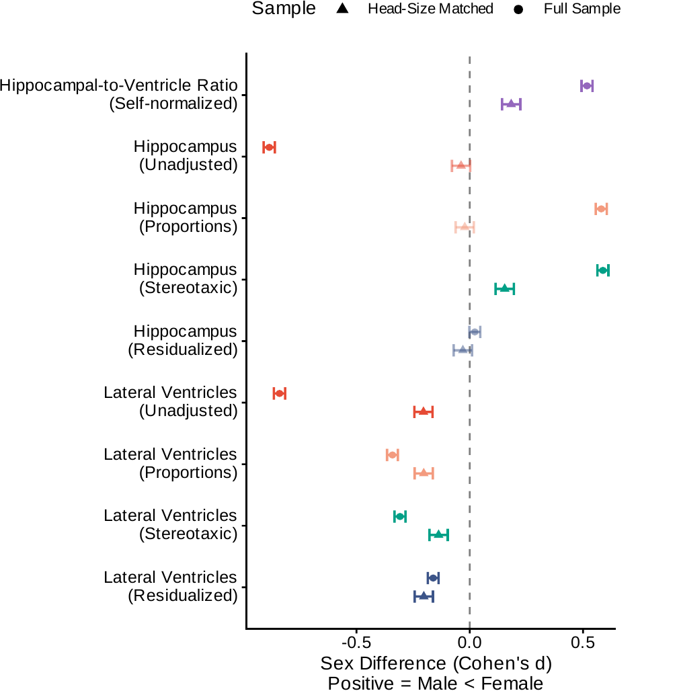

---
format:
  revealjs:
    theme: default
    background-color: white
    fontcolor: "#1a1a1a"
    slide-number: true
    width: 1280
    height: 720
    margin: 0.06
    transition: none
    hash: true
    history: false
    controls: false
    progress: true
    embed-resources: true
    navigation-mode: vertical
    css: custom.css
    show-notes: false
    menu:
      side: left
---

## {#title-slide data-menu-title="Title"}

::: {style="text-align: left; padding-left: 32px; margin-top: 120px; border-left: 4px solid #ed1b2f;"}

::: {.eyebrow}
PhD Defense · 2026
:::

::: {style="font-size: 1.9em; font-weight: 700; line-height: 1.1; white-space: nowrap"}
The Hippocampal-to-Ventricle Ratio
:::

::: {style="margin-top: 18px; font-size: 1em; color: #4a4a4a; font-weight: 500; line-height: 1.4"}
A self-normalizing biomarker for medial temporal integrity across the Alzheimer's disease continuum
:::

::: {style="margin-top: 32px; font-size: 0.8em; color: #6b6b6b"}
Sofía Fernández-Lozano · Supervisor: Louis Collins
:::

:::

::: {.title-logos}

{.mcgill-logo}

:::

::: {.notes}
"Good morning. Over the next twenty minutes I'll walk you through four studies that build, validate, and apply the hippocampal-to-ventricle ratio — HVR — as a brain-aging biomarker across the Alzheimer's continuum."
:::

# {.divider data-menu-title="Background divider"}

::: {.divider-content}

::: {.eyebrow}
Background
:::

::: {.divider-title}
Why HVR exists
:::

::: {.divider-subtitle}
The hippocampus in Alzheimer's disease, and the head-size problem
:::

:::

::: {.notes}
"First — why HVR exists at all."

[4 slides: disease → hippocampus → variability → head size → then the formula]
:::

## {.fig-leftright data-menu-title="Alzheimer's disease"}

::: {.slide-body}

::: {.header-col}

::: {.eyebrow}
Background · The disease
:::

::: {.slide-title}
Alzheimer's: the leading cause of dementia
:::

::: {.slide-subtitle}
55 M cases worldwide projected [**139 M by 2050**]{.accent}
:::

::: {.body-text}
**Pathology spans multiple systems** amyloid · tau · neurodegeneration · inflammation · synuclein · vascular (2024 NIA-AA [**AT₁T₂NISV**]{.accent}).

**Structural MRI** captures *N* — the substrate HVR measures.
:::

:::

::: {.fig-col}

:::

:::

::: {.slide-citation}
Image: Alzheimer's Association · Livingston et al., 2024 · Jack et al., 2024
:::

::: {.notes}
"On the right, a healthy brain beside an advanced Alzheimer's brain — cortex thinning, ventricles ballooning. It's the leading cause of dementia: 55 million cases today, 139 million by 2050. The frameworks define AD by amyloid, tau, and neurodegeneration — and structural MRI sits at that last one, the N. That's what HVR measures."
:::

## {.fig-leftright data-menu-title="Why hippocampus"}

::: {.slide-body}

::: {.header-col}

::: {.eyebrow}
Background · The hippocampus
:::

::: {.slide-title}
The reference structural marker
:::

::: {.slide-subtitle}
Medial temporal lobe · earliest AD target
:::

::: {.body-text}
The most-used structural MRI biomarker in AD.

Anchors clinical trials, diagnostic frameworks, and longitudinal studies.
:::

:::

::: {.fig-col}

:::

:::

::: {.slide-citation}
Gray's Anatomy (Gray739) · Wikimedia Commons
:::

::: {.notes}
"This is the hippocampus — highlighted here, deep in the medial temporal lobe. It's the reference structural marker in AD: it anchors clinical trials and diagnostic frameworks, and tau strikes it earliest. Normal aging trims it about 1.4 percent a year; AD nearly quadruples that."
:::

## {.big-number data-menu-title="Variability problem"}

::: {.eyebrow}
Background · The first problem
:::

::: {.slide-title}
HC volume is highly variable
:::

::: {.slide-body}

[\~25%]{.bignum}

[of healthy young adults have HC volumes that overlap with the elderly]{.bignum-label}

:::

::: {.slide-citation}
Lupien et al., 2007 · Bruno et al., 2016
:::

::: {.notes}
"The first problem is this number: up to a quarter of healthy young adults have hippocampi as small as the average 70-year-old. That overlap makes raw volume a noisy predictor — you can't tell a congenitally small hippocampus from a shrinking one. It's what motivates the normative models in Chapter 5."
:::

## {.fig-leftright data-menu-title="Head-size confound"}

::: {.slide-body}

::: {.header-col}

::: {.eyebrow}
Background · The methodological problem
:::

::: {.slide-title}
No consensus on head-size correction
:::

::: {.slide-subtitle}
Same data → different —sometimes [**reversed**]{.accent}—sex differences
:::

::: {.body-text}
Multiple competing correction methods (proportions, residualization, stereotaxic) rest on different assumptions.

Decades of conflicting findings on whether HC is larger in males or females.
:::

:::

::: {.fig-col}

:::

:::

::: {.slide-citation}
Pintzka et al., 2015 · O'Brien et al., 2011 · Voevodskaya et al., 2014
:::

::: {.notes}
"Men have 10-to-12 percent larger heads, and the hippocampus scales with head size, so the correction matters. The two panels are the same data — top uses proportions, bottom residuals — and the sex-difference bars flip sign between them, a full 1.5-SD swing from analytical choice alone. And it's not just the correction — even how the hippocampus is segmented shifts these differences. No consensus on either."
:::

## {.fig-leftright data-menu-title="HVR concept"}

::: {.slide-body}

::: {.header-col}

::: {.eyebrow}
Background · The proposed solution
:::

::: {.slide-title}
HVR: the ratio that self-normalizes
:::

::: {.slide-subtitle}
[**HVR = HC / (HC + th-CSF)**]{.accent}
:::

::: {.body-text}
As the hippocampus atrophies, CSF expands ex vacuo into the space.

Both structures scale with head size — the ratio cancels it out.
:::

:::

::: {.fig-col}

:::

:::

::: {.slide-citation}
Figure: adapted from Schoemaker et al., 2019 · Bruno et al., 2016
:::

::: {.notes}
"The solution — the formula at top, and below it a coronal slice with the hippocampus in red, surrounding CSF in blue. HVR exploits ex-vacuo dilation: as the red shrinks, the blue expands to fill the void, so both move together and amplify the signal. And since both scale with head size, their ratio cancels it — a dimensionless index, zero to one."

[builds on Heister's HOC; Schoemaker 2019 broadened the CSF compartment]
:::

## {.fig-pure data-menu-title="Thesis roadmap"}

::: {.eyebrow}
Background · The four chapters
:::

::: {.slide-title}
From concept to clinical inference
:::

::: {.slide-body}

::: {.text-col-full style="max-width: 960px; margin: 50px auto 0;"}

[**Chapter 3**]{.subhead} — [**Qrater:**]{.accent} open-source QC platform that curates the imaging data.

[**Chapter 4**]{.subhead} — [**Automated HVR:**]{.accent} CNN segmentation validated against manual labels in ADNI.

[**Chapter 5**]{.subhead} — [**HVR at scale:**]{.accent} 27,680 UK Biobank participants; sex-specific normative reference.

[**Chapter 6**]{.subhead} — [**HVR in the clinic:**]{.accent} apply the normative reference to amyloid-positive ADNI; isolate cardiovascular risk from age.

:::

:::

::: {.notes}
"Each block solves one problem in the pipeline. Chapter 3, trustworthy data. Chapter 4 automates HVR and validates it against manual segmentation. Chapter 5 takes it to population scale and builds sex-specific normative curves. Chapter 6 takes those curves into the clinic: does cardiovascular risk actually drive brain-cognition decline? Concept to clinical inference."
:::

# {.divider data-menu-title="Ch3 divider"}

::: {.divider-content}

::: {.eyebrow}
Chapter 3
:::

::: {.divider-title}
Qrater
:::

::: {.divider-subtitle}
A collaborative and centralized imaging quality-control web application
:::

::: {.divider-pub}
Fernández-Lozano&nbsp;S, Dadar&nbsp;M, Morrison&nbsp;C, Manera&nbsp;A, Andrews&nbsp;D, Rajabli&nbsp;R, Madge&nbsp;V, St-Onge&nbsp;E, Shaffie&nbsp;N, Livadas&nbsp;A, Fonov&nbsp;VS, Collins&nbsp;DL; for the ADNI. QRATER: a collaborative and centralized imaging quality control web-based application. *Aperture Neuro*. 2024;4. doi:10.52294/001c.118616
:::

:::

::: {.notes}
"Before any biomarker work, we needed clean data — and visual QC was the rate-limiting step. Chapter 3 is the tool that unblocked it."

[move fast through this one]
:::

## {.fig-sidebar data-menu-title="Ch3 · Why we needed it"}

::: {.eyebrow}
Chapter 3 · Motivation
:::

::: {.slide-title}
Visual QC was the bottleneck
:::

::: {.slide-body style="grid-template-columns: 50% 50%;"}

::: {.fig-col style="padding-left: 12px"}

[**The problem**]{.subhead}

- Thousands of MRI scans
- Multiple raters in parallel
- Each QC task (raw · registration · segmentation) had its own ad-hoc tool

:::

::: {.text-col}

[**Existing tools fell short**]{.subhead}

- [**Single-user**]{.accent} workflows (VisualQC)
- [**Modality-specific**]{.accent} pipelines (MRIQC, pyfMRIQC)
- Dashboards not built for [**rating throughput**]{.accent} (Mindcontrol)

:::

:::

::: {.notes}
"Visual inspection is still the QC gold standard, but the tools were fragmented — single-user, modality-specific, nothing built for many raters on one dataset at throughput. We needed one tool people could use in parallel."
:::

## {.fig-triptych data-menu-title="Ch3 · Qrater + tasks"}

::: {.eyebrow}
Chapter 3 · The tool
:::

::: {.slide-title}
Qrater: three QC tasks, three mosaic formats
:::

::: {.slide-body}

::: {.triptych}

::: {.panel}

[Raw T1w MRI]{.panel-label}

[Native space]{.panel-sub}
:::

::: {.panel}

[Linear registration]{.panel-label}

[Template overlay in red]{.panel-sub}
:::

::: {.panel}

[Skull segmentation]{.panel-label}

[Segmentation overlay in red]{.panel-sub}
:::

:::

:::

::: {.slide-footer}
Containerized web app, rates any 2D rendering · 60-slice mosaic each · 11 raters vs senior-expert gold standard.
:::

::: {.slide-citation}
Fernández-Lozano, 2024
:::

::: {.notes}
"Qrater is a containerized web app that rates any 2D rendering, so it's task-agnostic. Here are the three tasks we tested, rising in complexity: raw T1 on the left, linear registration centre with the template in red, skull segmentation right. Each is a mosaic — the trick that collapses a 3D volume into one rateable image. Eleven raters judged each against a senior-expert gold standard."
:::

## {.fig-hero data-menu-title="Ch3 · Speedup"}

::: {.eyebrow}
Chapter 3 · The improvement
:::

::: {.slide-title}
Per-task speedup vs conventional viewer
:::

::: {.slide-body}

| Task | Rater | Conventional | Qrater | Speedup |
|------|-------|:---:|:---:|---:|
| Raw MRI | Expert | 90 imgs / 63 min | 99 imgs / 63 min | [**1.1×**]{.accent} |
| Raw MRI | Trainee | 79 imgs / 98 min | 99 imgs / 98 min | [**1.3×**]{.accent} |
| Linear registration | Expert | 43 imgs / 36 min | 99 imgs / 36 min | [**2.3×**]{.accent} |
| Linear registration | Trainee | 30 imgs / 37 min | 99 imgs / 37 min | [**3.3×**]{.accent} |
| Skull segmentation | Expert | ~60 s / image | ~3 s / image | [**~20×**]{.accent} |

: {tbl-colwidths="[26,11,26,26,11]"}

:::

::: {.notes}
"The Speedup column scales with task complexity. Raw MRI is barely faster — 1.1× — since a clean T1 is already quick. But skull segmentation, the bottom row, is about 20× — sixty seconds a scan down to three, same accuracy. The mosaic removes the slice-by-slice scrolling."
:::

## {.big-number data-menu-title="Ch3 · Adoption"}

::: {.eyebrow}
Chapter 3 · Adoption + tools
:::

::: {.slide-title}
Qrater in use beyond this thesis
:::

::: {.slide-subtitle}
Released on DockerHub + GitHub
:::

::: {.slide-body}

[250 K+]{.bignum}

[images on the lab Qrater instance (current)]{.bignum-label}

[Adopted beyond the original project; used by collaborator labs. The QC'd ADNI dataset is the foundation for Chapters 4 and 6 of this thesis.]{.bignum-context}

:::

::: {.slide-citation}
Fernández-Lozano, 2024
:::

::: {.notes}
"That number — over 250,000 images rated on our instance now. Open-sourced on GitHub and DockerHub, used by labs beyond the original project. And the payoff for this thesis is the QC'd ADNI cohort it produced — the data feeding Chapters 4 and 6."
:::

# {.divider data-menu-title="Ch4 divider"}

::: {.divider-content}

::: {.eyebrow}
Chapter 4
:::

::: {.divider-title}
HVR Validation
:::

::: {.divider-subtitle}
Automated CNN-based segmentation and clinical benchmarking in ADNI (N = 1,641)
:::

::: {.divider-pub}
Fernández-Lozano&nbsp;S, Fonov&nbsp;VS, Schoemaker&nbsp;D, Pruessner&nbsp;JC, Potvin&nbsp;O, Duchesne&nbsp;S, Collins&nbsp;DL; for the ADNI. Enhanced Detection of Age-Related and Cognitive Declines Using Automated Hippocampal-to-Ventricle Ratio in Alzheimer's Patients. *Human Brain Mapping*. 2025;46(11). doi:10.1002/hbm.70265
:::

:::

::: {.notes}
"Chapter 4, the methods workhorse. Two questions: can we automate HVR at scale, and does the ratio still amplify clinical signal once segmentation is automated?"

[methods story: CNN matches manual · biomarker story: HVR rescues effect sizes]
:::

## {.big-number data-menu-title="Ch4 · Why automate"}

::: {.eyebrow}
Chapter 4 · Motivation
:::

::: {.slide-title}
Manual segmentation doesn't scale
:::

::: {.slide-body}

[2 h]{.bignum}

[per subject to hand-trace HC + temporal-horn (Schoemaker 2019)]{.bignum-label}

[Plus high intra- and inter-rater variability. Biobank-scale HVR is infeasible without automation.]{.bignum-context}

:::

::: {.notes}
"That number is the motivation — two hours per subject to hand-trace the hippocampus and temporal horn. Times 1,641 ADNI scans, let alone 28,000 in UK Biobank, the manual route is dead on arrival."
:::

## {.fig-leftright data-menu-title="Ch4 · Study design"}

::: {.slide-body}

::: {.header-col}

::: {.eyebrow}
Chapter 4 · Design
:::

::: {.slide-title}
From 80 manual labels to 1,641 clinical scans
:::

::: {.slide-subtitle}
Four method families · joint HC + th-CSF
:::

::: {.body-text}
**Training** 80 manually labelled (Pruessner protocol) 5-fold CV (64 / 16).

**Out-of-sample** — 60 (CH / MCI / AD).

**Clinical application** — *N* = 1,641 ADNI.

**Compared** MALF · NLPB · CNN · FreeSurfer v4.3 / 5.1 / 6.0.
:::

:::

::: {.fig-col}

:::

:::

::: {.slide-citation}
U-Net schematic · Ronneberger et al., 2015
:::

::: {.notes}
"The figure is our segmenter — a 3D U-Net, image tile in, segmentation map out. We train on 80 manually-labelled scans, and the out-of-sample set spans controls, MCI, and AD, so we test on the atrophy we care about. Then we pit four methods — MALF, NLPB, this CNN, and FreeSurfer — on 1,641 ADNI baselines."
:::

## {.fig-leftright data-menu-title="Ch4 · CNN matches manual"}

::: {.slide-body}

::: {.header-col}

::: {.eyebrow}
Chapter 4 · Segmentation performance
:::

::: {.slide-title}
CNN matches manual at the rater-noise floor
:::

::: {.slide-subtitle}
Against 80 manually-segmented labels
:::

::: {.body-text}
[**Dice HC**]{.subhead} = [**0.94–0.96 (0.9)**]{.accent}

[**Volume ρ**]{.subhead} = [**0.97-0.99 (0.90-0.96)**]{.accent}

MALF and NLPB show systematic drift; CNN doesn't.
:::

:::

::: {.fig-col}

:::

:::

::: {.slide-citation}
Fernández-Lozano, 2025
:::

::: {.notes}
"Each point is one subject — manual volume on the y, automated on the x. Follow the CNN in blue: tight on the identity line, correlation 0.99, Dice 0.94 to 0.96 — the rater-noise floor. MALF and NLPB drift off the line, especially in the atrophied range that matters most. The CNN wins on every metric."
:::

## {.fig-hero data-menu-title="Ch4 · HVR rescues effect sizes"}

::: {.eyebrow}
Chapter 4 · The defining property
:::

::: {.slide-title}
HVR amplifies effect sizes across all methods
:::

::: {.slide-subtitle}
CH:AD discrimination · Δ = Cohen's d
:::

::: {.slide-body}

| Segmentation | HCvol Δ | HVR Δ |
|---|:---:|:---:|
| [**MALF**]{.accent} | [**−0.78**]{.accent} | [**−1.24**]{.accent} |
| NLPB | −1.54 | −1.73 |
| CNN | −1.85 | −1.86 |
| FreeSurfer v6.0 | −1.76 | −2.02 |

: {tbl-colwidths="[40,30,30]"}

:::

::: {.slide-footer}
HVR ≥ HCvol for every method · biggest gain where segmentation is weakest (MALF, +59%).
:::

::: {.notes}
"The table is each method's effect size for separating controls from AD — HC volume middle, HVR right. Read across any row: the right is always bigger. The top row is the punchline — MALF, the weakest, goes from a feeble −0.78 to −1.24 as a ratio, a 59 percent gain. The ratio captures the atrophy signal even when segmentation is noisy."
:::

## {.fig-hero data-menu-title="Ch4 · Age associations"}

::: {.eyebrow}
Chapter 4 · Brain–behavior associations
:::

::: {.slide-title}
HVR recovers brain–behavior signal HC volume loses
:::

::: {.slide-subtitle}
Correlation with age and cognition (Spearman ρ) · AD group
:::

::: {.slide-body}

| Segmentation | HCvol–age | HVR–age | HCvol–ADAS | HVR–ADAS |
|---|:---:|:---:|:---:|:---:|
| [**MALF**]{.accent} | [**−0.03**]{.accent} (n.s.) | [**−0.38**]{.accent} | [**+0.04**]{.accent} (n.s.) | [**−0.30**]{.accent} |
| NLPB | −0.32 | −0.44 | −0.17 | −0.27 |
| CNN | −0.44 | −0.49 | −0.22 | −0.30 |
| FreeSurfer v6.0 | −0.46 | −0.52 | −0.22 | −0.28 |

: {tbl-colwidths="[28,18,18,18,18]"}

:::

::: {.slide-footer}
Both outcomes (cognition by ADAS-13, lower = better) · HVR ≥ HCvol for every method; MALF HCvol n.s. in both · memory (RAVLT) in supp.
:::

::: {.slide-citation}
Fernández-Lozano, 2025
:::

::: {.notes}
"The brain-behavior payoff, AD group. Left two columns are correlation with age, right two with cognition on ADAS — where lower is better, so negative is the right direction. Everywhere, the HVR column beats or ties the volume column beside it. MALF is again striking: volume is uncorrelated with both, yet the ratio recovers a strong minus 0.38 and minus 0.30. Discrimination, age, cognition — same rescue."

[CH/MCI groups and memory/RAVLT in backup]
:::

## {.big-number data-menu-title="Ch4 · Reliability"}

::: {.eyebrow}
Chapter 4 · Reliability at scale
:::

::: {.slide-title}
CNN holds at biobank scale
:::

::: {.slide-body}

[0.1%]{.bignum}

[CNN failure rate on 1,641 ADNI scans]{.bignum-label}

[2 failures total · vs MALF 1.5%, FS v4.3/5.1 ~14% missing. Pipeline ready for population-scale (Ch5) and clinical longitudinal (Ch6).]{.bignum-context}

:::

::: {.notes}
"And it's robust — the CNN's failure rate at scale is two scans out of 1,641, a tenth of a percent, versus about 1.5 percent for the others. Most accurate and most reliable — and it ships as a Docker container, the exact pipeline I run on 27,000 UK Biobank scans in Chapter 5 and the ADNI cohort in Chapter 6."
:::

::: {.slide-citation}
Fernández-Lozano, 2025
:::

# {.divider data-menu-title="Ch5 divider"}

::: {.divider-content}

::: {.eyebrow}
Chapter 5
:::

::: {.divider-title}
Sex Differences in UK Biobank
:::

::: {.divider-subtitle}
HVR as a head-size-independent biomarker · N = 27,680 UKB participants
:::

::: {.divider-pub}
Fernández-Lozano&nbsp;S, Collins&nbsp;DL. Hippocampal-to-Ventricle Ratio as a Head-Size-Independent Biomarker: Sex Differences and Cognitive Associations in 27,680 UK Biobank Participants. *bioRxiv*; to be submitted to *Human Brain Mapping*. 2026. doi:10.64898/2026.04.13.718285
:::

:::

::: {.notes}
"From clinical validation to our largest sample — nearly 28,000 healthy UK Biobank participants. The hook is a long-standing controversy: hippocampal sex differences flip direction depending on head-size correction — a perfect stress test for HVR's head-size independence."

[hook = the controversy on the next slide]
:::

## {.fig-leftright data-menu-title="Ch5 · Question"}

::: {.slide-body}

::: {.header-col}

::: {.eyebrow}
Chapter 5 · The controversy
:::

::: {.slide-title}
Reported HC sex differences flip across studies
:::

::: {.slide-subtitle}
Adjustment method drives the answer — does HVR sidestep this?
:::

::: {.body-text}
**Sample** — [**N = 27,680**]{.accent} UKB 56% female · ages 45–82.

**Tests** — 4 adjustment methods ICV-matched pairs · brain–cognition SEM.

**Output** — sex-specific normative reference.
:::

:::

::: {.fig-col}

:::

:::

::: {.slide-citation}
Fernández-Lozano, 2026
:::

::: {.notes}
"The flow chart traces our sample down through QC to 27,680 participants, and the three branches at the bottom are our three orthogonal tests: adjustment-method comparison, ICV-matched pairs, brain-cognition SEM. The controversy in one line: after head-size correction, sex classification from the brain drops from over 80 percent to about 60 — so much of the 'sex difference' may be artifact."
:::

## {.fig-sidebar data-menu-title="Ch5 · Four methods"}

::: {.eyebrow}
Chapter 5 · Methods compared
:::

::: {.slide-title}
Four head-size adjustments
:::

::: {.slide-subtitle}
Each assumes something different about how brain volume scales with head size
:::

::: {.slide-body}

::: {.text-col-full}

| Adjustment | What it does |
|------------|--------------|
| [**Raw**]{.accent} | No correction — volumes in native space |
| [**Proportions**]{.accent} | *V* / ICV — assumes isometric scaling |
| [**Stereotaxic**]{.accent} | Warp to a common template — removes ICV spatially |
| [**Residualized**]{.accent} | Linear regression removes the ICV component |

: {tbl-colwidths="[22,78]"}

:::

:::

::: {.notes}
"The right column is the assumption each correction bakes in — proportions assumes perfect scaling, stereotaxic warps to a template, residualization assumes a linear fit. No consensus on which is right, and they give contradictory answers on the same region. That's the ambiguity HVR is built to sidestep."
:::

## {.big-number data-menu-title="Ch5 · Matched proof"}

::: {.eyebrow}
Chapter 5 · The geometric proof
:::

::: {.slide-title}
Match on head size: HC collapses, HVR persists
:::

::: {.slide-body}

[d = 0.18]{.bignum}

[HVR female advantage in 4,750 head-size-matched pairs]{.bignum-label}

[Matched on age and head size, the raw HC difference collapses to ≈ 0 — but HVR stays significant. What remains is biology, not artifact.]{.bignum-context}

:::

::: {.notes}
"The single tightest test: 4,750 pairs matched on age and head size, so head size can't drive anything. The raw hippocampal difference collapses from minus 0.89 to zero — pure artifact. HVR drops too, to this 0.18, but stays significant. What survives is biology — and next we'll see it hold across every correction method."
:::

## {.fig-leftright data-menu-title="Ch5 · The reversal"}

::: {.slide-body}

::: {.header-col}

::: {.eyebrow}
Chapter 5 · The headline figure
:::

::: {.slide-title}
HC reverses across methods · HVR doesn't
:::

::: {.slide-subtitle}
4 adjustment methods (triangles = matched-pair subsample)
:::

::: {.body-text}
[**HC**]{.subhead} swings d = −0.89 → +0.58 a [**1.5-SD**]{.accent} range across methods.

[**HVR**]{.subhead} holds at d ≈ [**+0.52**]{.accent} (female advantage), regardless of adjustment.
:::

:::

::: {.fig-col}

:::

:::

::: {.slide-citation}
Fernández-Lozano, 2026
:::

::: {.notes}
"The headline. Each row is the sex difference for one measure-and-method; zero is no difference, right favors females. The hippocampus rows scatter all across — minus 0.89 unadjusted, plus 0.58 with proportions, a 1.5-SD swing from the method alone. But the top row, HVR, sits steady near plus 0.52 whatever the adjustment. If your sex difference flips when you change the denominator, you weren't measuring biology."
:::

## {.fig-leftright data-menu-title="Ch5 · Age × sex"}

::: {.slide-body}

::: {.header-col}

::: {.eyebrow}
Chapter 5 · Trajectories
:::

::: {.slide-title}
Males decline 1.7× faster in HVR
:::

::: {.slide-subtitle}
Cross-sectional age × sex
:::

::: {.body-text}
[**HVR**]{.subhead} male slope [**1.7×**]{.accent} steeper than female.

Sits between [**HC (1.4x)**]{.accent} and [**LV (2x)**]{.accent} HVR captures both atrophy and ventricular expansion.
:::

:::

::: {.fig-col}

:::

:::

::: {.slide-citation}
Fernández-Lozano, 2026
:::

::: {.notes}
"Now across age. Follow the purple HVR line — it climbs steadily, so men and women diverge more with age. The male HVR slope is 1.7× steeper than female. That 1.7 sits between the hippocampus at 1.4 and the ventricle at 2.0 — just what you'd expect if HVR integrates both. So HVR doesn't only hold at one age; it tracks a sex-differential trajectory."
:::

## {.fig-hero data-menu-title="Ch5 · Brain–cognition"}

::: {.eyebrow}
Chapter 5 · Functional validity
:::

::: {.slide-title}
HVR predicts general cognition in both sexes; residualized HC fails in males
:::

::: {.slide-subtitle}
Standardized path → general cognition (g) · significance by sex
:::

::: {.slide-body}

| Brain measure → g | Female | Male |
|---|:---:|:---:|
| [**HVR**]{.accent} | ✓ | ✓ |
| HC (Res) | ✓ | [**✗**]{.accent} |
| HC (raw) | ✓ | ✓ |

: {tbl-colwidths="[44,28,28]"}

:::

::: {.slide-footer}
✓ = standardized path significant (p < 0.05) · the linear ICV adjustment strips cognition-relevant signal in males; HVR's self-normalization preserves it.
:::

::: {.slide-citation}
Fernández-Lozano, 2026
:::

::: {.notes}
"We reduce UK Biobank's 12 cognitive tests to a single general-cognition factor with a bifactor SEM, then ask whether each brain measure predicts it, by sex. The grid is the answer: check is significant, cross is not. Top row, HVR: checks in both sexes. But the residualized-HC row — check for women, red cross for men. The linear head-size adjustment strips cognition-relevant signal specifically in males. HVR keeps it."
:::

## {.fig-leftright data-menu-title="Ch5 · Centiles"}

::: {.slide-body}

::: {.header-col}

::: {.eyebrow}
Chapter 5 · Normative reference
:::

::: {.slide-title}
Sex-specific normative centile curves
:::

::: {.slide-subtitle}
Reference percentiles HVR / HC / LV by sex, ages 45–82
:::

::: {.body-text}
Well-calibrated on held-out 20%.

Transferred to ADNI in [**Chapter 6**]{.accent} to z-score patients.
:::

:::

::: {.fig-col}

:::

:::

::: {.slide-citation}
Fernández-Lozano, 2026
:::

::: {.notes}
"The deliverable — sex-specific normative curves, females red on the left, males blue on the right, HVR on top with hippocampus and ventricle below. Each band is the percentiles across age; you read off where a patient falls. And these are exactly the curves Chapter 6 transfers into ADNI to z-score patients."
:::

# {.divider data-menu-title="Ch6 divider"}

::: {.divider-content}

::: {.eyebrow}
Chapter 6
:::

::: {.divider-title}
Cardiovascular Risk and HVR&#8209;Cognitive Coupling
:::

::: {.divider-subtitle}
Does cardiovascular risk drive brain–cognition decline — or just track age?
:::

::: {.divider-pub}
Fernández-Lozano&nbsp;S, Villeneuve&nbsp;S, Collins&nbsp;DL; for the ADNI. Cardiovascular risk and hippocampal-cognitive coupling in Alzheimer's disease. *medRxiv* MEDRXIV/2026/354601; to be submitted to *Alzheimer's & Dementia*. 2026
:::

:::

::: {.notes}
"The capstone takes the normative HVR into ADNI to ask a loaded question. Many studies link the Framingham Risk Score to brain decline — but Framingham is dominated by age. So is that a true cardiovascular effect, or age in disguise?"

[in prep, Alzheimer's & Dementia; medRxiv in progress]
:::

## {.fig-leftright data-menu-title="Ch6 · Sample"}

::: {.slide-body}

::: {.header-col}

::: {.eyebrow}
Chapter 6 · ADNI sample
:::

::: {.slide-title}
Amyloid-positive primary cohort, amyloid-negative controls
:::

::: {.slide-subtitle}
Longitudinal MRI + cognition along the AD continuum
:::

::: {.body-text}
[**Primary**]{.subhead} — [**N = 923**]{.accent} amyloid-positive.

[**Control**]{.subhead} — [**N = 317**]{.accent} amyloid-negative, cognitively unimpaired.
:::

:::

::: {.fig-col}

:::

:::

::: {.slide-citation}
Fernández-Lozano, 2026
:::

::: {.notes}
"Two cohorts out of ADNI. The main branch is the primary cohort — 923 amyloid-positive, spanning normal, MCI, and AD. The highlighted side branch is the critical one: 317 amyloid-negative, cognitively-unimpaired controls — our counterfactual at the very end. Everything downstream is sex-stratified, since Framingham weights age differently by sex."
:::

## {.fig-hero data-menu-title="Ch6 · Norm transfer"}

::: {.eyebrow}
Chapter 6 · Bridge from Chapter 5
:::

::: {.slide-title}
HVR z-scored against sex-specific normative model
:::

::: {.slide-subtitle}
Ch 5 GAMLSS centiles transferred from UKB to ADNI
:::

::: {.slide-body}

{width="66%"}

:::

::: {.slide-footer}
A−/CU controls sit near the expected 0 (small offset, older sample) — within-ADNI comparisons remain valid.
:::

::: {.slide-citation}
Fernández-Lozano, 2026
:::

::: {.notes}
"The bridge from Chapter 5: we z-score every ADNI scan against the UK Biobank model. The two histograms are our healthy controls — HVR left, volume right — and the check is whether they sit near the dashed 'expected zero.' They do, with a small offset since ADNI runs older. The norms transferred cleanly enough that within-ADNI comparisons stay valid."
:::

## {.big-number data-menu-title="Ch6 · FRS age-confound"}

::: {.eyebrow}
Chapter 6 · The problem with FRS in elderly cohorts
:::

::: {.slide-title}
The Framingham Risk Score is the wrong instrument here
:::

::: {.slide-subtitle}
Dominated by age — and saturated — in an elderly cohort
:::

::: {.slide-body}

[3.06 / 2.33]{.bignum}

[FRS age coefficients (men / women) — log-hazard scale]{.bignum-label}

[Age is the heaviest input, so in ADNI it explains most of FRS variance. And FRS caps at 30%: [**75% of women, 28% of men**]{.accent} pile up at that ceiling.]{.bignum-context}

:::

::: {.notes}
"Two problems, one slide. First, the numbers — these age coefficients are the heaviest inputs in the Framingham formula, so in an elderly cohort age explains most of the variance. 'Framingham predicts brain decline' could just as easily read 'age predicts brain decline.' Second, it saturates: capped at 30 percent, with 75 percent of women and 28 percent of men already at that ceiling, where it can't rank risk at all. Either way, raw Framingham is the wrong instrument."

[ceiling histograms in backup]
:::

## {.fig-sidebar data-menu-title="Ch6 · Why MIMIC"}

::: {.eyebrow}
Chapter 6 · Methodology
:::

::: {.slide-title}
Age is an internal weight, not an external confounder
:::

::: {.slide-body style="grid-template-columns: 50% 50%;"}

::: {.fig-col style="padding-left: 12px"}

[**Covariate adjustment ✗**]{.subhead}

- Regress age out of FRS [*post-hoc*]{.accent}
- Removes only [**shared variance**]{.accent}
- Age-weighting [**still inside**]{.accent} the score

:::

::: {.text-col}

[**MIMIC SEM ✓**]{.subhead}

- Age as [*cause*]{.accent} of a latent CVR factor
- BP · chol · diabetes · smoking → CVR
- Age partialled at the [**latent level**]{.accent}, before the score exists

:::

:::

::: {.notes}
"Two approaches. Left, with the cross, is the naive fix — add age as a covariate. It fails, because age is inside the formula by design; regressing it out leaves the age-weighting baked in. Right, with the check, is ours: a MIMIC model treats age as a cause of a latent cardiovascular factor built from the raw biomarkers, so age is removed at the latent level, before the score exists."
:::

## {.big-number data-menu-title="Ch6 · MIMIC equation"}

::: {.eyebrow}
Chapter 6 · The MIMIC model
:::

::: {.slide-title}
Latent CVR = γ · *Age*~z~ + ζ
:::

::: {.slide-subtitle}
Age explains a tiny slice of latent cardiovascular risk — the residual ζ is CVR~mimic~
:::

::: {.slide-body}

[1.6%]{.bignum}

[of latent CVR variance explained by age (γ = 0.125)]{.bignum-label}

[CVR~mimic~ is the age-orthogonal residual. It correlates [**r ≈ 0.3–0.5**]{.accent} with FRS — same cardiovascular signal, age stripped.]{.bignum-context}

:::

::: {.notes}
"The model is the line in the title — latent risk equals gamma times age, plus a residual. The big number is the payoff: age explains just 1.6 percent of that latent factor; the rest is biomarkers. That residual is CVR-mimic. It still correlates 0.3 to 0.5 with Framingham, since they share biomarkers — what they don't share is age."
:::

## {.fig-hero data-menu-title="Ch6 · CVR validation"}

::: {.eyebrow}
Chapter 6 · Validation
:::

::: {.slide-title}
CVR~mimic~ is age-orthogonal by construction
:::

::: {.slide-subtitle}
FRS climbs with age (*r* = 0.33); CVR~mimic~ is flat (*r* = 0.03)
:::

::: {.slide-body}

:::

::: {.slide-footer}
Same cardiovascular signal as FRS (*r* ≈ [**0.3–0.5**]{.accent}) — age stripped.
:::

::: {.slide-citation}
Fernández-Lozano, 2026
:::

::: {.notes}
"A quick sanity check. On the left, Framingham climbs steeply with age. On the right, CVR-mimic is flat — near zero, by construction. And their 0.3-to-0.5 correlation confirms we didn't throw the cardiovascular signal out with the age bathwater."
:::

## {.fig-pure data-menu-title="Ch6 · Cognition setup"}

::: {.eyebrow}
Chapter 6 · Cognitive outcomes
:::

::: {.slide-title}
Three ADSP-PHC composite scores
:::

::: {.slide-body}

::: {.text-col-full style="max-width: 1020px; margin: 50px auto 0; display: grid; grid-template-columns: 1fr 1fr 1fr; gap: 40px; text-align: left;"}

::: {}
[**Memory**]{.accent} 
WMS-R · AVLT 
ADAS-Cog recall
:::

::: {}
[**Language**]{.accent} 
Category fluency 
Boston Naming
:::

::: {}
[**Executive Function**]{.accent} 
Trail A/B 
Digit Span/Symbol
:::

:::

::: {.text-col-full style="max-width: 980px; margin: 50px auto 0; text-align: center;"}

[**Kang et al.**]{.accent} — bifactor item-banking harmonizes the composites across ADNI · ACT · ROS/MAP · NACC 
[**This thesis**]{.accent} — the measurement-error SE is carried into the LGCM residual variance
:::

:::

::: {.slide-citation}
Kang et al., 2023 (ADSP-PHC composites)
:::

::: {.notes}
"A brief detour on the outcomes. The three columns are the cognitive composites — memory, language, executive function. They're Kang's ADSP-PHC harmonization, co-calibrated across cohorts onto one scale. My contribution is the line below: each composite enters the growth model carrying its own measurement-error estimate, so the model needn't estimate noise from sparse data. Three domains by two sexes is why you'll see 'six models.'"
:::

## {.fig-hero data-menu-title="Ch6 · Mediation a-path"}

::: {.eyebrow}
Chapter 6 · Q1 — does cardiovascular risk drive atrophy?
:::

::: {.slide-title}
FRS predicts HVR decline; CVR~mimic~ doesn't
:::

::: {.slide-subtitle}
LGCM a-path (risk → HVR slope) · 6 models = 3 domains × 2 sexes
:::

::: {.slide-body}

| Cognitive domain | FRS → HVR (F / M) | CVR~mimic~ → HVR (F / M) |
|---|:---:|:---:|
| Memory | ✓ / ✓ | ✗ / ✗ |
| Language | ✓ / ✓ | ✗ / ✗ |
| Executive | ✓ / ✓ | ✗ / ✗ |
| [**Total**]{.accent} | [**6 / 6**]{.accent} | [**0 / 6**]{.accent} |

: {tbl-colwidths="[28,36,36]"}

:::

::: {.slide-footer}
✓ = a-path bootstrap 95% CI excludes 0 · strip age from the score and the cardiovascular → atrophy effect vanishes.
:::

::: {.notes}
"The headline, and the grid makes it stark. Does cardiovascular risk cause hippocampal atrophy? Middle column Framingham, right CVR-mimic. Framingham is all checks — six of six. CVR-mimic is all crosses — zero of six. The only difference between them is age; strip it out and the effect vanishes. The prior literature was measuring an age-weighting artifact."
:::

## {.fig-leftright data-menu-title="Ch6 · LME forest"}

::: {.slide-body}

::: {.header-col}

::: {.eyebrow}
Chapter 6 · Q2 — does CVR modify HVR–Cog coupling?
:::

::: {.slide-title}
Same pattern in moderation: FRS dominates, CVR~mimic~ mostly null
:::

::: {.slide-subtitle}
3-way Years × CVR × HVR interaction
:::

::: {.body-text}
All [**6 FRS effects**]{.accent} survive FDR correction.

CVR~mimic~ sig in [**Female Executive only**]{.accent}.
:::

:::

::: {.fig-col}

:::

:::

::: {.slide-citation}
Fernández-Lozano, 2026
:::

::: {.notes}
"Question two — moderation: does cardiovascular burden change how much hippocampal decline costs cognitively? Orange is Framingham, blue CVR-mimic; a point whose interval clears the dashed zero line is significant. Across both panels, the orange points clear zero in all six cells. The blue points mostly straddle zero — significant in just one, female executive function. Same as the a-path: Framingham dominates, age-adjusted risk is nearly null."
:::

## {.fig-leftright data-menu-title="Ch6 · A−/CU reversal"}

::: {.slide-body}

::: {.header-col}

::: {.eyebrow}
Chapter 6 · Pivotal sensitivity result
:::

::: {.slide-title}
Without AD pathology, the pattern reverses
:::

::: {.slide-subtitle}
Amyloid-negative cognitively unimpaired (control) sample
:::

::: {.body-text}
**Amyloid-positive:** FRS survives correction · CVR~mimic~ null.

**Amyloid-negative controls:** FRS [**no longer significant**]{.accent} · CVR~mimic~ [**becomes significant**]{.accent}.

Without amyloid driving atrophy, a [**genuine cardiovascular signal**]{.accent} surfaces.
:::

:::

::: {.fig-col}

:::

:::

::: {.slide-citation}
Fernández-Lozano, 2026
:::

::: {.notes}
"The pivotal test. Same forest, re-run in the 317 amyloid-negative controls. Watch what flips: the orange Framingham points pull back across zero, no longer significant, while the blue CVR-mimic points now clear it. In amyloid-positive AD, atrophy is so dominated by neurodegeneration that a true cardiovascular signal is drowned out, and Framingham only 'predicts' through age. Pull amyloid out, and the genuine, age-independent effect finally surfaces."
:::

## {.fig-pure data-menu-title="Ch6 · Coupling"}

::: {.eyebrow}
Chapter 6 · The robust finding
:::

::: {.slide-title}
The divergence is upstream
:::

::: {.slide-subtitle}
The b-path (HVR slope → cognitive slope) is identical under both predictors
:::

::: {.slide-body}

::: {.text-col-full style="max-width: 900px; margin: 30px auto 0; text-align: center;"}

**FRS model** — b-path significant in [**4 of 6**]{.accent} cells. 
**CVR~mimic~ model** — significant in the [**same 4 of 6**]{.accent} cells.

So FRS and CVR~mimic~ diverge *only* on the a-path ([**6 / 6**]{.accent} vs [**0 / 6**]{.accent}). The downstream coupling — hippocampal decline → cognitive decline — is real and predictor-agnostic: a neurodegenerative signal, not vascular.
:::

:::

::: {.slide-citation}
Fernández-Lozano, 2026
:::

::: {.notes}
"To answer that, look at the link itself — the b-path, hippocampal decline to cognitive decline. It's significant in the same four of six cells whether you model Framingham or CVR-mimic — identical. So the two diverge only on the upstream a-path, where the age artifact lives. Downstream, the coupling holds regardless of risk measure — a robust, predictor-agnostic neurodegenerative signal, not vascular damage."
:::

## {.fig-pure data-menu-title="Ch6 · Reserve"}

::: {.eyebrow}
Chapter 6 · Interpretation
:::

::: {.slide-title}
Moderation without mediation
:::

::: {.slide-subtitle}
A cognitive-reserve-like mechanism
:::

::: {.slide-body}

::: {.text-col-full style="max-width: 920px; margin: 30px auto 0; text-align: center;"}
**The puzzle** — CVR~mimic~ doesn't cause hippocampal decline, yet it still modifies the HVR–cognition link in some female models.

**Reserve framing** — cardiovascular burden reduces the brain's [**capacity to maintain**]{.accent} cognition at a given structural level — distinct from amyloid / tau.

**Implication** — a *modifiable*, reserve-like target.
:::

:::

::: {.slide-citation}
Fernández-Lozano, 2026
:::

::: {.notes}
"Where it acts wraps up the chapter: CVR-mimic doesn't cause hippocampal decline — no mediation — but it modifies how much that decline costs cognitively, especially executive function in women. That's the signature of cognitive reserve: reducing the brain's capacity to maintain cognition at a given structural level. And the clinical punchline — cardiovascular burden is a modifiable, reserve-like target: manage it and you may not slow atrophy, but you preserve the cognition patients actually feel."
:::

# {.divider data-menu-title="Closing divider"}

::: {.divider-content}

::: {.eyebrow}
Closing
:::

::: {.divider-title}
Conclusions & Original Contributions
:::

::: {.divider-subtitle}
An end-to-end HVR pipeline, validated across two cohorts
:::

:::

::: {.notes}
"Having walked through all four chapters, let me close with what this thesis built — and what it means."

[gear shift: results → deliverables; two slides]
:::

## {.fig-pure data-menu-title="Original contributions"}

::: {.eyebrow}
Original contributions
:::

::: {.slide-title}
What this thesis built
:::

::: {.slide-body}

::: {.text-col-full style="max-width: 940px; margin: 24px auto 0;"}

[**Ch 3 — Qrater**]{.subhead} Open-source, collaborative QC platform. *Aperture Neuro* 2024.

[**Ch 4 — Automated HVR**]{.subhead} CNN segmentation, Docker-deployed. *Human Brain Mapping* 2025.

[**Ch 5 — Self-normalization + norms**]{.subhead} Sex-difference reversal exposed as artifact; sex-specific GAMLSS centiles. *bioRxiv* 2026.

[**Ch 6 — MIMIC framework**]{.subhead} Age-adjusted CVR; FRS–brain link reflects age-weighting; HVR–cognitive coupling robust. In preparation.

:::

:::

::: {.notes}
"Four deliverables, one per chapter, each an open-source tool available today: Qrater, the automated HVR pipeline, the sex-specific normative curves, and the MIMIC age-adjusted cardiovascular framework. Three published or preprinted, as the journal names show, with Chapter 6 in preparation."

[don't recap the chapters — the dividers did that]
:::

## {.fig-pure data-menu-title="Closing statement"}

::: {.eyebrow}
Closing
:::

::: {.slide-title}
From raw MRI to individualized brain-aging assessment
:::

::: {.slide-body}

::: {.text-col-full style="max-width: 940px; margin: 60px auto 0; text-align: center;"}

Quality-controlled imaging → automated HVR segmentation → sex-specific normative z-scores → clinical inference.

[**Methodological vigilance is how artifacts are distinguished from biology.**]{.accent}

:::

:::

::: {.footer-logos}

{.mcgill-logo}

:::

::: {.notes}
"The arrow is the practical contribution end to end — quality-controlled imaging, automated HVR, normative z-scores, clinical inference. And the thread through all four chapters: methodological vigilance is how we tell artifacts from biology. The reversal of hippocampal sex differences, and the disappearance of cardiovascular effects after age adjustment, show that prior conclusions were, in part, products of the tools rather than neurobiology."
:::

## {.fig-pure data-menu-title="Thank you"}

::: {.eyebrow}
Acknowledgements
:::

::: {.slide-title}
Thank you
:::

::: {.slide-body}

::: {.text-col-full style="max-width: 1080px; margin: 30px auto 0; text-align: center; line-height: 1.9;"}

My supervisor and my committee 
My coauthors, collaborators, and labmates 
My friends and family 

[**Funding:**]{.accent} CIHR · International Progressive MS Alliance · Famille Charron 
[**Data:**]{.accent} the ADNI investigators

:::

:::

::: {.notes}
"Thank you — to my supervisor and committee, to my coauthors, collaborators, and labmates, and to my friends and family. This work was supported by CIHR, the International Progressive MS Alliance, and the Charron family, and used data from ADNI. I'm happy to take your questions."
:::
