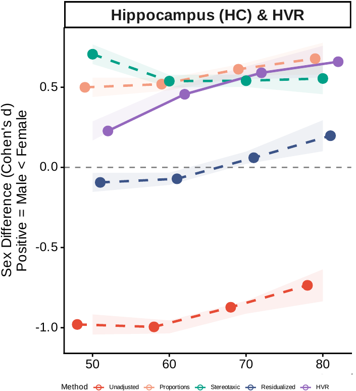
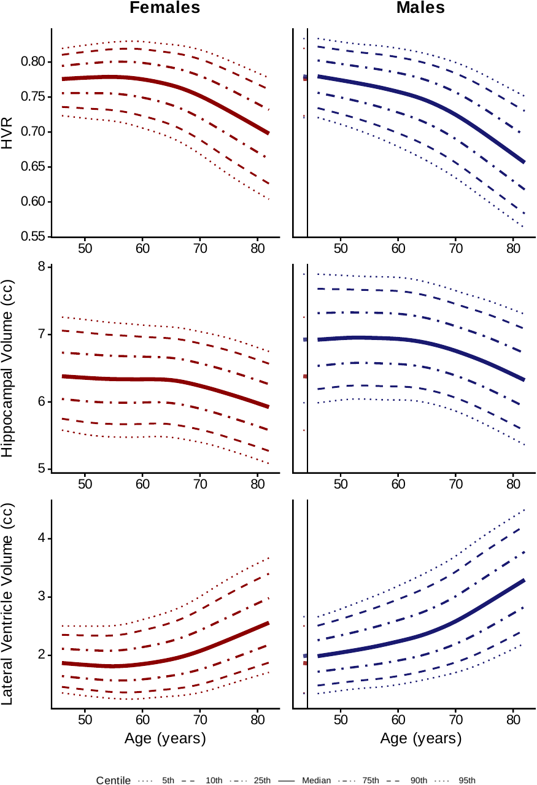
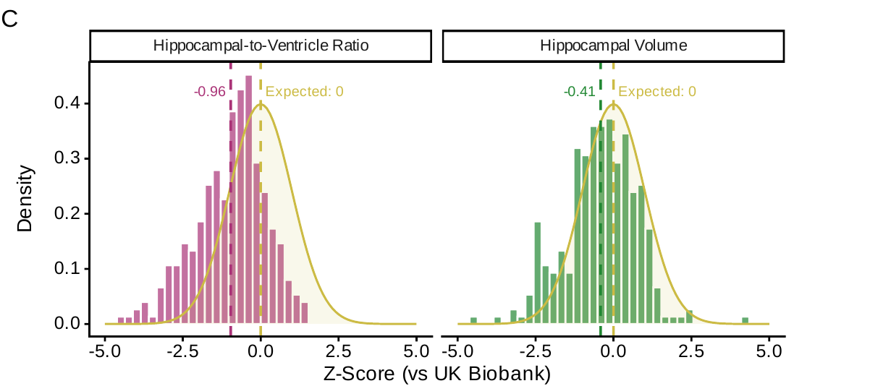
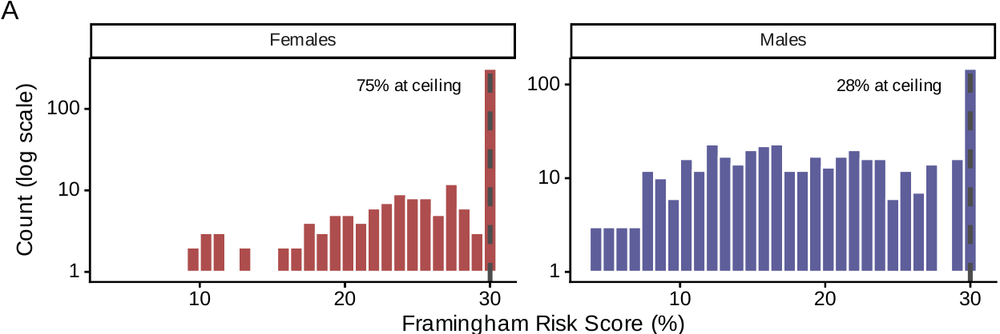
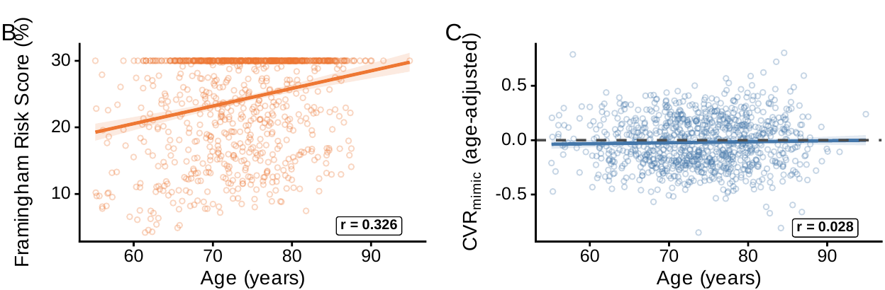
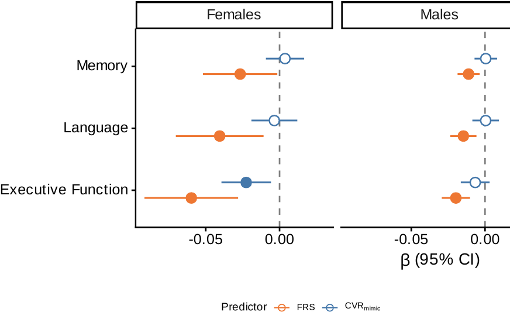
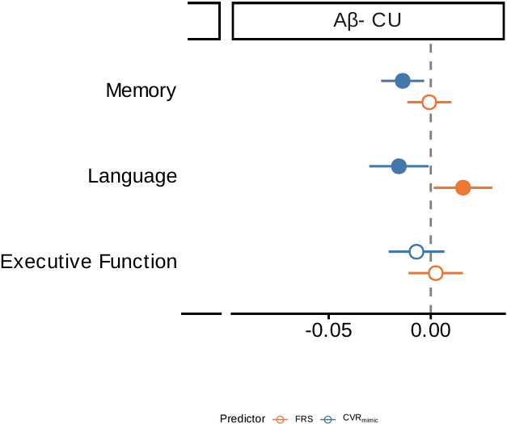

---
format:
  revealjs:
    theme: default
    background-color: white
    fontcolor: "#1a1a1a"
    slide-number: true
    width: 1280
    height: 720
    margin: 0.06
    transition: none
    hash: true
    history: false
    controls: false
    progress: true
    embed-resources: true
    navigation-mode: vertical
    css: custom.css
    show-notes: false
    menu:
      side: left
---

## {#title-slide data-menu-title="Title"}

::: {style="text-align: left; padding-left: 32px; margin-top: 120px; border-left: 4px solid #ed1b2f;"}

::: {.eyebrow}
PhD Defense · 2026
:::

::: {style="font-size: 1.9em; font-weight: 700; line-height: 1.1; white-space: nowrap"}
The Hippocampal-to-Ventricle Ratio
:::

::: {style="margin-top: 18px; font-size: 1em; color: #4a4a4a; font-weight: 500; line-height: 1.4"}
A self-normalizing biomarker for medial temporal integrity across the Alzheimer's disease continuum
:::

::: {style="margin-top: 32px; font-size: 0.8em; color: #6b6b6b"}
Sofía Fernández-Lozano · Supervisor: Louis Collins
:::

:::

::: {.title-logos}

{.mcgill-logo}

:::

::: {.notes}
"Good morning, and thank you all for being here. I'm Sofía Fernández-Lozano. Over the next twenty minutes I'll walk you through four studies that build, validate, and apply the hippocampal-to-ventricle ratio — HVR — as a brain-aging biomarker across the Alzheimer's continuum. My thanks to Dr. Collins, the committee, and everyone who supported this work."

>> next: the disease that motivates the thesis
:::

# {.divider data-menu-title="Background divider"}

::: {.divider-content}

::: {.eyebrow}
Background
:::

::: {.divider-title}
Why HVR exists
:::

::: {.divider-subtitle}
The hippocampus in Alzheimer's disease, and the head-size problem
:::

:::

::: {.notes}
"First — why HVR exists at all."

[4 slides: disease → hippocampus → variability → head size → then the formula]
:::

## {.fig-leftright data-menu-title="Alzheimer's disease"}

::: {.slide-body}

::: {.header-col}

::: {.eyebrow}
Background · The disease
:::

::: {.slide-title}
Alzheimer's: the leading cause of dementia
:::

::: {.slide-subtitle}
55 M cases worldwide projected [**139 M by 2050**]{.accent}
:::

::: {.body-text}
**Pathology spans multiple systems** amyloid · tau · neurodegeneration · inflammation · synuclein · vascular (2024 NIA-AA [**AT₁T₂NISV**]{.accent}).

**Structural MRI** captures *N* — the substrate HVR measures.
:::

:::

::: {.fig-col}

:::

:::

::: {.slide-citation}
Image: Alzheimer's Association · Livingston et al., 2024 · Jack et al., 2024
:::

::: {.notes}
"Alzheimer's is the leading cause of dementia — 55 million cases today, projected to 139 million by 2050, already over 800 billion dollars a year. The biological frameworks — the 2018 AT(N) and its 2024 extension — define AD by amyloid, tau, and neurodegeneration. Structural MRI sits at that N, the structural endpoint of the cascade, and that's exactly what HVR measures."

>> next: one structure dominates that space — the hippocampus
:::

## {.fig-leftright data-menu-title="Why hippocampus"}

::: {.slide-body}

::: {.header-col}

::: {.eyebrow}
Background · The hippocampus
:::

::: {.slide-title}
The reference structural marker
:::

::: {.slide-subtitle}
Medial temporal lobe · earliest AD target
:::

::: {.body-text}
The most-used structural MRI biomarker in AD.

Anchors clinical trials, diagnostic frameworks, and longitudinal studies.
:::

:::

::: {.fig-col}

:::

:::

::: {.slide-citation}
Gray's Anatomy (Gray739) · Wikimedia Commons
:::

::: {.notes}
"The hippocampus is the most widely used structural marker in AD — it anchors clinical trials and diagnostic frameworks. And it's hit early: tau initiates in transentorhinal cortex and invades CA1 and subiculum. Healthy aging loses about 1.4 percent a year; AD accelerates that to nearly five."

>> next: but before we read atrophy off a single scan — how variable is it to begin with?
:::

## {.big-number data-menu-title="Variability problem"}

::: {.eyebrow}
Background · The first problem
:::

::: {.slide-title}
HC volume is highly variable
:::

::: {.slide-body}

[\~25%]{.bignum}

[of healthy young adults have HC volumes that overlap with the elderly]{.bignum-label}

:::

::: {.slide-citation}
Lupien et al., 2007 · Bruno et al., 2016
:::

::: {.notes}
"The headline number: up to a quarter of healthy young adults have hippocampal volumes as small as the average healthy 60-to-75-year-old. That overlap makes raw cross-sectional volume a noisy predictor — you can't tell a congenitally small hippocampus from one that's actively shrinking. It's what motivates the normative models I build in Chapter 5."

>> next: and on top of that biological variability, a methodological confound — head size
:::

## {.fig-leftright data-menu-title="Head-size confound"}

::: {.slide-body}

::: {.header-col}

::: {.eyebrow}
Background · The methodological problem
:::

::: {.slide-title}
No consensus on head-size correction
:::

::: {.slide-subtitle}
Same data → different —sometimes [**reversed**]{.accent}—sex differences
:::

::: {.body-text}
Multiple competing correction methods (proportions, residualization, stereotaxic) rest on different assumptions.

Decades of conflicting findings on whether HC is larger in males or females.
:::

:::

::: {.fig-col}

:::

:::

::: {.slide-citation}
Pintzka et al., 2015 · O'Brien et al., 2011 · Voevodskaya et al., 2014
:::

::: {.notes}
"Men have 10-to-12 percent larger intracranial volumes, and the hippocampus scales with head size, so the correction matters enormously. In the same dataset: unadjusted gives a male advantage of d = −0.89; proportions flips it to a female advantage of +0.58; residualization makes it vanish — a 1.5-SD swing, purely from analytical choice. And it's not only the correction — even how the hippocampus is defined, the segmentation protocol itself, shifts these sex differences. There's still no consensus on either."

>> next: what if we didn't need to correct for head size at all?
:::

## {.fig-leftright data-menu-title="HVR concept"}

::: {.slide-body}

::: {.header-col}

::: {.eyebrow}
Background · The proposed solution
:::

::: {.slide-title}
HVR: the ratio that self-normalizes
:::

::: {.slide-subtitle}
[**HVR = HC / (HC + th-CSF)**]{.accent}
:::

::: {.body-text}
As the hippocampus atrophies, CSF expands ex vacuo into the space.

Both structures scale with head size — the ratio cancels it out.
:::

:::

::: {.fig-col}

:::

:::

::: {.slide-citation}
Figure: adapted from Schoemaker et al., 2019 · Bruno et al., 2016
:::

::: {.notes}
"HVR exploits ex-vacuo dilation: as the hippocampus shrinks, the surrounding CSF — the temporal horn — expands to fill the void, so both terms move together and amplify the atrophy signal. And because both scale with head size, the ratio cancels it out — a dimensionless index from zero to one."

>> next: four chapters turn this idea into a working biomarker

[builds on Heister's HOC; Schoemaker 2019 broadened the CSF compartment]
:::

## {.fig-pure data-menu-title="Thesis roadmap"}

::: {.eyebrow}
Background · The four chapters
:::

::: {.slide-title}
From concept to clinical inference
:::

::: {.slide-body}

::: {.text-col-full style="max-width: 960px; margin: 50px auto 0;"}

[**Chapter 3**]{.subhead} — [**Qrater:**]{.accent} open-source QC platform that curates the imaging data.

[**Chapter 4**]{.subhead} — [**Automated HVR:**]{.accent} CNN segmentation validated against manual labels in ADNI.

[**Chapter 5**]{.subhead} — [**HVR at scale:**]{.accent} 27,680 UK Biobank participants; sex-specific normative reference.

[**Chapter 6**]{.subhead} — [**HVR in the clinic:**]{.accent} apply the normative reference to amyloid-positive ADNI; isolate cardiovascular risk from age.

:::

:::

::: {.notes}
"Each chapter solves a specific problem in the pipeline. Chapter 3 gives us trustworthy input data. Chapter 4 automates HVR and validates it head-to-head against manual segmentation. Chapter 5 takes the validated pipeline to population scale and builds sex-specific normative curves. And Chapter 6 takes those curves into a clinical sample to ask: does cardiovascular risk actually drive brain-cognition decline?"

>> next: start with the quality-control foundation
:::

# {.divider data-menu-title="Ch3 divider"}

::: {.divider-content}

::: {.eyebrow}
Chapter 3
:::

::: {.divider-title}
Qrater
:::

::: {.divider-subtitle}
A collaborative and centralized imaging quality-control web application
:::

::: {.divider-pub}
Fernández-Lozano&nbsp;S, Dadar&nbsp;M, Morrison&nbsp;C, Manera&nbsp;A, Andrews&nbsp;D, Rajabli&nbsp;R, Madge&nbsp;V, St-Onge&nbsp;E, Shaffie&nbsp;N, Livadas&nbsp;A, Fonov&nbsp;VS, Collins&nbsp;DL; for the ADNI. QRATER: a collaborative and centralized imaging quality control web-based application. *Aperture Neuro*. 2024;4. doi:10.52294/001c.118616
:::

:::

::: {.notes}
"Before any biomarker work, we needed clean data — and visual QC was the rate-limiting step. Chapter 3 is the tool that unblocked it."

[move fast through this one]
:::

## {.fig-sidebar data-menu-title="Ch3 · Why we needed it"}

::: {.eyebrow}
Chapter 3 · Motivation
:::

::: {.slide-title}
Visual QC was the bottleneck
:::

::: {.slide-body style="grid-template-columns: 50% 50%;"}

::: {.fig-col style="padding-left: 12px"}

[**The problem**]{.subhead}

- Thousands of MRI scans
- Multiple raters in parallel
- Each QC task (raw · registration · segmentation) had its own ad-hoc tool

:::

::: {.text-col}

[**Existing tools fell short**]{.subhead}

- [**Single-user**]{.accent} workflows (VisualQC)
- [**Modality-specific**]{.accent} pipelines (MRIQC, pyfMRIQC)
- Dashboards not built for [**rating throughput**]{.accent} (Mindcontrol)

:::

:::

::: {.notes}
"Visual inspection is still the gold standard for QC, but the existing landscape was fragmented — single-user tools, modality-specific pipelines, nothing built for many raters working one dataset at high throughput. We needed one tool many people could use in parallel."

>> next: so we built one
:::

## {.fig-hero data-menu-title="Ch3 · Interface"}

::: {.eyebrow}
Chapter 3 · The tool
:::

::: {.slide-title}
Qrater — web-based, containerized, collaborative
:::

::: {.slide-body}

:::

::: {.slide-footer}
Flask + MySQL + Redis in Docker · rates any 2D rendering · 8+ concurrent users.
:::

::: {.slide-citation}
Fernández-Lozano, 2024
:::

::: {.notes}
"Qrater is a Flask app, fully containerized in Docker — one command to deploy. The key design choice: it rates any 2D rendering, so it's task-agnostic, and user accounts let multiple raters work the same dataset concurrently."

>> next: we tested it on three QC tasks
:::

## {.fig-triptych data-menu-title="Ch3 · Three tasks"}

::: {.eyebrow}
Chapter 3 · What we tested
:::

::: {.slide-title}
Three QC tasks, three mosaic formats
:::

::: {.slide-body}

::: {.triptych}

::: {.panel}

[Raw T1w MRI]{.panel-label}

[Native space]{.panel-sub}
:::

::: {.panel}

[Linear registration]{.panel-label}

[Template overlay in red]{.panel-sub}
:::

::: {.panel}

[Skull segmentation]{.panel-label}

[Segmentation overlay in red]{.panel-sub}
:::

:::

:::

::: {.slide-footer}
60-slice mosaic each · 11 raters trained · gold standard set by senior experts.
:::

::: {.slide-citation}
Fernández-Lozano, 2024
:::

::: {.notes}
"We stress-tested it on three tasks of increasing complexity — raw T1, linear registration, and skull segmentation — with eleven raters, two experts and nine trainees, against a senior-expert gold standard. The trick is the mosaic: it collapses a 3D volume into a single rateable image."

>> next: and that's where the speedup comes from
:::

## {.fig-hero data-menu-title="Ch3 · Speedup"}

::: {.eyebrow}
Chapter 3 · The improvement
:::

::: {.slide-title}
Per-task speedup vs conventional viewer
:::

::: {.slide-body}

| Task | Rater | Conventional | Qrater | Speedup |
|------|-------|:---:|:---:|---:|
| Raw MRI | Expert | 90 imgs / 63 min | 99 imgs / 63 min | [**1.1×**]{.accent} |
| Raw MRI | Trainee | 79 imgs / 98 min | 99 imgs / 98 min | [**1.3×**]{.accent} |
| Linear registration | Expert | 43 imgs / 36 min | 99 imgs / 36 min | [**2.3×**]{.accent} |
| Linear registration | Trainee | 30 imgs / 37 min | 99 imgs / 37 min | [**3.3×**]{.accent} |
| Skull segmentation | Expert | ~60 s / image | ~3 s / image | [**~20×**]{.accent} |

: {tbl-colwidths="[26,11,26,26,11]"}

:::

::: {.notes}
"Speedup scales with task complexity. Raw MRI is barely faster — rating a clean T1 is already quick — but skull segmentation hits about 20×, sixty seconds down to three, by collapsing slice-by-slice inspection into one labelled mosaic. And agreement with the gold standard stayed high across the board."

>> next: and it's been adopted well beyond this thesis
:::

## {.big-number data-menu-title="Ch3 · Adoption"}

::: {.eyebrow}
Chapter 3 · Adoption + tools
:::

::: {.slide-title}
Qrater in use beyond this thesis
:::

::: {.slide-subtitle}
Released on DockerHub + GitHub
:::

::: {.slide-body}

[250 K+]{.bignum}

[images on the lab Qrater instance (current)]{.bignum-label}

[Adopted beyond the original project; used by collaborator labs. The QC'd ADNI dataset is the foundation for Chapters 4 and 6 of this thesis.]{.bignum-context}

:::

::: {.slide-citation}
Fernández-Lozano, 2024
:::

::: {.notes}
"Over 250,000 images rated on our instance now — the paper reports the earlier 100K snapshot. It's open-sourced on GitHub and DockerHub and used by collaborator labs beyond the original project. The concrete payoff for this thesis: the QC'd ADNI cohort that feeds Chapters 4 and 6."

>> next: with clean data in hand — does HVR hold up as a biomarker?
:::

# {.divider data-menu-title="Ch4 divider"}

::: {.divider-content}

::: {.eyebrow}
Chapter 4
:::

::: {.divider-title}
HVR Validation
:::

::: {.divider-subtitle}
Automated CNN-based segmentation and clinical benchmarking in ADNI (N = 1,641)
:::

::: {.divider-pub}
Fernández-Lozano&nbsp;S, Fonov&nbsp;VS, Schoemaker&nbsp;D, Pruessner&nbsp;JC, Potvin&nbsp;O, Duchesne&nbsp;S, Collins&nbsp;DL; for the ADNI. Enhanced Detection of Age-Related and Cognitive Declines Using Automated Hippocampal-to-Ventricle Ratio in Alzheimer's Patients. *Human Brain Mapping*. 2025;46(11). doi:10.1002/hbm.70265
:::

:::

::: {.notes}
"Chapter 4 is the methods workhorse, published in Human Brain Mapping. Two intertwined questions: can we automate HVR computation at scale, and does the ratio still amplify clinical signal once segmentation is automated?"

[methods story: CNN matches manual · biomarker story: HVR rescues effect sizes]
:::

## {.big-number data-menu-title="Ch4 · Why automate"}

::: {.eyebrow}
Chapter 4 · Motivation
:::

::: {.slide-title}
Manual segmentation doesn't scale
:::

::: {.slide-body}

[2 h]{.bignum}

[per subject to hand-trace HC + temporal-horn (Schoemaker 2019)]{.bignum-label}

[Plus high intra- and inter-rater variability. Biobank-scale HVR is infeasible without automation.]{.bignum-context}

:::

::: {.notes}
"Manual segmentation is two hours per subject for an expert tracer — and that's before inter-rater drift. Multiply by 1,641 ADNI scans, let alone UK Biobank, and the manual route is dead on arrival."

>> next: so how do we train an automated method that survives that scale?
:::

## {.fig-leftright data-menu-title="Ch4 · Study design"}

::: {.slide-body}

::: {.header-col}

::: {.eyebrow}
Chapter 4 · Design
:::

::: {.slide-title}
From 80 manual labels to 1,641 clinical scans
:::

::: {.slide-subtitle}
Four method families · joint HC + th-CSF
:::

::: {.body-text}
**Training** 80 manually labelled (Pruessner protocol) 5-fold CV (64 / 16).

**Out-of-sample** — 60 (CH / MCI / AD).

**Clinical application** — *N* = 1,641 ADNI.

**Compared** MALF · NLPB · CNN · FreeSurfer v4.3 / 5.1 / 6.0.
:::

:::

::: {.fig-col}

:::

:::

::: {.slide-citation}
U-Net schematic · Ronneberger et al., 2015
:::

::: {.notes}
"The training set is small but deeply curated — 80 manually-labelled scans, five-fold cross-validation. The out-of-sample 60 spans controls, MCI, and AD, so we stress-test on the atrophy we care about. Then four method families — MALF, multi-atlas label fusion; NLPB, non-local patch-based; our own 3D U-Net CNN; and FreeSurfer — get applied to 1,641 ADNI baselines."

>> next: first question — does the CNN reach manual quality?
:::

## {.fig-leftright data-menu-title="Ch4 · CNN matches manual"}

::: {.slide-body}

::: {.header-col}

::: {.eyebrow}
Chapter 4 · Segmentation performance
:::

::: {.slide-title}
CNN matches manual at the rater-noise floor
:::

::: {.slide-subtitle}
Against 80 manually-segmented labels
:::

::: {.body-text}
[**Dice HC**]{.subhead} = [**0.94–0.96 (0.9)**]{.accent}

[**Volume ρ**]{.subhead} = [**0.97-0.99 (0.90-0.96)**]{.accent}

MALF and NLPB show systematic drift; CNN doesn't.
:::

:::

::: {.fig-col}

:::

:::

::: {.slide-citation}
Fernández-Lozano, 2025
:::

::: {.notes}
"Dice 0.94 to 0.96 against manual — that's at the rater-noise floor — and a volumetric correlation of 0.99. Across all five metrics the CNN significantly beats both MALF and NLPB, and crucially its scatter sits tight on the identity line, where the others show systematic drift, especially in atrophied brains."

>> next: so it's the best segmenter — but what about the biomarker itself?
:::

## {.fig-hero data-menu-title="Ch4 · HVR rescues effect sizes"}

::: {.eyebrow}
Chapter 4 · The defining property
:::

::: {.slide-title}
HVR amplifies effect sizes across all methods
:::

::: {.slide-subtitle}
CH:AD discrimination · Δ = Cohen's d
:::

::: {.slide-body}

| Segmentation | HCvol Δ | HVR Δ |
|---|:---:|:---:|
| [**MALF**]{.accent} | [**−0.78**]{.accent} | [**−1.24**]{.accent} |
| NLPB | −1.54 | −1.73 |
| CNN | −1.85 | −1.86 |
| FreeSurfer v6.0 | −1.76 | −2.02 |

: {tbl-colwidths="[40,30,30]"}

:::

::: {.slide-footer}
HVR ≥ HCvol for every method · biggest gain where segmentation is weakest (MALF, +59%).
:::

::: {.notes}
"This is the defining property of HVR. With HC volume alone, MALF gives a weak effect of −0.78. Take the ratio with the temporal horn and it lifts to −1.24 — a 59 percent gain — and every method gains. The point isn't that MALF is broken; it's that the ratio captures the same ex-vacuo atrophy signal even when the segmentation is noisy."

>> next: the same pattern extends from group discrimination to age
:::

## {.fig-hero data-menu-title="Ch4 · Age associations"}

::: {.eyebrow}
Chapter 4 · Brain–behavior associations
:::

::: {.slide-title}
HVR recovers the age signal HC volume loses
:::

::: {.slide-subtitle}
Correlation with age (Spearman ρ) · AD group
:::

::: {.slide-body}

| Segmentation | HCvol–age ρ | HVR–age ρ |
|---|:---:|:---:|
| [**MALF**]{.accent} | [**−0.03**]{.accent} (n.s.) | [**−0.38**]{.accent} |
| NLPB | −0.32 | −0.44 |
| CNN | −0.44 | −0.49 |
| FreeSurfer v6.0 | −0.46 | −0.52 |

: {tbl-colwidths="[40,30,30]"}

:::

::: {.slide-footer}
All ρ significant (p < 0.001) except MALF HCvol (n.s.) · HVR ≥ HC for every method.
:::

::: {.slide-citation}
Fernández-Lozano, 2025
:::

::: {.notes}
"This is the brain-behavior payoff, in the AD group. HVR's correlation with age is at least as strong as HC volume's for every method. The dramatic case is MALF: HC volume has essentially no relationship with age — rho −0.03, not significant — but take the ratio and HVR recovers a strong −0.38. Even a poor segmentation carries a rescuable age signal once you self-normalize."

>> next: and the same rescue holds for global cognition

[CH/MCI groups in backup]
:::

## {.fig-hero data-menu-title="Ch4 · Cognition associations"}

::: {.eyebrow}
Chapter 4 · Brain–behavior associations
:::

::: {.slide-title}
The same rescue holds for global cognition
:::

::: {.slide-subtitle}
Correlation with ADAS-13 (lower = better) · AD group
:::

::: {.slide-body}

| Segmentation | HCvol–ADAS ρ | HVR–ADAS ρ |
|---|:---:|:---:|
| [**MALF**]{.accent} | [**+0.04**]{.accent} (n.s.) | [**−0.30**]{.accent} |
| NLPB | −0.17 | −0.27 |
| CNN | −0.22 | −0.30 |
| FreeSurfer v6.0 | −0.22 | −0.28 |

: {tbl-colwidths="[40,30,30]"}

:::

::: {.slide-footer}
HVR ρ all significant (p < 0.001) · HCvol significant except MALF (n.s.) · memory (RAVLT) in supp.
:::

::: {.slide-citation}
Fernández-Lozano, 2025
:::

::: {.notes}
"The same pattern extends from age to global cognition, on ADAS-13 — and remember, lower ADAS means better cognition, so negative is the expected direction. MALF is again the dramatic case: HC volume is essentially uncorrelated, +0.04 and not significant; HVR recovers −0.30."

>> next: one last methods question — does it scale reliably?

[memory/RAVLT in backup]
:::

## {.big-number data-menu-title="Ch4 · Reliability"}

::: {.eyebrow}
Chapter 4 · Reliability at scale
:::

::: {.slide-title}
CNN holds at biobank scale
:::

::: {.slide-body}

[0.1%]{.bignum}

[CNN failure rate on 1,641 ADNI scans]{.bignum-label}

[2 failures total · vs MALF 1.5%, FS v4.3/5.1 ~14% missing. Pipeline ready for population-scale (Ch5) and clinical longitudinal (Ch6).]{.bignum-context}

:::

::: {.notes}
"Two failures out of 1,641 — that's 0.1 percent — versus about 1.5 percent for MALF and FreeSurfer. So the CNN is both more accurate and more reliable, and it's packaged as a Docker container — the exact pipeline used on 27,000 UKB scans in Chapter 5 and the ADNI longitudinal cohort in Chapter 6."

>> next: to population-scale validation in UK Biobank
:::

::: {.slide-citation}
Fernández-Lozano, 2025
:::

# {.divider data-menu-title="Ch5 divider"}

::: {.divider-content}

::: {.eyebrow}
Chapter 5
:::

::: {.divider-title}
Sex Differences in UK Biobank
:::

::: {.divider-subtitle}
HVR as a head-size-independent biomarker · N = 27,680 UKB participants
:::

::: {.divider-pub}
Fernández-Lozano&nbsp;S, Collins&nbsp;DL. Hippocampal-to-Ventricle Ratio as a Head-Size-Independent Biomarker: Sex Differences and Cognitive Associations in 27,680 UK Biobank Participants. *bioRxiv*; to be submitted to *Human Brain Mapping*. 2026. doi:10.64898/2026.04.13.718285
:::

:::

::: {.notes}
"From clinical validation in ADNI to the largest sample we test HVR on — nearly 28,000 healthy UK Biobank participants. The hook is a long-standing controversy: reported hippocampal sex differences flip direction depending on head-size correction. We use it as a stress test for HVR's head-size independence."

[hook = the controversy on the next slide]
:::

## {.fig-leftright data-menu-title="Ch5 · Question"}

::: {.slide-body}

::: {.header-col}

::: {.eyebrow}
Chapter 5 · The controversy
:::

::: {.slide-title}
Reported HC sex differences flip across studies
:::

::: {.slide-subtitle}
Adjustment method drives the answer — does HVR sidestep this?
:::

::: {.body-text}
**Sample** — [**N = 27,680**]{.accent} UKB 56% female · ages 45–82.

**Tests** — 4 adjustment methods ICV-matched pairs · brain–cognition SEM.

**Output** — sex-specific normative reference.
:::

:::

::: {.fig-col}

:::

:::

::: {.slide-citation}
Fernández-Lozano, 2026
:::

::: {.notes}
"The controversy in one line: men have about 12 percent larger heads, and after head-size correction, sex classification from brain features drops from over 80 percent to roughly 60 — so much of what we call a 'sex difference' may be head-size artifact. Our sample is 27,680 participants; three orthogonal tests — four adjustment methods, ICV-matched pairs, and brain-cognition SEM."

>> next: the four correction methods
:::

## {.fig-sidebar data-menu-title="Ch5 · Four methods"}

::: {.eyebrow}
Chapter 5 · Methods compared
:::

::: {.slide-title}
Four head-size adjustments
:::

::: {.slide-subtitle}
Each assumes something different about how brain volume scales with head size
:::

::: {.slide-body}

::: {.text-col-full}

| Adjustment | What it does |
|------------|--------------|
| [**Raw**]{.accent} | No correction — volumes in native space |
| [**Proportions**]{.accent} | *V* / ICV — assumes isometric scaling |
| [**Stereotaxic**]{.accent} | Warp to a common template — removes ICV spatially |
| [**Residualized**]{.accent} | Linear regression removes the ICV component |

: {tbl-colwidths="[22,78]"}

:::

:::

::: {.notes}
"Four mainstream methods, each with a different assumption baked in: proportions assumes perfect scaling, residualization assumes linear coupling, stereotaxic warps to a template. There's no consensus, and recent work shows they can give contradictory conclusions on the same region — exactly the ambiguity HVR is designed to sidestep."

>> next: so let's see what happens when we apply all four
:::

## {.big-number data-menu-title="Ch5 · Matched proof"}

::: {.eyebrow}
Chapter 5 · The geometric proof
:::

::: {.slide-title}
Match on head size: HC collapses, HVR persists
:::

::: {.slide-body}

[d = 0.18]{.bignum}

[HVR female advantage in 4,750 head-size-matched pairs]{.bignum-label}

[Matched on age (±1 yr) and intracranial volume (ICV, ±25 cc). HC raw collapses from d = −0.89 to ≈ 0; HVR drops from 0.52 to 0.18 but stays sig. With head size equated, what remains is biology — not artifact.]{.bignum-context}

:::

::: {.notes}
"The strongest test against head-size confounding: 4,750 male-female pairs matched tightly on age and head size. The raw HC difference collapses from −0.89 to essentially zero — it was a head-size artifact — while HVR drops from 0.52 to 0.18 but stays significant. What remains after equating head size is biology, not geometry."

>> next: now let's see this across all four correction methods
:::

## {.fig-leftright data-menu-title="Ch5 · The reversal"}

::: {.slide-body}

::: {.header-col}

::: {.eyebrow}
Chapter 5 · The headline figure
:::

::: {.slide-title}
HC reverses across methods · HVR doesn't
:::

::: {.slide-subtitle}
4 adjustment methods (triangles = matched-pair subsample)
:::

::: {.body-text}
[**HC**]{.subhead} swings d = −0.89 → +0.58 a [**1.5-SD**]{.accent} range across methods.

[**HVR**]{.subhead} holds at d ≈ [**+0.52**]{.accent} (female advantage), regardless of adjustment.
:::

:::

::: {.fig-col}

:::

:::

::: {.slide-citation}
Fernández-Lozano, 2026
:::

::: {.notes}
"The headline figure. HC swings from d = −0.89, men larger unadjusted, to +0.58, women larger with proportions — a 1.5-SD range driven entirely by analytical choice. HVR sits at about +0.52 regardless of which adjustment you apply, because the ratio cancels the head-size term. The take-away: if your sex difference flips when you change the denominator, you weren't measuring biology."

>> next: and beyond this snapshot, sex differences also play out across age
:::

## {.fig-leftright data-menu-title="Ch5 · Age × sex"}

::: {.slide-body}

::: {.header-col}

::: {.eyebrow}
Chapter 5 · Trajectories
:::

::: {.slide-title}
Males decline 1.7× faster in HVR
:::

::: {.slide-subtitle}
Cross-sectional age × sex
:::

::: {.body-text}
[**HVR**]{.subhead} male slope [**1.7×**]{.accent} steeper than female.

Sits between [**HC (1.4x)**]{.accent} and [**LV (2x)**]{.accent} HVR captures both atrophy and ventricular expansion.
:::

:::

::: {.fig-col}

:::

:::

::: {.slide-citation}
Fernández-Lozano, 2026
:::

::: {.notes}
"Cross-sectional age-by-sex interaction: males show a 1.7× steeper HVR slope than females, with p below ten-to-the-minus-fifty. That number sits neatly between the HC ratio of 1.4 and the ventricle ratio of 2.0 — exactly what you'd expect if HVR integrates both hippocampal atrophy and ventricular expansion. So HVR doesn't just hold at one age; it tracks a sex-differential aging trajectory."

>> next: but does HVR predict cognition? first, a quick detour through how we model it
:::

## {.fig-pure data-menu-title="Ch5 · SEM setup"}

::: {.eyebrow}
Chapter 5 · Brain → cognition setup
:::

::: {.slide-title}
From 12 cognitive tests to a single path coefficient
:::

::: {.slide-body}

::: {.text-col-full style="max-width: 960px; margin: 40px auto 0;"}

[**Step 1**]{.subhead} — 12 UKB cognitive tests reduced via [**bifactor SEM**]{.accent} → general-cognition factor [***g***]{.accent} + domain-specific memory & speed factors.

[**Step 2**]{.subhead} — Each brain measure (HVR, raw HC, residualized HC) tested as a predictor of *g* → [**standardized path coefficient (β)**]{.accent}.

[**Step 3**]{.subhead} — Estimated [**separately by sex**]{.accent}  measurement-invariance verification: (loadings, intercepts, residuals all equal across sex).

:::

:::

::: {.slide-citation}
Rosseel et al., 2012 · Cheung & Rensvold, 2002
:::

::: {.notes}
"A quick measurement model so the path coefficients make sense. UK Biobank's battery has 12 cognitive tests, and a bifactor SEM extracts a general-cognition factor — g — that loads on all of them. The question becomes: for each brain measure, what's the standardized path to g, and does it hold up sex-stratified? Multi-group invariance testing confirms the model means the same thing in both sexes, which validates the comparison."

>> next: with that scaffolding, the cleaner result
:::

## {.fig-hero data-menu-title="Ch5 · Brain–cognition"}

::: {.eyebrow}
Chapter 5 · Functional validity
:::

::: {.slide-title}
HVR predicts general cognition in both sexes; residualized HC fails in males
:::

::: {.slide-subtitle}
Standardized path → general cognition (g) · significance by sex
:::

::: {.slide-body}

| Brain measure → g | Female | Male |
|---|:---:|:---:|
| [**HVR**]{.accent} | ✓ | ✓ |
| HC (Res) | ✓ | [**✗**]{.accent} |
| HC (raw) | ✓ | ✓ |

: {tbl-colwidths="[44,28,28]"}

:::

::: {.slide-footer}
✓ = standardized path significant (p < 0.05) · the linear ICV adjustment strips cognition-relevant signal in males; HVR's self-normalization preserves it.
:::

::: {.slide-citation}
Fernández-Lozano, 2026
:::

::: {.notes}
"Brain-cognition coupling, run separately by sex. HVR predicts general cognition significantly in both men and women. The interesting failure is residualized HC: significant in women but not in men — the linear head-size adjustment is stripping out cognition-relevant variance specifically in males, where the head-size-to-hippocampus coupling is steeper. HVR's self-normalization preserves that male signal."

>> next: so we package HVR as a clinical reference
:::

## {.fig-leftright data-menu-title="Ch5 · Centiles"}

::: {.slide-body}

::: {.header-col}

::: {.eyebrow}
Chapter 5 · Normative reference
:::

::: {.slide-title}
Sex-specific normative centile curves
:::

::: {.slide-subtitle}
Reference percentiles HVR / HC / LV by sex, ages 45–82
:::

::: {.body-text}
Well-calibrated on held-out 20%.

Transferred to ADNI in [**Chapter 6**]{.accent} to z-score patients.
:::

:::

::: {.fig-col}

:::

:::

::: {.slide-citation}
Fernández-Lozano, 2026
:::

::: {.notes}
"We fit sex-specific GAMLSS centile curves for HVR across ages 45 to 82, following the brain-charting tradition. They're well-calibrated on a held-out 20 percent — empirical coverage matches nominal. The deliverable is a reference patients can be z-scored against — and that's exactly what Chapter 6 does, transferring these UK Biobank norms to ADNI to harmonize HVR across studies."

>> next: the final chapter — does cardiovascular risk push patients off these centiles?
:::

# {.divider data-menu-title="Ch6 divider"}

::: {.divider-content}

::: {.eyebrow}
Chapter 6
:::

::: {.divider-title}
Cardiovascular Risk and HVR&#8209;Cognitive Coupling
:::

::: {.divider-subtitle}
Does cardiovascular risk drive brain–cognition decline — or just track age?
:::

::: {.divider-pub}
Fernández-Lozano&nbsp;S, Villeneuve&nbsp;S, Collins&nbsp;DL; for the ADNI. Cardiovascular risk and hippocampal-cognitive coupling in Alzheimer's disease. *bioRxiv* [screening]; to be submitted to *Alzheimer's & Dementia*. 2026
:::

:::

::: {.notes}
"The capstone: we take the normative HVR from Chapter 5 into ADNI to ask a clinically loaded question. Many studies link the Framingham Risk Score to brain decline — but Framingham is dominated by age, so are we seeing a true cardiovascular effect, or age in disguise?"

[in prep, Alzheimer's & Dementia; bioRxiv in progress]
:::

## {.fig-leftright data-menu-title="Ch6 · Sample"}

::: {.slide-body}

::: {.header-col}

::: {.eyebrow}
Chapter 6 · ADNI sample
:::

::: {.slide-title}
Amyloid-positive primary cohort, amyloid-negative controls
:::

::: {.slide-subtitle}
Longitudinal MRI + cognition along the AD continuum
:::

::: {.body-text}
[**Primary**]{.subhead} — [**N = 923**]{.accent} amyloid-positive.

[**Control**]{.subhead} — [**N = 317**]{.accent} amyloid-negative, cognitively unimpaired.
:::

:::

::: {.fig-col}

:::

:::

::: {.slide-citation}
Fernández-Lozano, 2026
:::

::: {.notes}
"ADNI is our clinical anchor — longitudinal MRI plus cognition across the AD continuum. The primary cohort is 923 amyloid-positive participants, spanning normal, MCI, and AD. The critical sensitivity cohort is 317 amyloid-negative, cognitively-unimpaired controls — we'll use them as a counterfactual at the end. Everything's sex-stratified, since Framingham weights age differently for men and women."

>> next: first, harmonize HVR into this cohort
:::

## {.fig-hero data-menu-title="Ch6 · Norm transfer"}

::: {.eyebrow}
Chapter 6 · Bridge from Chapter 5
:::

::: {.slide-title}
HVR z-scored against sex-specific normative model
:::

::: {.slide-subtitle}
Ch 5 GAMLSS centiles transferred from UKB to ADNI
:::

::: {.slide-body}

{width="66%"}

:::

::: {.slide-footer}
A−/CU controls sit near the expected 0 (small offset, older sample) — within-ADNI comparisons remain valid.
:::

::: {.slide-citation}
Fernández-Lozano, 2026
:::

::: {.notes}
"This is the bridge from Chapter 5: we z-score every ADNI HVR against the UK Biobank centile model. The healthy controls are our calibration check — if the norms transferred cleanly, they should sit near zero. We see a small offset, since ADNI runs older, but the spread is right, so within-ADNI comparisons stay valid."

>> next: with HVR harmonized — what drives it?
:::

## {.big-number data-menu-title="Ch6 · FRS age-confound"}

::: {.eyebrow}
Chapter 6 · The problem with FRS in elderly cohorts
:::

::: {.slide-title}
The Framingham Risk Score is dominated by age
:::

::: {.slide-subtitle}
A 10-year cardiovascular-event composite — age is the heaviest input
:::

::: {.slide-body}

[3.06 / 2.33]{.bignum}

[FRS age coefficients (men / women) — log-hazard scale]{.bignum-label}

[In ADNI, age explains most of FRS variance. Any FRS → brain effect risks being an age effect in disguise.]{.bignum-context}

:::

::: {.notes}
"Here's the core problem. Framingham was built and validated for midlife, where it works beautifully. But its heaviest inputs are the age coefficients — 3.06 for men, 2.33 for women. In an elderly cohort like ADNI, age ends up explaining most of the score's variance. So when prior work reports 'Framingham predicts brain decline,' it could just as easily read 'age predicts brain decline.'"

>> next: and there's a second, independent problem
:::

## {.fig-hero data-menu-title="Ch6 · FRS ceiling"}

::: {.eyebrow}
Chapter 6 · The problem with FRS in elderly cohorts
:::

::: {.slide-title}
FRS also saturates — most women hit the ceiling
:::

::: {.slide-subtitle}
The 10-year risk score caps at 30% · distribution in ADNI
:::

::: {.slide-body}

:::

::: {.slide-footer}
[**75% of women**]{.accent} and 28% of men pile up at the 30% ceiling — FRS can no longer rank risk where it matters.
:::

::: {.slide-citation}
Fernández-Lozano, 2026
:::

::: {.notes}
"A second, independent problem: Framingham saturates. It caps at a 30 percent ten-year risk, and in ADNI most people are already there — 75 percent of women and 28 percent of men sit at that ceiling. Once you're at the ceiling, the score has no resolution left; it can't tell moderate from severe burden in exactly the people we care about. So between age-domination and this ceiling, raw Framingham is the wrong instrument."

>> next: so we rebuild cardiovascular risk as a continuous latent factor
:::

## {.fig-sidebar data-menu-title="Ch6 · Why MIMIC"}

::: {.eyebrow}
Chapter 6 · Methodology
:::

::: {.slide-title}
Age is an internal weight, not an external confounder
:::

::: {.slide-body style="grid-template-columns: 50% 50%;"}

::: {.fig-col style="padding-left: 12px"}

[**Covariate adjustment ✗**]{.subhead}

- Regress age out of FRS [*post-hoc*]{.accent}
- Removes only [**shared variance**]{.accent}
- Age-weighting [**still inside**]{.accent} the score

:::

::: {.text-col}

[**MIMIC SEM ✓**]{.subhead}

- Age as [*cause*]{.accent} of a latent CVR factor
- BP · chol · diabetes · smoking → CVR
- Age partialled at the [**latent level**]{.accent}, before the score exists

:::

:::

::: {.notes}
"The naive fix — just add age as a covariate — fails here, because age is inside the Framingham formula by design, not an external confounder. Regressing it out only removes shared variance; the age-weighting baked into the score stays. A MIMIC model instead treats age as a cause of a latent cardiovascular-risk factor, built from the underlying biomarkers — blood pressure, cholesterol, smoking, diabetes — so age is partialled out at the latent level, before the score even exists."

>> next: here's that model in one line
:::

## {.big-number data-menu-title="Ch6 · MIMIC equation"}

::: {.eyebrow}
Chapter 6 · The MIMIC model
:::

::: {.slide-title}
Latent CVR = γ · *Age*~z~ + ζ
:::

::: {.slide-subtitle}
Age explains a tiny slice of latent cardiovascular risk — the residual ζ is CVR~mimic~
:::

::: {.slide-body}

[1.6%]{.bignum}

[of latent CVR variance explained by age (γ = 0.125)]{.bignum-label}

[CVR~mimic~ is the age-orthogonal residual. It correlates [**r ≈ 0.3–0.5**]{.accent} with FRS — same cardiovascular signal, age stripped.]{.bignum-context}

:::

::: {.notes}
"The equation is one line: latent cardiovascular risk equals gamma times age, plus a residual. Gamma is 0.125 — age explains just 1.6 percent of the latent factor; the rest comes from the biomarkers. That residual, the part that's not age, is what I call CVR-mimic. It still correlates 0.3 to 0.5 with Framingham, because they share the same biomarkers — what they don't share is the age weighting. Two measures of cardiovascular risk, identical in content, different in age contamination — a clean contrast."

>> next: a quick check that it worked
:::

## {.fig-hero data-menu-title="Ch6 · CVR validation"}

::: {.eyebrow}
Chapter 6 · Validation
:::

::: {.slide-title}
CVR~mimic~ is age-orthogonal by construction
:::

::: {.slide-subtitle}
FRS climbs with age (*r* = 0.33); CVR~mimic~ is flat (*r* = 0.03)
:::

::: {.slide-body}

:::

::: {.slide-footer}
Same cardiovascular signal as FRS (*r* ≈ [**0.3–0.5**]{.accent}) — age stripped.
:::

::: {.slide-citation}
Fernández-Lozano, 2026
:::

::: {.notes}
"A quick sanity check. On the left, Framingham climbs steeply with age, as expected. On the right, CVR-mimic is essentially flat against age — correlation near zero, by construction. And the 0.3-to-0.5 correlation between them confirms we didn't throw the cardiovascular signal out with the age bathwater — same biomarker content, only the age weighting differs."

>> next: before the outcomes, a brief note on how cognition is measured
:::

## {.fig-pure data-menu-title="Ch6 · Cognition setup"}

::: {.eyebrow}
Chapter 6 · Cognitive outcomes
:::

::: {.slide-title}
Three ADSP-PHC composite scores
:::

::: {.slide-body}

::: {.text-col-full style="max-width: 1020px; margin: 50px auto 0; display: grid; grid-template-columns: 1fr 1fr 1fr; gap: 40px; text-align: left;"}

::: {}
[**Memory**]{.accent} 
WMS-R · AVLT 
ADAS-Cog recall
:::

::: {}
[**Language**]{.accent} 
Category fluency 
Boston Naming
:::

::: {}
[**Executive Function**]{.accent} 
Trail A/B 
Digit Span/Symbol
:::

:::

::: {.text-col-full style="max-width: 980px; margin: 50px auto 0; text-align: center;"}

[**Kang et al.**]{.accent} — bifactor item-banking harmonizes the composites across ADNI · ACT · ROS/MAP · NACC 
[**This thesis**]{.accent} — the measurement-error SE is carried into the LGCM residual variance
:::

:::

::: {.slide-citation}
Kang et al., 2023 (ADSP-PHC composites)
:::

::: {.notes}
"A brief detour before the results. The composites themselves are Kang's ADSP-PHC harmonization — memory, language, and executive function. They're built by item-banking, which just means co-calibrating each cohort's tests onto one common scale, so scores are comparable across studies. My contribution is what happens next: each composite arrives at the growth model with its own measurement-error estimate folded in, so the model doesn't have to estimate noise from sparse longitudinal data. This is why you'll see 'six models' — three domains by two sexes."

>> next: the first mediation question
:::

## {.fig-hero data-menu-title="Ch6 · Mediation a-path"}

::: {.eyebrow}
Chapter 6 · Q1 — does cardiovascular risk drive atrophy?
:::

::: {.slide-title}
FRS predicts HVR decline; CVR~mimic~ doesn't
:::

::: {.slide-subtitle}
LGCM a-path (risk → HVR slope) · 6 models = 3 domains × 2 sexes
:::

::: {.slide-body}

| Cognitive domain | FRS → HVR (F / M) | CVR~mimic~ → HVR (F / M) |
|---|:---:|:---:|
| Memory | ✓ / ✓ | ✗ / ✗ |
| Language | ✓ / ✓ | ✗ / ✗ |
| Executive | ✓ / ✓ | ✗ / ✗ |
| [**Total**]{.accent} | [**6 / 6**]{.accent} | [**0 / 6**]{.accent} |

: {tbl-colwidths="[34,33,33]"}

:::

::: {.slide-footer}
✓ = a-path bootstrap 95% CI excludes 0 · strip age from the score and the cardiovascular → atrophy effect vanishes.
:::

::: {.notes}
"This is the headline result. Question one: does cardiovascular risk cause hippocampal atrophy? Using latent growth-curve mediation across six models, the Framingham-to-HVR-slope path — the a-path — is significant in all six. With CVR-mimic, the same path is significant in zero. Strip age from the score and the apparent cardiovascular-to-hippocampus effect disappears — the prior literature has been measuring an age-weighting artifact."

>> next: question two — does it modify the coupling?
:::

## {.fig-leftright data-menu-title="Ch6 · LME forest"}

::: {.slide-body}

::: {.header-col}

::: {.eyebrow}
Chapter 6 · Q2 — does CVR modify HVR–Cog coupling?
:::

::: {.slide-title}
Same pattern in moderation: FRS dominates, CVR~mimic~ mostly null
:::

::: {.slide-subtitle}
3-way Years × CVR × HVR interaction
:::

::: {.body-text}
All [**6 FRS effects**]{.accent} survive FDR correction.

CVR~mimic~ sig in [**Female Executive only**]{.accent}.
:::

:::

::: {.fig-col}

:::

:::

::: {.slide-citation}
Fernández-Lozano, 2026
:::

::: {.notes}
"Question two switches frameworks, from mediation to moderation: does cardiovascular burden change how much hippocampal decline costs you cognitively? Same pattern as before — the interaction is significant in all six cells for Framingham and survives correction, but for CVR-mimic it survives in just one: female executive function."

>> next: but here's the surprise — what happens when there's no amyloid?
:::

## {.fig-leftright data-menu-title="Ch6 · A−/CU reversal"}

::: {.slide-body}

::: {.header-col}

::: {.eyebrow}
Chapter 6 · Pivotal sensitivity result
:::

::: {.slide-title}
Without AD pathology, the pattern reverses
:::

::: {.slide-subtitle}
Amyloid-negative cognitively unimpaired (control) sample
:::

::: {.body-text}
**Amyloid-positive:** FRS survives correction · CVR~mimic~ null.

**Amyloid-negative controls:** FRS [**no longer significant**]{.accent} · CVR~mimic~ [**becomes significant**]{.accent}.

Without amyloid driving atrophy, a [**genuine cardiovascular signal**]{.accent} surfaces.
:::

:::

::: {.fig-col}

:::

:::

::: {.slide-citation}
Fernández-Lozano, 2026
:::

::: {.notes}
"The pivotal sensitivity test. Re-run the same models in the 317 amyloid-negative controls and the pattern flips: Framingham no longer survives correction, and CVR-mimic becomes significant. The interpretation — in amyloid-positive AD, atrophy is so dominated by neurodegeneration that a true cardiovascular signal gets drowned out, while Framingham still 'predicts' through its age content. Pull amyloid out, and the genuine, age-independent cardiovascular effect surfaces."

>> next: so CVR is real — but is the atrophy-to-cognition link itself vascular, or is HVR tracking neurodegeneration?
:::

## {.fig-pure data-menu-title="Ch6 · Coupling"}

::: {.eyebrow}
Chapter 6 · The robust finding
:::

::: {.slide-title}
The divergence is upstream
:::

::: {.slide-subtitle}
The b-path (HVR slope → cognitive slope) is identical under both predictors
:::

::: {.slide-body}

::: {.text-col-full style="max-width: 900px; margin: 30px auto 0; text-align: center;"}

**FRS model** — b-path significant in [**4 of 6**]{.accent} cells. 
**CVR~mimic~ model** — significant in the [**same 4 of 6**]{.accent} cells.

So FRS and CVR~mimic~ diverge *only* on the a-path ([**6 / 6**]{.accent} vs [**0 / 6**]{.accent}). The downstream coupling — hippocampal decline → cognitive decline — is real and predictor-agnostic: a neurodegenerative signal, not vascular.
:::

:::

::: {.slide-citation}
Fernández-Lozano, 2026
:::

::: {.notes}
"To answer that, look at the link itself — the b-path, hippocampal decline to cognitive decline. It's significant in the same four of six cells whether you model Framingham or CVR-mimic — identical. So the two diverge only on the upstream a-path, where the age artifact lives. Downstream, the coupling holds regardless of how you index cardiovascular risk — a robust, predictor-agnostic neurodegenerative signal, exactly what you'd expect if HVR captures AD-relevant atrophy rather than vascular damage."

>> next: so the coupling is neurodegenerative — CVR doesn't drive it and doesn't break it; so where does it act?
:::

## {.fig-leftright data-menu-title="Ch6 · Reserve"}

::: {.slide-body}

::: {.header-col}

::: {.eyebrow}
Chapter 6 · Interpretation
:::

::: {.slide-title}
Moderation without mediation
:::

::: {.slide-subtitle}
A cognitive-reserve-like mechanism
:::

::: {.body-text}
**The puzzle** — CVR~mimic~ doesn't cause hippocampal decline, yet it still modifies the HVR–cognition link in some female models.

**Reserve framing** — cardiovascular burden reduces the brain's [**capacity to maintain**]{.accent} cognition at a given structural level — distinct from amyloid / tau.

**Implication** — a *modifiable* reserve-like target.
:::

:::

::: {.fig-col}

:::

:::

::: {.slide-citation}
Fernández-Lozano, 2026
:::

::: {.notes}
"Here's where it acts, and the puzzle that wraps up the chapter: CVR-mimic doesn't cause hippocampal decline — no mediation — but it does modify how much that decline costs cognitively, especially executive function in women. That's the textbook signature of cognitive reserve: reducing the brain's capacity to maintain cognition at a given structural level, distinct from amyloid or tau driving the structure itself. And the clinical punchline — cardiovascular burden is a modifiable, reserve-like target: manage it and you may not slow atrophy, but you preserve the cognitive translation of reserve, which is what patients actually feel."

>> next: what the thesis built, all together
:::

# {.divider data-menu-title="Closing divider"}

::: {.divider-content}

::: {.eyebrow}
Closing
:::

::: {.divider-title}
Conclusions & Original Contributions
:::

::: {.divider-subtitle}
An end-to-end HVR pipeline, validated across two cohorts
:::

:::

::: {.notes}
"Having walked through all four chapters, let me close with what this thesis built — and what it means."

[gear shift: results → deliverables; two slides]
:::

## {.fig-pure data-menu-title="Original contributions"}

::: {.eyebrow}
Original contributions
:::

::: {.slide-title}
What this thesis built
:::

::: {.slide-body}

::: {.text-col-full style="max-width: 940px; margin: 24px auto 0;"}

[**Ch 3 — Qrater**]{.subhead} Open-source, collaborative QC platform. *Aperture Neuro* 2024.

[**Ch 4 — Automated HVR**]{.subhead} CNN segmentation, Docker-deployed. *Human Brain Mapping* 2025.

[**Ch 5 — Self-normalization + norms**]{.subhead} Sex-difference reversal exposed as artifact; sex-specific GAMLSS centiles. *bioRxiv* 2026.

[**Ch 6 — MIMIC framework**]{.subhead} Age-adjusted CVR; FRS–brain link reflects age-weighting; HVR–cognitive coupling robust. In preparation.

:::

:::

::: {.notes}
"This is the deliverable — four open-source tools available today: Qrater, the automated HVR pipeline, the sex-specific normative curves, and the MIMIC age-adjusted cardiovascular framework. Three publications and one preprint, with Chapter 6 in preparation."

>> next: and one pipeline ties them together

[don't recap the chapters — the dividers did that]
:::

## {.fig-pure data-menu-title="Closing statement"}

::: {.eyebrow}
Closing
:::

::: {.slide-title}
From raw MRI to individualized brain-aging assessment
:::

::: {.slide-body}

::: {.text-col-full style="max-width: 940px; margin: 60px auto 0; text-align: center;"}

Quality-controlled imaging → automated HVR segmentation → sex-specific normative z-scores → clinical inference.

[**Methodological vigilance is how artifacts are distinguished from biology.**]{.accent}

:::

:::

::: {.footer-logos}

{.mcgill-logo}

:::

::: {.notes}
"This is the practical contribution: an end-to-end pipeline — raw MRI, automated HVR, normative z-scores, clinical inference. And the intellectual thread through all four chapters: methodological vigilance is how we tell artifacts from biology. The reversal of hippocampal sex differences, and the disappearance of cardiovascular effects after age adjustment, aren't side notes — they show prior conclusions were, in part, products of the analytical tools rather than neurobiology."

>> next: thank you
:::

## {.fig-pure data-menu-title="Thank you"}

::: {.eyebrow}
Acknowledgements
:::

::: {.slide-title}
Thank you
:::

::: {.slide-body}

::: {.text-col-full style="max-width: 900px; margin: 30px auto 0; text-align: center; line-height: 1.9;"}

My supervisor · my committee 
My coauthors, collaborators, and labmates 
My friends and family 

[**Funding**]{.accent} — CIHR · International Progressive MS Alliance · Famille Charron 
[**Data**]{.accent} — the ADNI investigators

:::

:::

::: {.notes}
"Thank you — to my supervisor and committee, to my coauthors, collaborators, and labmates, and to my friends and family. This work was supported by CIHR, the International Progressive MS Alliance, and the Charron family, and used data from ADNI. I'm happy to take your questions."
:::
