---
format:
  revealjs:
    theme: default
    background-color: white
    fontcolor: "#1a1a1a"
    slide-number: true
    width: 1280
    height: 720
    margin: 0.06
    transition: none
    hash: true
    history: false
    controls: false
    progress: true
    embed-resources: true
    navigation-mode: vertical
    css: custom.css
    show-notes: false
    menu:
      side: left
---

## {#title-slide data-menu-title="Title"}

::: {style="text-align: left; padding-left: 32px; margin-top: 120px; border-left: 4px solid #ed1b2f;"}

::: {.eyebrow}
PhD Defense · 2026
:::

::: {style="font-size: 1.9em; font-weight: 700; line-height: 1.1; white-space: nowrap"}
The Hippocampal-to-Ventricle Ratio
:::

::: {style="margin-top: 18px; font-size: 1em; color: #4a4a4a; font-weight: 500; line-height: 1.4"}
A self-normalizing biomarker for medial temporal integrity across the Alzheimer's disease continuum
:::

::: {style="margin-top: 32px; font-size: 0.8em; color: #6b6b6b"}
Sofía Fernández-Lozano · Supervisor: Louis Collins
:::

:::

::: {.title-logos}

{.mcgill-logo}

:::

::: {.notes}
Good morning, and thank you all for being here. My name is Sofía Fernández-Lozano, and over the next twenty minutes I'll walk you through four studies that build, validate, and apply the hippocampal-to-ventricle ratio as a brain-aging biomarker across the Alzheimer's disease continuum. I'm grateful to my supervisor, Dr. Louis Collins, to the committee, and to everyone who has supported this work. Let's begin.
:::

# {.divider data-menu-title="Background divider"}

::: {.divider-content}

::: {.eyebrow}
Background
:::

::: {.divider-title}
Why HVR exists
:::

::: {.divider-subtitle}
The hippocampus in Alzheimer's disease, and the head-size problem
:::

:::

::: {.notes}
Brief framing cue: open with the disease that motivates this whole thesis, then walk through why the hippocampus is the reference structure, the variability problem, the head-size confound, and finally the HVR as the proposed solution. Four slides, then the formula.
:::

## {.fig-leftright data-menu-title="Alzheimer's disease"}

::: {.slide-body}

::: {.header-col}

::: {.eyebrow}
Background · The disease
:::

::: {.slide-title}
Alzheimer's: the leading cause of dementia
:::

::: {.slide-subtitle}
55 M cases worldwide projected [**139 M by 2050**]{.accent}
:::

::: {.body-text}
**Pathology spans multiple systems** amyloid · tau · neurodegeneration · inflammation · synuclein · vascular (2024 NIA-AA [**AT₁T₂NISV**]{.accent}).

**Structural MRI** captures *N* — the substrate HVR measures.
:::

:::

::: {.fig-col}
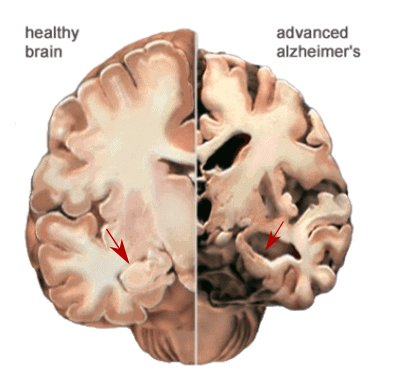
:::

:::

::: {.slide-citation}
Image: Alzheimer's Association · Livingston et al., 2024 · Jack et al., 2024
:::

::: {.notes}
AD is the leading cause of dementia — projections go from ~55M to ~139M cases by 2050, with global costs already above US$818B annually. The 2018 NIA-AA AT(N) framework formalized AD as a biological construct (amyloid, tau, neurodegeneration); the 2024 update extends this to AT₁T₂NISV — soluble (T₁) vs aggregated (T₂) tau, inflammation, α-synuclein co-pathology, and vascular brain injury. Structural MRI sits at N — capturing the structural endpoint of the cascade — which is what HVR measures. Transition: "Within the structural-MRI biomarker space, one structure dominates the field — the hippocampus."
:::

## {.fig-leftright data-menu-title="Why hippocampus"}

::: {.slide-body}

::: {.header-col}

::: {.eyebrow}
Background · The hippocampus
:::

::: {.slide-title}
The reference structural marker
:::

::: {.slide-subtitle}
Medial temporal lobe · earliest AD target
:::

::: {.body-text}
The most-used structural MRI biomarker in AD.

Anchors clinical trials, diagnostic frameworks, and longitudinal studies.
:::

:::

::: {.fig-col}
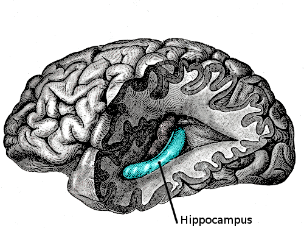
:::

:::

::: {.slide-citation}
Gray's Anatomy (Gray739) · Wikimedia Commons
:::

::: {.notes}
The hippocampus is the most widely used structural MRI biomarker in AD — it anchors clinical trials, diagnostic frameworks, and longitudinal cohort studies. Pathologically it is hit early: tau tangles initiate in transentorhinal cortex and rapidly invade CA1 and subiculum. Healthy aging loses ~1.4% per year; AD accelerates this to ~4.6–4.7% per year. Transition: "But before we can read atrophy off a single scan, we have to reckon with how variable the hippocampus is to begin with."
:::

## {.big-number data-menu-title="Variability problem"}

::: {.eyebrow}
Background · The first problem
:::

::: {.slide-title}
HC volume is highly variable
:::

::: {.slide-body}

[\~25%]{.bignum}

[of healthy young adults have HC volumes that overlap with the elderly]{.bignum-label}

:::

::: {.slide-citation}
Lupien et al., 2007 · Bruno et al., 2016
:::

::: {.notes}
The headline number: up to ~25% of healthy young adults have hippocampal volumes as small as the average healthy 60–75-year-old. That overlap makes raw cross-sectional volume a noisy predictor of pathology — you can't tell a congenitally small hippocampus from one that's actively shrinking. This motivates both longitudinal designs and demographically-adjusted normative models (which becomes Chapter 5). Transition: "And on top of that biological variability, there's a methodological confound: head size."
:::

## {.fig-leftright data-menu-title="Head-size confound"}

::: {.slide-body}

::: {.header-col}

::: {.eyebrow}
Background · The methodological problem
:::

::: {.slide-title}
No consensus on head-size correction
:::

::: {.slide-subtitle}
Same data → different —sometimes [**reversed**]{.accent}—sex differences
:::

::: {.body-text}
Multiple competing correction methods (proportions, residualization, stereotaxic) rest on different assumptions.

Decades of conflicting findings on whether HC is larger in males or females.
:::

:::

::: {.fig-col}
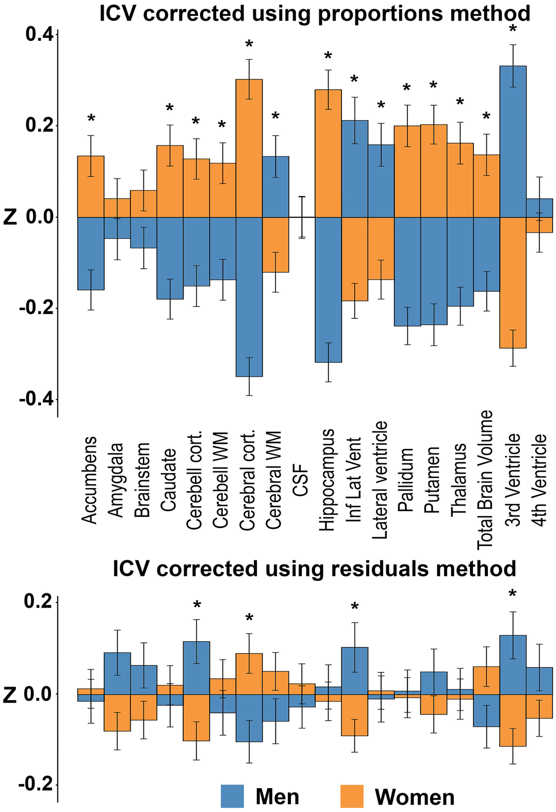
:::

:::

::: {.slide-citation}
Pintzka et al., 2015 · O'Brien et al., 2011 · Voevodskaya et al., 2014
:::

::: {.notes}
Males have ~10–12% larger intracranial volumes than females, and the hippocampus scales hypoallometrically with ICV (exponent ~0.5–0.7), so the choice of correction matters enormously. Same dataset, Sanchis-Segura et al.: unadjusted gives a male advantage of d = -0.89, proportions flips it to a female advantage of d = +0.58, residualization makes it vanish — a swing of ~1.5 SD purely from analytical choice. There's still no consensus on the optimal correction, so much of the sexual-dimorphism literature is method-dependent. Transition: "What if we didn't need to correct for head size at all?"
:::

## {.fig-leftright data-menu-title="HVR concept"}

::: {.slide-body}

::: {.header-col}

::: {.eyebrow}
Background · The proposed solution
:::

::: {.slide-title}
HVR: the ratio that self-normalizes
:::

::: {.slide-subtitle}
[**HVR = HC / (HC + th-CSF)**]{.accent}
:::

::: {.body-text}
As the hippocampus atrophies, CSF expands ex vacuo into the space.

Both structures scale with head size — the ratio cancels it out.
:::

:::

::: {.fig-col}
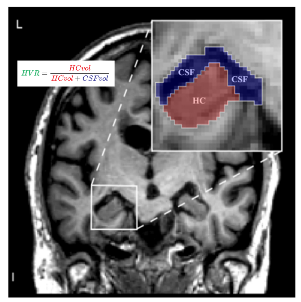
:::

:::

::: {.slide-citation}
Figure: adapted from Schoemaker et al., 2019 · Bruno et al., 2016
:::

::: {.notes}
HVR exploits ex-vacuo dilation — as the hippocampus shrinks, the perihippocampal CSF (temporal horn, uncal recess, hippocampal fissure) passively expands to fill the void, so both terms move together and amplify the atrophy signal. Because both structures scale with ICV, the ratio algebraically cancels head size — exact under isometric scaling, approximate under mild allometry — yielding a dimensionless 0-to-1 index. Builds on Heister's HOC score; Schoemaker (2019) broadened the CSF compartment to capture earlier change. Transition: "That's the idea — now the four chapters of this thesis turn it into a working biomarker."
:::

## {.fig-pure data-menu-title="Thesis roadmap"}

::: {.eyebrow}
Background · The four chapters
:::

::: {.slide-title}
From concept to clinical inference
:::

::: {.slide-body}

::: {.text-col-full style="max-width: 960px; margin: 50px auto 0;"}

[**Chapter 3**]{.subhead} — [**Qrater:**]{.accent} open-source QC platform that curates the imaging data.

[**Chapter 4**]{.subhead} — [**Automated HVR:**]{.accent} CNN segmentation validated against manual labels in ADNI.

[**Chapter 5**]{.subhead} — [**HVR at scale:**]{.accent} 27,680 UK Biobank participants; sex-specific normative reference.

[**Chapter 6**]{.subhead} — [**HVR in the clinic:**]{.accent} apply the normative reference to amyloid-positive ADNI; isolate cardiovascular risk from age.

:::

:::

::: {.notes}
The roadmap. Each chapter solves a specific problem in the HVR pipeline. Ch3 gives us trustworthy input data — without clean QC, every downstream number is suspect. Ch4 automates HVR computation and validates it head-to-head against manual segmentation. Ch5 takes the validated pipeline to population scale and produces sex-specific normative curves. Ch6 takes those curves into a clinical sample to ask a specific question: does cardiovascular risk drive brain-cognition decline? Transition: "Let's start with the quality-control foundation."
:::

# {.divider data-menu-title="Ch3 divider"}

::: {.divider-content}

::: {.eyebrow}
Chapter 3
:::

::: {.divider-title}
Qrater
:::

::: {.divider-subtitle}
A collaborative and centralized imaging quality-control web application
:::

::: {.divider-pub}
Fernández-Lozano et al., Aperture Neuro 2024
:::

:::

::: {.notes}
Quick pivot — before any biomarker work, we needed clean data, and visual QC was the rate-limiting step. Chapter 3 is the tool that unblocked it. I'll move fast through this one.
:::

## {.fig-sidebar data-menu-title="Ch3 · Why we needed it"}

::: {.eyebrow}
Chapter 3 · Motivation
:::

::: {.slide-title}
Visual QC was the bottleneck
:::

::: {.slide-body style="grid-template-columns: 50% 50%;"}

::: {.fig-col style="padding-left: 12px"}

[**The problem**]{.subhead}

- Thousands of MRI scans
- Multiple raters in parallel
- Each QC task (raw · registration · segmentation) had its own ad-hoc tool

:::

::: {.text-col}

[**Existing tools fell short**]{.subhead}

- [**Single-user**]{.accent} workflows (VisualQC)
- [**Modality-specific**]{.accent} pipelines (MRIQC, pyfMRIQC)
- Dashboards not built for [**rating throughput**]{.accent} (Mindcontrol)

:::

:::

::: {.notes}
Visual inspection is still the gold standard for QC, but the existing landscape was fragmented — single-user tools, modality-specific pipelines, or dashboards not built for high-throughput rating. We needed one tool many raters could use in parallel on the same dataset. Transition: "So we built one."
:::

## {.fig-hero data-menu-title="Ch3 · Interface"}

::: {.eyebrow}
Chapter 3 · The tool
:::

::: {.slide-title}
Qrater — web-based, containerized, collaborative
:::

::: {.slide-body}
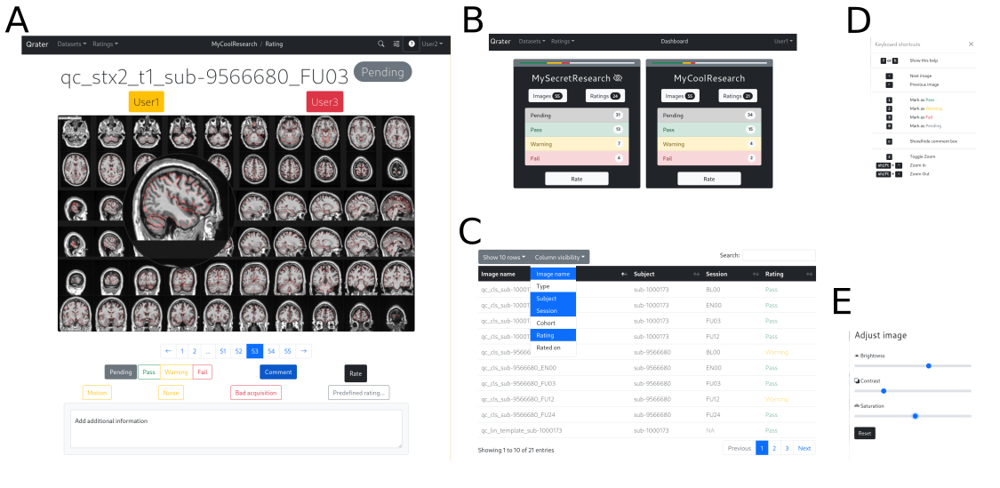
:::

::: {.slide-footer}
Flask + MySQL + Redis in Docker · rates any 2D rendering · 8+ concurrent users.
:::

::: {.slide-citation}
Fernández-Lozano et al., Aperture Neuro 2024
:::

::: {.notes}
Qrater is a Flask app with a MySQL store and a Redis backend, all containerized in Docker — one command to deploy. Key design choice: it rates any 2D rendering, so it's task-agnostic. User accounts let multiple raters work the same dataset concurrently without stepping on each other.
:::

## {.fig-triptych data-menu-title="Ch3 · Three tasks"}

::: {.eyebrow}
Chapter 3 · What we tested
:::

::: {.slide-title}
Three QC tasks, three mosaic formats
:::

::: {.slide-body}

::: {.triptych}

::: {.panel}
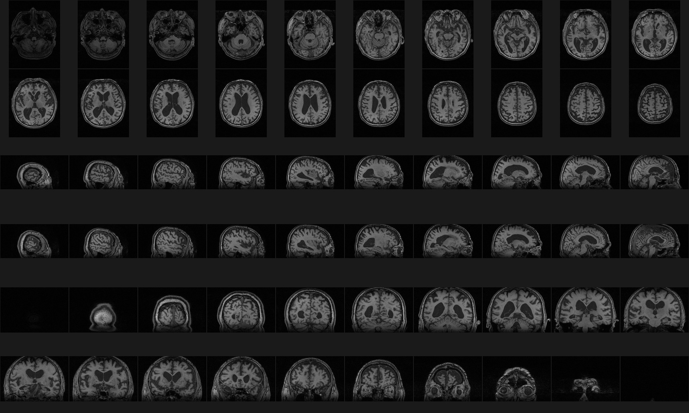

[Raw T1w MRI]{.panel-label}

[Native space]{.panel-sub}
:::

::: {.panel}
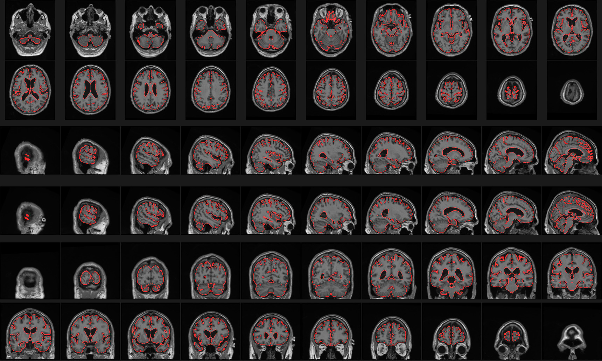

[Linear registration]{.panel-label}

[Template overlay in red]{.panel-sub}
:::

::: {.panel}
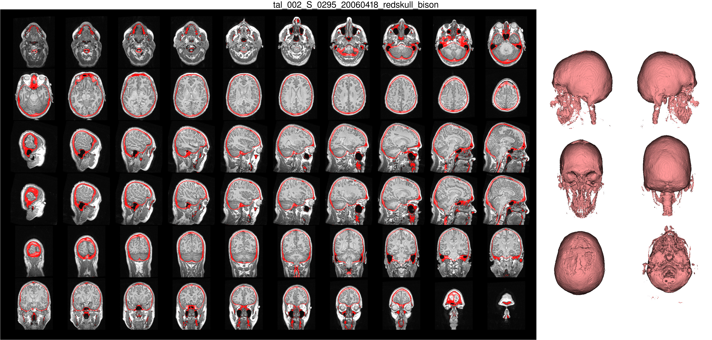

[Skull segmentation]{.panel-label}

[Segmentation overlay in red]{.panel-sub}
:::

:::

:::

::: {.slide-footer}
60-slice mosaic each · 11 raters trained · gold standard set by senior experts.
:::

::: {.slide-citation}
Fernández-Lozano et al., Aperture Neuro 2024
:::

::: {.notes}
We stress-tested Qrater on three tasks of increasing complexity — raw T1w, linear registration with template overlay, and skull segmentation. Eleven raters, two experts (30+ and 10+ years) and nine trainees, against a senior-expert gold standard. The mosaic format collapses a 3D volume into one rateable image, which is what enables the speedup.
:::

## {.fig-hero data-menu-title="Ch3 · Speedup"}

::: {.eyebrow}
Chapter 3 · The improvement
:::

::: {.slide-title}
Per-task speedup vs conventional viewer
:::

::: {.slide-body}

| Task | Rater | Conventional | Qrater | Speedup |
|------|-------|:---:|:---:|---:|
| Raw MRI | Expert | 90 imgs / 63 min | 99 imgs / 63 min | [**1.1×**]{.accent} |
| Raw MRI | Trainee | 79 imgs / 98 min | 99 imgs / 98 min | [**1.3×**]{.accent} |
| Linear registration | Expert | 43 imgs / 36 min | 99 imgs / 36 min | [**2.3×**]{.accent} |
| Linear registration | Trainee | 30 imgs / 37 min | 99 imgs / 37 min | [**3.3×**]{.accent} |
| Skull segmentation | Expert | ~60 s / image | ~3 s / image | [**~20×**]{.accent} |

: {tbl-colwidths="[26,11,26,26,11]"}

:::

::: {.notes}
Speedup scales with task complexity — raw MRI is barely faster because rating a clean T1w is already quick, but registration and especially skull segmentation are where the mosaic pays off. The ~20× on skull came from collapsing slice-by-slice inspection into a single labelled mosaic — about 60 seconds down to 3. Agreement with the expert gold standard stayed high across the board.
:::

## {.big-number data-menu-title="Ch3 · Adoption"}

::: {.eyebrow}
Chapter 3 · Adoption + tools
:::

::: {.slide-title}
Qrater in use beyond this thesis
:::

::: {.slide-subtitle}
Released on DockerHub + GitHub
:::

::: {.slide-body}

[250 K+]{.bignum}

[images on the lab Qrater instance (current)]{.bignum-label}

[Adopted beyond the original project; used by collaborator labs. The QC'd ADNI dataset is the foundation for Chapters 4 and 6 of this thesis.]{.bignum-context}

:::

::: {.slide-citation}
Fernández-Lozano et al., Aperture Neuro 2024
:::

::: {.notes}
Over 250,000 images on the lab Qrater instance — the chapter (published 2024) reports the earlier snapshot of 100K+, but two more years of routine use have driven the count past 250K. The platform is open-sourced on GitHub with a DockerHub image, and now used by collaborator labs beyond the original project. The concrete payoff for this thesis: the QC'd ADNI cohort that feeds Chapters 4 and 6. Transition: "With clean data in hand, we could ask whether HVR holds up as a biomarker."
:::

# {.divider data-menu-title="Ch4 divider"}

::: {.divider-content}

::: {.eyebrow}
Chapter 4
:::

::: {.divider-title}
HVR Validation
:::

::: {.divider-subtitle}
Automated CNN-based segmentation and clinical benchmarking in ADNI (N = 1,641)
:::

::: {.divider-pub}
Fernández-Lozano et al., Human Brain Mapping 2025
:::

:::

::: {.notes}
Chapter 4 is the methods workhorse — published in Human Brain Mapping in 2025. Two intertwined questions: can we automate HVR computation at scale, and does the ratio still amplify clinical signal once segmentation is automated? You will see a methods story — CNN matches manual — and a biomarker story — HVR rescues effect sizes even from a poor segmentation. Transition: "the motivation is brutally simple — manual segmentation does not scale."
:::

## {.big-number data-menu-title="Ch4 · Why automate"}

::: {.eyebrow}
Chapter 4 · Motivation
:::

::: {.slide-title}
Manual segmentation doesn't scale
:::

::: {.slide-body}

[2 h]{.bignum}

[per subject to hand-trace HC + temporal-horn (Schoemaker 2019)]{.bignum-label}

[Plus high intra- and inter-rater variability. Biobank-scale HVR is infeasible without automation.]{.bignum-context}

:::

::: {.notes}
Two hours per subject for an expert tracer to delineate hippocampus and temporal-horn ventricle — and that is before you account for inter-rater drift. Multiply that by 1641 ADNI scans, let alone UK Biobank, and the manual route is dead on arrival. The Schoemaker 2019 protocol is what the gold-standard 80 training labels here use — the same protocol Dorothee Schoemaker used to first define HVR. Transition: "so the design question becomes — how do we train an automated method that survives biobank scale?"
:::

## {.fig-leftright data-menu-title="Ch4 · Study design"}

::: {.slide-body}

::: {.header-col}

::: {.eyebrow}
Chapter 4 · Design
:::

::: {.slide-title}
From 80 manual labels to 1,641 clinical scans
:::

::: {.slide-subtitle}
Four method families · joint HC + th-CSF
:::

::: {.body-text}
**Training** 80 manually labelled (Pruessner protocol) 5-fold CV (64 / 16).

**Out-of-sample** — 60 (CH / MCI / AD).

**Clinical application** — *N* = 1,641 ADNI.

**Compared** MALF · NLPB · CNN · FreeSurfer v4.3 / 5.1 / 6.0.
:::

:::

::: {.fig-col}
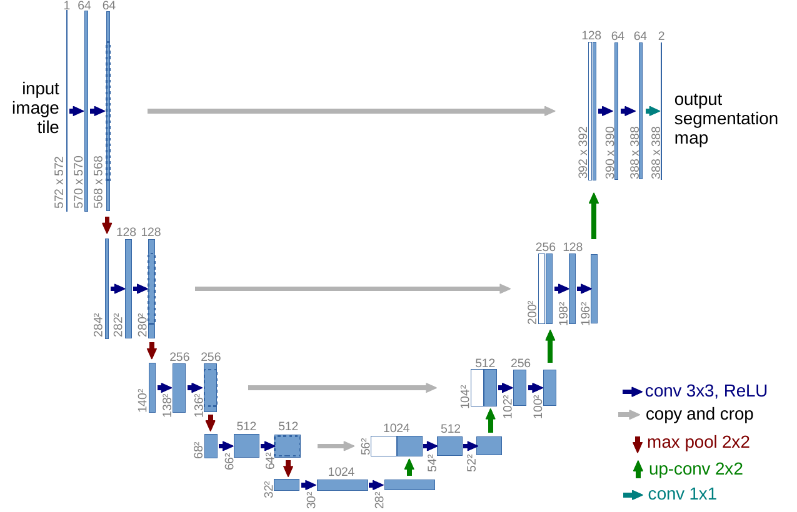
:::

:::

::: {.slide-citation}
U-Net schematic · Ronneberger et al., 2015
:::

::: {.notes}
The training set is small but deeply curated — 80 manually-labelled scans using the Pruessner-Collins protocol — split 64/16 in 5-fold cross-validation. The out-of-sample 60 spans CH, MCI, AD (20 each), so we are stress-testing on the atrophy we care about. Then the trained methods are applied to 1641 ADNI baselines for the clinical comparison. Four method families: MALF (multi-atlas), NLPB (non-local patch-based), our 3D U-Net CNN, and three FreeSurfer versions for community reference. Transition: "first question — does the CNN reach manual quality?"
:::

## {.fig-leftright data-menu-title="Ch4 · CNN matches manual"}

::: {.slide-body}

::: {.header-col}

::: {.eyebrow}
Chapter 4 · Segmentation performance
:::

::: {.slide-title}
CNN matches manual at the rater-noise floor
:::

::: {.slide-subtitle}
Against 80 manually-segmented labels
:::

::: {.body-text}
[**Dice HC**]{.subhead} = [**0.94–0.96 (0.9)**]{.accent}

[**Volume ρ**]{.subhead} = [**0.97-0.99 (0.90-0.96)**]{.accent}

MALF and NLPB show systematic drift; CNN doesn't.
:::

:::

::: {.fig-col}
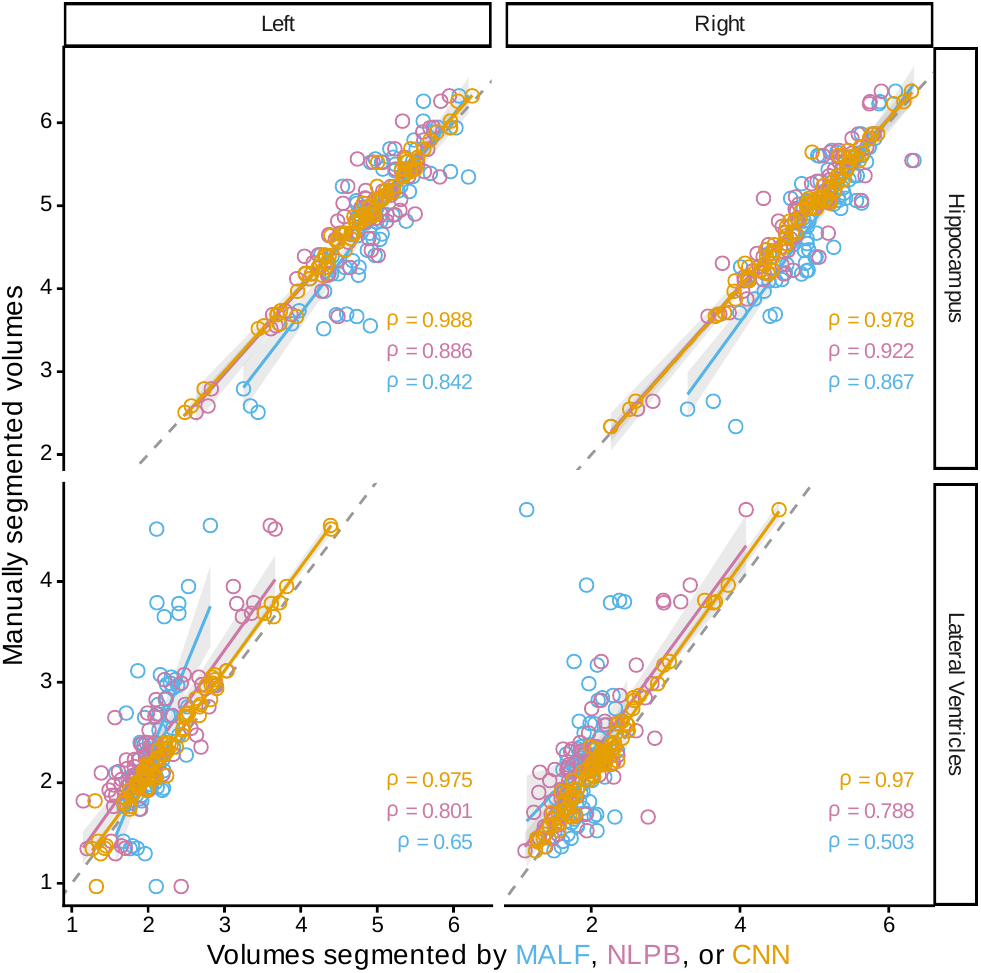
:::

:::

::: {.slide-citation}
Fernández-Lozano et al., Human Brain Mapping 2025
:::

::: {.notes}
Dice 0.94 to 0.96 against manual labels — that is at the rater-noise floor. Volumetric Spearman correlation with manual is 0.99. Across all five performance metrics — Dice, kappa, accuracy, sensitivity, specificity — CNN significantly outperforms both MALF and NLPB. The robust ANOVA confirms this with effect sizes psi above 0.04 for HC and 0.15 for the ventricle. Crucially the CNN scatter sits tight on the identity line — MALF and NLPB show systematic over- or under-segmentation drift, especially in atrophied brains. Transition: "so the CNN is the best segmenter — but what about the biomarker itself?"
:::

## {.fig-hero data-menu-title="Ch4 · HVR rescues effect sizes"}

::: {.eyebrow}
Chapter 4 · The defining property
:::

::: {.slide-title}
HVR amplifies effect sizes across all methods
:::

::: {.slide-subtitle}
CH:AD discrimination · Δ = Cohen's d
:::

::: {.slide-body}

| Segmentation | HCvol Δ | HVR Δ |
|---|:---:|:---:|
| [**MALF**]{.accent} | [**−0.78**]{.accent} | [**−1.24**]{.accent} |
| NLPB | −1.54 | −1.73 |
| CNN | −1.85 | −1.86 |
| FreeSurfer v6.0 | −1.76 | −2.02 |

: {tbl-colwidths="[40,30,30]"}

:::

::: {.slide-footer}
HVR ≥ HCvol for every method · biggest gain where segmentation is weakest (MALF, +59%).
:::

::: {.notes}
This is the defining property of HVR. With HC volume alone, MALF gives a weak Δ of −0.78 — it is the underperformer. Take the ratio with the temporal horn and that effect size lifts to −1.24, a 59 percent gain. Every other method also gains: NLPB goes to −1.73, CNN to −1.86, FreeSurfer v6 reaches −2.02 — only the MALF improvement is statistically significant but the direction is unanimous. The point is not that MALF is broken, it is that the ratio captures the same ex-vacuo atrophy signal even when the segmentation is noisy. Transition: "and the same pattern extends from group discrimination to age associations."
:::

## {.fig-hero data-menu-title="Ch4 · Age associations"}

::: {.eyebrow}
Chapter 4 · Brain–behavior associations
:::

::: {.slide-title}
HVR recovers the age signal HC volume loses
:::

::: {.slide-subtitle}
Correlation with age (Spearman ρ) · AD group
:::

::: {.slide-body}

| Segmentation | HCvol–age ρ | HVR–age ρ |
|---|:---:|:---:|
| [**MALF**]{.accent} | [**−0.03**]{.accent} (n.s.) | [**−0.38**]{.accent} |
| NLPB | −0.32 | −0.44 |
| CNN | −0.44 | −0.49 |
| FreeSurfer v6.0 | −0.46 | −0.52 |

: {tbl-colwidths="[40,30,30]"}

:::

::: {.slide-footer}
All ρ significant (p < 0.001) except MALF HCvol (n.s.) · HVR ≥ HC for every method.
:::

::: {.slide-citation}
Fernández-Lozano et al., Human Brain Mapping 2025
:::

::: {.notes}
This is the brain–behavior payoff, shown for the AD group. Read the table: HVR's correlation with age is at least as strong as HC volume's for every segmentation method. The dramatic case is MALF — a noisy segmentation. There, HC volume has essentially no relationship with age, rho minus 0.03, not significant; take the ratio and HVR recovers a strong minus 0.38. So even a poor segmentation carries a rescuable age signal once you self-normalize. The CH and MCI groups are in the backup slides. Transition: "and the same rescue extends to global cognition."
:::

## {.fig-hero data-menu-title="Ch4 · Cognition associations"}

::: {.eyebrow}
Chapter 4 · Brain–behavior associations
:::

::: {.slide-title}
The same rescue holds for global cognition
:::

::: {.slide-subtitle}
Correlation with ADAS-13 (lower = better) · AD group
:::

::: {.slide-body}

| Segmentation | HCvol–ADAS ρ | HVR–ADAS ρ |
|---|:---:|:---:|
| [**MALF**]{.accent} | [**+0.04**]{.accent} (n.s.) | [**−0.30**]{.accent} |
| NLPB | −0.17 | −0.27 |
| CNN | −0.22 | −0.30 |
| FreeSurfer v6.0 | −0.22 | −0.28 |

: {tbl-colwidths="[40,30,30]"}

:::

::: {.slide-footer}
HVR ρ all significant (p < 0.001) · HCvol significant except MALF (n.s.) · memory (RAVLT) in supp.
:::

::: {.slide-citation}
Fernández-Lozano et al., Human Brain Mapping 2025
:::

::: {.notes}
The same pattern extends from age to global cognition, measured by ADAS-13 — and remember, lower ADAS means better cognition, so a negative correlation is the expected direction. Read it exactly like the previous table: HVR's correlation with cognition is at least as strong as HC volume's for every method. MALF is again the dramatic case — HC volume is essentially uncorrelated with cognition, rho plus 0.04, not significant; HVR recovers minus 0.30. Memory, by RAVLT, points the same way but is weak across the board in this AD sample — those numbers are in the backup. Transition: "one last methods question — does this scale reliably?"
:::

## {.big-number data-menu-title="Ch4 · Reliability"}

::: {.eyebrow}
Chapter 4 · Reliability at scale
:::

::: {.slide-title}
CNN holds at biobank scale
:::

::: {.slide-body}

[0.1%]{.bignum}

[CNN failure rate on 1,641 ADNI scans]{.bignum-label}

[2 failures total · vs MALF 1.5%, FS v4.3/5.1 ~14% missing. Pipeline ready for population-scale (Ch5) and clinical longitudinal (Ch6).]{.bignum-context}

:::

::: {.notes}
Two failures out of 1641 — one MCI, one AD — that is 0.1 percent. MALF and FreeSurfer v6 each fail on about 1.5 percent. FreeSurfer v4.3 and v5.1 missing values from ADNI's reported UCSF files account for roughly 14 percent of cases. So CNN is more accurate and more reliable than every alternative. Critically it is packaged as a Docker container on Docker Hub — the pipeline used in Chapter 5 on 27 thousand UKB scans and Chapter 6 on the ADNI longitudinal cohort is this exact tool. Transition: "with the pipeline in hand, we turn to population-scale validation in UK Biobank."
:::

::: {.slide-citation}
Fernández-Lozano et al., Human Brain Mapping 2025
:::

# {.divider data-menu-title="Ch5 divider"}

::: {.divider-content}

::: {.eyebrow}
Chapter 5
:::

::: {.divider-title}
Sex Differences in UK Biobank
:::

::: {.divider-subtitle}
HVR as a head-size-independent biomarker · N = 27,680 UKB participants
:::

::: {.divider-pub}
Fernández-Lozano & Collins, bioRxiv 2026.04.13.718285
:::

:::

::: {.notes}
Pivot from clinical validation in ADNI to the largest population sample we test HVR on — nearly 28,000 healthy UK Biobank participants. The hook is a long-standing controversy in neuroscience: reported hippocampal sex differences flip direction depending on how you correct for head size. We use this controversy as a stress test for HVR's claim to be head-size-independent. Transition: "let's start with why this controversy exists."
:::

## {.fig-leftright data-menu-title="Ch5 · Question"}

::: {.slide-body}

::: {.header-col}

::: {.eyebrow}
Chapter 5 · The controversy
:::

::: {.slide-title}
Reported HC sex differences flip across studies
:::

::: {.slide-subtitle}
Adjustment method drives the answer — does HVR sidestep this?
:::

::: {.body-text}
**Sample** — [**N = 27,680**]{.accent} UKB 56% female · ages 45–82.

**Tests** — 4 adjustment methods ICV-matched pairs · brain–cognition SEM.

**Output** — sex-specific normative reference.
:::

:::

::: {.fig-col}
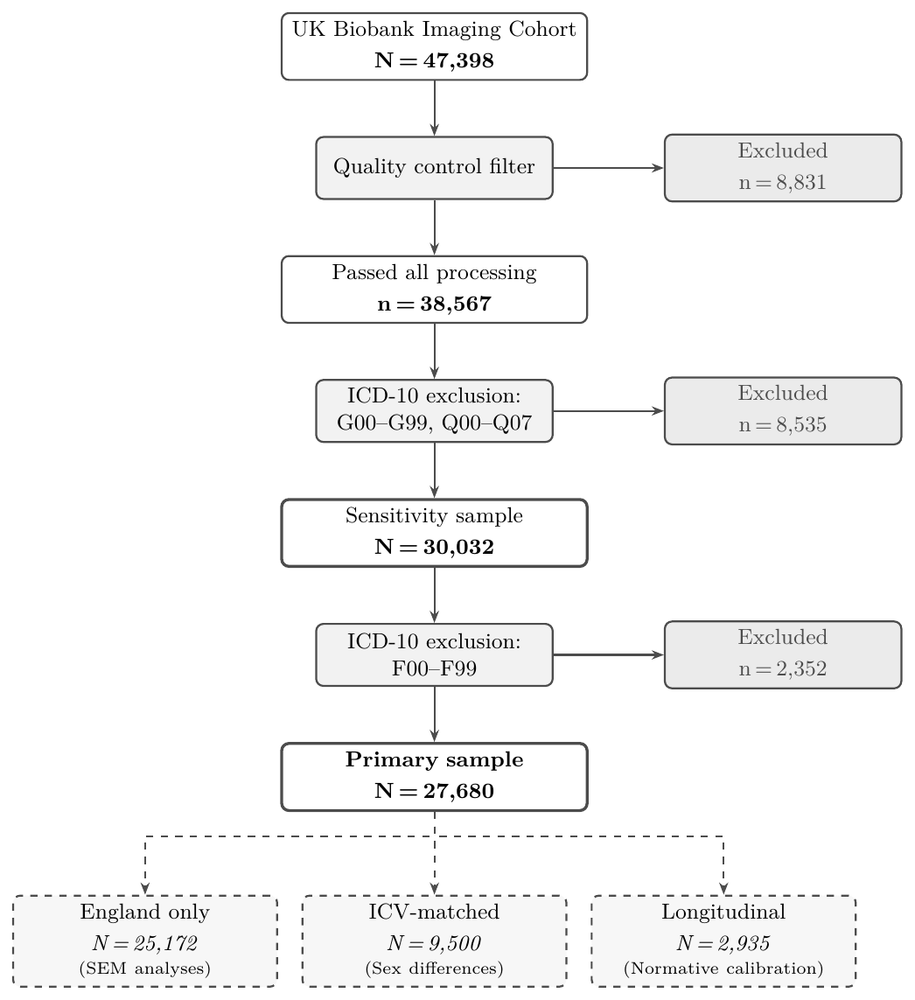
:::

:::

::: {.slide-citation}
Fernández-Lozano & Collins, bioRxiv 2026.04.13.718285
:::

::: {.notes}
The controversy in one line: males have ~12% larger ICV than females, and after head-size correction sex classification from brain features drops from above 80% to roughly 60% — meaning much of what we call "sex differences" may be head-size artifact. Sample is 27,680 UKB participants, 56% female, ages 45 to 82; PRISMA flow on the right shows our QC and exclusions. Three orthogonal tests: four adjustment methods on the full sample, then ICV-matched pairs as a geometric proof, then SEM on brain-cognition coupling. Output feeds Ch 6 as a sex-specific normative reference.
:::

## {.fig-sidebar data-menu-title="Ch5 · Four methods"}

::: {.eyebrow}
Chapter 5 · Methods compared
:::

::: {.slide-title}
Four head-size adjustments
:::

::: {.slide-subtitle}
Each assumes something different about how brain volume scales with head size
:::

::: {.slide-body}

::: {.text-col-full}

| Adjustment | What it does |
|------------|--------------|
| [**Raw**]{.accent} | No correction — volumes in native space |
| [**Proportions**]{.accent} | *V* / ICV — assumes isometric scaling |
| [**Stereotaxic**]{.accent} | Warp to a common template — removes ICV spatially |
| [**Residualized**]{.accent} | Linear regression removes the ICV component |

: {tbl-colwidths="[22,78]"}

:::

:::

::: {.notes}
Four mainstream methods, each with a different assumption baked in. Proportions assumes perfect allometric scaling — biologically implausible. Residualization assumes linear coupling. Stereotaxic warps to a template, removing ICV spatially. There's no consensus on which is correct, and recent comparisons (Wang 2024) show they can yield contradictory conclusions on the same brain region. That's exactly the methodological ambiguity HVR is designed to sidestep. Transition: "so let's see what happens when we apply all four."
:::

## {.big-number data-menu-title="Ch5 · Matched proof"}

::: {.eyebrow}
Chapter 5 · The geometric proof
:::

::: {.slide-title}
Match on head size: HC collapses, HVR persists
:::

::: {.slide-body}

[d = 0.18]{.bignum}

[HVR female advantage in 4,750 head-size-matched pairs]{.bignum-label}

[Matched on age (±1 yr) and intracranial volume (ICV, ±25 cc). HC raw collapses from d = −0.89 to ≈ 0; HVR drops from 0.52 to 0.18 but stays sig. With head size equated, what remains is biology — not artifact.]{.bignum-context}

:::

::: {.notes}
Strongest test against head-size confounding — 4,750 male-female pairs matched tightly on age (±1 yr) and ICV (±25 cc, roughly 0.3 SD of head size). HC raw effect collapses from d = −0.89 to essentially zero, confirming the unadjusted hippocampal difference was a head-size artifact. HVR drops from 0.52 to 0.18 but stays significant — small but real. What remains after equating head size is biology, not geometry. Transition: "and now we can see how this plays out across all four standard correction methods."
:::

## {.fig-leftright data-menu-title="Ch5 · The reversal"}

::: {.slide-body}

::: {.header-col}

::: {.eyebrow}
Chapter 5 · The headline figure
:::

::: {.slide-title}
HC reverses across methods · HVR doesn't
:::

::: {.slide-subtitle}
4 adjustment methods (triangles = matched-pair subsample)
:::

::: {.body-text}
[**HC**]{.subhead} swings d = −0.89 → +0.58 a [**1.5-SD**]{.accent} range across methods.

[**HVR**]{.subhead} holds at d ≈ [**+0.52**]{.accent} (female advantage), regardless of adjustment.
:::

:::

::: {.fig-col}
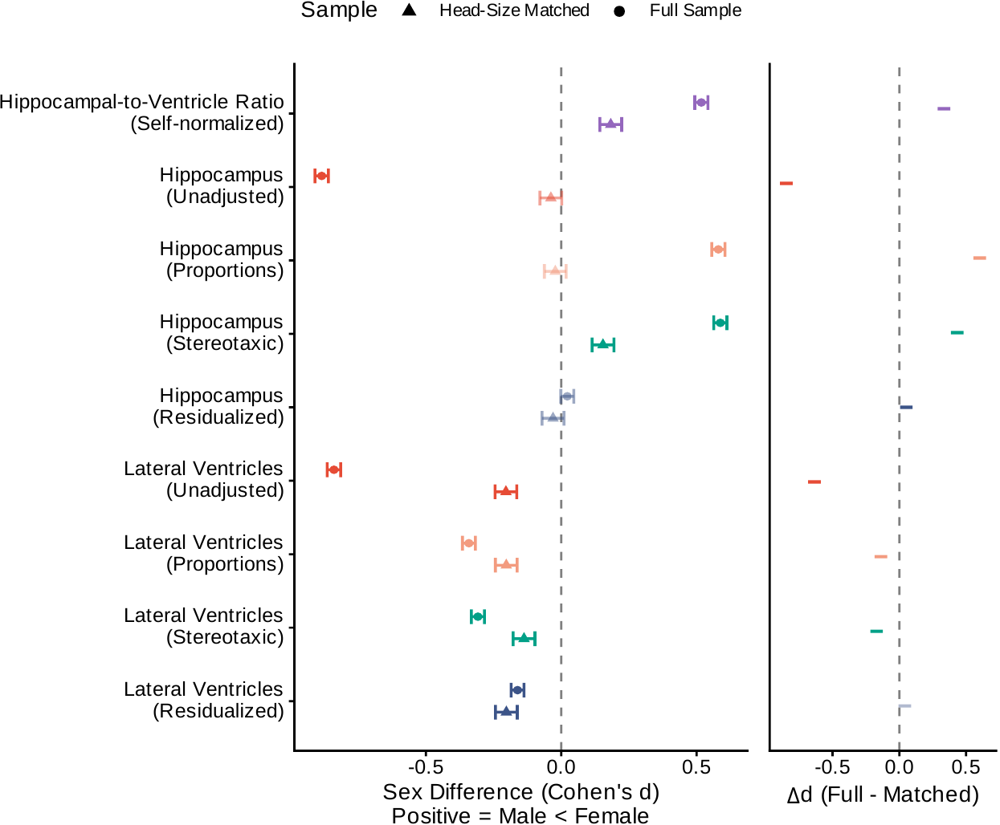
:::

:::

::: {.slide-citation}
Fernández-Lozano & Collins, bioRxiv 2026.04.13.718285
:::

::: {.notes}
The headline figure. HC effect size swings from d = −0.89 (males larger, unadjusted) to d = +0.58 (females larger, proportions) — a 1.5-SD range driven entirely by analytical choice. HVR sits at d ≈ +0.52 regardless of which adjustment you apply, because its self-normalizing ratio cancels the ICV term. The triangles you saw on the previous slide are also plotted here — head-size-matched effects collapse for HC and shrink-but-persist for HVR, consistent across all four method families. The take-away: if your sex difference flips when you change the denominator, you weren't measuring biology. Transition: "and beyond this static snapshot, sex differences also play out across age."
:::

## {.fig-leftright data-menu-title="Ch5 · Age × sex"}

::: {.slide-body}

::: {.header-col}

::: {.eyebrow}
Chapter 5 · Trajectories
:::

::: {.slide-title}
Males decline 1.7× faster in HVR
:::

::: {.slide-subtitle}
Cross-sectional age × sex
:::

::: {.body-text}
[**HVR**]{.subhead} male slope [**1.7×**]{.accent} steeper than female.

Sits between [**HC (1.4x)**]{.accent} and [**LV (2x)**]{.accent} HVR captures both atrophy and ventricular expansion.
:::

:::

::: {.fig-col}
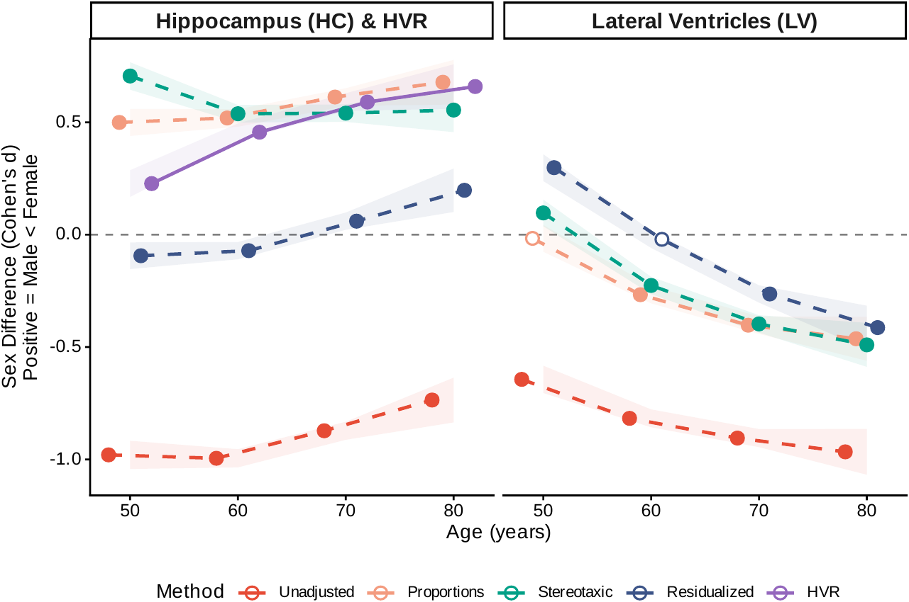
:::

:::

::: {.slide-citation}
Fernández-Lozano & Collins, bioRxiv 2026.04.13.718285
:::

::: {.notes}
Cross-sectional age × sex interaction — males show 1.7× steeper HVR slope than females, p < 10⁻⁵⁰. That number sits neatly between the HC slope ratio (1.4×) and the LV slope ratio (2.0×), which is exactly what you'd expect if HVR is integrating both hippocampal atrophy and ventricular expansion. This aligns with prior work showing earlier and more pronounced ventricular enlargement in males (Currà 2019). So HVR isn't just consistent at one age — it tracks a sex-differential aging trajectory. Transition: "But does HVR actually predict cognition? — to answer this, a brief detour through how cognition is modeled."
:::

## {.fig-pure data-menu-title="Ch5 · SEM setup"}

::: {.eyebrow}
Chapter 5 · Brain → cognition setup
:::

::: {.slide-title}
From 12 cognitive tests to a single path coefficient
:::

::: {.slide-body}

::: {.text-col-full style="max-width: 960px; margin: 40px auto 0;"}

[**Step 1**]{.subhead} — 12 UKB cognitive tests reduced via [**bifactor SEM**]{.accent} → general-cognition factor [***g***]{.accent} + domain-specific memory & speed factors.

[**Step 2**]{.subhead} — Each brain measure (HVR, raw HC, residualized HC) tested as a predictor of *g* → [**standardized path coefficient (β)**]{.accent}.

[**Step 3**]{.subhead} — Estimated [**separately by sex**]{.accent}  measurement-invariance verification: (loadings, intercepts, residuals all equal across sex).

:::

:::

::: {.slide-citation}
Rosseel et al., 2012 · Cheung & Rensvold, 2002
:::

::: {.notes}
A brief detour through the cognitive measurement model so the next slide's path coefficients make sense. UKB's touchscreen battery has 12 tests across memory, speed, executive function, reasoning. Bifactor SEM extracts a general-cognition factor g that loads on all 12, plus orthogonal domain-specific factors (Memory_s on 3 memory items, Speed_s on 3 speed items). The analytic question becomes: for each brain measure → g path, what's the standardized β? And does it hold up sex-stratified? Multi-group invariance (configural → metric → scalar → strict, all ΔCFI ≤ 0.01) confirms the model means the same thing in both sexes, validating the comparison. Transition: "with that scaffolding in place, the result is the cleaner story."
:::

## {.fig-leftright data-menu-title="Ch5 · Brain–cognition"}

::: {.slide-body}

::: {.header-col}

::: {.eyebrow}
Chapter 5 · Functional validity
:::

::: {.slide-title}
HVR predicts cognition in both sexes; residualized HC fails in males
:::

::: {.slide-subtitle}
Standardized path coefficients by sex
:::

::: {.body-text}
[**HVR → cognition**]{.subhead} — sig in [**both sexes**]{.accent} (F · M).

[**Residualized HC → cognition**]{.subhead} — sig in [**females only**]{.accent} — the linear adjustment strips cognition-relevant signal in males.
:::

:::

::: {.fig-col}
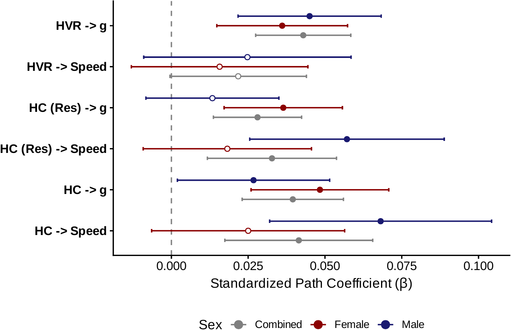
:::

:::

::: {.slide-citation}
Fernández-Lozano & Collins, bioRxiv 2026.04.13.718285
:::

::: {.notes}
Structural equation modeling for brain-cognition coupling, run separately by sex. HVR predicts general cognition significantly in both sexes (β ≈ 0.04, comparable to HC, overlapping CIs). The interesting failure is residualized HC: significant in females but not in males — the linear ICV adjustment is stripping out cognition-relevant variance specifically in males, where the ICV-HC coupling is steeper. This echoes prior work where hippocampal volume predicted memory in older women but not men (Zheng 2017). HVR's invariance preserves that male signal. Transition: "with HVR validated, we package it as a clinical reference."
:::

## {.fig-leftright data-menu-title="Ch5 · Centiles"}

::: {.slide-body}

::: {.header-col}

::: {.eyebrow}
Chapter 5 · Normative reference
:::

::: {.slide-title}
Sex-specific normative centile curves
:::

::: {.slide-subtitle}
Reference percentiles HVR / HC / LV by sex, ages 45–82
:::

::: {.body-text}
Well-calibrated on held-out 20%.

Transferred to ADNI in [**Chapter 6**]{.accent} to z-score patients.
:::

:::

::: {.fig-col}
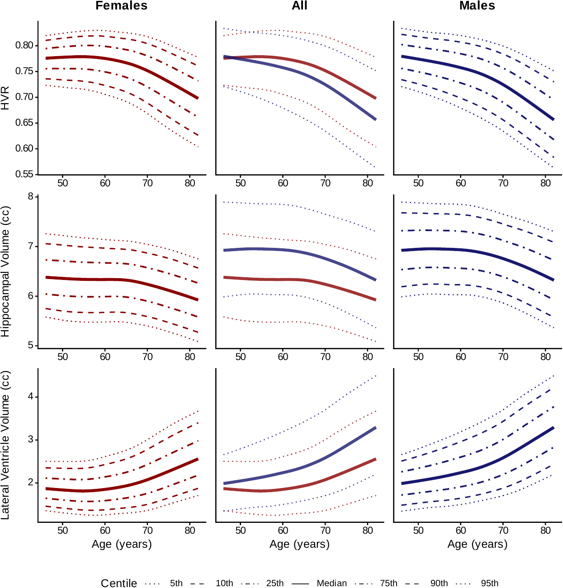
:::

:::

::: {.slide-citation}
Fernández-Lozano & Collins, bioRxiv 2026.04.13.718285
:::

::: {.notes}
We fit sex-specific GAMLSS centile curves for HVR, HC, and LV across ages 45–82, following the brain-charting tradition (Bethlehem 2022, Coupé 2019). Curves are well-calibrated on a held-out 20% — empirical centile coverage matches nominal. The deliverable is a reference patients can be z-scored against — and that's exactly what Chapter 6 does, transferring these UKB-derived norms to the ADNI cohort to harmonize HVR across studies. Transition: "and that brings us to the final chapter — does cardiovascular risk push patients off these centiles?"
:::

# {.divider data-menu-title="Ch6 divider"}

::: {.divider-content}

::: {.eyebrow}
Chapter 6
:::

::: {.divider-title}
Cardiovascular Risk and HVR&#8209;Cognitive Coupling
:::

::: {.divider-subtitle}
Does cardiovascular risk drive brain–cognition decline — or just track age?
:::

::: {.divider-pub}
Fernández-Lozano et al., bioRxiv [screening]
:::

:::

::: {.notes}
Chapter 6 is the methodological capstone — it takes the normative HVR from Chapter 5 into ADNI to ask a clinically loaded question. Many studies link the Framingham Risk Score to brain decline, but FRS is dominated by age, so are we seeing a true cardiovascular effect or age in disguise? I'll show a MIMIC fix, apply it inside two complementary frameworks — mediation via LGCM and moderation via LME — and land on a reserve-like interpretation. Currently in prep for *Alzheimer's & Dementia*, bioRxiv preprint in progress.
:::

## {.fig-leftright data-menu-title="Ch6 · Sample"}

::: {.slide-body}

::: {.header-col}

::: {.eyebrow}
Chapter 6 · ADNI sample
:::

::: {.slide-title}
Amyloid-positive primary cohort, amyloid-negative controls
:::

::: {.slide-subtitle}
Longitudinal MRI + cognition along the AD continuum
:::

::: {.body-text}
[**Primary**]{.subhead} — [**N = 923**]{.accent} amyloid-positive.

[**Control**]{.subhead} — [**N = 317**]{.accent} amyloid-negative, cognitively unimpaired.
:::

:::

::: {.fig-col}
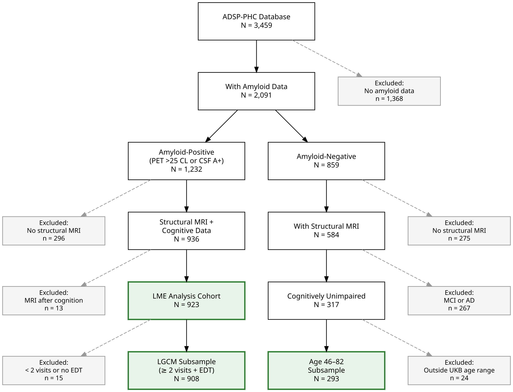
:::

:::

::: {.slide-citation}
Fernández-Lozano et al., bioRxiv [screening]
:::

::: {.notes}
ADNI gives us the clinical anchor — longitudinal MRI plus cognition across the AD continuum. Primary cohort: 923 amyloid-positive participants spanning CU, MCI, and AD. Critical sensitivity cohort: 317 amyloid-negative cognitively unimpaired controls — same scanner, same protocols, no AD pathology — we'll use them as a counterfactual at the end. All analyses are sex-stratified, since FRS has different age weightings for men and women.
:::

## {.fig-leftright data-menu-title="Ch6 · Norm transfer"}

::: {.slide-body}

::: {.header-col}

::: {.eyebrow}
Chapter 6 · Bridge from Chapter 5
:::

::: {.slide-title}
HVR z-scored against sex-specific normative model
:::

::: {.slide-subtitle}
Ch 5 GAMLSS centiles transferred from UKB to ADNI
:::

::: {.body-text}
A−/CU validates the transfer with a small calibration offset (older sample) — within-ADNI comparisons remain valid.
:::

:::

::: {.fig-col}
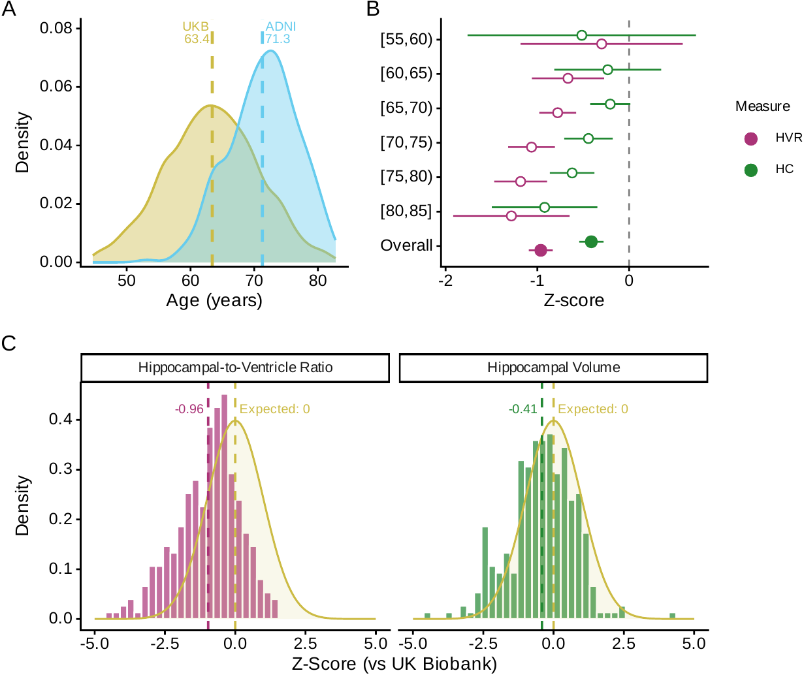
:::

:::

::: {.slide-citation}
Fernández-Lozano et al., bioRxiv [screening]
:::

::: {.notes}
This is the bridge from Chapter 5: we z-score every ADNI HVR measurement against the UKB GAMLSS centile model. The A−/CU subgroup is our calibration check — if the norms transferred cleanly, healthy controls should sit near zero. We see a small offset (ADNI is older than UKB's upper range) but the spread is right, so within-ADNI comparisons — amyloid-positive versus negative, FRS versus CVRₙ — remain valid. Transition: "with HVR harmonized, we can ask what drives it."
:::

## {.big-number data-menu-title="Ch6 · FRS age-confound"}

::: {.eyebrow}
Chapter 6 · The problem with FRS in elderly cohorts
:::

::: {.slide-title}
The Framingham Risk Score is dominated by age
:::

::: {.slide-subtitle}
A 10-year cardiovascular-event composite — age is the heaviest input
:::

::: {.slide-body}

[3.06 / 2.33]{.bignum}

[FRS age coefficients (men / women) — log-hazard scale]{.bignum-label}

[In ADNI, age explains most of FRS variance. Any FRS → brain effect risks being an age effect in disguise.]{.bignum-context}

:::

::: {.notes}
Here's the core problem. The Framingham formula was built and validated for midlife, where it works beautifully. But its log-hazard coefficients on age — 3.06 for men, 2.33 for women (D'Agostino 2008) — are the heaviest inputs in the score. In ADNI, where age variance is restricted to roughly 55–90, age ends up explaining most of FRS variance. So when prior work reports "FRS predicts brain decline," it could just as easily read "age predicts brain decline." Pencina 2019 and Ko 2020 quantify how much of FRS's predictive performance in elderly samples is just age.
:::

## {.fig-sidebar data-menu-title="Ch6 · Why MIMIC"}

::: {.eyebrow}
Chapter 6 · Methodology
:::

::: {.slide-title}
Age is an internal weight, not an external confounder
:::

::: {.slide-body style="grid-template-columns: 50% 50%;"}

::: {.fig-col style="padding-left: 12px"}

[**Covariate adjustment ✗**]{.subhead}

- Regress age out of FRS [*post-hoc*]{.accent}
- Removes only [**shared variance**]{.accent}
- Age-weighting [**still inside**]{.accent} the score

:::

::: {.text-col}

[**MIMIC SEM ✓**]{.subhead}

- Age as [*cause*]{.accent} of a latent CVR factor
- BP · chol · diabetes · smoking → CVR
- Age partialled at the [**latent level**]{.accent}, before the score exists

:::

:::

::: {.notes}
The naive fix — just add age as a covariate — fails here. Age is *inside* the FRS formula by design, not an external confounder. Regressing it out post-hoc only removes the variance that age shares with FRS; the age-weighting baked into the score remains. A MIMIC SEM solves this differently: it models age as a *cause* of a latent cardiovascular-risk factor whose indicators are the underlying CV biomarkers (BP, cholesterol, smoking, diabetes). Age's contribution is partialled at the latent-variable level, before the score is built.
:::

## {.big-number data-menu-title="Ch6 · MIMIC equation"}

::: {.eyebrow}
Chapter 6 · The MIMIC model
:::

::: {.slide-title}
Latent CVR = γ · *Age*~z~ + ζ
:::

::: {.slide-subtitle}
Age explains a tiny slice of latent cardiovascular risk — the residual ζ is CVR~mimic~
:::

::: {.slide-body}

[1.6%]{.bignum}

[of latent CVR variance explained by age (γ = 0.125)]{.bignum-label}

[CVR~mimic~ is the age-orthogonal residual. It correlates [**r ≈ 0.3–0.5**]{.accent} with FRS — same cardiovascular signal, age stripped.]{.bignum-context}

:::

::: {.notes}
The MIMIC equation is just one line: latent CVR equals gamma times age-z plus a residual zeta. Gamma is 0.125, so age explains 1.6% of latent CVR variance — the rest comes from the biomarker indicators. That residual zeta — the part of latent CVR that's *not* age — is what I call CVRₙ. It still correlates with FRS at roughly 0.3–0.5 because they share the same biomarker indicators; what they don't share is the age weighting. So we have two measures of "cardiovascular risk" identical in content but different in their age contamination — a clean instrumental contrast.
:::

## {.fig-leftright data-menu-title="Ch6 · CVR validation"}

::: {.slide-body}

::: {.header-col}

::: {.eyebrow}
Chapter 6 · Validation
:::

::: {.slide-title}
CVR~mimic~ is age-orthogonal by construction
:::

::: {.slide-subtitle}
Same cardiovascular signal as FRS — age stripped
:::

::: {.body-text}
[**FRS vs age**]{.subhead} — climbs steeply.

[**CVR~mimic~ vs age**]{.subhead} — flat (*r* ≈ 0).

CVR~mimic~–FRS *r* ≈ [**0.3–0.5**]{.accent} — shared CV indicators retained.
:::

:::

::: {.fig-col}
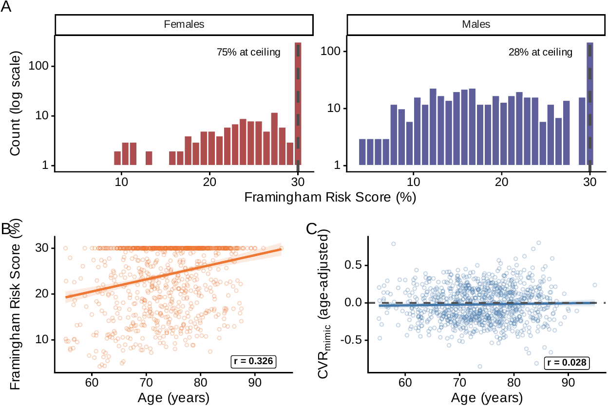
:::

:::

::: {.slide-citation}
Fernández-Lozano et al., bioRxiv [screening]
:::

::: {.notes}
Quick sanity check before we use it. Left panel: FRS plotted against age — a steep upward climb, as expected. Right panel: CVRₙ against age — essentially flat, correlation near zero, by construction. And the CVRₙ–FRS correlation in the 0.3–0.5 range confirms we haven't thrown the cardiovascular signal out with the age bathwater. The two scores carry the same underlying CV biomarker content; only the age weighting differs. Transition: "and before we look at cognitive outcomes, a brief note on how cognition is measured here."
:::

## {.fig-pure data-menu-title="Ch6 · Cognition setup"}

::: {.eyebrow}
Chapter 6 · Cognitive outcomes
:::

::: {.slide-title}
Three ADSP-PHC composite scores
:::

::: {.slide-body}

::: {.text-col-full style="max-width: 1020px; margin: 50px auto 0; display: grid; grid-template-columns: 1fr 1fr 1fr; gap: 40px; text-align: left;"}

::: {}
[**Memory**]{.accent} 
WMS-R · AVLT 
ADAS-Cog recall
:::

::: {}
[**Language**]{.accent} 
Category fluency 
Boston Naming
:::

::: {}
[**Executive Function**]{.accent} 
Trail A/B 
Digit Span/Symbol
:::

:::

::: {.text-col-full style="max-width: 980px; margin: 50px auto 0; text-align: center;"}

Bifactor [**item banking**]{.accent} across ADNI · ACT · ROS/MAP · NACC 
Measurement-error SE [**fixed into LGCM residual variance**]{.accent}
:::

:::

::: {.slide-citation}
Kang et al., 2023 (ADSP-PHC composites)
:::

::: {.notes}
Brief detour before the results. ADNI doesn't use a single cognitive score — it uses three domain composites from the ADSP-PHC harmonization project: Memory, Language, Executive Function. Each composite pools several individual tests, co-calibrated via bifactor item banking across four large cohorts (ADNI, ACT, ROS/MAP, NACC) so scores are comparable across studies. Each composite arrives at the LGCM with its own measurement-error estimate from the CFA — that SE² is fixed into the residual variance, so the model doesn't have to estimate measurement noise from sparse longitudinal data. This is why subsequent slides report "6/6 models" — 3 domains × 2 sexes. Transition: "with cognition operationalized, here's the first mediation question."
:::

## {.fig-hero data-menu-title="Ch6 · Mediation a-path"}

::: {.eyebrow}
Chapter 6 · Q1 — does cardiovascular risk drive atrophy?
:::

::: {.slide-title}
FRS predicts HVR decline; CVR~mimic~ doesn't
:::

::: {.slide-subtitle}
LGCM a-path (risk → HVR slope) · 6 models = 3 domains × 2 sexes
:::

::: {.slide-body}

| Cognitive domain | FRS → HVR (F / M) | CVR~mimic~ → HVR (F / M) |
|---|:---:|:---:|
| Memory | ✓ / ✓ | ✗ / ✗ |
| Language | ✓ / ✓ | ✗ / ✗ |
| Executive | ✓ / ✓ | ✗ / ✗ |
| [**Total**]{.accent} | [**6 / 6**]{.accent} | [**0 / 6**]{.accent} |

: {tbl-colwidths="[34,33,33]"}

:::

::: {.slide-footer}
✓ = a-path bootstrap 95% CI excludes 0 · strip age from the score and the cardiovascular → atrophy effect vanishes.
:::

::: {.notes}
This is the headline result. Q1 — does CVR cause hippocampal atrophy? We use latent growth curve mediation, six models: 3 cognitive domains (memory, executive, language) by 2 sexes. The FRS → HVR-slope path — the a-path — is significant in 6 out of 6 models. With CVRₙ, the same a-path is significant in 0 out of 6. Strip age from the score and the apparent cardiovascular → hippocampus effect disappears. The prior literature on FRS and brain volume has been measuring an age-weighting artifact.
:::

## {.fig-leftright data-menu-title="Ch6 · LME forest"}

::: {.slide-body}

::: {.header-col}

::: {.eyebrow}
Chapter 6 · Q2 — does CVR modify HVR–Cog coupling?
:::

::: {.slide-title}
Same pattern in moderation: FRS dominates, CVR~mimic~ mostly null
:::

::: {.slide-subtitle}
3-way Years × CVR × HVR interaction
:::

::: {.body-text}
All [**6 FRS effects**]{.accent} survive FDR correction.

CVR~mimic~ sig in [**Female Executive only**]{.accent}.
:::

:::

::: {.fig-col}
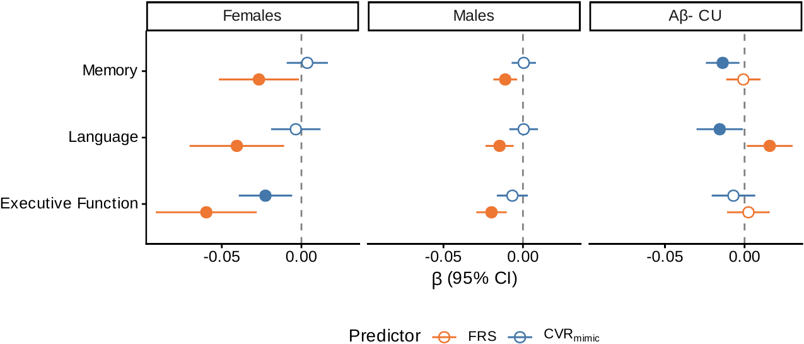
:::

:::

::: {.slide-citation}
Fernández-Lozano et al., bioRxiv [screening]
:::

::: {.notes}
Q2 switches frameworks: from LGCM mediation to LME moderation. Does CVR *modify* the HVR–cognition coupling — does cardiovascular burden change how much hippocampal decline costs you cognitively? Same pattern as Q1: the 3-way Years × CVR × HVR interaction is significant in all 6 cells for FRS and survives FDR. For CVRₙ it survives in just one — Female Executive Function — which echoes Villeneuve 2011 showing vascular burden selectively impairs executive function in women with MCI. Transition: "but here's the surprise — what happens when there's no amyloid in the brain?"
:::

## {.fig-leftright data-menu-title="Ch6 · A−/CU reversal"}

::: {.slide-body}

::: {.header-col}

::: {.eyebrow}
Chapter 6 · Pivotal sensitivity result
:::

::: {.slide-title}
Without AD pathology, the pattern reverses
:::

::: {.slide-subtitle}
Amyloid-negative cognitively unimpaired (control) sample
:::

::: {.body-text}
**Amyloid-positive:** FRS survives correction · CVR~mimic~ null.

**Amyloid-negative controls:** FRS [**no longer significant**]{.accent} · CVR~mimic~ [**becomes significant**]{.accent}.

Without amyloid driving atrophy, a [**genuine cardiovascular signal**]{.accent} surfaces.
:::

:::

::: {.fig-col}

:::

:::

::: {.slide-citation}
Fernández-Lozano et al., bioRxiv [screening]
:::

::: {.notes}
This is the pivotal sensitivity test. Re-run the same LME models in the 317 amyloid-negative controls — the pattern flips. FRS no longer survives multiple-comparison correction; CVRₙ becomes significant. The interpretation: in amyloid-positive AD, hippocampal atrophy is so dominated by neurodegeneration that a true cardiovascular signal gets drowned out, while FRS still "predicts" because of its age content. Pull amyloid out of the picture and the genuine, age-independent CV effect surfaces — exactly what you'd expect if CVRₙ is real and FRS was just tracking age.
:::

## {.fig-leftright data-menu-title="Ch6 · Coupling"}

::: {.slide-body}

::: {.header-col}

::: {.eyebrow}
Chapter 6 · The robust finding
:::

::: {.slide-title}
HVR decline → cognitive decline, regardless of which CVR you use
:::

::: {.slide-subtitle}
Hippocampal–cognitive coupling, predictor-agnostic
:::

::: {.body-text}
Sig in [**4–6 of 6 cells**]{.accent} for [**both**]{.accent} FRS and CVR~mimic~ models.

A neurodegenerative signal, not vascular.
:::

:::

::: {.fig-col}
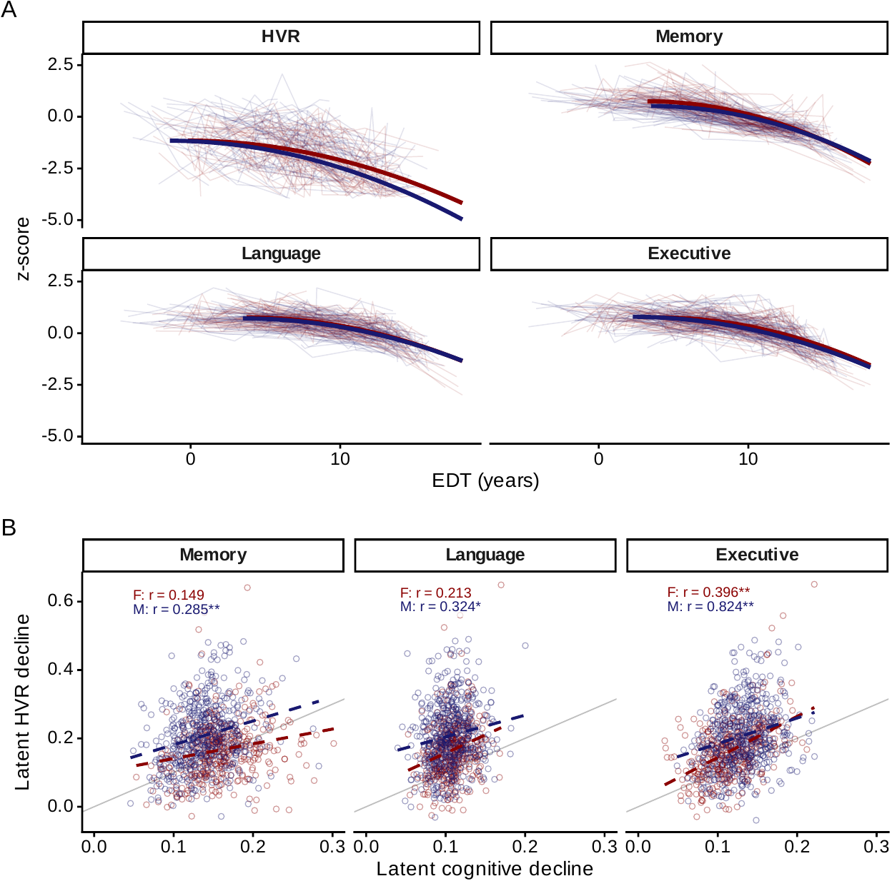
:::

:::

::: {.slide-citation}
Fernández-Lozano et al., bioRxiv [screening]
:::

::: {.notes}
One result that doesn't care which CVR you use: the HVR-slope → cognitive-slope path — the b-path in the LGCM. It's significant in 4–6 of 6 cells for *both* FRS and CVRₙ. Whatever you index cardiovascular risk with, hippocampal decline still predicts cognitive decline. That's the neurodegenerative signal — robust, predictor-agnostic, and exactly what we'd expect if HVR is capturing AD-relevant atrophy rather than vascular damage.
:::

## {.fig-leftright data-menu-title="Ch6 · Reserve"}

::: {.slide-body}

::: {.header-col}

::: {.eyebrow}
Chapter 6 · Interpretation
:::

::: {.slide-title}
Moderation without mediation
:::

::: {.slide-subtitle}
A cognitive-reserve-like mechanism
:::

::: {.body-text}
**The puzzle** — CVR~mimic~ doesn't cause hippocampal decline, yet it still modifies the HVR–cognition link in some female models.

**Reserve framing** — cardiovascular burden reduces the brain's [**capacity to maintain**]{.accent} cognition at a given structural level — distinct from amyloid / tau.

**Implication** — a *modifiable* reserve-like target.
:::

:::

::: {.fig-col}
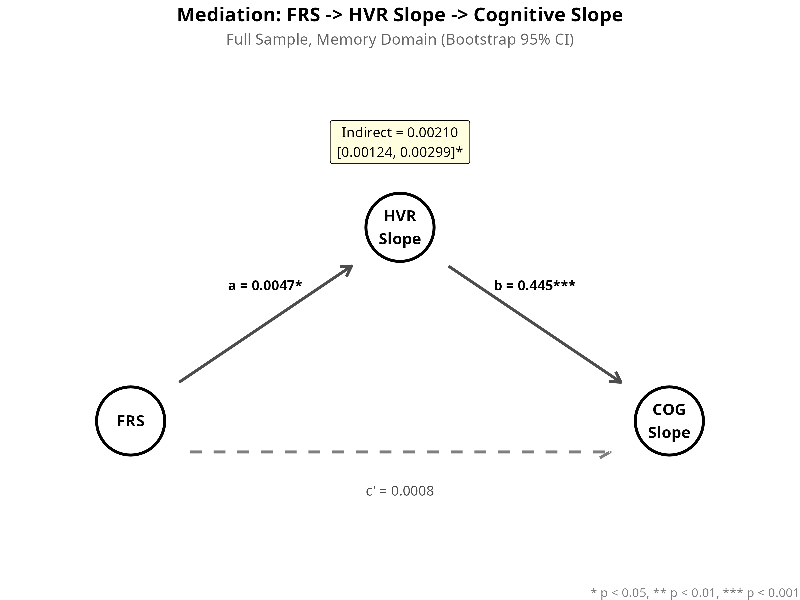
:::

:::

::: {.slide-citation}
Figure: Fernández-Lozano et al., bioRxiv [screening] · Concept: Stern 2012 · Rabin et al., 2018 · Iadecola 2020
:::

::: {.notes}
The puzzle to wrap up: CVRₙ doesn't *cause* hippocampal decline (no mediation), but it still *modifies* how HVR translates into cognition in some female models (moderation, especially executive function). That's the textbook signature of cognitive reserve — Stern 2012, Rabin 2018 — reducing the brain's capacity to maintain cognition at a given structural level, distinct from amyloid or tau driving the structure itself. The clinical implication is the punchline: cardiovascular burden is a *modifiable* reserve-like target. Manage it, and you may not slow atrophy, but you preserve the cognitive translation of brain reserve — which is what patients actually feel.
:::

# {.divider data-menu-title="Closing divider"}

::: {.divider-content}

::: {.eyebrow}
Closing
:::

::: {.divider-title}
Conclusions & Original Contributions
:::

::: {.divider-subtitle}
An end-to-end HVR pipeline, validated across two cohorts
:::

:::

::: {.notes}
This is the wrap-up. Signal a clear gear-shift from results to deliverables: "having walked through all four chapters, let me close with what this thesis built and what it means." Two slides only — the contributions inventory and the closing statement.
:::

## {.fig-pure data-menu-title="Original contributions"}

::: {.eyebrow}
Original contributions
:::

::: {.slide-title}
What this thesis built
:::

::: {.slide-body}

::: {.text-col-full style="max-width: 940px; margin: 24px auto 0;"}

[**Ch 3 — Qrater**]{.subhead} Open-source, collaborative QC platform. *Aperture Neuro* 2024.

[**Ch 4 — Automated HVR**]{.subhead} CNN segmentation, Docker-deployed. *Human Brain Mapping* 2025.

[**Ch 5 — Self-normalization + norms**]{.subhead} Sex-difference reversal exposed as artifact; sex-specific GAMLSS centiles. *bioRxiv* 2026.

[**Ch 6 — MIMIC framework**]{.subhead} Age-adjusted CVR; FRS–brain link reflects age-weighting; HVR–cognitive coupling robust. In preparation.

:::

:::

::: {.notes}
This is the deliverable — four chapters, four open-source tools, three publications and one preprint, with Chapter 6 in preparation. Resist the urge to recap each — the chapter dividers already did that. Frame this slide as "what's available for download today": Qrater, the automated HVR pipeline, the sex-specific normative curves, and the MIMIC-based age-adjusted CVR framework. Transition: "and tying these four contributions together is a single working pipeline…"
:::

## {.fig-pure data-menu-title="Closing statement"}

::: {.eyebrow}
Closing
:::

::: {.slide-title}
From raw MRI to individualized brain-aging assessment
:::

::: {.slide-body}

::: {.text-col-full style="max-width: 940px; margin: 60px auto 0; text-align: center;"}

Quality-controlled imaging → automated HVR segmentation → sex-specific normative z-scores → clinical inference.

[**Methodological vigilance is how artifacts are distinguished from biology.**]{.accent}

:::

:::

::: {.footer-logos}

{.mcgill-logo}

:::

::: {.notes}
Land on the pipeline arrow — raw MRI → segmentation → z-score → clinical inference — as the practical contribution. The methodological-vigilance line is the intellectual contribution: Chapter 7's conclusion frames it as "methodological vigilance in quality control, head-size adjustment, and risk score construction is not peripheral to scientific discovery but is itself how artifacts are distinguished from biology." The reversal of hippocampal sex differences and the disappearance of cardiovascular risk effects upon age adjustment are not secondary findings — they show that prior conclusions were, in part, products of analytical tools rather than neurobiology. Pause briefly. Thank the committee. Open the floor.
:::
