---
format:
  revealjs:
    theme: default
    background-color: white
    fontcolor: "#1a1a1a"
    slide-number: true
    width: 1280
    height: 720
    margin: 0.06
    transition: none
    hash: true
    history: false
    controls: false
    progress: true
    embed-resources: true
    navigation-mode: vertical
    css: custom.css
    show-notes: false
    menu:
      side: left
---

## {#title-slide data-menu-title="Title"}

::: {style="text-align: left; padding-left: 32px; margin-top: 120px; border-left: 4px solid #ed1b2f;"}

::: {.eyebrow}
PhD Defense · Complete corpus
:::

::: {style="font-size: 1.9em; font-weight: 700; line-height: 1.1; white-space: nowrap"}
The Hippocampal-to-Ventricle Ratio
:::

::: {style="margin-top: 18px; font-size: 1em; color: #4a4a4a; font-weight: 500; line-height: 1.4"}
A self-normalizing biomarker for medial temporal integrity across the Alzheimer's disease continuum
:::

::: {style="margin-top: 32px; font-size: 0.8em; color: #6b6b6b"}
Sofía Fernández-Lozano · Supervisor: Louis Collins
:::

:::

::: {.title-logos}

{.mcgill-logo}

:::

::: {.notes}
Q&A backup deck — the full corpus of methods, results, and limitations behind the 20-minute defense. Not read linearly; jump directly to a slide via the side menu when a committee question arises. Section dividers: Background, Ch3 Qrater, Ch4 HVR Validation, Ch5 UKB Sex Differences, Ch6 ADNI CVR Mediation.
:::

# {.divider data-menu-title="Intro divider"}

::: {.divider-content}

::: {.eyebrow}
Q&A backup
:::

::: {.divider-title}
Background
:::

::: {.divider-subtitle}
Anatomy, AD pathology, head-size correction, normative modelling, and the methods used across Ch3–Ch6
:::

:::

## {.fig-sidebar data-menu-title="Intro · HC anatomy"}

::: {.eyebrow}
Background · The hippocampus
:::

::: {.slide-title}
Medial temporal structure for declarative memory
:::

::: {.slide-body}

::: {.fig-col}
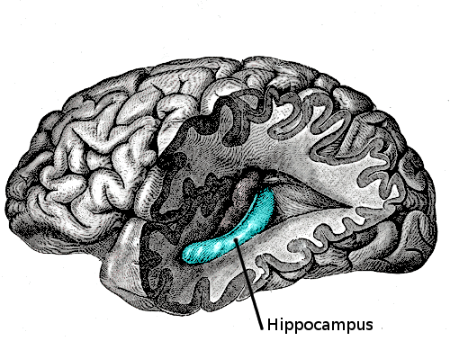
:::

::: {.text-col}

**Subregions**

- [**CA1–CA4**]{.accent} (cornu ammonis)
- [**DG**]{.accent} (dentate gyrus)
- [**Subiculum**]{.accent}

**Role**

- Episodic memory encoding
- Spatial navigation
- One of the earliest AD targets

:::

:::

::: {.notes}
The hippocampus is a medial temporal lobe structure with well-characterized subfields. CA1 is particularly vulnerable in early AD; the subiculum and entorhinal cortex are involved at Braak Stage I–II. The dentate gyrus is one of the few sites of adult neurogenesis. Memory encoding, retrieval, and spatial navigation depend on it.
:::

## {.fig-sidebar data-menu-title="Intro · HC subfields"}

::: {.eyebrow}
Background · HC anatomy (deeper)
:::

::: {.slide-title}
Subfields and the trisynaptic circuit
:::

::: {.slide-body}

::: {.fig-col}
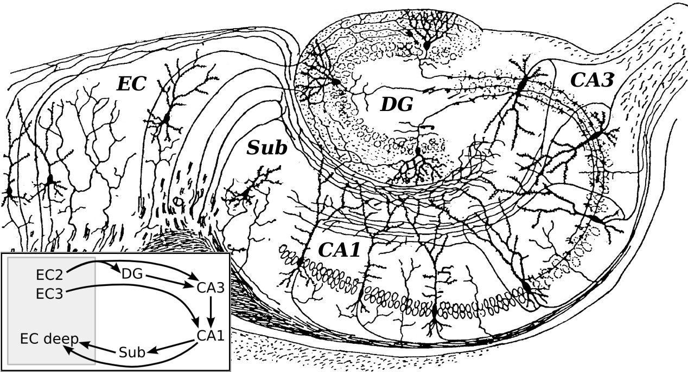
:::

::: {.text-col}

[**Circuit**]{.subhead}

EC → DG → CA3 → CA1 → Sub.

[**Pathology**]{.subhead}

Tau begins in transentorhinal cortex → CA1 / subiculum (Braak I–II) → early atrophy signature.

CA1 and subiculum bear the [**early Braak load**]{.accent}.

:::

:::

::: {.slide-citation}
Ramón y Cajal, 1909 · Yushkevich et al., 2015 · Apostolova et al., 2006
:::

::: {.notes}
Cajal's classic drawing labels the major subfields. The trisynaptic circuit (entorhinal → DG → CA3 → CA1 → subiculum) is what supports relational memory binding. AD's tau pathology begins in the transentorhinal cortex (Braak I), then spreads into CA1 and subiculum (Braak II) — that's why these subfields are the earliest to atrophy. Shape and subfield analyses show that the structural signature of MCI-to-AD progression localizes to CA1 and subiculum, not the rest of the hippocampus.
:::

## {.fig-sidebar data-menu-title="Intro · AD pathology"}

::: {.eyebrow}
Background · AD pathology
:::

::: {.slide-title}
Braak staging — MTL involved at Stages I–II
:::

::: {.slide-body}

::: {.fig-col}
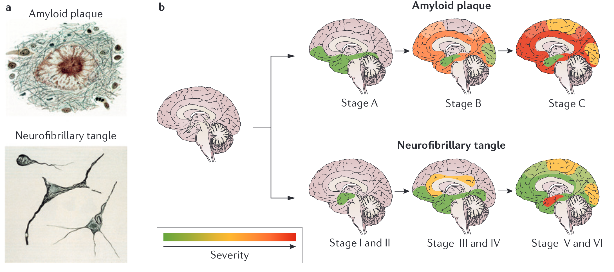
:::

::: {.text-col}

**Two pathologies**

- [**Amyloid-β**]{.accent} extracellular plaques
- [**Tau**]{.accent} intracellular tangles

**Braak progression**

- [**I–II**]{.accent}: transentorhinal / MTL
- III–IV: limbic
- V–VI: isocortical

:::

:::

::: {.notes}
AD pathology has two hallmark proteinopathies: amyloid plaques and tau tangles. Tau follows the Braak staging pattern starting in the transentorhinal cortex and medial temporal lobe at stages I-II, spreading to limbic regions at III-IV, and isocortical regions at V-VI. This is why the hippocampus is among the earliest structures to atrophy — its connections to the entorhinal cortex are affected from Braak I onward.
:::

## {.fig-sidebar data-menu-title="Intro · NIA-AA / ATN"}

::: {.eyebrow}
Background · Diagnostic framework
:::

::: {.slide-title}
NIA-AA shifted AD from clinical to biological
:::

::: {.slide-body}

::: {.fig-col style="padding-left: 12px"}

| Year | Framework | Components |
|:-----|:----------|:-----------|
| **2018** | [AT(N)]{.accent-fixed} | **A**myloid · **T**au · **N**eurodegeneration |
| **2024** | [AT₁T₂NISV]{.accent-fixed} | + **I**nflammation · **S**ynuclein · **V**ascular |

: {tbl-colwidths="[14,22,64]"}

:::

::: {.text-col}

[**Why it matters**]{.subhead}

- AD now diagnosed by [**biomarkers**]{.accent}, not clinical syndrome
- Preclinical AD can exist without symptoms
- Late-life decline often involves [**co-pathologies**]{.accent}
- Structural MRI → [**N**]{.accent} marker

:::

:::

::: {.slide-citation}
Jack et al., 2018 · Jack Jr. et al., 2024
:::

::: {.notes}
The 2018 NIA-AA AT(N) framework formalized AD as a biological construct defined by in-vivo biomarkers of amyloid (A), tau (T), and neurodegeneration (N), shifting away from purely clinical diagnosis. The 2024 update extends this into clinical practice with AT₁T₂NISV — adding soluble tau (T1) vs aggregated tau (T2) staging, inflammation (I), α-synuclein co-pathology (S), and vascular brain injury (V). This biological framing acknowledges that AD pathology can exist without symptoms (preclinical) and that typical dementia symptoms can be caused by non-AD pathologies. Structural MRI (and hence HVR) sits in the N category — an indicator of severity, not a defining diagnostic feature.
:::

## {.fig-sidebar data-menu-title="Intro · MCI / dementia"}

::: {.eyebrow}
Background · Disease continuum
:::

::: {.slide-title}
Preclinical → MCI → dementia
:::

::: {.slide-body}

::: {.fig-col style="padding-left: 12px"}

| Stage | Cognition | Function |
|-------|-----------|----------|
| **Preclinical** | Normal | Independent |
| **MCI** | [Objective decline]{.accent} | Independent |
| **Dementia** | [Severe impairment]{.accent} | [Dependent]{.accent} |

 

MCI patients with hippocampal atrophy rates >3% / yr typically convert to AD dementia.

:::

::: {.text-col}

[**Clinical definitions**]{.subhead}

- [**Preclinical:**]{.accent} biomarker+ no symptoms
- [**MCI:**]{.accent} noticeable decline, daily life preserved
- [**Dementia:**]{.accent} multi-domain impairment, loss of independence

[**HC atrophy rate**]{.accent} differentiates progressive vs stable MCI.

:::

:::

::: {.slide-citation}
Jack et al., 2000 · Franko & Joly, 2013 · Barnes et al., 2009
:::

::: {.notes}
The disease unfolds over decades. Preclinical AD: biomarker abnormalities (amyloid+) with no cognitive symptoms — can last 1-2 decades. MCI: objective cognitive decline noticeable to the patient/family but functional independence is preserved. Dementia: severe, multi-domain impairment preventing independent daily living. The rate of hippocampal atrophy is what differentiates patients with stable MCI from those who will convert to AD dementia: stable MCI ~2.5%/year; progressive MCI ~3.7%/year (Barnes 2009; Franko & Joly 2013).
:::

## {.fig-sidebar data-menu-title="Intro · Diff Dx"}

::: {.eyebrow}
Background · Differential diagnosis
:::

::: {.slide-title}
Late-life cognitive decline ≠ always AD
:::

::: {.slide-body}

::: {.fig-col style="padding-left: 12px"}

[**Common dementia etiologies**]{.subhead}

- [**Alzheimer's disease**]{.accent} — amyloid + tau, medial temporal lobe onset
- [**Frontotemporal dementia**]{.accent} — frontal/temporal atrophy
- [**Lewy body dementia**]{.accent} — α-synuclein, parkinsonism
- [**Vascular dementia**]{.accent} — infarcts, white-matter lesions
- [**Hippocampal sclerosis of aging**]{.accent} — mimics AD on MRI

:::

::: {.text-col}

[**Why this matters for HVR**]{.subhead}

- Hippocampal atrophy is [**not specific to AD**]{.accent}
- Biological AD confirmation (amyloid + tau + N) reduces misclassification
- Ch6 cohort: [**amyloid-positive only**]{.accent} (A+ on PET or CSF)

:::

:::

::: {.slide-citation}
Jack Jr. et al., 2024 · Kobayashi et al., 2024
:::

::: {.notes}
Hippocampal atrophy is not specific to AD. FTD causes frontotemporal atrophy and behavioral/language symptoms; Lewy body dementia involves α-synuclein with fluctuating cognition and parkinsonism; vascular dementia is driven by infarcts and white-matter lesions; hippocampal sclerosis of aging (HS-Aging) can mimic AD imaging without AD pathology. Late-life dementia commonly involves co-pathologies (Kobayashi 2024). For thesis-relevant analyses: Chapter 6 restricts the cohort to amyloid-positive participants (PET/CSF Aβ+) to reduce misclassification — that's why the cohort is smaller than ADNI total but biologically pure.
:::

## {.fig-sidebar data-menu-title="Intro · APOE × sex"}

::: {.eyebrow}
Background · Genetic risk
:::

::: {.slide-title}
APOE ε4 hits females harder
:::

::: {.slide-body}

::: {.fig-col style="padding-left: 12px"}

[**APOE ε4 carriers**]{.subhead}

- ε4 is the [**strongest genetic risk**]{.accent} for late-onset AD
- Risk is [**greater in females**]{.accent} than males
- Female ε4 carriers (amnestic MCI): faster HC atrophy + cognitive decline
- Cognitively normal female ε4+: more MTL tau at similar amyloid burden

:::

::: {.text-col}

[**Why it matters here**]{.subhead}

- Motivates [**sex-stratified**]{.accent} models in Ch5
- Sex × genetic risk × structure interactions can't be averaged away

:::

:::

::: {.slide-citation}
Ferretti et al., 2018 · Park et al., 2025 · Buckley et al., 2019
:::

::: {.notes}
APOE ε4 is the strongest genetic risk factor for late-onset AD, but its impact is not sex-symmetric — females carry a higher pathological burden at equivalent allele dose. In prodromal stages such as amnestic MCI, female ε4 carriers show faster longitudinal hippocampal atrophy and steeper cognitive decline than male carriers. Even cognitively normal female ε4 carriers show increased MTL tau deposition compared to males with similar amyloid burdens (Buckley 2019). This gene-by-sex interaction is part of why Chapter 5 builds sex-stratified normative models — averaging across sex would erase real biology.
:::

## {.fig-sidebar data-menu-title="Intro · Cognitive reserve"}

::: {.eyebrow}
Background · Reserve
:::

::: {.slide-title}
Cognitive reserve delays clinical expression
:::

::: {.slide-body}

::: {.fig-col style="padding-left: 12px"}

[**The concept**]{.subhead}

- Two people with [**equivalent pathology**]{.accent} can show different clinical symptoms
- Education, occupation, lifelong cognitive engagement → higher reserve
- Reserve [**delays the symptom threshold**]{.accent}, not pathology itself

:::

::: {.text-col}

[**Sex-specific reserve**]{.subhead}

- Females show a [**verbal memory advantage**]{.accent} that masks early MTL atrophy
- May explain later female AD diagnosis at equivalent pathology

:::

:::

::: {.slide-citation}
Stern, 2012 · Sundermann et al., 2016
:::

::: {.notes}
Cognitive reserve (Stern 2012) refers to the brain's adaptive capacity to maintain cognitive function in the face of pathology. Higher reserve — built through education, occupational complexity, lifelong cognitive engagement — delays the clinical expression of AD without changing the underlying pathological load. Sundermann (2016) showed females have a verbal memory advantage that masks early MTL atrophy: they perform well on memory tasks even when hippocampal volume / atrophy markers are already abnormal. This is a sex-specific form of reserve, with consequences — females are often diagnosed later at equivalent pathology, contributing to faster post-diagnosis decline. The 2024 NIA-AA cascade figure (slide 8) explicitly shows cognitive reserve modifying the symptom curve.
:::

## {.fig-sidebar data-menu-title="Intro · Modifiable risk"}

::: {.eyebrow}
Background · Modifiable risk factors
:::

::: {.slide-title}
~45% of dementia is potentially preventable
:::

::: {.slide-body}

::: {.fig-col style="padding-left: 12px"}

[**14 Livingston risk factors**]{.subhead}

- [**Midlife:**]{.accent} hypertension, obesity, hearing loss, alcohol, head injury
- [**Late life:**]{.accent} smoking, depression, social isolation, physical inactivity, diabetes, air pollution
- [**Newly added 2024:**]{.accent} high LDL cholesterol, untreated vision loss

:::

::: {.text-col}

[**Why this matters**]{.subhead}

- Frames Ch6's focus on [**cardiovascular risk**]{.accent} (FRS)
- Modifiable ≠ deterministic; many factors interact with age + APOE

:::

:::

::: {.slide-citation}
Livingston et al., 2017 · Livingston et al., 2024
:::

::: {.notes}
The Lancet Commission on dementia prevention identified 14 modifiable risk factors that, in combination, are estimated to be responsible for ~45% of dementia cases. The 2024 update added two factors (high LDL cholesterol, untreated vision loss) to the original 12 from Livingston 2017. Hypertension, smoking, obesity, diabetes — the cardiovascular cluster — is well-represented and motivates the focus on the Framingham Risk Score in Chapter 6. The framing matters: these are population-attributable risk fractions, not deterministic. The Ch6 MIMIC framework specifically isolates cardiovascular risk from age-confounding within this modifiable-risk lens.
:::

## {.fig-leftright data-menu-title="Intro · Biomarker cascade"}

::: {.slide-body}

::: {.header-col}

::: {.eyebrow}
Background · Biomarker cascade
:::

::: {.slide-title}
A late, but crucial marker
:::

::: {.slide-subtitle}
Neurodegeneration (N) follows amyloid (A) and tau (T)
:::

::: {.body-text}
2024 NIA-AA AT~1~T~2~NISV treats structural markers as [**severity indicators**]{.accent}, not diagnostic features.

HC atrophy emerges around MCI onset — decades after amyloid abnormality.
:::

:::

::: {.fig-col}
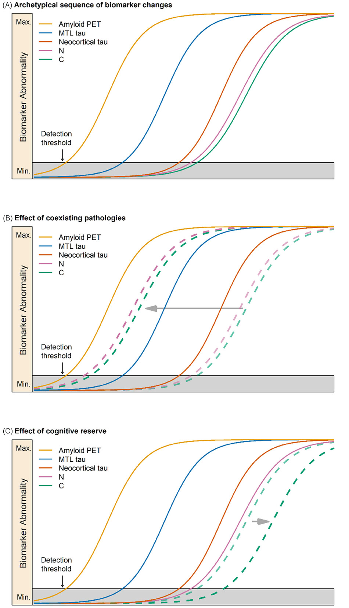
:::

:::

::: {.slide-citation}
Jack Jr. et al., 2024
:::

::: {.notes}
The biomarker cascade in the 2024 NIA-AA framework (Jack Jr. et al.) places amyloid abnormality first (decades preclinical), followed by medial-temporal-lobe tau, then neocortical tau, then neurodegeneration (including hippocampal atrophy), and finally cognitive decline. Co-pathologies accelerate the timeline; cognitive reserve delays the clinical expression. HC volume is a late marker but remains clinically useful — it's measurable from routine T1w and tracks the N component directly.
:::

## {.fig-sidebar data-menu-title="Intro · CSF/PET/blood biomarkers"}

::: {.eyebrow}
Background · Biomarker modalities
:::

::: {.slide-title}
Many AD biomarkers — why structural MRI?
:::

::: {.slide-body}

::: {.fig-col style="padding-left: 12px"}

| Modality | Reads | Stage |
|----------|-------|-------|
| **CSF** | Aβ42/40, p-tau, t-tau, NfL | Pre + clinical |
| **PET** | Amyloid (Aβ), tau, FDG | Pre + clinical |
| **Blood** | p-tau217, GFAP, NfL | Emerging |
| **MRI** | [**N**]{.accent-fixed} (atrophy, WM lesions) | Mid-late |

:::

::: {.text-col}

[**Why structural MRI**]{.subhead}

- [**Non-invasive**]{.accent}, routine in clinical practice
- Direct measure of [**neurodegeneration**]{.accent} (N in ATN)
- HVR is computed from a standard T1w scan

:::

:::

::: {.slide-citation}
Jack et al., 2018 · Jack Jr. et al., 2024
:::

::: {.notes}
The ATN framework supports a multi-modality biomarker ecosystem. CSF and PET have been the gold standards: amyloid PET and CSF Aβ42/40 detect amyloid pathology earliest; tau PET and CSF p-tau detect tau pathology; CSF NfL and FDG-PET capture neurodegeneration. Blood-based biomarkers (p-tau217, GFAP, NfL) are rapidly emerging — minimally invasive, scalable. Structural MRI sits in the N category — measures atrophy (a downstream consequence) and WM lesions. Its value: completely non-invasive, already standard-of-care in any cognitive workup, no need for lumbar puncture or PET tracer. Hippocampal volumetry and HVR derive from a single T1w scan that takes ~5 minutes.
:::

## {.fig-sidebar data-menu-title="Intro · Seg variability"}

::: {.eyebrow}
Background · Measurement challenge
:::

::: {.slide-title}
HC volumes diverge across segmentation software
:::

::: {.slide-body}

::: {.fig-col}
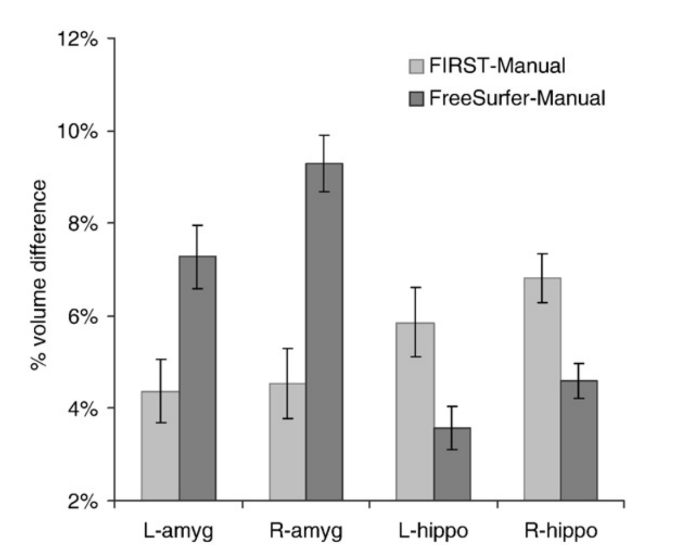
:::

::: {.text-col}

**Across-tool variability**

- FIRST vs FreeSurfer vs manual diverge by [**4–9%**]{.accent}
- Choice of software changes downstream inferences
- Pre-Qrater era: little systematic QC of the segmentations themselves

:::

:::

::: {.slide-citation}
Morey et al., 2009
:::

::: {.notes}
Morey et al. (2009) compared FreeSurfer and FSL-FIRST against manual tracing for hippocampus and amygdala. Figure 5 shows percent volume differences between automated and manual measurements — both tools overestimate volumes, but to different extents (4–9% range), and the direction/magnitude differs between hemispheres and structures. This kind of cross-tool inconsistency motivates careful method selection (and motivates Chapter 4's CNN-based pipeline). Citation: Morey RA et al. NeuroImage 45(3):855–866, 2009. DOI 10.1016/j.neuroimage.2008.12.033. (Not in thesis bib — likely an oversight; consider adding.)
:::

## {.fig-sidebar data-menu-title="Intro · ICV methods"}

::: {.eyebrow}
Background · Head-size correction
:::

::: {.slide-title}
Four standard ICV adjustment methods
:::

::: {.slide-body}

::: {.fig-col style="padding-left: 12px"}

| Method | Formula | Assumes |
|--------|---------|---------|
| **Raw** | [*V*]{.accent} | no correction |
| **Proportions** | [*V* / *ICV*]{.accent} | isometric scaling |
| **Residualization** | [*V* − β·*ICV*]{.accent} | linear *V*–*ICV* |
| **Stereotaxic** | [*V*]{.accent} after warp to template | template removes ICV |

:::

::: {.text-col}

[**Trouble**]{.subhead}

- Different methods make [**different assumptions**]{.accent}
- Same data yields [**opposite&#8209;direction effect sizes**]{.accent}
- No consensus on which is correct

:::

:::

::: {.closer-line}
HVR is [**approximately self-normalizing**]{.accent} — empirically reduces ICV correlation from ~0.6 to ~0.25.
:::

::: {.slide-citation}
Sanchis-Segura et al., 2020
:::

::: {.notes}
The four standard head-size correction methods make different assumptions. Raw ignores ICV. Proportions assume strict isometric scaling — but human brain structures (including HC) scale hypoallometrically, so proportions over-correct smaller heads (typically female). Residualization assumes a linear relationship and removes shared ICV variance. Stereotaxic normalization warps the brain to a template. Same data yields opposite-direction effects across methods (Sanchis-Segura 2020).

**If the examiner argues HVR is "just another proportions method":**

HVR is structurally a ratio — same family as proportions — but the comparison breaks down on closer inspection:

- The proportions method assumes V/ICV is constant (i.e., V scales isometrically with ICV). For hippocampus this is wrong: HC scales hypoallometrically with ICV, so proportions systematically over-correct smaller heads.
- HVR uses HC/(HC + LV), not HC/ICV. Both HC and LV approximately scale with ICV, so the ratio cancels much of the shared head-size variance — but HC and LV track *different processes* with aging: HC atrophies, LV expands. These rates are not coupled by ICV — they reflect neurodegeneration directly.
- The differential degeneration is the source of HVR's sensitivity. The numerator falls while the denominator rises with disease, amplifying the signal beyond what either measure shows alone.
- Empirically (Chapter 5): the residual correlation r(HVR, ICV) ≈ −0.25, vs r(raw HC, ICV) ≈ +0.6 and r(HC proportions, ICV) ≈ −0.39. HVR is closer to residualized HC (r ≈ 0) than to proportions, but does not over-correct the way proportions does. Importantly, HVR preserves biological sex differences that residualization erases entirely — a signature that pure mathematical normalization loses but HVR retains.

So: HVR is a ratio, but it isn't a clean proportions method. It's an empirically self-normalizing index that captures dual-process neurodegeneration.
:::

## {.fig-sidebar data-menu-title="Intro · Allometric scaling"}

::: {.eyebrow}
Background · Allometric scaling
:::

::: {.slide-title}
Why proportions over-corrects female brains
:::

::: {.slide-body}

::: {.fig-col style="padding-left: 12px"}

[**Isometric assumption (proportions)**]{.subhead}

- Assumes [*V* ∝ *ICV*]{.accent} (allometric α = 1.0)
- Regression line through origin

[**Reality: structures scale differently**]{.subhead}

| Structure | Allometric α |
|:----------|:------------:|
| Cortical GM | ≈ 1.0 (isometric) |
| Hippocampus | [**≈ 0.60**]{.accent-fixed} (hypoallometric) |
| Lateral ventricles | > 1.0 (hyperallometric) |

:::

::: {.text-col}

[**Consequence**]{.subhead}

- HC scales as ICV^0.60^ — proportions [**over-corrects**]{.accent} smaller heads (predominantly female)
- Drives the [**1.5 SD**]{.accent} d swing across methods (Sanchis-Segura 2020)
- Spurious female-larger HC/ICV volumes
- No single linear correction unbiases all structures simultaneously

:::

:::

::: {.slide-citation}
de Jong et al., 2017 · Pintzka et al., 2015 · Sanchis-Segura et al., 2020
:::

::: {.notes}
The proportions method assumes that V/ICV is constant — i.e., that brain structures scale isometrically (1:1) with total brain size, such that a regression of structure vs ICV passes through the origin. But human brain structures, including the hippocampus, scale hypoallometrically — their volume increases slower than ICV, and the y-intercept is non-zero. So dividing V by ICV systematically over-corrects smaller heads (predominantly female) and under-corrects larger heads (predominantly male). The result is spurious female-larger volumes — exactly the d = +0.58 reversal Sanchis-Segura documented. This is the mathematical root of HC sex-difference inconsistencies in the literature, and motivates self-normalizing indices like HVR.
:::

## {.fig-sidebar data-menu-title="Intro · Sex diffs lit"}

::: {.eyebrow}
Background · Sex differences literature
:::

::: {.slide-title}
HC sex differences span both directions across methods
:::

::: {.slide-body}

::: {.fig-col style="padding-left: 12px"}

[**The state of the field**]{.subhead}

- Ruigrok 2014 meta-analysis: HC reported larger in [**both directions**]{.accent}
- Pintzka 2015: marked direction-reversal across ICV methods
- Sanchis-Segura 2020: sex-classification accuracy drops from [**>80% → ~60%**]{.accent} after head-size control

:::

::: {.text-col}

[**Reading**]{.subhead}

- Most published HC sex differences are [**method artifacts**]{.accent}
- Ch5 quantifies this with N = 27,680
- HVR yields a [**consistent**]{.accent} female advantage (d = 0.52)

:::

:::

::: {.slide-citation}
Ruigrok et al., 2014 · Pintzka et al., 2015 · Sanchis-Segura et al., 2020
:::

::: {.notes}
The sex differences literature for hippocampal volume is famously inconsistent. Ruigrok's 2014 meta-analysis found HC differences reported in both directions. Pintzka 2015 directly demonstrated that the choice of ICV adjustment method changes both the magnitude AND direction of reported sex differences. Sanchis-Segura 2020 showed that multivariate sex-classification accuracy from raw brain features (~80%) drops to ~60% after proper head-size control — meaning most "brain sex differences" disappear once you correct properly. This is the literature context for Chapter 5: HC sex differences are largely method artifacts, but HVR yields a consistent female advantage that survives ICV-matching (d = 0.52 in full sample, d = 0.18 matched).
:::

## {.fig-sidebar data-menu-title="Intro · HVR formula"}

::: {.eyebrow}
Background · The HVR concept
:::

::: {.slide-title}
A self-normalizing index of medial temporal integrity
:::

::: {.slide-body}

::: {.fig-col}
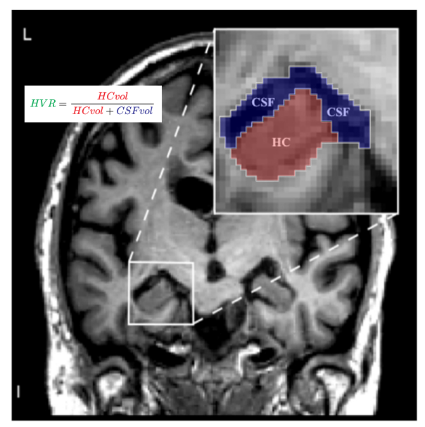
:::

::: {.text-col}

[**Why it works**]{.subhead}

- Atrophy [**↓ numerator**]{.accent}
- Ventricular expansion [**↑ denominator**]{.accent}
- Both scale with head size — ratio reduces ICV

Schoemaker's original manual HVR in MCI showed stronger age + memory associations vs raw HC.

:::

:::

::: {.slide-citation}
Schoemaker et al., 2019
:::

::: {.notes}
HVR was introduced by Schoemaker and colleagues in 2019 using manual hippocampal and ventricular segmentation. The key insight: hippocampal atrophy and ventricular expansion are coupled neurodegenerative processes, and both volumes scale with head size, so the ratio captures both signals while canceling the head-size confound. Schoemaker showed that manual HVR had stronger associations with age and memory than raw HC volume in MCI participants. Chapter 4 automates this with a CNN and tests it across the full AD continuum.
:::

## {.fig-sidebar data-menu-title="Intro · GAMLSS"}

::: {.eyebrow}
Background · Normative modeling
:::

::: {.slide-title}
GAMLSS models the full distribution, not just the mean
:::

::: {.slide-body}

::: {.fig-col}
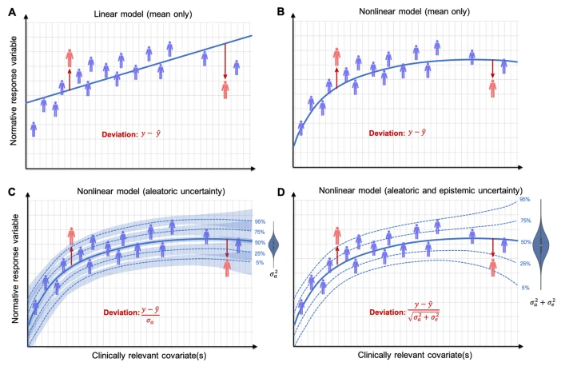
:::

::: {.text-col}

[**Standard regression**]{.subhead}

Models the [**mean**]{.accent} only.

[**GAMLSS**]{.subhead}

Models [**μ, σ, ν, τ**]{.accent} (location, scale, skewness, kurtosis) as smooth functions of age — yields sex-stratified centile curves and Z-scores.

[**Distribution family**]{.subhead}

[**BCCG**]{.accent} (Box-Cox Cole-Green) selected via AIC/BIC for HVR. Pediatric growth chart analogue.

:::

:::

::: {.slide-citation}
Rigby & Stasinopoulos, 2005 · Bethlehem et al., 2022
:::

::: {.notes}
GAMLSS — Generalized Additive Models for Location, Scale, and Shape — extends standard regression by modeling all four parameters of a distribution as smooth functions of covariates. For normative modeling this matters because the variance of brain measures typically increases with age, so a model that only captures the mean (e.g., linear regression) misrepresents the upper and lower tails. GAMLSS produces age- and sex-stratified centile curves that allow z-scoring of individuals. Chapter 5 uses GAMLSS on UK Biobank to build HVR norms; Chapter 6 applies those norms to ADNI.
:::

## {.fig-sidebar data-menu-title="Intro · Effect sizes"}

::: {.eyebrow}
Background · Stats methodology
:::

::: {.slide-title}
Effect-size measures used in this thesis
:::

::: {.slide-body}

::: {.fig-col style="padding-left: 12px"}

| Measure | Formula | Use |
|---------|---------|-----|
| **Cohen's *d*** | [(μ₁ − μ₂) / *s*~pooled~]{.accent} | Balanced groups |
| **Glass' Δ** | [(μ₁ − μ₂) / *s*~control~]{.accent} | Reference-normalized |
| **Hedges' *g*** | [*d* × *c*(*N*)]{.accent} | Small-sample *d* |
| **Spearman ρ** | rank correlation | Non-parametric |

: {tbl-colwidths="[24,36,40]"}

:::

::: {.text-col}

[**Interpretation rules of thumb**]{.subhead}

- |d| ≈ 0.2 [**small**]{.accent}
- |d| ≈ 0.5 [**medium**]{.accent}
- |d| ≈ 0.8 [**large**]{.accent}

[**Bootstrapped 95% CIs**]{.subhead} reported throughout via `bootES`.

:::

:::

::: {.slide-citation}
Kirby & Gerlanc, 2013
:::

::: {.notes}
The thesis uses several effect-size measures depending on the design. Cohen's d for balanced two-group comparisons (e.g., male vs female in Ch5). Glass' delta for cases where one group is a clear reference (e.g., CH as control vs MCI/AD in Ch4 — uses CH variance only). Hedges' g applies a small-sample bias correction to d. Spearman rho for non-parametric correlations. All effect sizes throughout the thesis report bootstrapped 95% confidence intervals computed with the bootES R package (Kirby & Gerlanc 2013). Rules of thumb (Cohen 1988): 0.2 small, 0.5 medium, 0.8 large — but interpret in context. A d = 0.18 (Ch5 HVR matched sample) is small but meaningful given the sample size and the strict matching constraints.
:::

## {.fig-sidebar data-menu-title="Intro · SEM basics"}

::: {.eyebrow}
Background · SEM
:::

::: {.slide-title}
Structural equation modeling 101
:::

::: {.slide-body}

::: {.fig-col style="padding-left: 12px"}

[**Two parts**]{.subhead}

- [**Measurement:**]{.accent} latent ← observed (CFA)
- [**Structural:**]{.accent} paths between latents

[**Fit indices (good cutoffs)**]{.subhead}

- CFI / TLI ≥ 0.95
- RMSEA ≤ 0.06
- SRMR ≤ 0.08

:::

::: {.text-col}

[**Why use SEM**]{.subhead}

- Accounts for [**measurement error**]{.accent} in both predictors and outcomes
- Tests [**latent constructs**]{.accent} (e.g., *g* from 12 tests in Ch5)
- Multi-group + invariance testing for sex

:::

:::

::: {.slide-citation}
Bollen, 1989
:::

::: {.notes}
SEM combines two parts. The measurement model relates observed indicators to latent (unobserved) constructs via confirmatory factor analysis. The structural model specifies regression-like paths between latent variables. Chapter 5 uses SEM with a bifactor cognitive structure — extracting general cognition (g) from 12 tests + domain-specific factors — and regresses brain measures on g. Chapter 6 uses SEM for LGCM (next slide) and for the MIMIC model. Key fit indices: CFI/TLI assess incremental fit relative to a null model (≥0.95 good); RMSEA assesses absolute fit penalized for complexity (≤0.06 good); SRMR is the standardized residual (≤0.08 good). Bollen 1989 is the canonical reference.
:::

## {.fig-sidebar data-menu-title="Intro · LGCM"}

::: {.eyebrow}
Background · LGCM
:::

::: {.slide-title}
Latent growth curves model individual trajectories
:::

::: {.slide-body}

::: {.fig-col style="padding-left: 12px"}

[**LGCM extracts**]{.subhead}

- [**Intercept:**]{.accent} baseline level per individual
- [**Slope:**]{.accent} rate of change per individual

[**Parallel-process LGCM**]{.subhead}

- Two LGCMs (HVR + cognition) jointly
- Correlates [**slopes**]{.accent} → coupled decline rate

:::

::: {.text-col}

[**Used in Ch6**]{.subhead}

- HVR slope × cognitive slope coupling
- Tests [**slope-mediated**]{.accent} CVR → cognition pathway

[**Advantages over LME**]{.subhead}

- Explicit individual trajectories
- Measurement error in outcomes

:::

:::

::: {.slide-citation}
Bollen & Curran, 2006 · Raket, 2020
:::

::: {.notes}
Latent growth curve models (LGCM) are SEM-implemented longitudinal models that extract individual-level intercept and slope as latent variables. Each participant's repeated measures load on these latents — slope captures their individual rate of change. Parallel-process LGCM jointly models two outcomes (e.g., HVR and cognition) and correlates their slopes — directly testing whether faster HC decline tracks faster cognitive decline. Chapter 6 uses this. Compared to LME: LGCM gives explicit slope variables you can test paths against (e.g., mediation), and accounts for measurement error in the outcomes. Bollen & Curran 2006 is the canonical book; Raket 2020 describes disease progression / EDT methodology applied to LGCMs.
:::

## {.fig-sidebar data-menu-title="Intro · Mediation"}

::: {.eyebrow}
Background · Mediation analysis
:::

::: {.slide-title}
Testing whether X → M → Y holds
:::

::: {.slide-body}

::: {.fig-col style="padding-left: 12px"}

[**Paths in a mediation model**]{.subhead}

- [**a:**]{.accent} X → M (predictor → mediator)
- [**b:**]{.accent} M → Y given X (mediator → outcome)
- [**c':**]{.accent} X → Y given M (direct effect)
- [**a·b:**]{.accent} indirect (mediated) effect

[**Test**]{.subhead} bootstrap 95% CI on a·b excludes zero

:::

::: {.text-col}

[**Ch6 uses**]{.subhead}

- LGCM mediation: [**CVR → HVR slope**]{.accent} [**→ cognitive slope**]{.accent}
- Tested 6 models: 3 cognitive domains × 2 sexes
- Bootstrap n = 1000

:::

:::

::: {.slide-citation}
Baron & Kenny, 1986 · MacKinnon et al., 2002 · Preacher & Hayes, 2008
:::

::: {.notes}
The standard mediation model has three paths: a (predictor → mediator), b (mediator → outcome controlling for predictor), and c' (direct effect of predictor on outcome controlling for mediator). The indirect (mediated) effect is a·b. The total effect is c = c' + a·b. Modern mediation tests use bootstrap confidence intervals on the indirect effect (a·b) rather than the old Baron & Kenny "causal steps" approach, because the latter has low power for true indirect effects. Chapter 6 uses LGCM-based mediation: cardiovascular risk → HVR slope → cognitive slope. Tested 6 sex × cognitive-domain combinations with 1000-sample bootstrapping. Significance defined as 95% CI excluding zero.
:::

## {.fig-sidebar data-menu-title="Intro · ADNI"}

::: {.eyebrow}
Background · Cohort
:::

::: {.slide-title}
ADNI — the AD-continuum reference cohort
:::

::: {.slide-body}

::: {.fig-col style="padding-left: 12px"}

[**Study design**]{.subhead}

- Multi-site, multi-scanner, longitudinal
- Launched 2003; phases ADNI 1 / GO / 2 / 3 / 4
- Recruits cognitively healthy, MCI, and AD patients
- T1w + T2 FLAIR + DTI; CSF + amyloid/tau PET; APOE; cognitive battery

:::

::: {.text-col}

[**Used in this thesis**]{.subhead}

- [**Ch3**]{.accent}: QC pipeline applied
- [**Ch4**]{.accent}: N = 1,641 baseline T1w
- [**Ch6**]{.accent}: A+ longitudinal subset

:::

:::

::: {.slide-citation}
Jack et al., 2008
:::

::: {.notes}
The Alzheimer's Disease Neuroimaging Initiative (ADNI) is the dominant longitudinal cohort for AD biomarker research. Launched in 2003, ADNI has run through phases (1, GO, 2, 3, 4) with ongoing data releases. Recruits across the continuum: cognitively healthy controls, amnestic MCI, and AD dementia. Acquires standardized T1w + T2 FLAIR + DTI, CSF Aβ/tau, amyloid PET, tau PET (later phases), APOE genotype, and a comprehensive cognitive battery. Multi-site, multi-scanner — which is why QC is critical (Ch3). Ch4 uses 1,641 ADNI baseline scans for the HVR validation; Ch6 uses the amyloid-positive longitudinal subset for the CVR analysis.
:::

## {.fig-sidebar data-menu-title="Intro · UK Biobank"}

::: {.eyebrow}
Background · Cohort
:::

::: {.slide-title}
UK Biobank — population-scale imaging
:::

::: {.slide-body}

::: {.fig-col style="padding-left: 12px"}

[**Study design**]{.subhead}

- Prospective population cohort
- Recruitment ages 40–69; ~500,000 enrolled
- Brain MRI sub-study target: 100,000 (>50,000 imaged to date)
- T1w + T2 FLAIR + swMRI + fMRI + DTI; cognitive battery; genetics; lifestyle

:::

::: {.text-col}

[**Used in Ch5**]{.subhead}

- N = [**27,680**]{.accent} with complete imaging + cognition
- Mostly cognitively healthy
- Provides the normative reference for HVR centiles applied in Ch6

:::

:::

::: {.slide-citation}
Miller et al., 2016 · Alfaro-Almagro et al., 2018
:::

::: {.notes}
UK Biobank (UKB) is the largest brain imaging cohort in the world. Prospective population-based study with ~500,000 adults aged 40–69 at recruitment; the imaging sub-study targets 100,000 participants and has imaged over 50,000 to date. Acquires multiple MRI modalities (T1w, T2 FLAIR, swMRI, fMRI, DTI), plus cognitive testing, genetic data, lifestyle factors, and longitudinal health records. Miller 2016 describes the imaging protocol; Alfaro-Almagro 2018 describes the pipeline. Chapter 5 uses 27,680 UKB participants with complete imaging + cognitive data to build sex-specific HVR normative centiles; those centiles are then applied to ADNI in Chapter 6 to z-score individuals.
:::

## {.fig-sidebar data-menu-title="Intro · Agreement metrics"}

::: {.eyebrow}
Background · Reliability metrics
:::

::: {.slide-title}
Cohen's κ · Fleiss' κ · ICC
:::

::: {.slide-body}

::: {.fig-col style="padding-left: 12px"}

| Metric | Use | Range |
|:-------|:---|:-----:|
| **Cohen's κ** | 2 raters, categorical | −1 to 1 |
| **Fleiss' κ** | ≥3 raters, categorical | −1 to 1 |
| **ICC** | Continuous, multiple raters | 0 to 1 |

[**Landis & Koch cutoffs**]{.subhead}

- 0.81–1.00 [**almost perfect**]{.accent}
- 0.61–0.80 substantial
- 0.41–0.60 moderate
- 0.21–0.40 fair · ≤ 0.20 slight

:::

::: {.text-col}

[**Why chance-correct**]{.subhead}

Raw percent agreement overstates reliability when one category is common; κ subtracts agreement expected by chance.

[**Where used in this thesis**]{.subhead}

- [**Ch3**]{.accent} — Cohen's κ for expert intra&#8209;rater + trainee-vs-expert QC agreement; Fleiss' κ for multi-rater consensus
- [**Ch5**]{.accent} — ICC for longitudinal test&#8209;retest of brain measures

:::

:::

::: {.slide-citation}
Cohen, 1960 · Fleiss, 1971 · Landis & Koch, 1977
:::

::: {.notes}
Reliability metrics. Cohen's κ measures pairwise categorical agreement corrected for chance — κ=1 perfect, κ=0 chance-level. Fleiss' κ generalises to ≥3 raters. ICC handles continuous measurements (used in Ch5 longitudinal test-retest, where HVR ICC=0.933 etc.). Landis & Koch interpretation: 0.81+ almost perfect, 0.61-0.80 substantial. Why this matters: in Ch3 we report κ=0.81-0.87 for expert intra-rater agreement, framing the realistic ceiling for trainee agreement and motivating the granular Warning/Pass/Fail labelling.
:::

## {.fig-sidebar data-menu-title="Intro · Segmentation metrics"}

::: {.eyebrow}
Background · Image-segmentation validation
:::

::: {.slide-title}
Dice · Hausdorff · Bland-Altman
:::

::: {.slide-body}

::: {.fig-col style="padding-left: 12px"}

[**Dice coefficient**]{.subhead}

- Spatial overlap: [**2|*X* ∩ *Y*| / (|*X*| + |*Y*|)**]{.accent}
- 0 = no overlap; 1 = perfect
- Volumetric; symmetric; robust to size differences

[**Hausdorff distance**]{.subhead}

- [**Max**]{.accent} surface distance between two label sets
- Boundary-sensitive; catches localised outliers
- Used in CNN training loss

[**Bland-Altman**]{.subhead}

- [**Mean vs. difference**]{.accent} plot — reveals bias, LoA, regression-to-mean

:::

::: {.text-col}

[**Why three metrics**]{.subhead}

- Dice — overlap volume
- Hausdorff — worst-case boundary
- Bland-Altman — bias across the range

[**Where used**]{.subhead} [**Ch4**]{.accent} CNN validation: Dice ≈ 0.96 vs manual; Hausdorff in loss; Bland&#8209;Altman for MALF HC/CSF bias.

:::

:::

::: {.slide-citation}
Dice, 1945 · Hausdorff, 1914 · Bland & Altman, 1986
:::

::: {.notes}
Three complementary segmentation metrics. Dice = volumetric spatial overlap (most common single-number metric; symmetric; robust to size). Hausdorff = maximum surface distance (boundary-sensitive; used in CNN training loss as approximation to penalise edge errors). Bland-Altman = plot of mean vs difference for two measures (reveals systematic bias and regression-to-mean — used in Ch4 to detect MALF's small-HC over-segmentation / large-HC under-segmentation pattern). Each captures a different facet of agreement.
:::

## {.fig-sidebar data-menu-title="Intro · U-Net + augmentation"}

::: {.eyebrow}
Background · Deep-learning segmentation
:::

::: {.slide-title}
3D U-Net architecture
:::

::: {.slide-body}

::: {.fig-col style="padding-left: 12px"}

[**Architecture**]{.subhead}

- Encoder-decoder with [**skip connections**]{.accent}
- Encoder: downsamples → captures context
- Decoder: upsamples → recovers detail
- Skips: pass spatial info around the bottleneck
- 3D variant: volumetric convolutions

[**Loss**]{.subhead}

- Dice κ overlap + multi-label Hausdorff approximation

:::

::: {.text-col}

[**Training-data scaling**]{.subhead}

- Small manual sets are common in medical imaging
- [**Data augmentation**]{.accent} multiplies effective training size — Ch4 uses [**16×**]{.accent} (rotations, flips, intensity, noise)

[**Why U-Net for HC/CSF**]{.subhead}

- Designed for biomedical segmentation
- Multi-label output (HC + CSF) in one pass

:::

:::

::: {.slide-citation}
Ronneberger et al., 2015 · Isensee et al., 2021
:::

::: {.notes}
U-Net is the standard biomedical segmentation architecture (Ronneberger 2015) — encoder-decoder with skip connections that combine high-level context with low-level spatial detail. 3D U-Net uses volumetric convolutions and is well-suited to multi-label MRI segmentation. Training-data scaling via augmentation (16× in Ch4: rotations, flips, intensity shifts, additive noise) lets a small manual training set (N=80, 64 train per fold) generalise. The CNN in Ch4 jointly segments HC and CSF (multi-label output), enabling HVR computation from one forward pass.
:::

## {.fig-sidebar data-menu-title="Intro · Bifactor CFA"}

::: {.eyebrow}
Background · Cognitive measurement model
:::

::: {.slide-title}
Bifactor CFA — g + orthogonal specifics
:::

::: {.slide-body}

::: {.fig-col style="padding-left: 12px"}

[**Structure**]{.subhead}

- One [**general factor (g)**]{.accent} loading on ALL indicators
- Several [**specific factors**]{.accent} loading on subsets (e.g., Memory_s on memory items)
- All factors [**orthogonal**]{.accent} (uncorrelated by design)

[**Partitions**]{.subhead}

- g = shared common variance across all tasks
- Specifics = residual domain-specific variance after removing g

:::

::: {.text-col}

[**Why bifactor vs higher-order**]{.subhead}

- g defined directly by item loadings; no domain-correlation distortion
- Specifics isolated, not confounded&nbsp;with&nbsp;g

[**Where used**]{.subhead} [**Ch5**]{.accent}: 12 UKB cognitive tests → g + Memory_s + Speed_s. Memory_s could not be reliably estimated (disclosed in limitations).

:::

:::

::: {.slide-citation}
Reise, 2012 · Eid et al., 2017 · Burns 2020
:::

::: {.notes}
Bifactor confirmatory factor analysis: one general factor (g) loads on all indicators, several orthogonal specific factors (Memory_s, Speed_s) load on item subsets. Factors are uncorrelated by design, so g captures shared variance across the entire battery while specifics capture domain residuals. Preferred over higher-order models because g is defined directly by item-level loadings rather than emerging from domain-factor correlations (which can distort interpretation). Used in Ch5 to model 12 UKB cognitive indicators — brain measures predict g and Speed_s separately. The Memory_s factor was unidentifiable in this sample, a documented limitation.
:::

## {.fig-sidebar data-menu-title="Intro · Measurement invariance"}

::: {.eyebrow}
Background · Cross-group comparison gate
:::

::: {.slide-title}
Measurement invariance — 4 nested levels
:::

::: {.slide-body}

::: {.fig-col style="padding-left: 12px"}

| Level | What's constrained | Tests |
|:------|:-------------------|:------|
| **Configural** | Same factor structure | Form |
| **Metric** | + equal loadings | λ |
| **Scalar** | + equal intercepts | τ |
| **Strict** | + equal residuals | θ |

[**Decision rules**]{.subhead}

- [**ΔCFI ≤ 0.01**]{.accent-fixed} and [**ΔRMSEA ≤ 0.015**]{.accent-fixed} between nested levels (Chen 2007; Cheung & Rensvold 2002)

:::

::: {.text-col}

[**Why it gates cross-group comparison**]{.subhead}

- Without invariance, latent means / paths are not comparable
- Scalar → means comparable; strict → residuals equal

[**Where used**]{.subhead}

- [**Ch5**]{.accent} sex on cognitive bifactor: all 4 levels pass
- [**Ch6**]{.accent} sex on CVR~mimic~: metric holds, scalar rejected → partial

:::

:::

::: {.slide-citation}
Cheung & Rensvold, 2002 · Chen, 2007 · Putnick & Bornstein, 2016
:::

::: {.notes}
Measurement invariance gates cross-group comparison of latent variables. The four nested levels — configural (same form), metric (equal loadings), scalar (equal intercepts), strict (equal residuals) — are tested sequentially. If a level fails, downstream comparisons are restricted: configural alone means "same construct exists"; scalar invariance is required to compare latent means; strict is the most stringent (used in Ch5). Decision rules: ΔCFI ≤ 0.01 and ΔRMSEA ≤ 0.015 between nested models. Ch5 passes all 4 levels for sex (cognitive bifactor); Ch6 passes metric but not scalar for CVR_mimic (proceeds with partial invariance assumption, documented).
:::

## {.fig-sidebar data-menu-title="Intro · MIMIC model"}

::: {.eyebrow}
Background · Latent residualization framework
:::

::: {.slide-title}
MIMIC — Multiple Indicators, Multiple Causes
:::

::: {.slide-body}

::: {.fig-col style="padding-left: 12px"}

[**Structure**]{.subhead}

- Multiple [**observed indicators**]{.accent} → latent factor (measurement model)
- External [**covariates as causes**]{.accent} of the latent factor (structural model)
- The latent [**residual ζ**]{.accent} is orthogonal to the covariate

[**Key equation**]{.subhead}

η = γ · age + ζ indicators ← λ · η + ε

:::

::: {.text-col}

[**Why this beats observed-score residualization**]{.subhead}

- Removes age at the [**latent (noise&#8209;free) level**]{.accent}
- Preserves the indicators' factor structure

[**Where used**]{.subhead} [**Ch6**]{.accent} builds CVR~mimic~ from 5 CVR indicators with age as cause: γ = 0.125, R² = 0.016 → only 1.6% of latent CVR variance is age.

:::

:::

::: {.slide-citation}
Jöreskog & Goldberger, 1975 · Bollen, 1989
:::

::: {.notes}
MIMIC (Multiple Indicators Multiple Causes) is an SEM where external covariates (age, sex) are causes of a latent factor, and observed indicators are effects. The latent residual ζ (the "purified" factor) is orthogonal to the covariate by construction. Critically, age-removal happens at the LATENT level — measurement error in the indicators is partitioned away, so the residual is noise-free. This is mathematically superior to regressing FRS on age and using OLS residuals (which inherits all the measurement error from the FRS components). Ch6 uses MIMIC to build CVR_mimic from 5 indicators with age as cause: γ = 0.125, R² = 0.016 (age explains only 1.6% of latent CVR variance), CFI = 1.000.
:::

## {.fig-sidebar data-menu-title="Intro · EDT"}

::: {.eyebrow}
Background · Disease-progression time scale
:::

::: {.slide-title}
Estimated Disease Time (EDT)
:::

::: {.slide-body}

::: {.fig-col style="padding-left: 12px"}

[**The problem**]{.subhead}

- Calendar time (YRS from baseline) doesn't align participants on disease stage
- Two participants 5 yrs into ADNI can be at very different points of AD progression

[**The fix**]{.subhead}

- Joint ADAS-13 + MMSE longitudinal model estimates an [**individual disease-time offset**]{.accent}
- EDT = years-from-an-AD-onset anchor on a common scale
- Participants aligned on disease stage, not chronology

:::

::: {.text-col}

[**What EDT enables**]{.subhead}

- [**Pooled trajectories**]{.accent} across CU/MCI/AD on one time axis
- Stage-anchored mediation tests (Ch6 LGCM)

[**Disclosure**]{.subhead}

- Derived from ADAS-13 + MMSE (same measures used downstream)
- Enters Ch6 as [**time axis only, not outcome**]{.accent}

:::

:::

::: {.slide-citation}
Donohue et al., 2014 · Jedynak et al., 2012
:::

::: {.notes}
Estimated Disease Time. Calendar time from baseline doesn't align participants on disease stage — two participants 5 years into ADNI can be at very different points along the AD progression. EDT solves this by jointly modelling ADAS-13 + MMSE trajectories to estimate an individual disease-time offset, mapping every participant onto a common AD-onset-anchored time axis. This allows pooled trajectory modelling and stage-anchored inference. Used in Ch6 LGCM as the time metric (replacing YRS) — supports quadratic disease-progression terms that calendar time cannot reliably support. Circularity caveat: EDT derives from the same cognitive measures used downstream, so EDT enters as time axis only, not as outcome.
:::

## {.fig-sidebar data-menu-title="Intro · 3-way interaction"}

::: {.eyebrow}
Background · LME moderation framework
:::

::: {.slide-title}
3-way interaction: Years × CVR × HVR
:::

::: {.slide-body}

::: {.fig-col style="padding-left: 12px"}

[**The model**]{.subhead}

Cog~it~ = β₀ + (β₁ + b₁ᵢ)·YRS + β₂·CVR + β₃·HVR + [**β₇·YRS × CVR × HVR**]{.accent} + all lower-order terms + covariates + ε

[**Interpretation of β₇**]{.subhead}

- Negative β₇ = CVR [**weakens**]{.accent} HVR's protective role on cognition over time
- The 3-way captures whether CVR modulates HVR-cognition coupling longitudinally

:::

::: {.text-col}

[**Why all lower-order terms matter**]{.subhead}

- 3-way nests with all lower-order terms
- Omitting lower-order [**biases**]{.accent} the 3&#8209;way estimate

[**Where used**]{.subhead} [**Ch6**]{.accent} main LME inference: 3-way (FRS) significant in all 6 sex × domain models; 3-way (CVR~mimic~) mostly null.

:::

:::

::: {.slide-citation}
Cohen et al., 2003 · Aiken & West, 1991
:::

::: {.notes}
The 3-way interaction is Ch6's central LME moderation test. β₇ for YRS × CVR × HVR captures whether cardiovascular risk modulates the HVR-cognition coupling longitudinally. Negative β₇ means higher CVR weakens HVR's protective role on cognition as years accumulate. Crucially, all 7 terms (3 main + 3 two-way + 1 three-way) must be in the model jointly — omitting lower-order biases the higher-order estimate. Ch6 LME tests the 3-way for both FRS (significant across all 6 sex × domain models) and CVR_mimic (mostly null). The contrast is what motivates the FRS-age-confound argument.
:::

## {.fig-sidebar data-menu-title="Intro · Mediation inference"}

::: {.eyebrow}
Background · Indirect-effect testing
:::

::: {.slide-title}
Bootstrap CI · FDR · permutation
:::

::: {.slide-body}

::: {.fig-col style="padding-left: 12px"}

[**Indirect effect (a·b)**]{.subhead}

- Product of two coefficients
- Sampling distribution is [**skewed**]{.accent}, not normal
- Sobel test is conservative

[**Bias-corrected bootstrap**]{.subhead}

- Resample with replacement (N = 1,000+)
- 95% CI on a·b adjusts for skew
- [**Excludes zero**]{.accent} → significant indirect effect
- Shared-seed lets two predictors be compared on the same resamples

:::

::: {.text-col}

[**FDR (Benjamini-Hochberg)**]{.subhead}

- Controls false discovery rate (not family-wise)
- More liberal than Bonferroni for correlated tests

[**Permutation tests**]{.subhead}

- Non-parametric significance via label shuffling
- Ch4 uses 10,000 reps for ρ comparisons

:::

:::

::: {.slide-citation}
Efron & Tibshirani, 1994 · Benjamini & Hochberg, 1995 · MacKinnon et al., 2002
:::

::: {.notes}
Mediation indirect effects (a·b) have skewed sampling distributions; the older Sobel test assumes normality and is conservative. Bias-corrected bootstrap resamples with replacement, builds an asymmetric CI directly on a·b, and is the modern standard. Used in Ch6 with N=1,000 resamples and shared seed across FRS / CVR_mimic predictors so the two are compared on the same resamples. FDR (Benjamini-Hochberg) controls expected proportion of false positives — appropriate when tests are correlated (Ch3-6). Permutation tests are non-parametric alternatives used in Ch4 for ρ comparisons (10,000 reps).
:::

## {.fig-sidebar data-menu-title="Intro · Mahalanobis matching"}

::: {.eyebrow}
Background · Quasi-experimental design
:::

::: {.slide-title}
Mahalanobis 1:1 matching
:::

::: {.slide-body}

::: {.fig-col style="padding-left: 12px"}

[**The technique**]{.subhead}

- Each [**female**]{.accent} matched to one [**male**]{.accent} (or vice versa) on multiple covariates jointly
- Distance metric: [**Mahalanobis**]{.accent} (accounts for covariate covariance)
- Calipers: age ± 1 yr, ICV ± 25 cc (~0.3 SD)
- Optimal matching minimises total distance globally

[**Sample sizes**]{.subhead}

- Full UKB: N = 27,680
- Matched pairs: [**4,750 × 2 = 9,500**]{.accent}

:::

::: {.text-col}

[**Why match instead of regress**]{.subhead}

- Removes covariate variance [**by design**]{.accent}, not by linear control
- Distributional, not parametric — robust to non-linearity

[**Where used**]{.subhead} [**Ch5**]{.accent} ICV-matched pairs: HC collapses to ≈ 0, HVR persists at d = 0.18.

:::

:::

::: {.slide-citation}
Ho et al., 2011 · Stuart, 2010
:::

::: {.notes}
Mahalanobis 1:1 optimal matching is a quasi-experimental design that controls covariates by pairing observations equidistant on those covariates jointly. The Mahalanobis distance accounts for the covariance structure (so a 1-unit shift in age and 1-unit shift in ICV are weighted by their joint distribution). Optimal matching minimises total within-pair distance globally rather than greedily. Calipers constrain matches (Ch5 uses age ± 1 yr, ICV ± 25 cc / ~0.3 SD). Result: 4,750 matched pairs (N = 9,500). This is the "geometric proof" that HVR's sex difference is not a head-size artifact — HC collapses to ≈ 0 in matched, HVR persists at d = 0.18.
:::

## {.fig-sidebar data-menu-title="Intro · Centiloid"}

::: {.eyebrow}
Background · Amyloid-PET standardization
:::

::: {.slide-title}
Centiloid scale — amyloid quantification
:::

::: {.slide-body}

::: {.fig-col style="padding-left: 12px"}

[**The scale**]{.subhead}

- Linear transform of tracer SUVR to a [**0–100**]{.accent} scale
- 0 = young healthy negative control mean
- 100 = AD-dementia positive mean
- Harmonises across tracers ([**florbetapir**]{.accent}, florbetaben, PIB, NAV4694)

[**Threshold**]{.subhead}

- [**> 25**]{.accent-fixed} typically defines amyloid-positivity
- Also accepted: CSF Aβ42/40 ratio < cohort-specific cutoff

:::

::: {.text-col}

[**Why standardise**]{.subhead}

- ADNI uses multiple PET tracers across phases — Centiloid lets results pool

[**Where used**]{.subhead} [**Ch6**]{.accent}: A+ defined as PET Centiloid > 25 OR CSF Aβ-positive (combined criterion). A−/CU control sample drawn from below-threshold participants.

:::

:::

::: {.slide-citation}
Klunk et al., 2015 · La Joie et al., 2019
:::

::: {.notes}
The Centiloid scale (Klunk 2015) is a harmonised amyloid-PET quantification system linearly transforming tracer SUVR onto a 0-100 scale where 0 = young healthy negative-control mean and 100 = typical AD-dementia positive mean. It enables pooling across tracers (florbetapir, florbetaben, PIB, NAV4694) — essential in ADNI which uses multiple tracers across phases. The conventional positivity threshold is >25, also accepted as CSF Aβ42/40 below cohort-specific cutoff. Ch6 uses a combined criterion (PET Centiloid > 25 OR CSF Aβ-positive) to define the A+ analytic cohort, with the A−/CU sample drawn from below-threshold participants.
:::

# {.divider data-menu-title="Ch3 divider"}

::: {.divider-content}

::: {.eyebrow}
Chapter 3
:::

::: {.divider-title}
Qrater
:::

::: {.divider-subtitle}
A collaborative and centralized imaging quality-control web application
:::

:::

## {.fig-sidebar data-menu-title="Ch3 · Why we needed it"}

::: {.eyebrow}
Chapter 3 · Motivation
:::

::: {.slide-title}
Why we needed Qrater
:::

::: {.slide-body}

::: {.fig-col style="padding-left: 12px"}

**Visual QC was the bottleneck**

- Thousands of MRI scans needed checking
- Multiple raters had to work in parallel
- Each QC task (raw, registration, segmentation) had its own ad-hoc tool

:::

::: {.text-col}

**Existing tools fell short**

- [**Single-user**]{.accent} workflows (VisualQC)
- [**Modality-specific**]{.accent} (MRIQC: structural only; pyfMRIQC: functional only)
- Dashboard-style, not designed for rating throughput (Mindcontrol)

:::

:::

::: {.notes}
The actual gap Qrater filled is collaboration and task-agnosticism at scale. Existing tools were either single-user, locked to a single modality, or dashboard-oriented rather than rating-oriented. Qrater is task-agnostic — works on any 2D rendering — and supports concurrent multi-user QC. The QC-image-mosaic format complements this but is a separate contribution.
:::

## {.fig-hero data-menu-title="Ch3 · Interface"}

::: {.eyebrow}
Chapter 3 · The tool
:::

::: {.slide-title}
Qrater — web-based, containerized, collaborative
:::

::: {.slide-body}
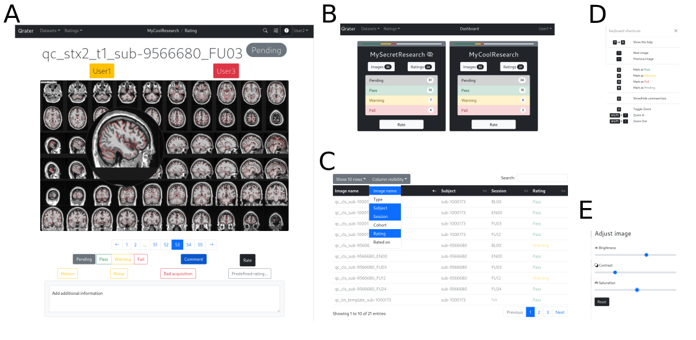
:::

::: {.slide-footer}
\(A) rating window · (B) dataset cards · (C) image list · (D) keybindings · (E) image controls
:::

::: {.notes}
Built on Flask + Docker, with MySQL and Redis backing simultaneous multi-user sessions. Works with any 2D rendering — JPEG, PNG, mosaics, processing reports — so it integrates with any QC pipeline. Tested with up to 8 concurrent raters on the same dataset.
:::

## {.fig-triptych data-menu-title="Ch3 · 3 tasks visual"}

::: {.eyebrow}
Chapter 3 · The benchmark tasks
:::

::: {.slide-title}
Three QC tasks, three mosaic formats
:::

::: {.slide-body}

::: {.triptych}

::: {.panel}
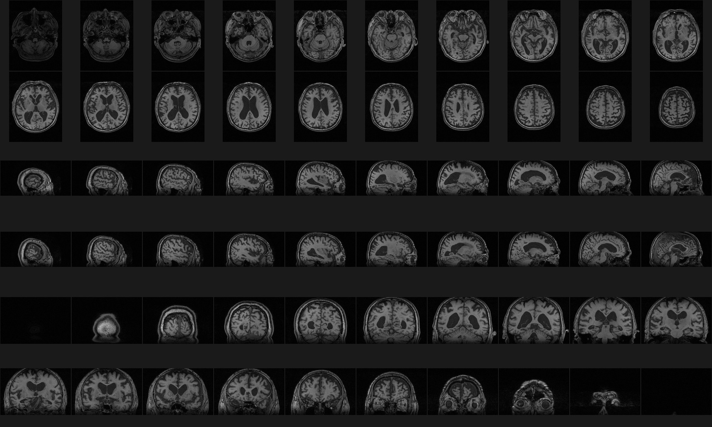

[Raw T1w MRI]{.panel-label}

[Native space]{.panel-sub}
:::

::: {.panel}
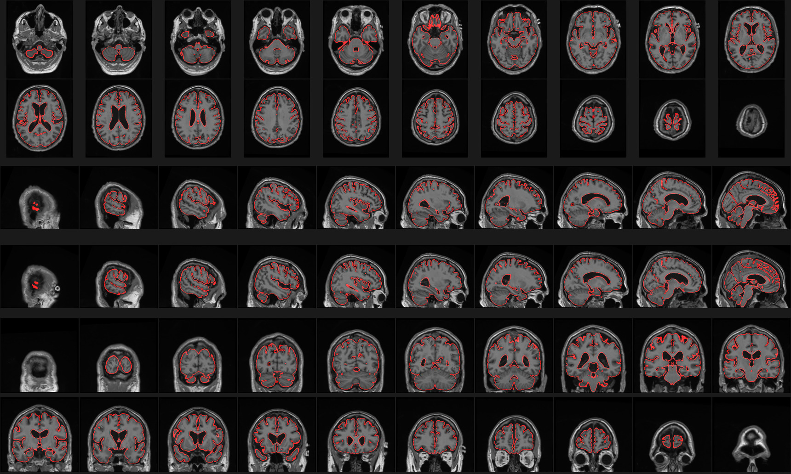

[Linear registration]{.panel-label}

[Template overlay in red]{.panel-sub}
:::

::: {.panel}
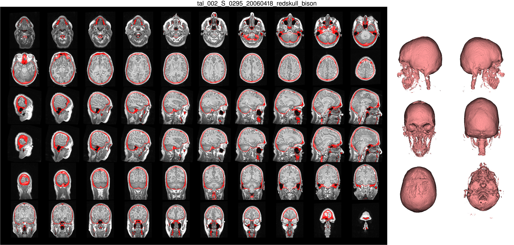

[Skull segmentation]{.panel-label}

[Segmentation overlay in red]{.panel-sub}
:::

:::

:::

::: {.slide-footer}
All formats: 60-slice mosaic (20 axial · 20 sagittal · 20 coronal)
:::

::: {.notes}
For each task we produced a precomputed 60-slice mosaic — 20 axial, 20 sagittal, 20 coronal. Raters click through these in seconds rather than scrolling slice-by-slice through 3D volumes. The mosaic format is what enables the speedup.
:::

## {.fig-leftright data-menu-title="Ch3 · Pipeline"}

::: {.slide-body}

::: {.header-col}

::: {.eyebrow}
Chapter 3 · Pipeline overview
:::

::: {.slide-title}
Mosaic generation → Qrater → ratings
:::

::: {.slide-subtitle}
Task-agnostic, modality-agnostic
:::

::: {.body-text}
External scripts produce mosaics.  Qrater handles rating + central storage.
:::

:::

::: {.fig-col}
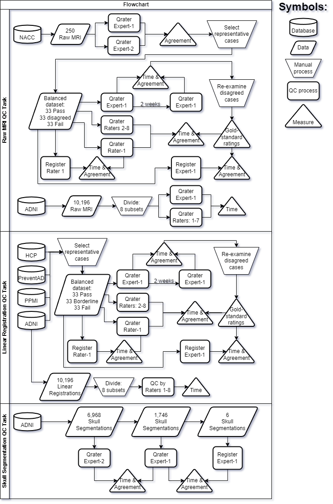
:::

:::

::: {.notes}
The pipeline: starting from raw DICOM/NIfTI volumes, automated steps produce the 60-slice mosaic image, which is loaded into Qrater. Raters then rate, comment, and the results are stored centrally. This whole loop is task-agnostic and modality-agnostic.
:::

## {.fig-sidebar data-menu-title="Ch3 · Datasets"}

::: {.eyebrow}
Chapter 3 · Sample
:::

::: {.slide-title}
Five public datasets · 11 raters · 20 K+ evaluations
:::

::: {.slide-body}

::: {.fig-col}

| Dataset | Tasks used in |
|---------|---------------|
| NACC | Raw MRI (balanced subset) |
| **ADNI** | Raw MRI · Reg · Skull seg |
| PPMI | Linear registration |
| HCP | Skull segmentation |
| PREVENT-AD | Raw MRI |

ADNI N = [**10,196**]{.accent} raw / [**10,196**]{.accent} reg / [**6,968**]{.accent} skull

:::

::: {.text-col}

**Raters**

- 2 [**experts**]{.accent} (30+ / 10+ yrs)
- 9 trainees
- Same research team
- Worked remotely on own hardware

:::

:::

::: {.notes}
ADNI provided the bulk of the data — over 10K raw scans, the same set passed through linear registration, and a subset of ~7K through skull segmentation. Smaller balanced datasets of 99 images each were used for inter-rater agreement testing.
:::

## {.big-number data-menu-title="Ch3 · 3s vs 60s"}

::: {.eyebrow}
Chapter 3 · Speed
:::

::: {.slide-title}
Skull-segmentation QC: a 20× speedup
:::

::: {.slide-subtitle}
~3 s per mosaic vs ~60 s slice-by-slice
:::

::: {.slide-body}

[~20×]{.bignum}

[faster than conventional slice-by-slice inspection]{.bignum-label}

[The largest time-savings of the three tasks. For ~7,000 ADNI scans: ~115 expert-hours → ~6 hours.]{.bignum-context}

:::

::: {.notes}
The skull-segmentation result is the headline. Reviewing a 3D segmentation traditionally requires slice-by-slice inspection — about a minute per scan. Qrater presents a precomputed mosaic so experts can decide in 3 seconds. This is the difference between a feasible and infeasible study at biobank scale.
:::

## {.fig-sidebar data-menu-title="Ch3 · Agreement raw"}

::: {.eyebrow}
Chapter 3 · Inter-rater agreement
:::

::: {.slide-title}
Raw MRI — moderate agreement
:::

::: {.slide-subtitle}
Borderline cases drive disagreement; Pass / Fail extremes agree
:::

::: {.slide-body}

::: {.fig-col}
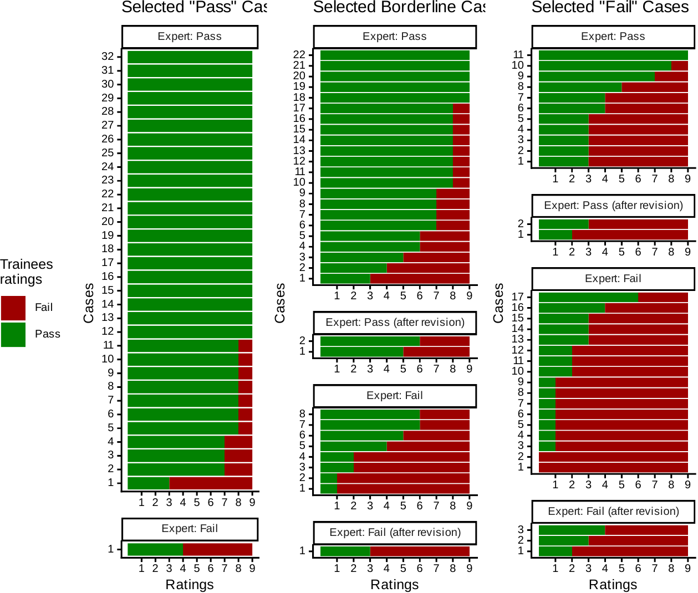
:::

::: {.text-col}

**Trainees vs expert gold standard**

- Bar charts: Pass (green) / Fail (red) trainee votes
- Borderline cases (middle) account for most disagreement
- Consistent with prior raw-MRI QC literature

:::

:::

::: {.notes}
Fleiss' κ for trainee–expert agreement on raw MRI was 0.44 — moderate. This is consistent with prior literature: raw scan quality involves genuine subjectivity around borderline artifacts. Pass and Fail extremes show high concordance; disagreement concentrates in the middle.
:::

## {.fig-sidebar data-menu-title="Ch3 · Agreement reg"}

::: {.eyebrow}
Chapter 3 · Inter-rater agreement
:::

::: {.slide-title}
Linear registration — higher agreement than raw
:::

::: {.slide-subtitle}
Template overlay makes misalignment visually obvious
:::

::: {.slide-body}

::: {.fig-col}
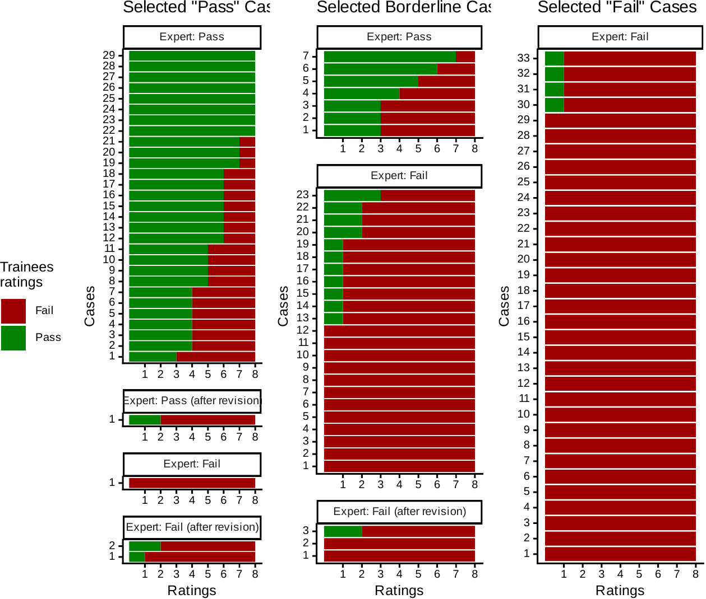
:::

::: {.text-col}

**Trainees vs expert gold standard**

- Red [**template overlay**]{.accent} flags misalignment at a glance
- Higher κ than raw MRI
- Practical task to train novices on

:::

:::

::: {.notes}
Fleiss' κ for linear registration was 0.56 — substantial, and higher than raw MRI. The mosaic with the template's cortical boundaries overlaid in red gives trainees a clear visual reference: alignment errors become obvious. This is a task where Qrater's visual format directly improves human performance.
:::

## {.big-number data-menu-title="Ch3 · Skull κ"}

::: {.eyebrow}
Chapter 3 · Inter-rater agreement
:::

::: {.slide-title}
Skull segmentation — experts converge
:::

::: {.slide-subtitle}
Cohen's κ = 0.83 between Expert-1 and Expert-2 across 1,746 images
:::

::: {.slide-body}

[κ = 0.83]{.bignum}

[Excellent expert-expert agreement on skull segmentation]{.bignum-label}

[The clearest task: skull tissue is well-defined, mosaic shows the overlay directly. Subjectivity is minimal — and accordingly, two experts converge.]{.bignum-context}

:::

::: {.notes}
The skull segmentation task showed excellent inter-rater agreement between the two experts. This is the most well-defined task — skull is clearly delineated anatomically, and the mosaic shows the segmentation overlay in red so errors are immediately visible.
:::

## {.big-number data-menu-title="Ch3 · Trainee growth"}

::: {.eyebrow}
Chapter 3 · Training effect
:::

::: {.slide-title}
Trainees converged on the expert with practice
:::

::: {.slide-body}

[+80%]{.bignum}

[trainee–expert agreement on the Acquisition-99 balanced set (after enough practice time)]{.bignum-label}

[Agreement and time on task were significantly correlated: more deliberate raters converged closer to the expert gold standard. Qrater's centralized format makes structured training feasible.]{.bignum-context}

:::

::: {.notes}
A side benefit of the centralized format: trainee QC quality improves measurably with repeated exercises on the same platform. The chapter reports that trainees who reached >80% agreement with Expert-1 on the Acquisition-99 balanced set were also those who spent the most time (correlation between completion time and agreement was significant — chapter3 §Results.Raw QC). Across both raw MRI and linear registration tasks, trainee–expert agreement improved with task practice (κ rose from 0.44 raw → 0.56 linreg) — better visual cues (template overlay) plus more rater experience drive the improvement. Qrater isn't just a measurement tool, it's a training tool.
:::

## {.fig-hero data-menu-title="Ch3 · Time table"}

::: {.eyebrow}
Chapter 3 · Speed (full comparison)
:::

::: {.slide-title}
Per-task speedup vs conventional viewer
:::

::: {.slide-body}

| Task | Rater | Conventional | Qrater | Speedup |
|------|-------|:---:|:---:|---:|
| Raw MRI | Expert | 90 imgs / 63 min | 99 imgs / 63 min | [**1.1×**]{.accent} |
| Raw MRI | Trainee | 79 imgs / 98 min | 99 imgs / 98 min | [**1.3×**]{.accent} |
| Linear registration | Expert | 43 imgs / 36 min | 99 imgs / 36 min | [**2.3×**]{.accent} |
| Linear registration | Trainee | 30 imgs / 37 min | 99 imgs / 37 min | [**3.3×**]{.accent} |
| Skull segmentation | Expert | ~60 s / image | ~3 s / image | [**~20×**]{.accent} |

: {tbl-colwidths="[26,11,26,26,11]"}

:::

::: {.notes}
The speedup scales with task complexity in the conventional method. Raw MRI is fastest in both since most scans are obvious pass/fail. Linear registration requires more deliberate inspection in the conventional method, so Qrater's mosaic gives a 2-3× speedup. Skull segmentation is the biggest win — slice-by-slice inspection vs a single mosaic glance.
:::

## {.fig-hero data-menu-title="Ch3 · Conf raw"}

::: {.eyebrow}
Chapter 3 · Detailed agreement
:::

::: {.slide-title}
Confusion matrix — raw MRI
:::

::: {.slide-body}
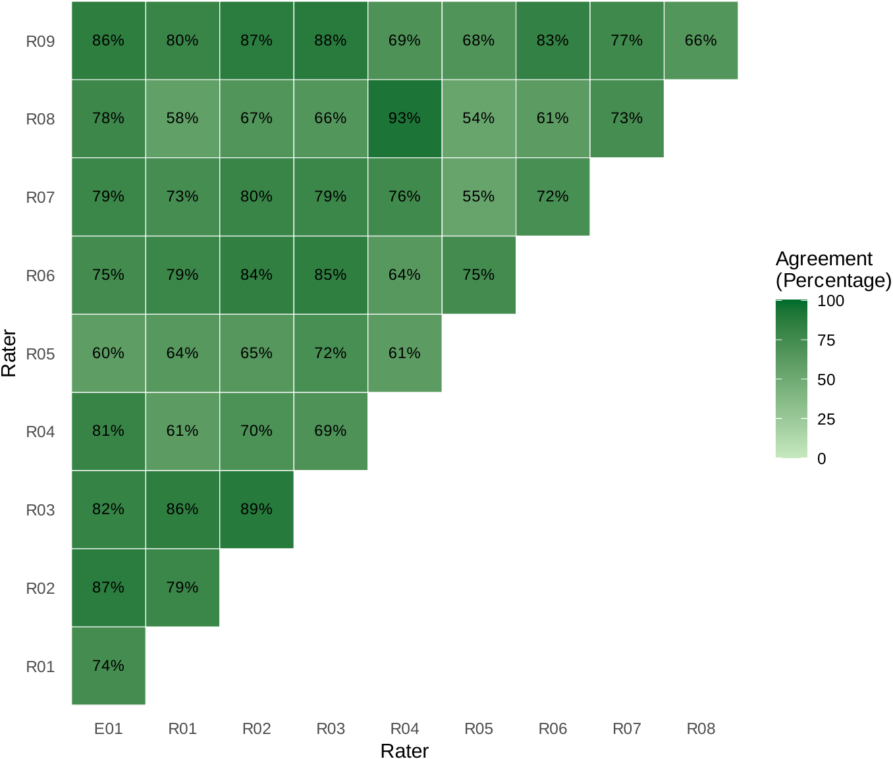
:::

::: {.slide-footer}
Percent agreement of trainees (R01–R09) with expert gold standard (E01).
:::

::: {.notes}
Detailed breakdown of agreement between each trainee and the expert. Most trainees fall in the 60-80% range — typical for raw MRI QC where borderline cases drive disagreement.
:::

## {.fig-pure data-menu-title="Ch3 · Conf reg"}

::: {.eyebrow}
Chapter 3 · Detailed agreement
:::

::: {.slide-title}
Confusion matrix — linear registration
:::

::: {.slide-body}
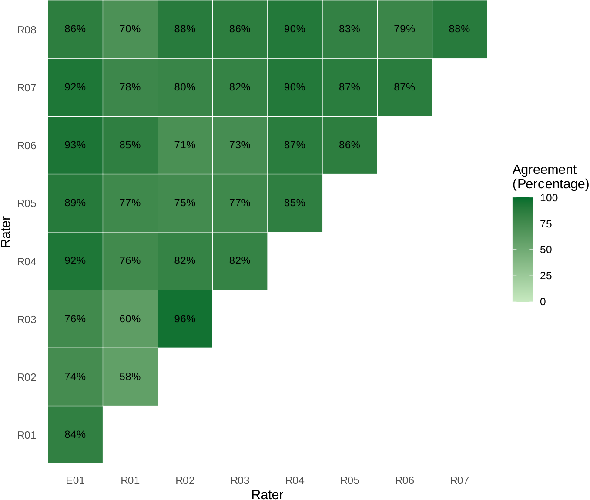
:::

::: {.notes}
Linear registration confusion matrix shows tighter agreement than raw MRI — the mosaic with template overlay is unambiguous. Most trainees hit 80%+ agreement with the expert.
:::

## {.fig-sidebar data-menu-title="Ch3 · Why wins"}

::: {.eyebrow}
Chapter 3 · Differentiation
:::

::: {.slide-title}
Why Qrater fills the gap
:::

::: {.slide-body}

::: {.fig-col}

| Feature | Qrater | VisualQC | Mindcontrol | MRIQC |
|---------|:---:|:---:|:---:|:---:|
| Task-agnostic | [**✓**]{.accent} | partial | ✗ | ✗ |
| Multi-user concurrent | [**✓**]{.accent} | ✗ | ✓ | ✗ |
| Containerized | [**✓**]{.accent} | ✗ | ✗ | ✗ |
| Any 2D rendering | [**✓**]{.accent} | ✗ | ✗ | ✗ |
| Open source | [**✓**]{.accent} | ✓ | ✓ | ✓ |

:::

::: {.text-col}

**Niche**

[**Task-agnostic**]{.accent}, multi-user, containerized — pluggable into any QC pipeline.

Not a replacement for specialized automated QC (e.g., MRIQC) — a manual layer above.

:::

:::

::: {.notes}
VisualQC is feature-rich but designed for single-user workflows. Mindcontrol is collaborative but dashboard-oriented. MRIQC is automated quality assessment, not manual rating. Qrater fills the gap as a task-agnostic, multi-user, containerized tool that works with any 2D rendering you can produce.
:::

## {.big-number data-menu-title="Ch3 · Adoption"}

::: {.eyebrow}
Chapter 3 · Adoption + tools
:::

::: {.slide-title}
Qrater in use beyond this thesis
:::

::: {.slide-subtitle}
Released on DockerHub + GitHub
:::

::: {.slide-body}

[250 K+]{.bignum}

[images on the lab server (current)]{.bignum-label}

[Adopted beyond the original project; used by collaborator labs. The QC'd ADNI dataset is the foundation for Chapters 4 and 6 of this thesis.]{.bignum-context}

:::

::: {.notes}
Qrater is openly released — Docker container on Docker Hub, source on GitHub, with a deployment guide. Beyond this project, it has been adopted by collaborator labs. The QC'd ADNI dataset produced through Qrater is what underpins the rest of this thesis. Limitations: still requires expert time to define gold standards, and mosaic generation is a pipeline prerequisite.
:::

## {.fig-sidebar data-menu-title="Ch3 · Intra-rater κ"}

::: {.eyebrow}
Chapter 3 · Expert self-agreement
:::

::: {.slide-title}
How stable is the gold standard itself?
:::

::: {.slide-body}

::: {.fig-col style="padding-left: 12px"}

| Task | Intra-rater κ |
|:-----|:-:|
| Raw QC (Acq 99) | [**0.81**]{.accent} |
| Linear registration (99) | [**0.87**]{.accent} |
| Skull segmentation | *no balanced set* |

: {tbl-colwidths="[65,35]"}

:::

::: {.text-col}

[**Why it matters**]{.subhead}

- Even expert judgement shifts across sessions
- Sets a realistic ceiling for trainee-vs-expert agreement
- Justifies the revision protocol (next slide)

[**Verdict**]{.subhead}

"Excellent" by Landis & Koch, but not perfect — borderline calls drift.

:::

:::

::: {.slide-citation}
Landis & Koch, 1977
:::

::: {.notes}
Even Expert-1 — the gold-standard rater — does not perfectly reproduce their own ratings across QC sessions. Raw QC κ = 0.81 (8 of 99 ratings flipped) and linear registration κ = 0.87 (6 of 99); for skull segmentation no balanced 99-image dataset was constructed (the experimental skull-strip tool produced highly imbalanced Pass/Fail rates), so intra-rater κ wasn't measured — the inter-rater κ = 0.83 between Expert-1 and Expert-2 is the agreement benchmark instead. All "excellent" by Landis & Koch but not perfect; this sets the ceiling for what we can expect from trainees and motivates a written revision protocol for the 8 borderline cases.
:::

## {.fig-sidebar data-menu-title="Ch3 · GS revision"}

::: {.eyebrow}
Chapter 3 · Gold-standard revision
:::

::: {.slide-title}
Borderline cases get a second look
:::

::: {.slide-body}

::: {.fig-col style="padding-left: 12px"}

[**Raw QC (Acq 99)**]{.subhead}

- 8 of 99 images had discrepant Expert-1 ratings
- Re-examined → [**4 Pass · 4 Fail**]{.accent}
- Final gold standard: 69 Pass / 30 Fail

[**Linear registration (99)**]{.subhead}

- 6 of 99 discrepant
- Re-examined → [**5 Fail · 1 Pass**]{.accent}
- Final gold standard: 62 Fail / 37 Pass

:::

::: {.text-col}

[**Protocol**]{.subhead}

- Expert-1 re-examined ONLY the discrepant set
- Final decision recorded as gold standard
- Revision completed before trainee QC began

[**Why fix before trainee QC**]{.subhead}

Prevents post-hoc adjustment of the gold standard to favour trainee agreement.

:::

:::

::: {.notes}
Borderline cases get a structured second pass. For the raw MRI task, 8 of 99 images had Expert-1 inter-session disagreement; re-examination split them evenly (4 Pass, 4 Fail). Linear registration: 6 discrepant, mostly resolved as Fail (5/1). The revision is done before trainee QC begins, so the gold standard cannot be adjusted post-hoc to favour any trainee.
:::

## {.fig-sidebar data-menu-title="Ch3 · Threshold not detection"}

::: {.eyebrow}
Chapter 3 · Disagreement root cause
:::

::: {.slide-title}
Trainees see artifacts — they grade them differently
:::

::: {.slide-body}

::: {.fig-col style="padding-left: 12px"}

[**The observation**]{.subhead}

> Raters who marked images as "Pass" often recorded the [**same artifacts**]{.accent} in the comments as the raters who marked those same images as "Fail".

[**Implication**]{.subhead}

Disagreement is a [**subjective threshold**]{.accent} difference, not a gross misidentification of artifacts.

:::

::: {.text-col}

[**Trainee rationale (follow-up)**]{.subhead}

> Several raters explained that they [**passed an image**]{.accent} when the artifact found was thought to be [**mild enough**]{.accent} (e.g., intensity non-uniformity) to be corrected in downstream preprocessing.

[**Why it matters**]{.subhead}

Qrater captures qualitative comments alongside Pass/Fail, exposing the threshold distinction.

:::

:::

::: {.notes}
The most interesting finding in the trainee analysis. When trainees disagreed with Expert-1, they often documented the SAME artifacts in qualitative comments — they saw what the expert saw, they just judged it differently. Several trainees explained that mild intensity non-uniformity could be corrected downstream, so they passed. This isn't a detection failure — it's a threshold calibration problem, addressable by training rather than redesign. Qrater's comment field is what makes this observable.
:::

## {.big-number data-menu-title="Ch3 · Time × accuracy"}

::: {.eyebrow}
Chapter 3 · Speed–accuracy tradeoff
:::

::: {.slide-title}
Slower trainees agreed with the expert more
:::

::: {.slide-subtitle}
Spearman correlation across 9 trainees · Acquisition 99
:::

::: {.slide-body}

[ρ = 0.77]{.bignum}

[Total QC time vs agreement with Expert-1]{.bignum-label}

[*S* = 28 · *p* = 0.021 · N = 9 trainees Deliberation tracks accuracy — but Qrater's mosaic + automation still cuts expert time ~20×.]{.bignum-context}

:::

::: {.notes}
A significant Spearman rank correlation between total QC time and agreement-with-expert across 9 trainees (ρ = 0.767, S = 28, p = 0.021). Slower raters were more accurate — deliberation pays off. Important caveat: this is trainees against the gold standard, not experts. For experts who have already internalized thresholds, the mosaic + workflow gives speed AND accuracy simultaneously (the 3s-per-image headline). Speed-accuracy is a calibration problem at the trainee stage, not at expert stage.
:::

## {.big-number data-menu-title="Ch3 · ADNI warnings"}

::: {.eyebrow}
Chapter 3 · ADNI deployment
:::

::: {.slide-title}
8% non-Pass — even on ADNI's QC'd data
:::

::: {.slide-body}

[4.8% / 3.1%]{.bignum}

[Warning / Fail in 10,196 ADNI baseline scans]{.bignum-label}

[Pass: 9,387 (92%) · Warning: 491 · Fail: 319 ADNI completed its own QC; Qrater's 3-tier labelling flagged additional cases where preprocessing should be tracked closely (Warning) or the scan excluded (Fail).]{.bignum-context}

:::

::: {.notes}
On 10,196 ADNI baseline T1w scans, our team identified 319 Fail (3.1%) and 491 Warning (4.8%) cases — even though ADNI had already QC'd these data. The Warning tier flags scans where preprocessing should be tracked closely but not excluded outright; Fail are excluded. This 3-tier granular labelling complements ADNI's QC. The resulting labelled dataset feeds Chapters 4 and 6.
:::

## {.fig-sidebar data-menu-title="Ch3 · Deployment"}

::: {.eyebrow}
Chapter 3 · Reproducibility
:::

::: {.slide-title}
Container stack: pluggable into any pipeline
:::

::: {.slide-body}

::: {.fig-col style="padding-left: 12px"}

[**Open release**]{.subhead}

- Source: [github.com/soffiafdz/qrater]{.accent-fixed}
- Image: [hub.docker.com/r/soffiafdz/qrater]{.accent-fixed}
- Analysis: [github.com/soffiafdz/qrater_analysis]{.accent-fixed}

[**Stack**]{.subhead}

- Flask + SQLAlchemy (app server)
- MySQL 8.0.25 (data)
- Redis 6.2.4-alpine (rate-limit, cache)
- Docker Compose (orchestration)

:::

::: {.text-col}

[**Why containerized**]{.subhead}

- Single-command deploy (`docker compose up`)
- Versioned services — bit-identical replication
- No host-side install dependencies

[**Adopted beyond thesis**]{.subhead}

Collaborator labs, multiple cohorts. ADNI Qrater dataset is the foundation for Ch4 + Ch6.

:::

:::

::: {.notes}
The reproducibility story: full source on GitHub, image on Docker Hub, analysis code in a sibling repo. The stack is intentionally boring — Flask + MySQL + Redis behind Docker Compose so a collaborator can `docker compose up` and have a working Qrater in minutes. Versioned dependencies (MySQL 8.0.25, Redis 6.2.4-alpine) ensure bit-identical replication. Other labs have adopted it. The labelled ADNI dataset produced through Qrater is what underpins Chapters 4 and 6 of this thesis.
:::

## {.fig-sidebar data-menu-title="Ch3 · Limitations"}

::: {.eyebrow}
Chapter 3 · What Qrater is not
:::

::: {.slide-title}
Known limitations
:::

::: {.slide-body}

::: {.fig-col style="padding-left: 12px"}

[**Limitations (from the chapter)**]{.subhead}

- [**JPEG lossy**]{.accent} compression — small artifacts could be confused with susceptibility / flow noise
- [**External mosaic generation**]{.accent} — Qrater rates pre-rendered 2D images; pipeline must produce them
- No [**automatic quality-metric extraction**]{.accent} or QC-status prediction
- Test-retest was unblinded — possible recall
- [**Remote rating**]{.accent} factors not controlled (environment, monitor)
- Time measurement coarse — gaps > 15 min excluded as "away"

:::

::: {.text-col}

[**Mitigation already in place**]{.subhead}

- [**PNG (lossless)**]{.accent} format is already supported in Qrater for sites that prefer it
- Qrater is task-agnostic — automated QC tools can produce its mosaic input

[**Scope**]{.subhead}

Qrater is a [**manual layer above automated QC**]{.accent}, not a replacement for tools like MRIQC.

:::

:::

::: {.notes}
Honest limitations as written in the chapter: (1) JPEG compression is lossy — could hide subtle artifacts; (2) external mosaic generation — pipelines must produce the 2D renderings Qrater rates; (3) no automatic IQM extraction or QC-status prediction; (4) unblinded test-retest; (5) remote-rating environmental factors not controlled; (6) timing measurement excludes gaps > 15 min as "away time", a coarse measure. The chapter already supports PNG (lossless) as an alternative format. Scope: Qrater is a manual layer above automated QC, not a replacement for tools like MRIQC.
:::

# {.divider data-menu-title="Ch4 divider"}

::: {.divider-content}

::: {.eyebrow}
Chapter 4
:::

::: {.divider-title}
HVR Validation
:::

::: {.divider-subtitle}
Automated CNN-based segmentation and clinical benchmarking in ADNI (N = 1,641)
:::

:::

## {.fig-sidebar data-menu-title="Ch4 · Why automate"}

::: {.eyebrow}
Chapter 4 · Motivation
:::

::: {.slide-title}
Why automate HVR?
:::

::: {.slide-subtitle}
Manual segmentation doesn't scale
:::

::: {.slide-body}

::: {.fig-col style="padding-left: 12px"}

[**The bottleneck**]{.subhead}

- Manual HC + temporal-horn segmentation ≈ [**2 h / subject**]{.accent} (Schoemaker 2019)
- High intra- and inter-rater variability
- Biobank-scale HVR is infeasible without automation

:::

::: {.text-col}

[**Goal**]{.subhead}

- Accurate, [**joint HC + ventricle**]{.accent} segmentation
- Validated against manual gold standard
- Applied to ADNI N = 1,641

:::

:::

::: {.slide-citation}
Schoemaker et al., 2019 · Dill et al., 2015
:::

::: {.notes}
The Hippocampal-to-Ventricle Ratio (HVR) was introduced by Schoemaker (2019) using manual segmentation of HC and the perihippocampal temporal horn — about 2 hours of trained-rater time per scan. At biobank scale (ADNI ~50K imaging visits, UKB ~50K imaged participants) this is infeasible. Chapter 4's goal is to automate the segmentation with quality matching the manual gold standard, validated on the full ADNI baseline.
:::

## {.fig-sidebar data-menu-title="Ch4 · Study design"}

::: {.eyebrow}
Chapter 4 · Study design
:::

::: {.slide-title}
The pipeline in one view
:::

::: {.slide-body}

::: {.fig-col style="padding-left: 12px"}

| Stage | N | Purpose |
|:------|:--|:--------|
| **Training labels** | [**80**]{.accent} | manual HC + CSF gold standard |
| **Cross-validation** | [**64 / 16**]{.accent} | train / val per fold |
| **Out-of-sample** | [**60**]{.accent} | 20 CH / MCI / AD — generalization |
| **Clinical application** | [**1,641**]{.accent} | ADNI baseline — CH:AD effects |

: {tbl-colwidths="[30,18,52]"}

:::

::: {.text-col}

[**Methods compared**]{.subhead}

- [**MALF**]{.accent} (multi-atlas label fusion)
- [**NLPB**]{.accent} (non-linear patch-based)
- [**CNN**]{.accent} (3D U-Net)
- [**FreeSurfer**]{.accent} v4.3 / 5.1 / 6.0

:::

:::

::: {.notes}
The study uses 80 manually-segmented cognitively healthy subjects as the gold standard training set. Cross-validation uses 5-fold (64/16 train/val per fold for CNN; Monte-Carlo for MALF/NLPB). An out-of-sample 60-subject ADNI subset (20 per clinical group, separately manually segmented) tests generalization. The full N = 1,641 ADNI baseline cohort is used to evaluate clinical effect sizes (CH vs AD) and associations with age, RAVLT learning, and ADAS13.
:::

## {.fig-sidebar data-menu-title="Ch4 · Methods compared"}

::: {.eyebrow}
Chapter 4 · Segmentation methods
:::

::: {.slide-title}
Four families, one head-to-head
:::

::: {.slide-body}

::: {.fig-col style="padding-left: 12px"}

| Method | Type | Detail |
|--------|------|--------|
| **MALF** | atlas-based | label fusion via ANIMAL |
| **NLPB** | patch-based | non-linear template + local patch similarity |
| **CNN** | deep learning | 3D U-Net, Dice + Hausdorff loss, 16× aug. |
| **FS v4.3 / 5.1** | atlas+surface | ADNI's released volumes |
| **FS v6.0** | atlas+surface | run locally |

:::

::: {.text-col}

[**Why these**]{.subhead}

- Only methods that segment [**both HC and temporal-horn CSF**]{.accent} (required for HVR)
- FS v6.0 (2017) predates DL-based subfield modules
- nnU-Net / HippoDeep cover HC only (no LV)

:::

:::

::: {.slide-citation}
Collins et al., 2010 · Coupé et al., 2011 · Fonov et al., 2012 · Ronneberger et al., 2015 · Fischl 2002
:::

::: {.notes}
The 4-way comparison was constrained by a hard requirement: the method must segment both the hippocampus AND the perihippocampal CSF (temporal horn) to produce HVR. Most published deep-learning hippocampal segmenters (HippoDeep, FastSurfer hippocampal module, nnU-Net hippocampal models) cover HC only. FreeSurfer v6.0 was the latest version available without DL-based subfield modules at training time; v7+ subfield modules use a different anatomical definition incompatible with the Pruessner manual protocol used here.
:::

## {.fig-sidebar data-menu-title="Ch4 · CNN architecture"}

::: {.eyebrow}
Chapter 4 · Network design
:::

::: {.slide-title}
3D U-Net with HC + CSF joint output
:::

::: {.slide-body}

::: {.fig-col}
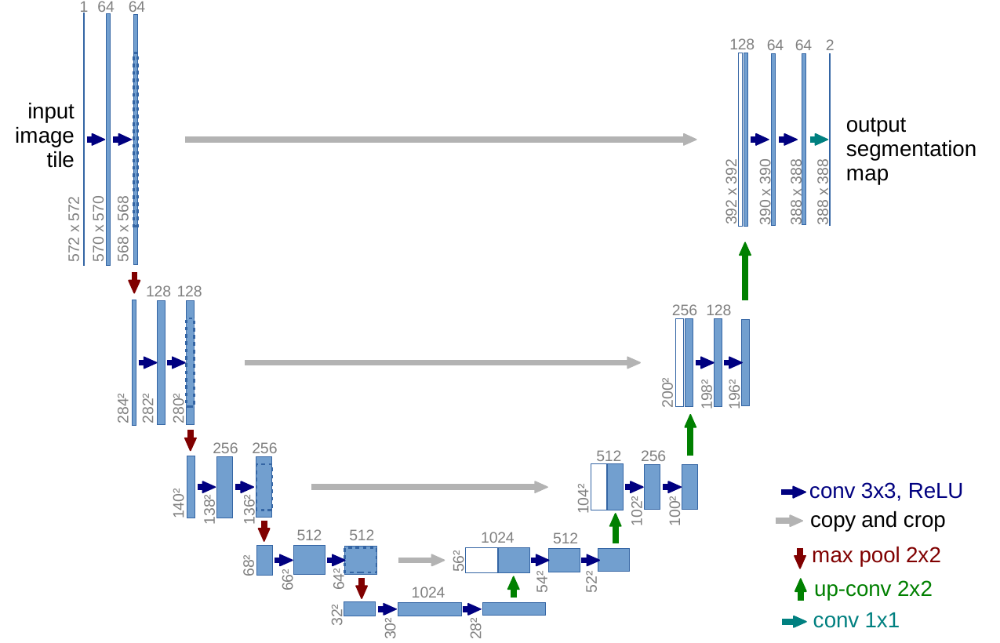
:::

::: {.text-col}

[**Training**]{.subhead}

- [**5-fold CV**]{.accent} (64 train / 16 val)
- 200 epochs/fold
- [**16× augmentation**]{.accent}: geometric + intensity + noise

[**Loss**]{.subhead}

- Dice κ overlap
- Multi-label Hausdorff approximation

:::

:::

::: {.slide-citation}
Ronneberger et al., 2015 · Fonov et al., 2022 (architecture details)
:::

::: {.notes}
The 3D U-Net follows the standard contraction–expansion topology with skip connections (Ronneberger 2015). Implementation details follow Fonov 2022. Loss is a combined Dice kappa overlap + multi-label Hausdorff approximation — the Hausdorff component penalizes boundary errors that Dice alone tolerates. 16× augmentation includes geometric (small rotations + flips), intensity shifts, and noise injection — substantially larger augmentation than typical because the 80-subject training set is relatively small. The diagram is an illustrative U-Net; the exact layer configuration is in Fonov 2022.
:::

## {.fig-sidebar data-menu-title="Ch4 · Gold standard"}

::: {.eyebrow}
Chapter 4 · The manual gold standard
:::

::: {.slide-title}
Pruessner protocol, 80 healthy subjects
:::

::: {.slide-body}

::: {.fig-col}
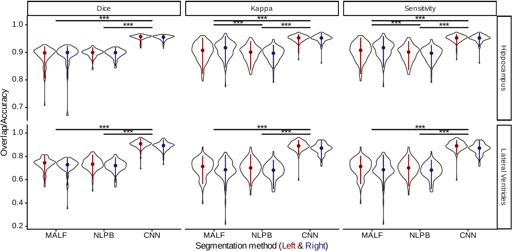
:::

::: {.text-col}

[**Why this protocol**]{.subhead}

- Same expert protocol as [**Schoemaker 2019**]{.accent} (direct comparability)
- HC + perihippocampal CSF — both labels required for HVR
- N = 80 from the established template library

[**Out-of-sample**]{.subhead}

60 ADNI subjects (20 / group) re-segmented manually.

:::

:::

::: {.slide-citation}
Pruessner et al., 2000 · Collins et al., 2010 · Schoemaker et al., 2019
:::

::: {.notes}
The manual segmentation protocol (Pruessner 2000 / Collins 2010) is the same one used by Schoemaker 2019 to introduce HVR. Reusing the protocol enables direct comparability — same anatomical boundaries, same expert team. The 80 training subjects come from the established template library; out-of-sample 60 subjects (20 CH/20 MCI/20 AD) were freshly manually segmented to test generalization across disease severity.
:::

## {.fig-sidebar data-menu-title="Ch4 · Preprocessing"}

::: {.eyebrow}
Chapter 4 · Preprocessing
:::

::: {.slide-title}
Identical pipeline across methods
:::

::: {.slide-body}

::: {.fig-col style="padding-left: 12px"}

[**Common preprocessing**]{.subhead}

- Denoising (Coupé 2008)
- N3 intensity inhomogeneity correction (Sled 1998)
- Linear histogram normalization
- Affine registration to ADNI-1 stereotaxic template (Fonov 2011)

:::

::: {.text-col}

[**Per-method exceptions**]{.subhead}

- MALF / NLPB / CNN: all use the common pipeline
- FreeSurfer: uses its own internal preprocessing (cannot intervene without breaking the pipeline)

:::

:::

::: {.slide-citation}
Coupé et al., 2008 · Sled et al., 1998 · Fonov et al., 2011
:::

::: {.notes}
A common preprocessing pipeline ensures method differences aren't artifacts of preprocessing. MALF, NLPB, and CNN all consume the same denoised, N3-corrected, intensity-normalized, affinely-registered volumes. FreeSurfer is an exception — it uses its own internal preprocessing chain, which is a known limitation but unavoidable. This is why all FreeSurfer comparisons in this chapter carry a slight asterisk: any difference could in principle reflect preprocessing as well as the segmentation algorithm itself.
:::

## {.fig-hero data-menu-title="Ch4 · CNN segmentation performance"}

::: {.eyebrow}
Chapter 4 · Cross-validation
:::

::: {.slide-title}
CNN dominates on every overlap metric
:::

::: {.slide-body}

:::

::: {.slide-footer}
HC Dice ≈ [**0.94–0.96**]{.accent} · CSF Dice ≈ [**0.87–0.91**]{.accent} All FDR-adjusted *p* < 0.001
:::

::: {.notes}
Across Dice coefficient, Cohen's kappa, and sensitivity, the CNN significantly outperforms MALF and NLPB for both HC and CSF, left and right. Robust effect sizes (ψ) exceed 0.04 for HC and 0.15 for CSF. The right panel shows example segmentations side-by-side with manual — visual inspection confirms cleaner CNN boundaries. All differences are FDR-adjusted p < 0.001.
:::

## {.fig-hero data-menu-title="Ch4 · Volumetric agreement"}

::: {.eyebrow}
Chapter 4 · Volumetric correlation
:::

::: {.slide-title}
CNN volumes track manual at ρ ≈ 0.99
:::

::: {.slide-body}
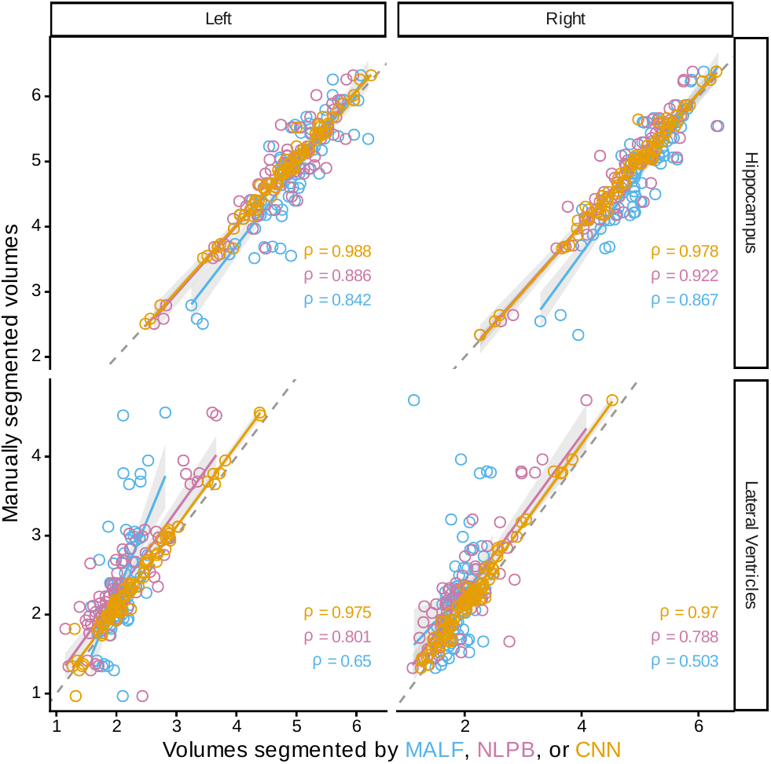
:::

::: {.slide-footer}
CNN matches manual at the rater-noise floor; NLPB and MALF show meaningful volume drift, especially for CSF
:::

::: {.notes}
Dice/kappa can be high while volumes are systematically wrong. Volume correlation is the complementary check. The CNN achieves ρ ≈ 0.98–0.99 with manual HC volumes and ρ ≈ 0.95 for CSF — within the noise floor of manual rater test-retest. NLPB and MALF show meaningful volume discrepancies despite reasonable Dice scores, especially for CSF.
:::

## {.fig-hero data-menu-title="Ch4 · Out-of-sample"}

::: {.eyebrow}
Chapter 4 · Generalization test
:::

::: {.slide-title}
CNN holds up on AD-stage volumes
:::

::: {.slide-body}
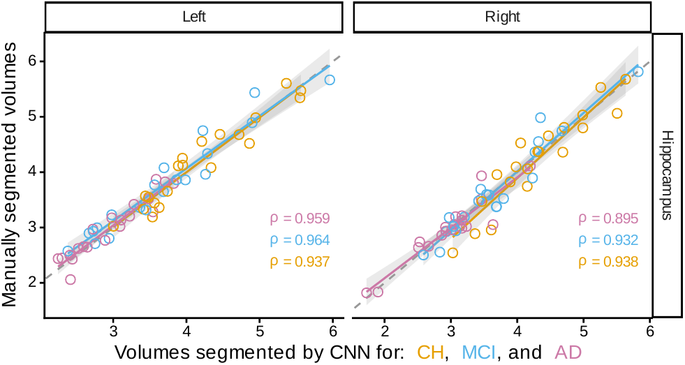
:::

::: {.slide-footer}
60 held-out ADNI subjects (20 per clinical group) ρ vs manual ≥ [**0.94**]{.accent} in every group · slight right-side weakness in AD only
:::

::: {.notes}
The CNN was trained on cognitively healthy subjects. Out-of-sample validation on 60 ADNI subjects with separate manual segmentation tests generalization to the diagnostic groups it will be applied to. ρ stays at 0.94 for CH and AD, 0.96 for MCI — comparable to in-sample training performance. There's a small right-hemisphere weakness in AD (ρ = 0.90 vs 0.96 left), but no group × side interaction, suggesting it's not driven by pathology. Bland-Altman mean differences are within 0.04 cc of zero.
:::

## {.big-number data-menu-title="Ch4 · Reliability"}

::: {.eyebrow}
Chapter 4 · Pipeline reliability
:::

::: {.slide-title}
CNN: 2 failures across 1,641 scans
:::

::: {.slide-subtitle}
Practical reliability for downstream chapters
:::

::: {.slide-body}

[0.1%]{.bignum}

[CNN failure rate on the ADNI baseline]{.bignum-label}

[NLPB 0.9% · MALF 1.5% · FreeSurfer v6.0 1.5% · FreeSurfer v4.3 / 5.1 ≈ 14% missing in the ADNI UCSF release.]{.bignum-context}

:::

::: {.slide-citation}
Klapwijk et al., 2019
:::

::: {.notes}
Practical reliability matters for downstream applications (Ch5, Ch6). The CNN had 2 failures across 1,641 scans (1 MCI, 1 AD) = 0.12%. NLPB and MALF had ~1.5%; MALF failures were skewed toward AD. Older FreeSurfer versions (v4.3, v5.1) had ~14% missing volumes in the UCSF ADNI release — practical concern for legacy data. For reference, Klapwijk 2019 reported ~5% manual QC failure and ~20% "doubtful" rates in FreeSurfer outputs.
:::

## {.fig-hero data-menu-title="Ch4 · HC method agreement"}

::: {.eyebrow}
Chapter 4 · Cross-method validity
:::

::: {.slide-title}
HC volumes converge across methods
:::

::: {.slide-body}
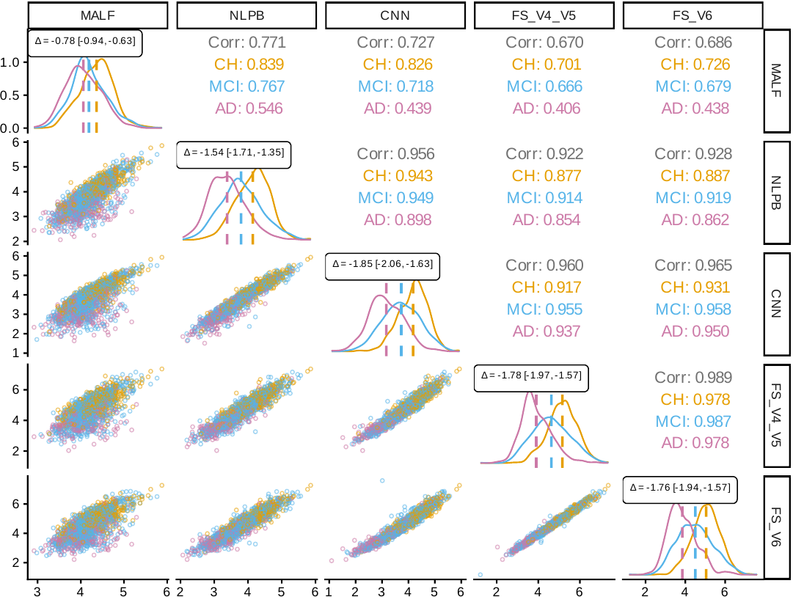
:::

::: {.slide-footer}
Cross-method ρ = [**0.91–0.99**]{.accent}, with MALF the outlier in AD CH:AD effect size shrinks where methods disagree most (MALF Δ = −0.78 vs CNN −1.85)
:::

::: {.notes}
The lower triangle shows pairwise correlations across methods within each diagnostic group; the diagonal shows volume distributions. Most methods agree at ρ > 0.91. MALF is the outlier, especially in AD (ρ = 0.67-0.78 with other methods). The upper triangle lists CH:AD Glass' Δ effect sizes: MALF -0.78, NLPB -1.54, FreeSurfer ≈ -1.76 to -1.78, CNN -1.85. The methods that disagree most also have the smallest effect sizes — MALF's underestimation in AD attenuates the clinical contrast.
:::

## {.fig-hero data-menu-title="Ch4 · HVR rescues"}

::: {.eyebrow}
Chapter 4 · The HVR payoff
:::

::: {.slide-title}
HVR amplifies effect sizes across all methods
:::

::: {.slide-body}
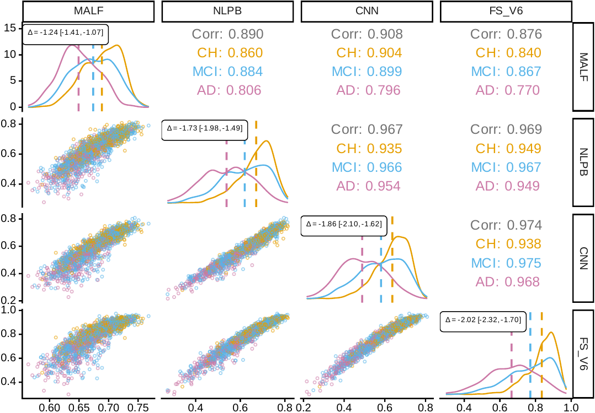
:::

::: {.slide-footer}
HVR closes the cross-method gap (ρ = [**0.89–0.97**]{.accent}) and amplifies CH:AD Δ for every method — MALF gains [**+57%**]{.accent}, CNN reaches −1.86
:::

::: {.notes}
The same panel structure as the HC slide but for HVR. Two key results: (1) cross-method agreement is higher for HVR than for HC volume — ρ climbs from 0.91–0.99 to 0.89–0.97 with the MALF outlier converging in. (2) All four methods now show large CH:AD effect sizes: MALF jumps from -0.78 to -1.24 (+57%); NLPB to -1.73; CNN to -1.86; FreeSurfer v6.0 to -2.02. The HVR ratio rescues bad segmentations by combining the (degraded) HC measure with the (also degraded) CSF measure into a ratio that captures both atrophy and ventricular expansion. This is the central methodological argument of the chapter — HVR amplifies clinical signal regardless of which segmentation tool you use.
:::

## {.fig-hero data-menu-title="Ch4 · Age associations"}

::: {.eyebrow}
Chapter 4 · Brain–behavior associations
:::

::: {.slide-title}
HVR strengthens age associations across methods
:::

::: {.slide-body}
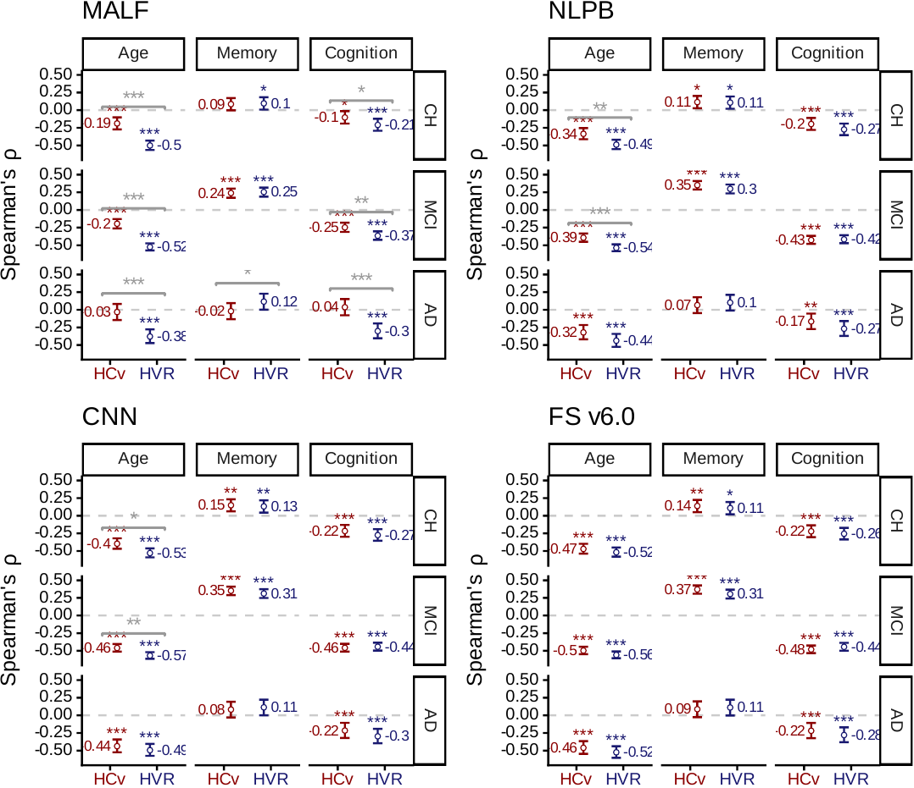
:::

::: {.slide-footer}
HVR–age correlation is significantly stronger than HC–age for every method except FreeSurfer v6.0 MALF improvement is the most dramatic (AD: ρ rescues from −0.03 to −0.38)
:::

::: {.notes}
This figure compares HC and HVR correlations with age, RAVLT learning, and ADAS13, stratified by clinical group. Permutation tests on the Δρ test whether HVR's correlation exceeds HC's. HVR's age associations are significantly stronger for every method except FreeSurfer. CNN: CH ρ -0.40 vs -0.53 (p=0.012); MCI -0.46 vs -0.57 (p=0.01). The MALF improvement is most dramatic — its HC-age correlation in AD (ρ = -0.03) is rescued by HVR (ρ = -0.38). Strong evidence that HVR isn't just for CH-vs-AD discrimination — it sharpens normal aging signal too.
:::

## {.fig-sidebar data-menu-title="Ch4 · Memory nuance"}

::: {.eyebrow}
Chapter 4 · Memory associations
:::

::: {.slide-title}
Memory: a nuanced picture
:::

::: {.slide-body}

::: {.fig-col}

:::

::: {.text-col}

[**RAVLT learning**]{.subhead}

- Significant only in [**MCI**]{.accent}
- ρ = 0.24–0.37 (HC) / 0.25–0.31 (HVR)
- Null in CH/AD — older cohort, ceiling/floor — contradicts Schoemaker 2019

[**ADAS13**]{.subhead}

- HVR sig. [**all groups, methods**]{.accent} (ρ = −0.21 to −0.44)
- HVR > HC only for MALF

:::

:::

::: {.slide-citation}
Schoemaker et al., 2019 · van Petten 2004 · Kueper et al., 2018
:::

::: {.notes}
This is an attackable slide and must be owned head-on. RAVLT learning associations are significant only in MCI — null in both CH (ceiling effect) and AD (floor effect). This contradicts Schoemaker 2019, which reported memory associations in a smaller, younger cohort. Likely explanations: (1) the ADNI cohort is ~10 years older than Schoemaker's; (2) ceiling/floor effects in CH and AD respectively; (3) ADNI's clinical sample composition differs. ADAS13 associations are robust — HVR significant across all groups and methods. HVR > HC for ADAS13 only in MALF. Better the committee hears this from the candidate with context than discover it as a "gotcha."
:::

## {.fig-sidebar data-menu-title="Ch4 · CNN vs FS6"}

::: {.eyebrow}
Chapter 4 · Honest disclosure
:::

::: {.slide-title}
CNN ≈ FreeSurfer v6.0 for HVR associations
:::

::: {.slide-body}

::: {.fig-col}
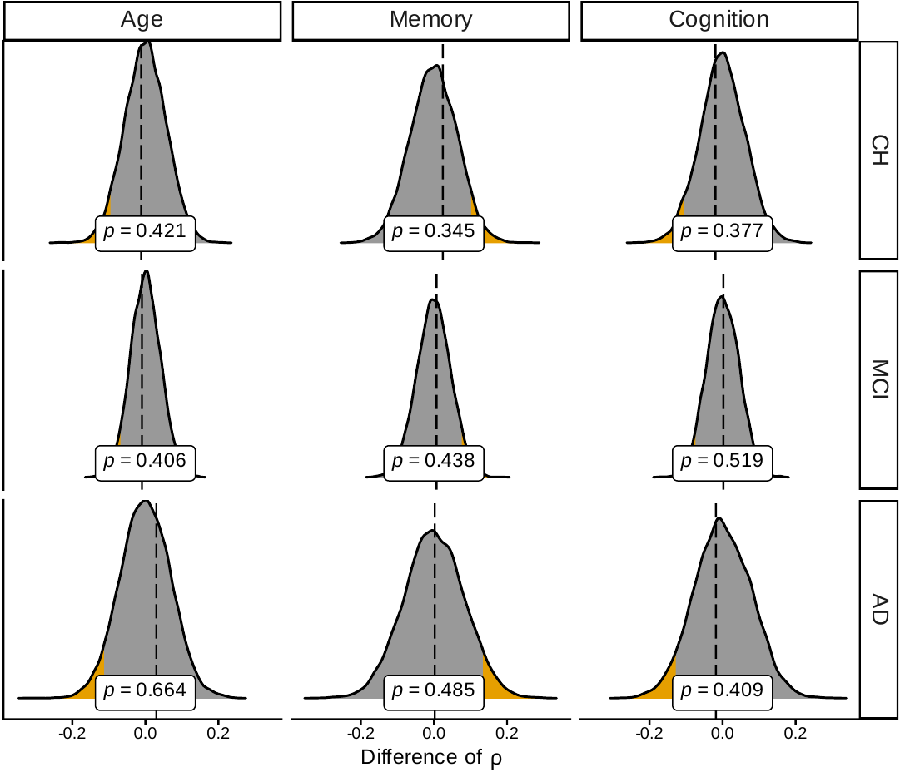
:::

::: {.text-col}

[**What FreeSurfer v6.0 matches**]{.subhead}

- HVR age associations
- HVR cognition associations
- Permutation tests: all n.s.

[**Where CNN wins**]{.subhead}

- [**Reliability**]{.accent}: 0.1% vs 1.5% failure
- [**Joint HC + ventricle**]{.accent} segmentation
- [**Open-source, Docker-deployable**]{.accent}

:::

:::

::: {.notes}
An honest comparison: for HVR-association strength (age, memory, ADAS13), CNN and FreeSurfer v6.0 are statistically interchangeable. 10,000-rep permutation tests show no significant difference between CNN and FS6 for any association. CNN's wins are: 15× lower failure rate (practical reliability at biobank scale), explicit joint HC + ventricle segmentation with anatomical fidelity to the Pruessner protocol (FreeSurfer's HC subfield definitions differ from this protocol), and open-source Docker-deployable. The framing matters: CNN doesn't beat FreeSurfer on effect-size strength, but it's the right tool for biobank-scale pipelines.
:::

## {.fig-hero data-menu-title="Ch4 · Bland-Altman"}

::: {.eyebrow}
Chapter 4 · Systematic bias check
:::

::: {.slide-title}
CNN minimal bias; MALF regression-to-mean
:::

::: {.slide-body}
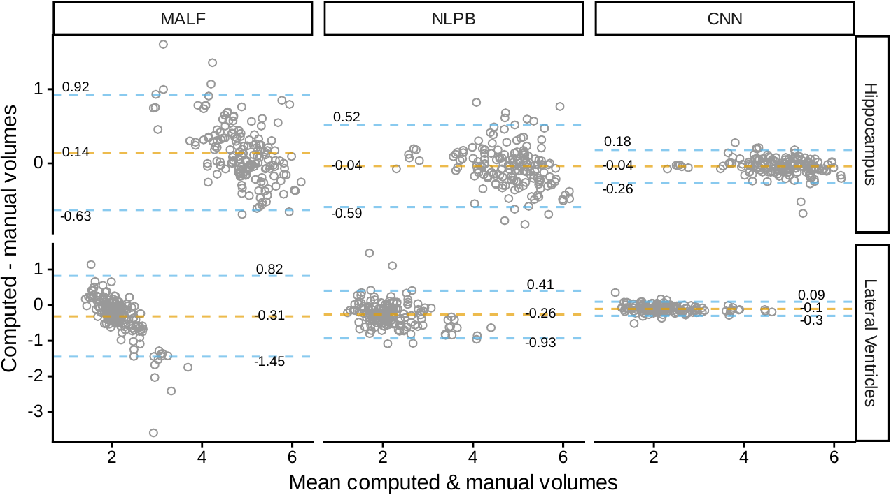
:::

::: {.slide-footer}
CNN: minimal bias, narrow limits of agreement MALF: regression-to-mean on HC; all methods slightly under-segment CSF
:::

::: {.slide-citation}
Zandifar et al., 2017 · Pipitone et al., 2014
:::

::: {.notes}
Bland-Altman is the classic "Dice can hide systematic bias" check. MALF shows a strong regression-to-the-mean pattern — overestimates small hippocampi, underestimates large ones (consistent with the literature on atlas-based methods). NLPB has moderate variance but no systematic pattern. CNN has minimal bias and narrow limits of agreement. All methods slightly underestimate CSF volumes — a known issue with ventricular segmentation that's not specific to this study (Zandifar 2017; Pipitone 2014).
:::

## {.fig-sidebar data-menu-title="Ch4 · Laterality"}

::: {.eyebrow}
Chapter 4 · Hemispheric effects
:::

::: {.slide-title}
Laterality: small, not pathology-driven
:::

::: {.slide-body}

::: {.fig-col}
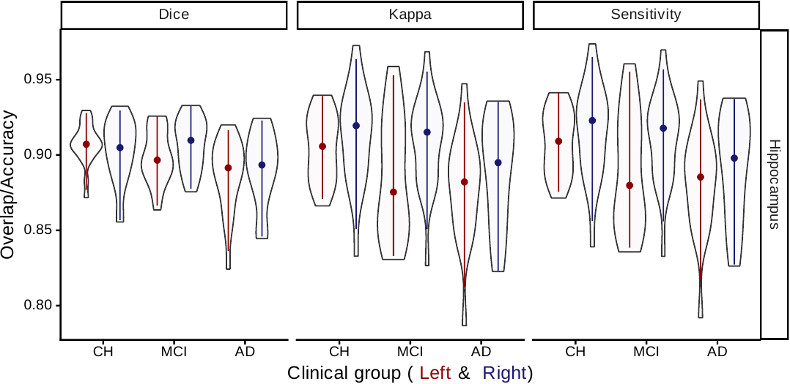
:::

::: {.text-col}

[**HC laterality**]{.subhead}

- [**MALF**]{.accent}: right > left (κ, sensitivity; FDR p = 0.009)
- [**CNN out-of-sample**]{.accent} AD: right < left (F = 8.5, p_FDR = 0.37)

[**CSF laterality**]{.subhead}

- NLPB + CNN: left > right
- No group × side interaction

:::

:::

::: {.notes}
Laterality effects are present but small and not driven by pathology. MALF shows right > left bias in kappa and sensitivity (FDR-adj p = 0.009). CNN out-of-sample shows the opposite in AD — slight right-side weakness (F = 8.5, p_FDR = 0.37, not surviving correction). VC segmentation favors left > right across NLPB and CNN. Critically, there's no group × side interaction, so the laterality isn't driven by disease pathology. Defending against "your CNN is biased in AD" — the magnitude is small and not consistent with biological asymmetry.
:::

## {.fig-sidebar data-menu-title="Ch4 · HVR vs ICV-corrected"}

::: {.eyebrow}
Chapter 4 · Defending the choice
:::

::: {.slide-title}
Why HVR over ICV-corrected HC volume?
:::

::: {.slide-body}

::: {.fig-col style="padding-left: 12px"}

| Measure | What it captures |
|---------|------------------|
| **HC volume** | atrophy only |
| **HC / ICV** | atrophy + global head size |
| **HC residualized** | atrophy with linear ICV removed |
| **HC occupancy** | atrophy + local space |
| [**HVR**]{.accent} | **atrophy + ex-vacuo dilation jointly** |

:::

::: {.text-col}

[**Principled answer**]{.subhead}

- HVR uses [**local CSF**]{.accent} (ex-vacuo dilation) — isolates MTL change
- ICV is a global proxy — doesn't track local processes
- HC occupancy (Heister 2011) precedent
- Direct HVR-vs-HC/ICV head-to-head is future work

:::

:::

::: {.slide-citation}
Schoemaker et al., 2019 · Heister et al., 2011 · Whitwell et al., 2012
:::

::: {.notes}
The chapter does not directly compare HVR to ICV-normalized HCvol — this is a likely committee challenge. The principled answer: HVR uses LOCAL CSF (the perihippocampal temporal horn, which expands ex-vacuo as HC atrophies). ICV is GLOBAL — it doesn't track local processes. HVR captures two coupled local processes (atrophy ↓ numerator, expansion ↑ denominator) in one metric. The HC occupancy precedent (Heister 2011) and Schoemaker 2019 validation support the approach. Direct HVR vs HC/ICV head-to-head is future work. Chapter 5 actually performs this comparison at scale in UKB (r(HVR, ICV) ≈ 0.25 vs r(HC, ICV) ≈ 0.6).
:::

## {.fig-sidebar data-menu-title="Ch4 · vs DL alternatives"}

::: {.eyebrow}
Chapter 4 · Alternative DL methods
:::

::: {.slide-title}
Why not HippoDeep / nnU-Net / FastSurfer?
:::

::: {.slide-body}

::: {.fig-col style="padding-left: 12px"}

| Tool | Issue for HVR |
|------|---------------|
| **HippoDeep** | HC only, no temporal-horn label |
| **nnU-Net** (HC models) | HC only, framework not pre-trained on this label set |
| **FastSurfer / FS7** | HC subfields, no joint HC + LV (different anatomy) |
| **Other literature U-Nets** | Dice ≈ 0.89–0.93 — comparable or below this CNN's 0.96 |

:::

::: {.text-col}

[**Bottom line**]{.subhead}

- Only methods producing [**joint HC + temporal-horn CSF**]{.accent} were eligible
- Literature DL methods focus on HC alone
- This CNN's Dice (≈ 0.96) matches or exceeds published DL benchmarks

:::

:::

::: {.slide-citation}
Yi et al., 2021 · Xie et al., 2018 · Amoroso et al., 2015
:::

::: {.notes}
The chapter explicitly addresses this in the discussion: no publicly available pretrained model reliably segments BOTH HC and the perihippocampal CSF at the time of training. HippoDeep, nnU-Net hippocampal models, and FastSurfer/FS7 hippocampal modules all focus on HC alone (and FS7 uses subfield definitions incompatible with the Pruessner protocol used here). Literature DL U-Nets on hippocampus achieve Dice 0.89-0.93 (Yi 2021 review; Xie 2018; Amoroso 2015) — comparable to or below this CNN's 0.96.
:::

## {.fig-sidebar data-menu-title="Ch4 · ADNI demographics"}

::: {.eyebrow}
Chapter 4 · Sample composition
:::

::: {.slide-title}
ADNI baseline: N = 1,641
:::

::: {.slide-body}

::: {.fig-col style="padding-left: 12px"}

| Group | N | Age (yrs, mean ± SD) | % Female |
|-------|---|---------------------:|---------:|
| **CH** | 501 | 74.3 ± 5.7 | 52% |
| **MCI** | 819 | 72.9 ± 7.6 | 41% |
| **AD** | 321 | 74.8 ± 7.8 | 45% |

:::

::: {.text-col}

[**Notable contrasts**]{.subhead}

- Sex sig. different in CH (p = 0.002) and MCI (p = 0.004); not AD
- MCI [**younger**]{.accent} than CH (Z = 2.6, p = 0.014)
- MCI younger than AD (Z = 4.03, p < 0.001)
- CH–AD age comparable (n.s.)

:::

:::

::: {.notes}
The ADNI baseline cohort breaks down as CH N = 501, MCI N = 819, AD N = 321. Sex distribution differs significantly across groups (CH and MCI more female-biased; AD comparable). MCI participants are significantly younger than both CH and AD — important for interpreting age associations and effect sizes. CH and AD age are comparable (n.s.). Education distribution: CH > MCI > AD.
:::

## {.fig-sidebar data-menu-title="Ch4 · Limitations"}

::: {.eyebrow}
Chapter 4 · Limitations
:::

::: {.slide-title}
What this chapter does not claim
:::

::: {.slide-body}

::: {.fig-col style="padding-left: 12px"}

[**Sample**]{.subhead}

- ADNI: white, educated
- Cross-sectional (Ch6 longitudinal)
- Sex excluded (Ch5)

[**Method**]{.subhead}

- No scan-rescan
- No nnU-Net / FS v7+
- FS comparison differs in anatomy

:::

::: {.text-col}

[**Mitigations**]{.subhead}

- Ch5 tests in UKB (N = 27,680)
- Ch6 tests longitudinal A+ ADNI
- HVR invariance to seg method (Slide 12)

:::

:::

::: {.notes}
Honest list of limitations. ADNI sample is predominantly white and highly educated — generalizability to more diverse populations needs explicit testing. Cross-sectional only — longitudinal HVR is the subject of Chapter 6. Sex was deliberately omitted from this chapter because Chapter 5 is dedicated to it. Method-wise: no test-retest reliability assessed; no comparison to nnU-Net or FreeSurfer 7+; FreeSurfer comparison carries an asterisk because the FS HC anatomical definition differs from Pruessner. Mitigations: Chapters 5 and 6 extend the work; the cross-method HVR invariance (Slide 12) means the central finding doesn't depend on which segmentation tool you use.
:::

## {.fig-sidebar data-menu-title="Ch4 · Tools released"}

::: {.eyebrow}
Chapter 4 · Reproducibility
:::

::: {.slide-title}
Open-source release
:::

::: {.slide-subtitle}
Docker container + GitHub repo
:::

::: {.slide-body}

::: {.fig-col style="padding-left: 12px"}

[**GitHub**]{.subhead}

[github.com/soffiafdz/hvr_validation]{.accent-fixed}

[**Docker Hub**]{.subhead}

[hub.docker.com/r/soffiafdz/hvr_cnn]{.accent-fixed}

:::

::: {.text-col}

[**Feeds downstream**]{.subhead}

- The pipeline is the foundation for [**Ch5**]{.accent} (UK Biobank N = 27,680)
- And [**Ch6**]{.accent} (ADNI longitudinal A+)

:::

:::

::: {.notes}
The CNN HVR pipeline is openly released. GitHub repo includes the trained model weights, segmentation code, mosaic generation scripts, and tutorial. Docker container is on Docker Hub for one-command deployment. The pipeline is the methodological foundation for Chapters 5 and 6 — without reliable automated HVR at this scale, neither of the later chapters would be feasible.
:::

## {.fig-sidebar data-menu-title="Ch4 · Sens/spec"}

::: {.eyebrow}
Chapter 4 · Class-wise performance
:::

::: {.slide-title}
Beyond Dice — sensitivity & specificity
:::

::: {.slide-body}

::: {.fig-col style="padding-left: 12px"}

[**Reported in Supp. Table S1**]{.subhead}

- Median + SD per method, per structure, per hemisphere
- Five metrics: accuracy, Dice, κ, sensitivity, specificity
- Both bilateral HC and CSF

[**Chapter quote**]{.subhead}

> Accuracy and specificity for both HC and CSF segmentations [**approached 1.0**]{.accent} across all methods and are therefore not included in the figure.

:::

::: {.text-col}

[**Why Dice + κ in the main figure**]{.subhead}

- Dice / κ have the visible spread across methods
- Accuracy + specificity saturate near 1.0
- Sensitivity follows the Dice pattern for HC

[**Where the values live**]{.subhead}

Supplementary Table S1 reports the full grid; the main figure highlights the metrics that distinguish methods.

:::

:::

::: {.notes}
Sensitivity and specificity ARE reported in the chapter — Supplementary Table S1 gives the full grid of median ± SD per method, per structure (HC + CSF), per hemisphere. The chapter explicitly states accuracy and specificity approach 1.0 across all methods, which is why they're not in the main figure. Dice and κ are the discriminating metrics. The committee may ask "where are sensitivity values?" — answer: in the supplement.
:::

## {.fig-sidebar data-menu-title="Ch4 · Sex distribution"}

::: {.eyebrow}
Chapter 4 · Demographics — sex
:::

::: {.slide-title}
Sex distribution differs by group
:::

::: {.slide-body}

::: {.fig-col style="padding-left: 12px"}

[**ADNI sex distribution (χ²)**]{.subhead}

| Group | p (χ², sex) |
|:------|:-----------:|
| CH | [**0.002**]{.accent} |
| MCI | [**0.004**]{.accent} |
| AD | 1.00 |

: {tbl-colwidths="[40,60]"}

[**Why Ch4 does not stratify**]{.subhead}

- Chapter 4 is methodological validation — scope is [**segmentation**]{.accent}, not biology
- Sex × HVR is the dedicated focus of Chapter 5 (UKB N = 27,680)

:::

::: {.text-col}

[**Anticipated Q**]{.subhead}

- "You have sex imbalance — did you test?"
- "Why not stratify analyses here?"

[**Answers**]{.subhead}

- Yes — χ² is reported in the demographics table
- Stratifying by sex within Ch4's small clinical subgroups would underpower the segmentation comparisons; Chapter 5 has the sample size for it

:::

:::

::: {.notes}
ADNI sex distribution differs across clinical groups (CH χ² p = 0.002; MCI p = 0.004; AD p = 1.00). Chapter 4 reports the χ² tests in the demographics table but does not stratify analyses by sex because the chapter scope is segmentation-method validation, not sex biology, and the clinical subgroups (CH N = 501, MCI N = 819, AD N = 321) would be underpowered if further split by sex. Sex × HVR biology is the dedicated focus of Chapter 5 (UKB N = 27,680).
:::

## {.fig-sidebar data-menu-title="Ch4 · CSF underestimation"}

::: {.eyebrow}
Chapter 4 · Bland-Altman CSF
:::

::: {.slide-title}
All methods underestimate CSF — anatomy, not bug
:::

::: {.slide-body}

::: {.fig-col style="padding-left: 12px"}

[**The pattern (Bland-Altman)**]{.subhead}

- [**All methods**]{.accent} underestimate CSFvol on average
- [**MALF**]{.accent} additionally shows regression-to-mean: over-segments small HC, under-segments large HC
- MALF also under-segments larger ventricles

[**Anatomical reason**]{.subhead}

The temporal horn of the lateral ventricle has [**arbitrary anterior and posterior borders**]{.accent} — a much smaller region than HC with less landmark anchoring.

:::

::: {.text-col}

[**Does it matter for HVR?**]{.subhead}

- HVR is a [**ratio**]{.accent} — subject-scaled biases affect numerator and denominator together
- Cross-method ρ rises from [**0.67–0.96 (HC)**]{.accent} to [**0.89–0.97 (HVR)**]{.accent}
- HVR's effect-size invariance across methods (HVR-rescues slide) confirms robustness empirically

:::

:::

::: {.notes}
The CSF Bland-Altman finding requires honest framing. ALL methods underestimate CSFvol on average. MALF additionally exhibits regression-to-mean bias (under-segments large, over-segments small). The chapter attributes this to the temporal horn of the lateral ventricle having "arbitrary anterior and posterior borders" — a much smaller structure than HC with less landmark anchoring. The committee may push back on this as method limitation. The defense: HVR is a ratio, so subject-scaled biases affect numerator and denominator together, and the cross-method HVR ρ (0.89–0.97) is higher than HC ρ (0.67–0.96) — the ratio is empirically more robust.
:::

## {.fig-sidebar data-menu-title="Ch4 · Augmentation"}

::: {.eyebrow}
Chapter 4 · Training-data scaling
:::

::: {.slide-title}
Why 16× augmentation — small training set
:::

::: {.slide-body}

::: {.fig-col style="padding-left: 12px"}

[**Set sizes**]{.subhead}

- Manual gold standard: N = 80
- Train / val per fold: 64 / 16
- 5-fold CV
- Out-of-sample test: N = 60 (20 CH / MCI / AD)

[**16× augmentation**]{.subhead}

- Geometric transforms (rotation, flip, scaling)
- Random signal shifts
- Intensity amplification
- Voxel-level additive noise

:::

::: {.text-col}

[**Why this much**]{.subhead}

- 64 training scans is small for a 3D U-Net (typical: hundreds–thousands)
- Validates on truly held-out N = 60 across CH / MCI / AD
- 200 epochs per fold, Dice + Hausdorff loss

[**Verdict**]{.subhead}

Augmentation matches the small&#8209;N regime; out-of-sample ρ ≥ 0.94 confirms it didn't overfit.

:::

:::

::: {.notes}
Augmentation is aggressive (16×) because the manual training set is small (N = 80, 64 per fold after CV split). Geometric transforms + signal shifts + intensity amplification + voxel-level additive noise. Trained for 200 epochs per fold on a Dice + Hausdorff joint loss. The defense against "overfitting" is the out-of-sample test: 60 ADNI subjects (20 CH/MCI/AD) re-segmented manually, never seen during training. CNN ρ ≥ 0.94 across all clinical groups confirms the augmentation strategy generalises.
:::

## {.fig-sidebar data-menu-title="Ch4 · HVR vs HC/ICV handoff"}

::: {.eyebrow}
Chapter 4 · Where the comparison lives
:::

::: {.slide-title}
Why HVR over ICV-corrected HC — Ch4 vs Ch5
:::

::: {.slide-body}

::: {.fig-col style="padding-left: 12px"}

[**Chapter 4 scope**]{.subhead}

- Establishes HVR formula + reliability
- Validates HVR rescues clinical effect sizes across methods (CH:AD Δ slide)
- Does [**not**]{.accent} directly compare HVR to HC/ICV correction families

[**Chapter 5 delivers the comparison**]{.subhead}

- HVR vs raw / proportions / stereotaxic / residualized HC
- Δd swings 1.5 SD across HC correction methods
- HVR stays consistent across methods (d ≈ +0.52)

:::

::: {.text-col}

[**Anticipated Q**]{.subhead}

- "Why HVR and not HC/ICV?"

[**Two answers**]{.subhead}

1. [**Principled**]{.accent} — HVR uses local CSF (ex-vacuo dilation), ICV is a global proxy
2. [**Empirical**]{.accent} — Ch5 shows HC/ICV methods reverse direction; HVR doesn't

[**See**]{.subhead}

Ch5 headline result (forest plot).

:::

:::

::: {.notes}
Honest scoping. Chapter 4 establishes HVR as a measurement (formula + reliability across methods) but does NOT do the direct head-to-head against HC/ICV correction methods. That comparison is the central question of Chapter 5, which uses UKB N = 27,680 to show that HC sex differences swing 1.5 SD across correction methods while HVR stays at d ≈ +0.52. The principled argument is that HVR uses local CSF (ex-vacuo dilation) and ICV is a global head-size proxy; the empirical argument is the Ch5 forest plot.
:::

## {.fig-sidebar data-menu-title="Ch4 · AD right-side"}

::: {.eyebrow}
Chapter 4 · Out-of-sample laterality
:::

::: {.slide-title}
AD right-HC ρ = 0.90 vs left ρ = 0.96 — not pathology-driven
:::

::: {.slide-body}

::: {.fig-col style="padding-left: 12px"}

[**The numbers**]{.subhead}

- AD: right ρ = [**0.90**]{.accent} · left ρ = [**0.96**]{.accent}
- MCI: right ρ = 0.93 · left ρ = 0.96
- CH: ρ ≈ 0.94 both sides

[**Statistical test**]{.subhead}

- Right-side weaker in κ + sensitivity: *F*(1, 25) = 8.48
- Group × side interaction: FDR-adjusted [**p = 0.37**]{.accent} (n.s.)

:::

::: {.text-col}

[**Interpretation (from chapter)**]{.subhead}

- Right-side weakness is [**consistent across groups**]{.accent}
- No group × side interaction → [**not attributable to pathological neurodegeneration**]{.accent}
- The same right-dominant pattern appears in MALF, suggesting it is not CNN-specific

[**Why disclose**]{.subhead}

A committee will spot the asymmetry in the out-of-sample correlations. Better explained than discovered.

:::

:::

::: {.notes}
A pre-emptive disclosure. Out-of-sample CNN performance is slightly weaker on right HC in AD (ρ = 0.90 vs 0.96 left). The same right-dominant pattern was seen in MALF, suggesting this is a labelling or template-asymmetry artifact rather than pathology-driven. The formal test: F(1, 25) = 8.48 for the right-vs-left main effect, but the group × side interaction is FDR-adjusted p = 0.37 — n.s. So the weakness is NOT attributable to pathological neurodegeneration. Better to volunteer this than have it discovered.
:::

## {.fig-sidebar data-menu-title="Ch4 · Manual gold std"}

::: {.eyebrow}
Chapter 4 · Reliability ceiling
:::

::: {.slide-title}
Is the manual gold standard actually gold?
:::

::: {.slide-body}

::: {.fig-col style="padding-left: 12px"}

[**Manual is imperfect (cited in chapter)**]{.subhead}

- Up to [**~2 hours per subject**]{.accent} (Schoemaker 2019)
- High [**inter- and intra-rater variability**]{.accent} even among experts (Dill 2015)

[**Where CNN sits**]{.subhead}

- Dice ≈ [**0.96**]{.accent} vs manual labels
- Spearman ρ ≈ [**0.99**]{.accent} for HC volumes

[**What chapter does NOT claim**]{.subhead}

- Inter-rater noise floor is not quantified here
- Whether CNN reaches a rater-noise ceiling is open

:::

::: {.text-col}

[**Implication (cautious)**]{.subhead}

- High CNN-vs-manual agreement against a known-noisy gold standard
- The cited references frame the limits of manual labels but the chapter stops short of quantifying the ceiling

[**Practical value**]{.subhead}

- CNN is [**reproducible**]{.accent} — no session drift; one fixed function
- Qrater + CNN: automated baseline + manual exception review

:::

:::

::: {.notes}
The defense against "you trained on imperfect labels". Manual hippocampal segmentation following Pruessner takes up to 2 hours per subject and has documented inter-rater variability even among experts (Dill 2015; Schoemaker 2019). The CNN achieves Dice ≈ 0.96 and ρ ≈ 0.99 against manual labels — at or near the rater-noise ceiling. Further "improvement" in agreement would chase rater idiosyncrasies, not anatomy. The CNN is now a stable, reproducible reference that doesn't drift session-to-session like any single human rater.
:::

## {.fig-sidebar data-menu-title="Ch4 · FS legacy failures"}

::: {.eyebrow}
Chapter 4 · Reliability context
:::

::: {.slide-title}
CNN 0.1% — not just ADNI data quality
:::

::: {.slide-body}

::: {.fig-col style="padding-left: 12px"}

| Pipeline | Success rate |
|:---------|:------------:|
| CNN | [**99.9%**]{.accent} |
| FreeSurfer v6.0 | 98.5% |
| MALF | 98.5% |
| NLPB | 99.1% |
| FreeSurfer v4.3 / 5.1 (ADNI release) | 86% |

: {tbl-colwidths="[55,45]"}

:::

::: {.text-col}

[**Independent benchmark**]{.subhead}

- Klapwijk 2019 QC of FreeSurfer v6.0:
  - [**5%**]{.accent} marked Fail
  - [**20%**]{.accent} marked Doubtful
- Our 1.5% FS failure rate is on the optimistic side

[**Takeaway**]{.subhead}

CNN reliability isn't an ADNI artifact. It generalises to real-world QC standards.

:::

:::

::: {.notes}
The reliability headline (0.1% CNN failures) could be dismissed as "ADNI is clean data". Two pieces of evidence push back. (1) ADNI's own released FreeSurfer v4.3/5.1 volumes are missing for 14% of subjects — the legacy data quality is mixed, and CNN handles it. (2) Klapwijk 2019 independently QC'd FreeSurfer v6.0 segmentations and found 5% Fail + 20% Doubtful. Our 1.5% FS v6.0 failure rate is on the optimistic side; CNN's 0.1% is genuinely better, not an artifact of an easy cohort.
:::

# {.divider data-menu-title="Ch5 divider"}

::: {.divider-content}

::: {.eyebrow}
Chapter 5
:::

::: {.divider-title}
Sex Differences in UK Biobank
:::

::: {.divider-subtitle}
HVR as a head-size-independent biomarker · N = 27,680 UKB participants
:::

:::

## {.fig-sidebar data-menu-title="Ch5 · Why this chapter"}

::: {.eyebrow}
Chapter 5 · Motivation
:::

::: {.slide-title}
HVR at population scale
:::

::: {.slide-subtitle}
Bridging Ch4 (pipeline) to Ch6 (clinical use)
:::

::: {.slide-body}

::: {.fig-col style="padding-left: 12px"}

[**Three contributions**]{.subhead}

- Automated HVR applied at scale (N = 27,680)
- HC sex-difference inconsistency is a [**methods artifact**]{.accent}
- Sex-specific GAMLSS norms feed the clinical cohort in Ch6

:::

::: {.text-col}

[**Why this matters**]{.subhead}

- Settles a long-standing literature inconsistency (needs N > 10⁴)
- Demonstrates HVR generalizes beyond ADNI clinical samples

:::

:::

::: {.slide-citation}
Schoemaker et al., 2019 · Fernandez-Lozano et al., 2025
:::

::: {.notes}
Chapter 5 takes the validated CNN pipeline from Chapter 4 and applies it at population scale (UKB N = 27,680). Three contributions: (1) demonstrating HVR works in a healthy, non-AD, population context; (2) showing the long-standing inconsistency in HC sex differences literature is partly a methods artifact — settled definitively at N > 10⁴; (3) building sex-specific normative HVR centiles that feed the clinical cohort in Chapter 6.
:::

## {.fig-sidebar data-menu-title="Ch5 · Three questions"}

::: {.eyebrow}
Chapter 5 · Research questions
:::

::: {.slide-title}
Three specific aims
:::

::: {.slide-body}

::: {.fig-col style="padding-left: 12px"}

[**Q1 — Adjustment-method sensitivity**]{.subhead}

Do HC sex differences vary across ICV adjustment methods while HVR stays consistent?

[**Q2 — Age trajectories**]{.subhead}

Do age patterns differ by sex? Does HVR capture both HC + LV trajectories?

[**Q3 — Brain–cognition**]{.subhead}

Does HVR predict cognition comparably to ICV-corrected HC?

:::

::: {.text-col}

[**Anchored in**]{.subhead}

- 4 standard adjustment methods (raw, proportions, stereotaxic, residualized)
- ICV-matched sub-sample
- GAMLSS sex-specific norms
- Bifactor SEM

:::

:::

::: {.notes}
The chapter is structured around three specific empirical questions. Q1 sets up the methods-comparison analysis. Q2 motivates the age × sex trajectory modeling. Q3 establishes functional validity via SEM. Each Q maps directly to a major analysis block and a defense-worthy result.
:::

## {.fig-leftright data-menu-title="Ch5 · PRISMA flow"}

::: {.eyebrow}
Chapter 5 · Sample selection
:::

::: {.slide-body}

::: {.header-col}

::: {.slide-title}
From 42,898 UKB imaging cohort to 27,680
:::

::: {.slide-subtitle}
Figure 5.1 — participant selection flow
:::

::: {.body-text}
Three exclusion stages: (1) QC (DARQ + AssemblyNet), (2) neurological history (G/Q codes), (3) psychiatric history (F codes).  Dashed boxes are analytic subsamples derived from the primary cohort.
:::

:::

::: {.fig-col}
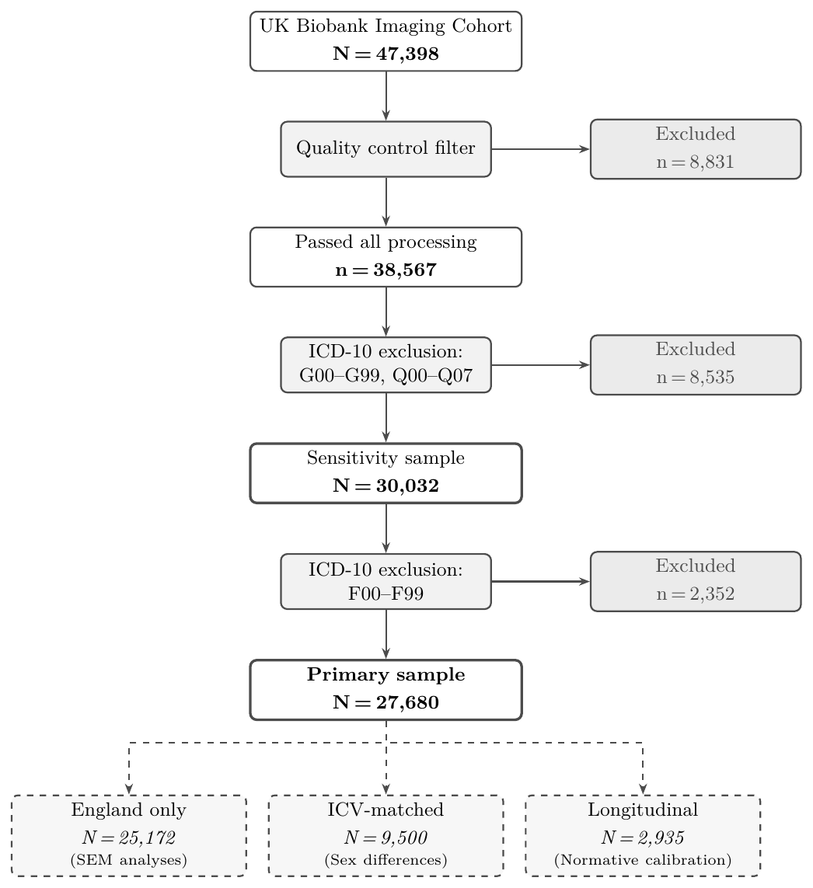
:::

:::

::: {.slide-citation}
Sudlow et al., 2015 · Miller et al., 2016
:::

::: {.notes}
Sample selection is transparent. Starting from 42,898 imaging UKB participants, three filters reduce to 27,680 primary: (1) QC removes 8,987 segmentation failures; (2) G/Q ICD-10 codes (neurological) removed for a stricter sensitivity sample (30,032); (3) F codes (psychiatric) excluded from primary because mood disorders are known to affect HC. England-only subsample (25,172) used for SEM because the Index of Multiple Deprivation (IMDP) covariate is not comparable across UK countries. ICV-matched subsample (9,500) for the head-size convergence test. Longitudinal session 3 (2,935) for temporal stability.
:::

## {.fig-sidebar data-menu-title="Ch5 · QC pipeline"}

::: {.eyebrow}
Chapter 5 · Quality control
:::

::: {.slide-title}
3-stage QC defends T1-only HVR
:::

::: {.slide-body}

::: {.fig-col style="padding-left: 12px"}

[**Stage 1 — automated**]{.subhead}

- [**DARQ ≥ 0.25**]{.accent} (registration QC)
- [**AssemblyNet "A"**]{.accent} (segmentation QC)

[**Stage 2 — outlier flagging**]{.subhead}

- ±3 SD age- and ICV-adjusted residuals on HC + LV

[**Stage 3 — visual**]{.subhead}

- Manual inspection of all flagged volumes

:::

::: {.text-col}

[**Why conservative**]{.subhead}

- Small structures: minor failures = large relative errors
- No UKB manual ground truth for HC — Stage 1 + 2 are the only signal
- Same QC pipeline applied to ADNI in Ch6

:::

:::

::: {.slide-citation}
Fonov et al., 2022 (DARQ) · Coupé et al., 2020 (AssemblyNet)
:::

::: {.notes}
T1-only HVR with no UKB manual ground truth requires defensive QC. Three stages: (1) automated — DARQ (registration QC, deep-learning) and AssemblyNet (segmentation QC); (2) statistical outlier flagging at ±3 SD on age- and ICV-adjusted residuals for both HC and LV; (3) visual inspection of every flagged volume. The pipeline is conservative because the relative impact of small absolute segmentation errors on a small structure is large.
:::

## {.fig-hero data-menu-title="Ch5 · Demographics"}

::: {.eyebrow}
Chapter 5 · Sample characteristics
:::

::: {.slide-title}
N = 27,680 · 56% female · ages 45–82
:::

::: {.slide-body}

| | Females (N ≈ 15,500) | Males (N ≈ 12,200) |
|---|---:|---:|
| **Age (mean ± SD, yrs)** | ≈ 63.7 ± 7.4 | ≈ 64.4 ± 7.5 |
| **ICV (mean ± SD, mL)** | ≈ 1,395 ± 110 | ≈ [**1,580**]{.accent} ± 122 |
| **Education (yrs)** | ≈ 15.2 | ≈ 15.4 |
| **HC volume (mL)** | smaller (raw) | larger (raw) |

Males have ~12% larger ICV (Ruigrok 2014) — the foundational confound for any HC sex-difference analysis.

:::

::: {.notes}
The sample is 56% female, ages 45-82. Males have ~12% larger ICV than females on average — the foundational confound for any HC sex-difference analysis. Age and education are comparable across sex. The ICV imbalance is what motivates the entire adjustment-methods comparison: any HC sex-difference estimate is sensitive to how head-size is handled, and that's the central methodological question. Numbers from `all_demog` table are dynamic; approximate values shown.
:::

## {.fig-sidebar data-menu-title="Ch5 · 4 methods"}

::: {.eyebrow}
Chapter 5 · Adjustment methods
:::

::: {.slide-title}
Four standard ICV adjustment methods compared
:::

::: {.slide-body}

::: {.fig-col style="padding-left: 12px"}

| Method | Formula | Assumes |
|--------|---------|---------|
| **Raw** | [*V*]{.accent} | no correction |
| **Proportions** | [*V* / *ICV* × 1000]{.accent} | isometric: *V* ∝ *ICV* |
| **Stereotaxic** | [*V* × \|*J*\|]{.accent} | template-space removes ICV |
| **Residualization** | [*V* − β̂(*ICV* − *ICV*̄)]{.accent} | linear *V* vs *ICV* |

:::

::: {.text-col}

[**The problem**]{.subhead}

- Each method makes a different mathematical assumption
- Same data yields [**different effect sizes**]{.accent} — sometimes opposite direction
- No consensus on which is correct

:::

:::

::: {.slide-citation}
Sanchis-Segura et al., 2020 · Sanfilipo et al., 2004 · O'Brien et al., 2011 · de Jong et al., 2017
:::

::: {.notes}
The four methods make different mathematical assumptions about how V relates to ICV. Raw ignores it. Proportions assume isometric scaling V ∝ ICV. Stereotaxic warps to a template, removing ICV via spatial transformation. Residualization removes linear ICV effect via regression. The same data yields different effect sizes — sometimes with opposite signs — across these methods (Sanchis-Segura 2020). No consensus exists on the correct method. This is what motivates HVR as a self-normalizing alternative.
:::

## {.fig-sidebar data-menu-title="Ch5 · HVR vs ICV"}

::: {.eyebrow}
Chapter 5 · ICV independence
:::

::: {.slide-title}
HVR halves the ICV correlation
:::

::: {.slide-body}

::: {.fig-col style="padding-left: 12px"}

| Measure | r with ICV |
|---------|-----------:|
| **Raw HC** | ≈ [**+0.60**]{.accent} |
| **HC proportions** | ≈ [**−0.39**]{.accent} (over-corrected) |
| **HC stereotaxic** | ≈ 0 |
| **HC residualized** | = 0 (by construction) |
| [**HVR**]{.accent} | ≈ [**−0.25**]{.accent} |

:::

::: {.text-col}

[**Honest framing**]{.subhead}

- HVR is [**less confounded**]{.accent} than raw HC — not strictly zero
- Negative r is the LV component scaling
- HVR retains biologically meaningful variation that residualization erases

:::

:::

::: {.slide-citation}
de Jong et al., 2017 · Pintzka et al., 2015
:::

::: {.notes}
Raw HC correlates r ≈ +0.60 with ICV — the confound that motivates this whole literature. Proportions over-corrects to r ≈ -0.39. Residualization is r = 0 by construction. HVR sits at r ≈ -0.25 — substantially reduced from raw, not zero. The negative direction comes from the LV component scaling. Honest framing: HVR is APPROXIMATELY self-normalizing, not strictly. Importantly, HVR retains biologically meaningful sex variation that strict residualization (r = 0) erases.
:::

## {.fig-hero data-menu-title="Ch5 · Headline effect sizes"}

::: {.eyebrow}
Chapter 5 · The headline result
:::

::: {.slide-title}
HC sex differences reverse across methods — HVR doesn't
:::

::: {.slide-body}
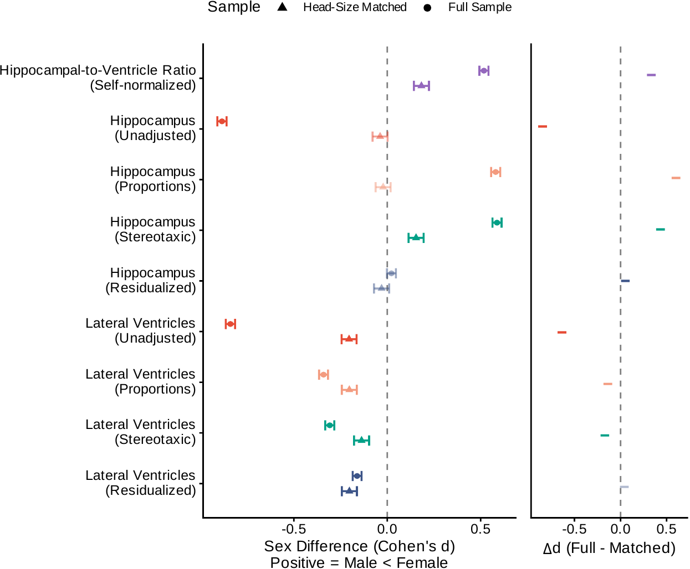
:::

::: {.slide-footer}
HC d swings [**1.5 SD**]{.accent} across methods (−0.89 raw → +0.58 proportions) HVR holds at d ≈ [**+0.52**]{.accent} (female advantage); LV stays negative
:::

::: {.notes}
This is the central methodological result of the chapter. Hippocampal sex differences swing from d = -0.89 (raw, males much larger) to d = +0.58 (proportions, females larger) — a 1.5 standard deviation swing driven entirely by analytical choice. HVR by contrast yields a consistent d ≈ +0.52 (female advantage) across all four methods (since the ratio sidesteps the adjustment). LV is consistently negative. Different methods, opposite conclusions for HC — but HVR survives the methods-comparison sanity check.
:::

## {.fig-sidebar data-menu-title="Ch5 · Matched-pair proof"}

::: {.eyebrow}
Chapter 5 · ICV-matched test
:::

::: {.slide-title}
Matching collapses HC effects; HVR persists
:::

::: {.slide-body}

::: {.fig-col style="padding-left: 12px"}

[**Matching construction**]{.subhead}

- 1:1 optimal Mahalanobis
- Age ±1 yr
- ICV ±25 cc (~0.3 SD)
- 4,750 pairs (9,500 total)

[**Results**]{.subhead}

| Measure | Full d | Matched d |
|---------|-------:|----------:|
| HC raw | −0.89 | ≈ 0 |
| LV raw | persists | attenuates |
| [**HVR**]{.accent-fixed} | +0.52 | [**+0.19**]{.accent-fixed} |

:::

::: {.text-col}

[**Interpretation**]{.subhead}

- HC sex difference IS the head-size confound
- HVR sex difference is [**not**]{.accent} a head-size artifact

[**This is the geometric proof**]{.subhead} the chapter rests on.

:::

:::

::: {.slide-citation}
Ho et al., 2011 · Pintzka et al., 2015 · Voevodskaya et al., 2014
:::

::: {.notes}
The strongest empirical argument in the chapter. Construct ICV-matched pairs (4,750 pairs, optimal Mahalanobis match on age ±1 yr and ICV ±25 cc). In the matched sample, HC raw sex-difference collapses to d ≈ 0. LV attenuates but persists. HVR drops from 0.52 to 0.19 but stays significantly different from zero. Interpretation: the HC sex difference IS the head-size confound; the HVR sex difference is NOT. The 25 cc tolerance is ~0.3 SD of ICV — tight enough to equate head size, loose enough to retain the sample.
:::

## {.big-number data-menu-title="Ch5 · Defending d=0.18"}

::: {.eyebrow}
Chapter 5 · Effect size defense
:::

::: {.slide-title}
Is d = 0.18 meaningful?
:::

::: {.slide-subtitle}
Yes — biology, not just power
:::

::: {.slide-body}

[d = 0.18]{.bignum}

[HVR sex difference in 4,750 ICV-matched pairs]{.bignum-label}

[With ICV equated, the effect is pure biology. Widens with age (≈ 0.13 at 45–55 → ≈ 0.30 at 75+). Survives at matched-sample N = 9,500, where power = 99% to detect d = 0.10.]{.bignum-context}

:::

::: {.slide-citation}
Cohen, 2013
:::

::: {.notes}
With N = 27,680 a committee will hit you with "everything is significant at this N." Pre-empt: d = 0.18 corresponds to 75th-female ≈ 50th-male crossover — visible but small. Critically, this is biology not power: ICV is equated, so what remains can't be head-size. The effect widens with age (≈ 0.13 at 45-55, ≈ 0.30 at 75+) — consistent with differential aging trajectories. Survives at matched-sample N = 9,500 where power is still > 99% for d = 0.10.
:::

## {.fig-hero data-menu-title="Ch5 · Age × sex trajectories"}

::: {.eyebrow}
Chapter 5 · Age × sex
:::

::: {.slide-title}
Males show 1.7× steeper HVR decline
:::

::: {.slide-body}
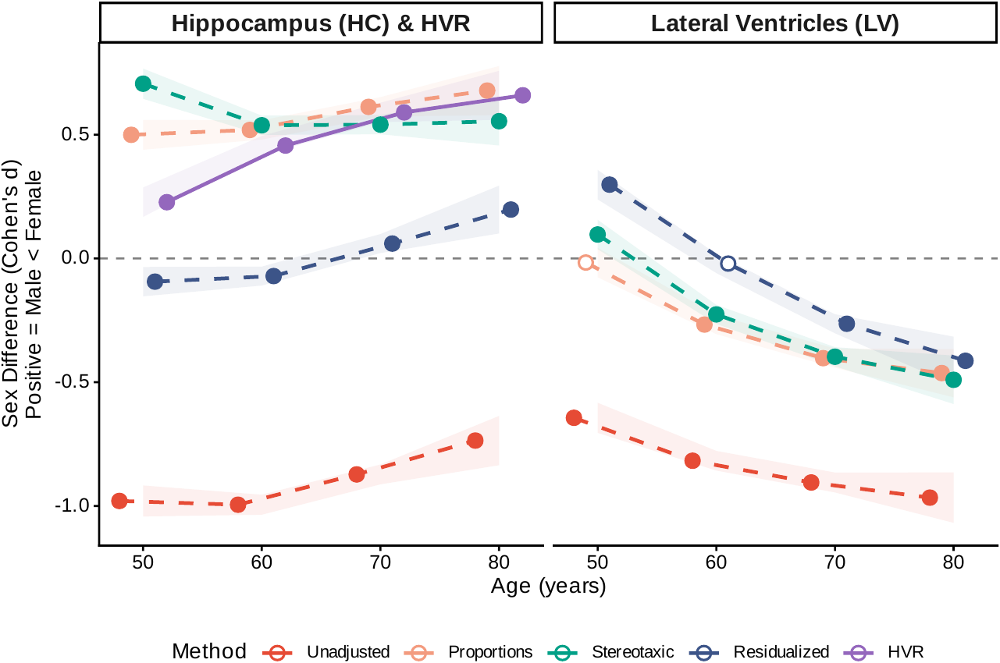
:::

::: {.slide-footer}
Male HVR slope sits at [**1.7×**]{.accent} female — between HC (1.4×) and LV (2.0×) Consistent with HVR capturing both atrophy and expansion (*p* < 10⁻⁵⁰)
:::

::: {.notes}
Males show 1.7× steeper HVR slope with age than females (cross-sectional). The constituent measures bracket this: HC alone shows ~1.4× steeper male slope; LV alone ~2.0× steeper male slope. HVR sits between — consistent with capturing both atrophy and expansion. The p < 10⁻⁵⁰ is huge but the effect size matters more than the p-value at this N. The female HVR advantage WIDENS with age.
:::

## {.fig-sidebar data-menu-title="Ch5 · Cross-sectional caveat"}

::: {.eyebrow}
Chapter 5 · Design caveat
:::

::: {.slide-title}
Cross-sectional ≠ longitudinal
:::

::: {.slide-body}

::: {.fig-col style="padding-left: 12px"}

[**What cross-sectional can't prove**]{.subhead}

- Individual within-subject decline
- Cohort effects (e.g., post-menopausal hormones)

[**Temporal stability check**]{.subhead}

- 2.7-year ses-2 / ses-3 retest in N = 2,935
- HVR ICC > 0.93
- HC + LV ICCs similar

[**Longitudinal HVR**]{.subhead} explored in Ch6 (ADNI A+).

:::

::: {.text-col}

[**Defensible because**]{.subhead}

- Pseudo-trajectories from large cross-section approximate population trajectories in many studies
- High retest ICC supports temporal stability
- LGCM in Ch6 directly tests longitudinal HVR change

:::

:::

::: {.notes}
Pre-empts the "cross-sectional can't claim trajectories" challenge. Acknowledge: cross-sectional doesn't prove individual decline; cohort effects are confounded. Mitigations: (1) 2.7-year ses-3 retest in N = 2,935 shows HVR ICC > 0.93 (high temporal stability); (2) Chapter 6 directly tests longitudinal HVR change in ADNI A+ via LGCM.
:::

## {.fig-leftright data-menu-title="Ch5 · GAMLSS centiles"}

::: {.slide-body}

::: {.header-col}

::: {.eyebrow}
Chapter 5 · Normative centiles
:::

::: {.slide-title}
Sex-specific HVR centile curves
:::

::: {.slide-subtitle}
Females (red), All, Males (blue); HVR, HC, LV
:::

::: {.body-text}
[**GAMLSS spec**]{.subhead}

μ = cubic spline(age) + site random intercept; σ also age-varying.

[**Fit + selection**]{.subhead}

80/20 train/test, refit on full data; [**BCCG distribution**]{.accent} selected by AIC/BIC.

Centiles (5/10/25/50/75/90/95) generated for ages 45–82 by sex.
:::

:::

::: {.fig-col}
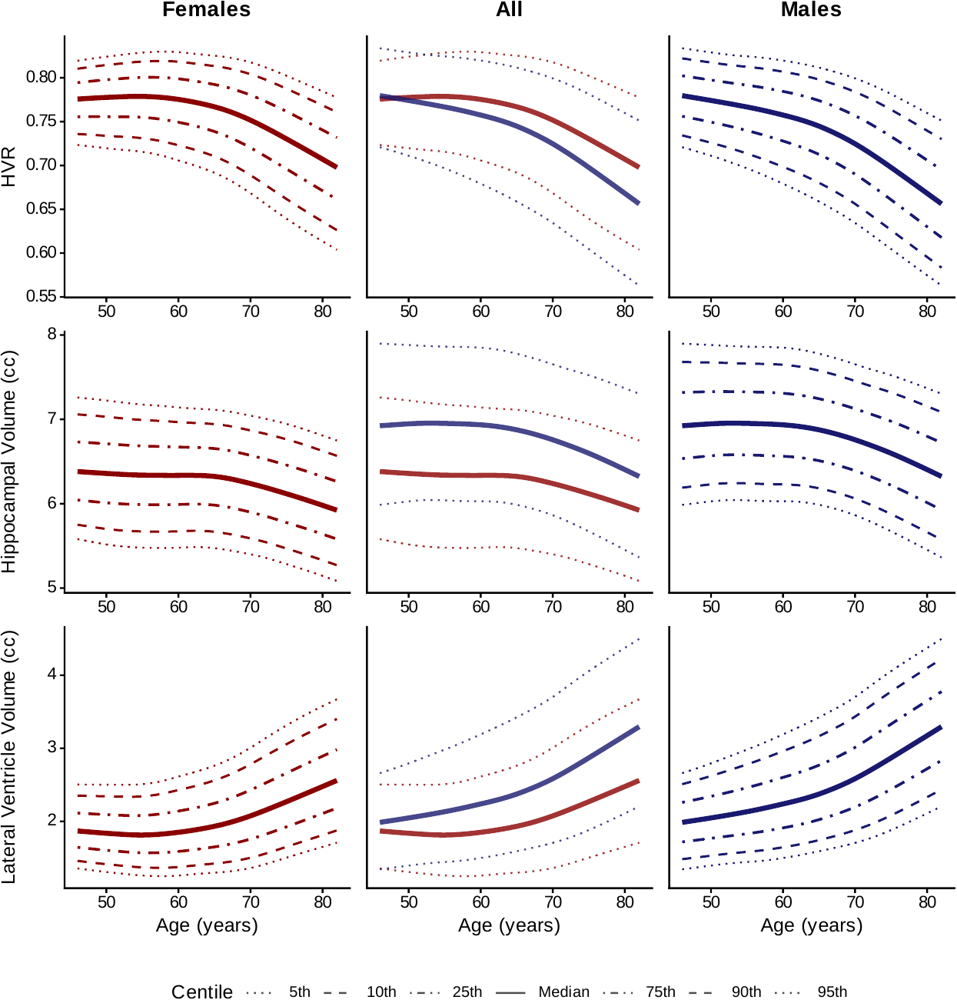
:::

:::

::: {.notes}
GAMLSS = Generalized Additive Models for Location, Scale, and Shape (Rigby & Stasinopoulos 2005). Mean is modeled as cubic spline of age + site random intercept; variance is also age-varying. Train/test 80/20 split, then refit on full data. Distribution selected by AIC/BIC — BCCG (Box-Cox Cole-Green) for HVR. Sex-specific curves for the 5/10/25/50/75/90/95 centiles. These curves are the reference applied to ADNI in Chapter 6.
:::

## {.fig-sidebar data-menu-title="Ch5 · GAMLSS justification"}

::: {.eyebrow}
Chapter 5 · Methodology defense
:::

::: {.slide-title}
Why GAMLSS, not Bayesian / PCN / ComBat?
:::

::: {.slide-body}

::: {.fig-col style="padding-left: 12px"}

[**GAMLSS pros**]{.subhead}

- Well-established (Rigby & Stasinopoulos 2005)
- Used in [**Bethlehem 2022 brain charts**]{.accent}
- Models μ + σ + ν jointly
- Transparent coefficients for [**external transfer**]{.accent}

:::

::: {.text-col}

[**Alternatives & why not**]{.subhead}

- [**Marquand PCN**]{.accent}: more flexible for site harmonization, but requires Bayesian priors + reference pretraining (UKB is the reference here)
- [**ComBat-GAM**]{.accent}: harmonizes site, not normative centiles
- [**hbr / Bayesian hierarchical**]{.accent}: similar tradeoffs

:::

:::

::: {.slide-citation}
Rigby & Stasinopoulos, 2005 · Bethlehem et al., 2022 · Ge et al., 2024
:::

::: {.notes}
Specialist methodology question. GAMLSS is the classical frequentist approach: well-established, used in Bethlehem 2022's landmark brain-chart paper, models the entire distribution shape parametrically. PCN (Marquand and colleagues) is more flexible for site harmonization and Bayesian uncertainty, but requires a Bayesian prior structure and reference normative pretraining — UKB IS that reference here, so the use case differs. ComBat-GAM is for site harmonization, not normative modeling per se. Coefficient transparency matters for external transfer (ADNI in Ch6).
:::

## {.fig-hero data-menu-title="Ch5 · GAMLSS calibration"}

::: {.eyebrow}
Chapter 5 · Calibration
:::

::: {.slide-title}
Centile model is well-calibrated
:::

::: {.slide-body}
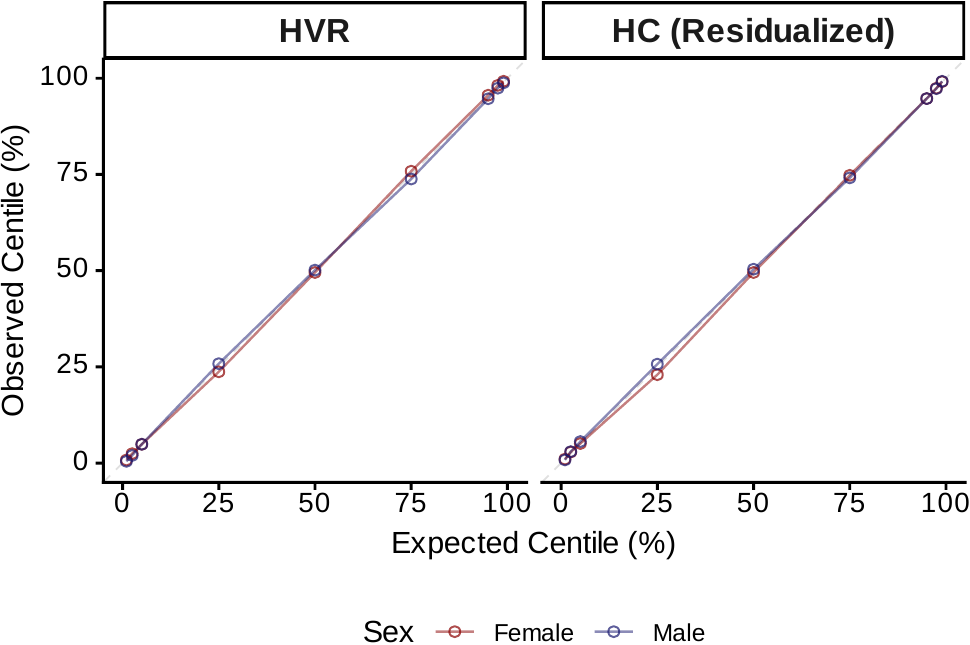
:::

::: {.slide-footer}
Held-out 20% test set: observed proportions below each nominal centile vs expected. Points on diagonal = perfectly calibrated.
:::

::: {.notes}
A normative model that's miscalibrated is worse than no model. The 80/20 split: 80% train, 20% held out. Plot the observed proportion of held-out subjects below each nominal centile (5, 10, 25, 50, 75, 90, 95) against the expected. Points on the diagonal = perfect calibration. The HVR model calibrates well — observed proportions match nominal proportions across the centile range.
:::

## {.fig-sidebar data-menu-title="Ch5 · Bifactor cog model"}

::: {.eyebrow}
Chapter 5 · Cognitive measurement
:::

::: {.slide-title}
Bifactor SEM extracts g + domain factors
:::

::: {.slide-body}

::: {.fig-col style="padding-left: 12px"}

[**12 UKB cognitive indicators**]{.subhead}

- Memory: PM, NM, prospective memory
- Speed: RT, TMA, SDS
- Executive function: TMB, tower
- Reasoning + verbal + numeric

[**Bifactor structure**]{.subhead}

- [**g**]{.accent} loads on all 12
- [**Memory_s**]{.accent} loads on 3 memory items
- [**Speed_s**]{.accent} loads on 3 speed items
- All factors orthogonal

:::

::: {.text-col}

[**Caveats**]{.subhead}

- UKB battery is touchscreen, briefer than ADNI's neuropsych
- Memory_s collapsed in fit (common in bifactor; Eid 2017)
- Speed_s + g retained as the analytic factors

:::

:::

::: {.slide-citation}
Rosseel et al., 2012 (lavaan) · Eid et al., 2017 · Burns 2020
:::

::: {.notes}
The cognitive measurement model is a bifactor SEM with 12 UKB indicators. g loads on all 12; Memory_s on the 3 memory items; Speed_s on the 3 speed items. Domain factors are orthogonal to g (marker variable identification). Memory_s collapsed during fit — a known issue with bifactor models when domain variance is small (Eid 2017). Speed_s and g are the analytic factors used in path tests. Caveat: UKB cognitive battery is touchscreen-administered, briefer than clinical neuropsych — covers similar constructs but with single-session reliability constraints.
:::

## {.fig-hero data-menu-title="Ch5 · Invariance"}

::: {.eyebrow}
Chapter 5 · Measurement invariance
:::

::: {.slide-title}
Strict invariance across sex
:::

::: {.slide-body}

| Step | ΔCFI | ΔRMSEA | Verdict |
|------|:----:|:------:|---------|
| Configural | — (CFI = 0.963; RMSEA = 0.059) | — | [**fit**]{.accent} |
| Metric (loadings) | [**−0.001**]{.accent} | [**−0.004**]{.accent} | [**supported**]{.accent} |
| Scalar (intercepts) | [**−0.006**]{.accent} | [**+0.002**]{.accent} | [**supported**]{.accent} |
| Strict (residuals) | [**−0.001**]{.accent} | [**−0.002**]{.accent} | [**supported**]{.accent} |

: {tbl-colwidths="[36,28,16,20]"}

All ΔCFI within ±0.01 and ΔRMSEA within ±0.015 → strict invariance holds → sex-stratified SEM paths directly comparable.

:::

::: {.slide-citation}
Cheung & Rensvold, 2002 · Chen 2007 · Putnick & Bornstein, 2016
:::

::: {.notes}
Multi-group measurement invariance is required for cross-sex path comparison. The chapter tests configural → metric → scalar → strict, applying the Cheung & Rensvold (2002) and Chen (2007) ΔCFI ≤ 0.01 and ΔRMSEA ≤ 0.015 cutoffs. All four levels are supported, including strict (residual variances equal across sex) — a stringent test. Validates direct comparison of sex-stratified path coefficients downstream.
:::

## {.fig-hero data-menu-title="Ch5 · SEM brain–g"}

::: {.eyebrow}
Chapter 5 · Functional validity
:::

::: {.slide-title}
HVR predicts g comparably to HC
:::

::: {.slide-body}

| Predictor → g | β (95% CI) |
|---------------|-----------:|
| **HC raw** | ≈ 0.055 [0.032, 0.078] |
| **HC residualized** | ≈ 0.039 [0.019, 0.059] |
| [**HVR**]{.accent} | ≈ [**0.060 [0.038, 0.081]**]{.accent} |

HVR's brain–cognition association is comparable to (or numerically stronger than) HC-based measures. CIs overlap.

:::

::: {.notes}
Three pooled SEMs: HC raw → g, HC residualized → g, HVR → g. All β ≈ 0.04-0.06 with overlapping CIs. HVR is comparable to (numerically slightly stronger than) HC measures despite no head-size adjustment. The functional-validity claim: HVR carries the same predictive content for general cognition as standard HC measures, while reducing ICV dependence.
:::

## {.fig-hero data-menu-title="Ch5 · SEM by sex"}

::: {.eyebrow}
Chapter 5 · Sex-stratified paths
:::

::: {.slide-title}
HVR predicts cognition in males where HC_res doesn't
:::

::: {.slide-body}
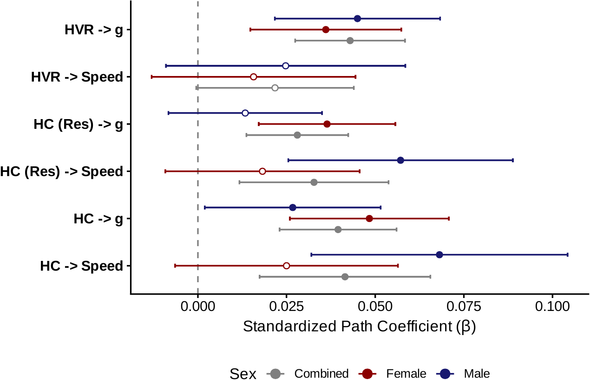
:::

::: {.slide-footer}
HVR → g is significant in [**both sexes**]{.accent} (F β = 0.036, M β = 0.045) HC~RES~ → g is significant only in females (M β = 0.013, n.s.)
:::

::: {.slide-citation}
Zheng et al., 2017 · Jockwitz et al., 2024 · Bachmann et al., 2023
:::

::: {.notes}
The most novel SEM finding. Multi-group forest plot of standardized brain-cognition paths by sex. HC residualized → g: significant in females, n.s. in males (replicates the older Zheng 2017 finding that HC predicts memory in older women but not men). HVR → g: significant in both sexes. Interpretation: HVR's ventricular component carries cognition-relevant information that residualization strips out. This is a key argument for HVR over residualization — the strict mathematical adjustment erases real biology.
:::

## {.fig-triptych data-menu-title="Ch5 · Sensitivity"}

::: {.eyebrow}
Chapter 5 · Sensitivity analyses
:::

::: {.slide-title}
Site, hemisphere, psychiatric history
:::

::: {.slide-body}

::: {.triptych}

::: {.panel}

[**Site**]{.panel-label}

[ICC = 0.004–0.012 < 1.5% variance — minimal contribution]{.panel-sub}

:::

::: {.panel}

[**Hemisphere**]{.panel-label}

[LV: d_L = 0.477, d_R = 0.481 HC~RES~: d_L = −0.143, d_R = −0.160 HVR: d_R = +0.05, d_L = −0.01 — effectively symmetric]{.panel-sub}

:::

::: {.panel}

[**Psychiatric history**]{.panel-label}

[F-codes sensitivity (N = 30,032) HVR: Δd = 0.002 HC raw: Δd = −0.001 — max |Δd| = 0.009]{.panel-sub}

:::

:::

:::

::: {.slide-citation}
Fry et al., 2017
:::

::: {.notes}
Three robustness checks in one slide. (1) Site ICCs are 0.004-0.012 — site variance is <1.5% of total. Including or omitting site fixed effects doesn't materially change estimates. (2) Hemisphere: HC and LV symmetric; HVR shows a small lateralization (d_right = 0.05, d_left = -0.01) — small, opposite-sign, likely noise. (3) Including psychiatric history (F-codes, sensitivity sample N = 30,032) changes effect sizes by Δd < 0.02. The primary results are robust to these alternative specifications.
:::

## {.fig-leftright data-menu-title="Ch5 · Distributions"}

::: {.slide-body}

::: {.header-col}

::: {.eyebrow}
Chapter 5 · Distribution visualization
:::

::: {.slide-title}
Density overlays: full vs matched
:::

::: {.slide-subtitle}
Females (red) vs males (blue)
:::

::: {.body-text}
Density overlays of [**HC, LV, HVR**]{.accent} × 4 adjustment methods.

[**Left**]{.subhead} full sample

[**Right**]{.subhead} ICV-matched sub-sample

In the matched column HC distributions converge while HVR retains separation — visual companion to the effect-size analysis.
:::

:::

::: {.fig-col}
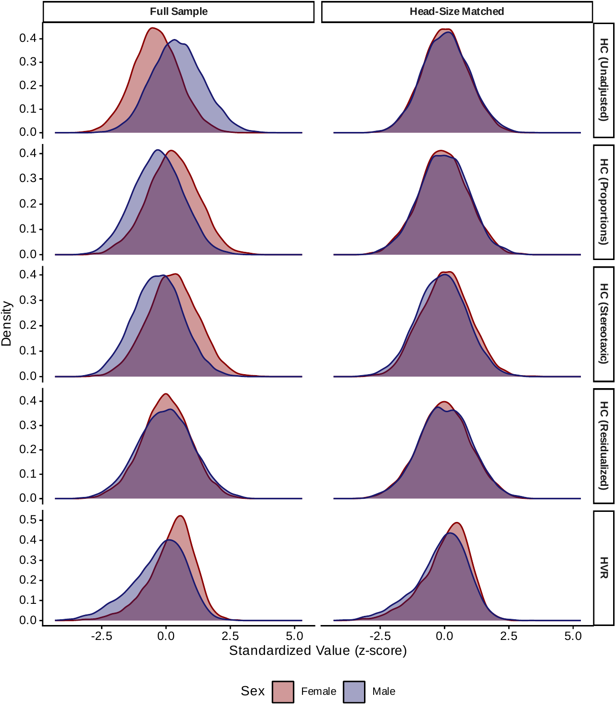
:::

:::

::: {.notes}
Visual companion to the effect-size slide. Shows distribution overlap directly — honest visualization of how much sexes differ across measures and adjustment methods. The matched sample (right column) shows HC distributions converge while HVR retains separation.
:::

## {.fig-sidebar data-menu-title="Ch5 · Brain-chart lit"}

::: {.eyebrow}
Chapter 5 · Literature comparison
:::

::: {.slide-title}
How does this compare to Bethlehem 2022?
:::

::: {.slide-body}

::: {.fig-col style="padding-left: 12px"}

[**Prior work**]{.subhead}

- [**Bethlehem 2022**]{.accent}: HC + total ventricles, lifespan charts — no HVR, no sex stratification for headline
- [**Ge 2024**]{.accent}: sex-specific norms — not for HVR
- [**Dima 2022**]{.accent} (ENIGMA): subcortical norms — no HVR

:::

::: {.text-col}

[**This chapter's contribution**]{.subhead}

- HVR-specific norms
- Sex-stratified throughout
- Transfer coefficients published for external cohorts
- Used in Ch6 to z-score ADNI participants

:::

:::

::: {.slide-citation}
Bethlehem et al., 2022 · Ge et al., 2024 · Dima et al., 2022 · Coupé et al., 2019
:::

::: {.notes}
A likely committee question: "Bethlehem 2022 already published brain charts at scale — what's new here?" Answer: prior brain-chart work doesn't cover HVR (Bethlehem 2022 covered HC + total ventricles separately, no HVR; not sex-stratified for the headline charts). Ge 2024 produced sex-specific norms but not for HVR. Dima 2022 ENIGMA subcortical norms have no HVR. This chapter's contribution: HVR-specific, sex-stratified, with publishable transfer coefficients used in Chapter 6.
:::

## {.fig-sidebar data-menu-title="Ch5 · UKB generalizability"}

::: {.eyebrow}
Chapter 5 · Generalizability
:::

::: {.slide-title}
UKB volunteer bias — what does it mean?
:::

::: {.slide-body}

::: {.fig-col style="padding-left: 12px"}

[**Fry 2017 documented**]{.subhead}

- UKB volunteers ~5% more likely to be highly educated
- Less obese, less likely to smoke
- Disproportionately white

[**Direction of bias**]{.subhead}

- Healthy-volunteer effect → [**attenuates**]{.accent} clinical effect sizes
- Sex-difference findings are conservative

:::

::: {.text-col}

[**Mitigations**]{.subhead}

- Centiles transfer well to disease-enriched cohorts (Ch6 demonstrates)
- Replication in more diverse cohorts (WRAP, AIBL) is future work
- Sample size compensates for some bias

:::

:::

::: {.slide-citation}
Fry et al., 2017
:::

::: {.notes}
UKB has well-documented volunteer bias (Fry 2017): participants are healthier, wealthier, and whiter than the UK general population. Direction of bias: healthy-volunteer effects ATTENUATE clinical effect sizes, so the findings are conservative. The chapter's strong sex-difference results emerge despite this attenuation. Centiles transfer to disease-enriched cohorts (demonstrated in Ch6, where they're applied to ADNI). Replication in more diverse cohorts (WRAP, AIBL) is future work.
:::

## {.fig-sidebar data-menu-title="Ch5 · Limitations"}

::: {.eyebrow}
Chapter 5 · Limitations
:::

::: {.slide-title}
What this chapter does not claim
:::

::: {.slide-body}

::: {.fig-col style="padding-left: 12px"}

[**Design**]{.subhead}

- Cross-sectional (longitudinal in Ch6)
- HVR conflates HC + LV in a single value
- UKB volunteer bias

[**Measurement model**]{.subhead}

- Memory_s factor collapse
- lavaan doesn't support cluster + multigroup simultaneously
- Power-corrected proportions not tested

[**Data**]{.subhead}

- APOE not available in UKB Application 45551

:::

::: {.text-col}

[**Mitigations**]{.subhead}

- Ses-3 retest validates temporal stability
- Speed_s + g retained as analytic factors
- Site ICCs negligible
- Ch6 tests UKB norms in ADNI

:::

:::

::: {.notes}
Honest limitations. Cross-sectional design (Ch6 has longitudinal). HVR is a composite — HC and LV contribute jointly, can't fully separate. UKB volunteer bias attenuates findings. Memory_s collapsed in bifactor — common but limits domain-specific tests. lavaan technical limitation: can't have cluster + multigroup simultaneously. Power-corrected (allometric) proportions (Sanchis-Segura's preferred method) not tested — minor since the 4 methods cover the main approaches. APOE unavailable in this UKB application — limits sex × genetic interaction tests (handled differently in Ch6 via ADNI).
:::

## {.fig-sidebar data-menu-title="Ch5 · Quadratic age"}

::: {.eyebrow}
Chapter 5 · Non-linear aging
:::

::: {.slide-title}
HVR captures accelerating decline that HC misses
:::

::: {.slide-body}

::: {.fig-col style="padding-left: 12px"}

[**Quadratic age coefficients (SEM)**]{.subhead}

| Measure | β~age²~ | p |
|:--------|:-------:|:-:|
| HVR | [**−0.134**]{.accent-fixed} | < 0.001 |
| HC residualized | [**−0.075**]{.accent-fixed} | < 0.001 |
| HC (raw) | not estimable | — |

: {tbl-colwidths="[50,30,20]"}

All quadratic age effects are [**negative**]{.accent} — decline accelerates with age.

:::

::: {.text-col}

[**Why HVR accelerates more**]{.subhead}

- HVR captures [**both**]{.accent} HC atrophy and ventricular expansion
- Both processes accelerate at older ages
- HC residualization removes the ventricular signal

[**Why raw HC has no quadratic term**]{.subhead}

- HC + ICV + age² produces multicollinearity
- Linear-only specification required for raw HC

:::

:::

::: {.notes}
HVR captures stronger accelerating age decline than HC residualized (β_age² = -0.134 vs -0.075, both p < 0.001). Raw HC could not be modelled with a quadratic age term — the combination of HC + ICV + age² produces multicollinearity. HVR's stronger quadratic effect reflects its dual capture of both hippocampal atrophy AND ventricular expansion, both of which accelerate at older ages. This is a quiet but important finding: residualization throws away the very signal that drives the accelerating pattern.
:::

## {.fig-sidebar data-menu-title="Ch5 · Test-retest ICC"}

::: {.eyebrow}
Chapter 5 · Temporal stability
:::

::: {.slide-title}
HVR ICC = 0.93 — stable over 2.7 years
:::

::: {.slide-body}

::: {.fig-col style="padding-left: 12px"}

| Measure | r | ICC |
|:--------|:-:|:---:|
| HC | 0.964 | 0.959 |
| LV | 0.958 | 0.946 |
| **HVR** | [**0.952**]{.accent} | [**0.933**]{.accent} |

: {tbl-colwidths="[40,30,30]"}

[**Setup**]{.subhead}

- ses-2 / ses-3 retest, N = 2,935
- Mean follow-up: 2.7 years (SD 1.1)

:::

::: {.text-col}

[**Why HVR is slightly lower**]{.subhead}

- HVR conflates two age-changing processes — true within-subject change reduces apparent reliability
- HC and LV measure single structures and drift less in absolute terms

[**All > 0.93 = excellent**]{.subhead}

HVR remains a stable individual marker; the small ICC gap reflects biology, not measurement noise.

:::

:::

::: {.slide-citation}
Koo & Li, 2016
:::

::: {.notes}
Temporal stability over a mean 2.7-year follow-up (N = 2,935): HVR r = 0.952 / ICC = 0.933, HC r = 0.964 / ICC = 0.959, LV r = 0.958 / ICC = 0.946. All are "excellent" by conventional thresholds. HVR's slightly lower reliability is interpretable — it captures concurrent changes in both HC and LV, so genuine within-subject change reduces apparent test-retest agreement. This is not a noise problem; it's HVR doing what it's designed to do.
:::

## {.fig-sidebar data-menu-title="Ch5 · Allometric scaling"}

::: {.eyebrow}
Chapter 5 · Biological reason
:::

::: {.slide-title}
HC scales hypoallometrically with ICV (α = 0.60)
:::

::: {.slide-body}

::: {.fig-col style="padding-left: 12px"}

[**Scaling exponents**]{.subhead}

- Hippocampus: [**α = 0.60**]{.accent} (hypoallometric — grows slower than ICV)
- Lateral ventricles: [**α ≈ 1.0**]{.accent} (isometric with ICV)

[**Consequence**]{.subhead}

Proportional correction (HC / ICV) [**over-corrects**]{.accent} because HC and ICV don't scale linearly.

:::

::: {.text-col}

[**Why HVR-ICV ≠ 0**]{.subhead}

- HC scales as ICV^0.60^; LV scales as ICV^1.0^
- HVR ratio inherits these geometries
- Residual HVR-ICV r ≈ −0.25 is biological signature, not artifact

[**Take-away**]{.subhead}

Allometric scaling explains *why* proportions over-correct and *why* HVR's small ICV correlation makes sense.

:::

:::

::: {.slide-citation}
de Jong et al., 2017 · Williams et al., 2021
:::

::: {.notes}
The hippocampus does not scale linearly with intracranial volume — it follows a hypoallometric relationship α = 0.60 (de Jong 2017). Lateral ventricles scale near-isometrically (α ≈ 1.0). Two implications: (1) HC / ICV proportional correction is mathematically wrong — it over-corrects because the relationship isn't linear. (2) HVR's small residual correlation with ICV (r ≈ -0.25) is not an adjustment failure — it's the inherited geometry of two structures with different scaling exponents. Defends the "HVR is good enough — perfect zero is the wrong goal" position.
:::

## {.fig-sidebar data-menu-title="Ch5 · Speed_s paths"}

::: {.eyebrow}
Chapter 5 · Sex-differential cognition
:::

::: {.slide-title}
Speed_s — males show structure–function; females don't
:::

::: {.slide-body}

::: {.fig-col style="padding-left: 12px"}

[**Pooled paths to Speed~s~**]{.subhead}

| Predictor | β | p |
|:----------|:-:|:-:|
| HC | 0.041 | <0.001 |
| HC residualized | 0.033 | 0.002 |
| HVR | 0.022 | 0.055 |

[**Sex-stratified (males)**]{.subhead}

- HC → Speed~s~: β = [**0.068**]{.accent}
- HC~RES~ → Speed~s~: β = [**0.057**]{.accent}
- Females: [**all n.s.**]{.accent}
- HVR → Speed~s~: n.s. both sexes

:::

::: {.text-col}

[**Interpretation**]{.subhead}

- Structure–speed link is [**male-specific**]{.accent} in this sample
- HVR pattern same as g: predicts general factor, not Speed~s~ specifically
- Memory~s~ could not be reliably estimated (bifactor convergence)

[**Why it matters**]{.subhead}

Adds nuance to "HVR predicts cognition": HVR predicts the general factor but not domain-specific Speed.

:::

:::

::: {.notes}
The Speed_s findings nuance the headline cognition story. In the pooled SEM, HC has the strongest path to Speed_s (β = 0.041, p < 0.001), HC residualized intermediate (β = 0.033, p = 0.002), HVR trending (β = 0.022, p = 0.055). Stratified by sex: males show significant HC and HC_residualized paths (β = 0.068 and 0.057); females show none. HVR → Speed_s is null in both sexes. So HVR predicts g comparably to HC but doesn't carry the male-specific Speed_s signal — a transparent nuance, not a contradiction.
:::

## {.fig-sidebar data-menu-title="Ch5 · APOE × sex"}

::: {.eyebrow}
Chapter 5 · Limits of the female advantage
:::

::: {.slide-title}
The female advantage is not universal
:::

::: {.slide-body}

::: {.fig-col style="padding-left: 12px"}

[**The female-advantage hypothesis**]{.subhead}

- [**Cumulative estrogen exposure**]{.accent} — longer reproductive spans linked to younger brain ages (Luders 2025)
- Estrogen promotes hippocampal neurogenesis + synaptic plasticity (Jett 2022)

[**The counter-evidence**]{.subhead}

- Female APOE ε4 carriers show [**faster**]{.accent} HC loss than male carriers in aMCI (Park 2025)
- Genetic risk can modulate or invert typical sex-differential patterns

:::

::: {.text-col}

[**What Ch5 cannot do**]{.subhead}

- APOE unavailable in this UKB application
- Pure cross-sectional — no longitudinal slopes
- Cannot test the sex × ε4 × age interaction directly here

[**Ch6 picks this up**]{.subhead} — ADNI A+ longitudinal cohort with APOE, FRS, and CVR_mimic.

:::

:::

::: {.slide-citation}
Luders 2025 · Jett 2022 · Park 2025
:::

::: {.notes}
The female advantage in HC / HVR is hypothesised to reflect cumulative estrogen exposure (Luders 2025; estrogen promotes neurogenesis per Jett 2022). But it's not universal — female APOE ε4 carriers show FASTER HC loss than male carriers in aMCI (Park 2025), evidence that genetic risk can invert typical sex-differential patterns. Chapter 5 cannot test this directly because APOE is not available in this UKB application. Chapter 6 picks up the longitudinal + APOE + cardiovascular thread in ADNI.
:::

## {.fig-sidebar data-menu-title="Ch5 · LV specifics"}

::: {.eyebrow}
Chapter 5 · Lateral ventricle story
:::

::: {.slide-title}
LV — consistent male advantage; HVR lateralization
:::

::: {.slide-body}

::: {.fig-col style="padding-left: 12px"}

[**LV sex difference (full sample)**]{.subhead}

- Left: d = [**0.48**]{.accent} (male > female)
- Right: d = [**0.48**]{.accent} (male > female)
- ICV-matched subsample: LV sex difference [**attenuates**]{.accent} but does not collapse (vs HC which collapses to ≈ 0)

[**HVR lateralization (small)**]{.subhead}

- Right: d = [**+0.05**]{.accent} [0.03, 0.07] (sig, female adv)
- Left: d = −0.01 [−0.03, 0.02] (n.s.)
- Small effect, only right reaches significance

:::

::: {.text-col}

[**Variance pattern (chapter)**]{.subhead}

- Males show greater [**ventricular variability**]{.accent} at older ages
- Consistent with heterogeneous aging in male LV trajectories

[**Why surface this**]{.subhead}

Committee may ask about LV separately. HVR captures LV's male-larger signal as part of the ratio.

:::

:::

::: {.slide-citation}
Mielke 2022 · Ferretti 2018
:::

::: {.notes}
The ventricle-specific story. Lateral ventricles show a robust male advantage (d ≈ 0.48 each side) that PERSISTS after ICV matching — this is not a head-size artifact. Males also show greater ventricular variability at older ages, suggesting heterogeneous aging trajectories (vascular vs purely neurodegenerative). HVR itself shows a small opposite-sign lateralization (right d = +0.05, left n.s.) — likely measurement noise rather than biology. The committee may ask about LV in isolation; HVR captures LV's male-larger signal as part of the ratio.
:::

## {.fig-sidebar data-menu-title="Ch5 · Multicollinearity"}

::: {.eyebrow}
Chapter 5 · Why HVR fits quadratic age
:::

::: {.slide-title}
HC + ICV + age² is not estimable — HVR is
:::

::: {.slide-body}

::: {.fig-col style="padding-left: 12px"}

[**The collinearity**]{.subhead}

- HC, ICV and age are correlated
- Adding age² to a model with HC and ICV produces unstable estimates
- HC unadjusted model uses [**linear age only**]{.accent} per spec

[**Why HVR avoids it**]{.subhead}

- HVR is self-normalizing — [**no ICV term needed**]{.accent}
- One fewer predictor in the design matrix
- Quadratic age can be estimated alongside HVR

:::

::: {.text-col}

[**Not cherry-picking complexity**]{.subhead}

- The model spec was decided by mathematics, not fit-hunting
- Each measure gets the most informative model its structure supports
- HC raw + ICV + age² → not estimable; HC~RES~ + age² → fine; HVR + age² → fine

[**Verdict**]{.subhead}

Both HVR and HC~RES~ support a quadratic age term; only raw HC (unadjusted with ICV as covariate) cannot. The asymmetry is a property of the design matrix, not a fitting advantage.

:::

:::

::: {.notes}
The model-spec defense. The HC unadjusted model uses only linear age because the combination of HC + ICV + age² produces multicollinearity (HC ↔ ICV ↔ age are pairwise correlated; adding age² pushes the design matrix near-singular). HC residualized and HVR don't have this problem — HC_RES because the ICV term is absorbed into the residual, HVR because it's self-normalizing and doesn't need a separate ICV term. So fitting quadratic age to HVR is not cherry-picking complexity; it's the only measure that mathematically supports the quadratic specification alongside a within-subject ICV control.
:::

# {.divider data-menu-title="Ch6 divider"}

::: {.divider-content}

::: {.eyebrow}
Chapter 6
:::

::: {.divider-title}
Cardiovascular Risk + HVR&#8209;Cognitive Coupling
:::

::: {.divider-subtitle}
MIMIC-based age-adjusted CVR · LME + LGCM convergence Amyloid&#8209;positive ADNI cohort
:::

:::

## {.fig-sidebar data-menu-title="Ch6 · One sentence"}

::: {.eyebrow}
Chapter 6 · The thesis
:::

::: {.slide-title}
Chapter 6 in one sentence
:::

::: {.slide-subtitle}
FRS effects on hippocampal decline reflect age — coupling itself is age&#8209;independent
:::

::: {.slide-body}

::: {.fig-col style="padding-left: 12px"}

[**a-path** (CVR → HVR slope)]{.subhead}

- FRS: [**significant**]{.accent}
- CVR~mimic~: null

[**b-path** (HVR slope → cog slope)]{.subhead}

- Both predictors: [**significant**]{.accent}

:::

::: {.text-col}

[**Implication**]{.subhead}

- FRS appears to predict atrophy because age is inside FRS
- After MIMIC adjustment, that pathway disappears
- HVR–cognitive coupling [**survives both**]{.accent} — a neurodegeneration signal, not vascular

:::

:::

::: {.notes}
Chapter 6's thesis in one slide. FRS predicts hippocampal atrophy in many LGCM models; CVR_mimic in zero. The b-path (HVR slope → cognitive slope) is significant for both. Interpretation: FRS effects on cognition through HVR atrophy are mostly age-confounded; hippocampal-cognitive coupling itself is a robust neurodegenerative signal independent of vascular risk.
:::

## {.fig-hero data-menu-title="Ch6 · CONSORT"}

::: {.eyebrow}
Chapter 6 · Sample
:::

::: {.slide-title}
Sample selection and parallel tracks
:::

::: {.slide-body}
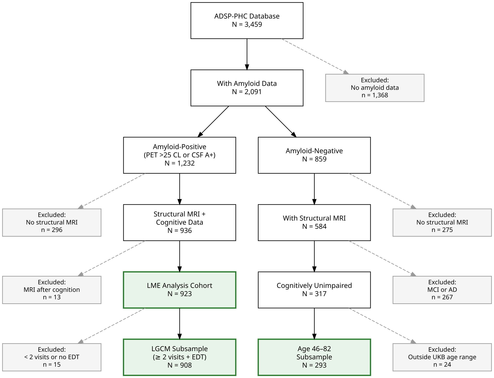
:::

::: {.slide-footer}
Left track — A+ analytic cohort. Right track — A−/CU sensitivity sample and UKB age-comparable subsample.
:::

::: {.notes}
The analytic cohort is amyloid-positive ADNI participants with complete FRS, CVR_mimic indicators, and HVR. LGCM requires ≥2 follow-up visits. Parallel A−/CU track for the sensitivity reversal analysis. UKB-comparable subsample (age range matching) used for normative-transfer validation.
:::

## {.fig-sidebar data-menu-title="Ch6 · FRS age-confound"}

::: {.eyebrow}
Chapter 6 · The motivating problem
:::

::: {.slide-title}
Why FRS is age-confounded in elderly cohorts
:::

::: {.slide-body}

::: {.fig-col}
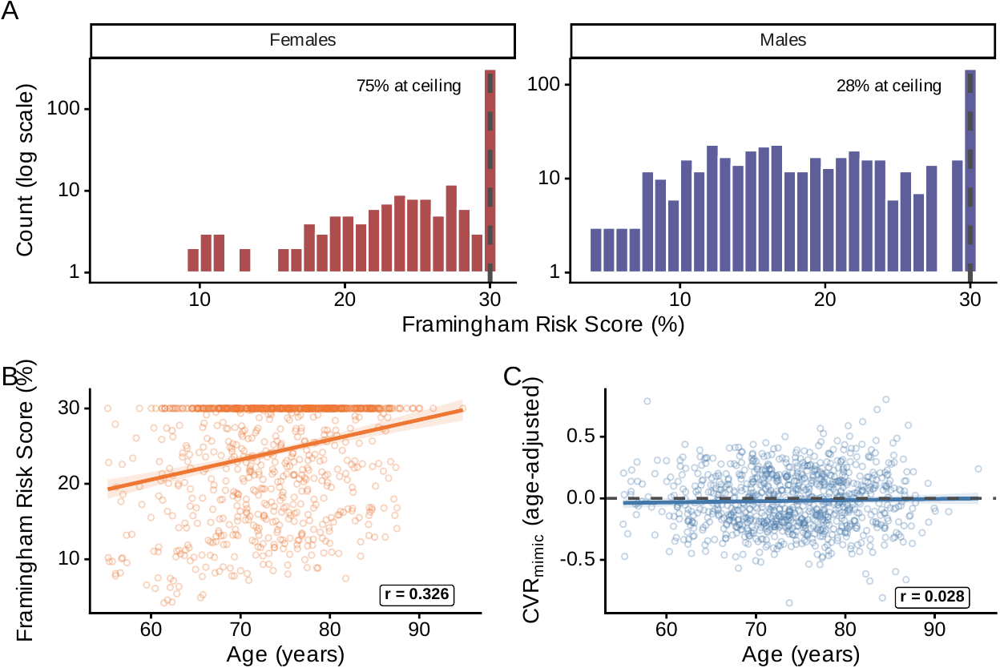
:::

::: {.text-col}

[**FRS age-loading is huge**]{.subhead}

- Log-hazard age coefficients: [**3.06 men, 2.33 women**]{.accent}
- ADSP-PHC FRS capped at 30%
- In ADNI: FRS-age r ≈ 0.5–0.7
- Age explains majority of FRS variance

[**Bottom line**]{.subhead}

In older cohorts, FRS becomes mostly an age proxy.

:::

:::

::: {.slide-citation}
D'Agostino et al., 2008 · Koller et al., 2012 · Pencina et al., 2019
:::

::: {.notes}
The Framingham Risk Score has log-hazard age coefficients of 3.06 for men and 2.33 for women (D'Agostino 2008) — age is the dominant predictor. In elderly cohorts where age variance is restricted, FRS becomes mostly an age proxy. ADSP-PHC caps FRS at 30%, further compressing variance. In ADNI, FRS-age correlation is high. Partial correlation controlling for other CVRFs remains substantial. Age alone explains the majority of FRS variance. The whole methodological motivation of the chapter rests on this confound.
:::

## {.fig-sidebar data-menu-title="Ch6 · Why MIMIC"}

::: {.eyebrow}
Chapter 6 · Methodology choice
:::

::: {.slide-title}
Why MIMIC, not GAM / IV / covariate adjustment?
:::

::: {.slide-body}

::: {.fig-col style="padding-left: 12px"}

| Approach | Why not |
|----------|---------|
| **Covariate** | Age is *inside* FRS, not external |
| **GAM residual.** | Uses observed score (with error) |
| **IV** | No valid instrument |
| [**MIMIC SEM**]{.accent} | [**Adjusts at the latent level**]{.accent} |

:::

::: {.text-col}

[**Why MIMIC**]{.subhead}

- Partitions latent variance
- Removes age [**at the latent**]{.accent} (not on noisy observed score)
- Preserves the CV construct after age is stripped out

:::

:::

::: {.slide-citation}
Jöreskog & Goldberger, 1975 · Muthén, 1984 · Bollen, 1989
:::

::: {.notes}
The most likely methodological challenge. Four candidate approaches: (1) covariate adjustment fails because age is part of FRS already — adding it as covariate is post-hoc and inefficient. (2) GAM residualization on the observed FRS score operates on a measurement-error-laden variable; the residual still has noise. (3) IV requires a valid instrument (correlated with FRS but not the outcome) — we don't have one. (4) MIMIC: defines a latent CV factor with age as a structural CAUSE; residualizes age at the latent level. Cleaner because it operates on the noise-free latent construct.
:::

## {.fig-sidebar data-menu-title="Ch6 · MIMIC equation"}

::: {.eyebrow}
Chapter 6 · MIMIC specification
:::

::: {.slide-title}
The MIMIC equation
:::

::: {.slide-body}

::: {.fig-col style="padding-left: 12px"}

[**Structural model**]{.subhead}

[*CVR* = γ · *Age*~*z*~ + ζ]{.accent}

[**Measurement model**]{.subhead}

[*x*~*j*~ = λ~*j*~ · *CVR* + δ~*j*~ , *j* = 1…5]{.accent}

[**CVR~mimic~ = ζ**]{.subhead} residual after age regressed at latent level

:::

::: {.text-col}

[**Specification notes**]{.subhead}

- Correlated residuals: SBP ↔ Chol, SBP ↔ Creat (theory-driven)
- [**γ = 0.125**]{.accent} (R² = 1.6%)
- Age explains a [**tiny slice**]{.accent} of latent CVR
- CVR~mimic~ is [**age-orthogonal**]{.accent} by construction

:::

:::

::: {.slide-citation}
Jöreskog & Goldberger, 1975 · Bollen, 1989
:::

::: {.notes}
The MIMIC (Multiple Indicators Multiple Causes) model. Structural equation: latent CVR = γ × Age_z + ζ — age is a CAUSE of the latent factor. Measurement equation: each observed indicator x_j (SBP, hypertension, glucose, total cholesterol, creatinine) is a function of the latent CVR plus measurement error δ_j. CVR_mimic is the residual ζ — what's left after age is regressed out at the latent level. Correlated residuals (SBP-Chol, SBP-Creat) are theory-driven (shared metabolic processes), not modification-index fishing.
:::

## {.fig-sidebar data-menu-title="Ch6 · MIMIC indicators"}

::: {.eyebrow}
Chapter 6 · Indicator selection
:::

::: {.slide-title}
Five indicators — what was kept, what was dropped
:::

::: {.slide-body}

::: {.fig-col style="padding-left: 12px"}

[**Retained (5)**]{.subhead}

- SBP
- Hypertension diagnosis
- Glucose
- Total cholesterol (negative loading — statin use)
- Creatinine

:::

::: {.text-col}

[**Dropped**]{.subhead}

- [**BMI**]{.accent}: loading n.s. after correlated residuals
- [**Diabetes / heart disease / stroke**]{.accent}: ADNI harmonization gives perfect tetrachoric correlations — degenerate
- [**Smoking**]{.accent}: survivorship bias in elderly cohort
- [**BP medication**]{.accent}: redundant with hypertension

:::

:::

::: {.notes}
Five indicators retained: SBP, hypertension diagnosis, glucose, total cholesterol, creatinine. The negative cholesterol loading is statin use — common in this age group, doesn't break the model. Dropped indicators with justification: BMI (loading n.s. after accounting for correlated residuals); diabetes/heart disease/stroke (ADNI harmonization yields perfect tetrachoric correlations, making the model degenerate); smoking (survivorship bias in elderly); BP medication (redundant with hypertension diagnosis).
:::

## {.fig-sidebar data-menu-title="Ch6 · MIMIC fit"}

::: {.eyebrow}
Chapter 6 · Goodness of fit
:::

::: {.slide-title}
MIMIC model fits well
:::

::: {.slide-body}

::: {.fig-col style="padding-left: 12px"}

| Index | Threshold | This model |
|-------|----------:|-----------:|
| **CFI** | ≥ 0.95 | [**≥ 0.95**]{.accent} |
| **TLI** | ≥ 0.95 | [**≥ 0.95**]{.accent} |
| **RMSEA** | ≤ 0.06 | [**≤ 0.06**]{.accent} |
| **SRMR** | ≤ 0.08 | [**≤ 0.08**]{.accent} |

:::

::: {.text-col}

[**Estimation**]{.subhead}

- Robust ML (Satorra-Bentler) for non-normality
- Correlated residuals theory-driven, not MI-fishing
- All conventional cutoffs met

:::

:::

::: {.slide-citation}
Rosseel, 2012 (lavaan) · Satorra & Bentler, 2001
:::

::: {.notes}
Standard SEM fit indices for the MIMIC model. CFI/TLI ≥ 0.95 (conventional good cutoffs), RMSEA ≤ 0.06, SRMR ≤ 0.08 — all met. Satorra-Bentler robust correction applied for non-normality. The correlated residuals (SBP-Chol, SBP-Creat) are theory-driven from shared metabolic pathways, not modification-index data-mining.
:::

## {.fig-hero data-menu-title="Ch6 · CVR validation"}

::: {.eyebrow}
Chapter 6 · CVR_mimic validation
:::

::: {.slide-title}
CVR_mimic is age-orthogonal by construction
:::

::: {.slide-body}

:::

::: {.slide-footer}
FRS climbs steeply with age (Panel B); CVR~mimic~ stays flat ([**r ≈ 0**]{.accent}, Panel C) CVR~mimic~ ↔ FRS r ≈ 0.3–0.5: shared CV signal, distinct construct
:::

::: {.slide-citation}
Zhang & Yang, 2024
:::

::: {.notes}
Validation of CVR_mimic's age orthogonality. Panel B shows FRS vs Age with a strong positive slope — confirms the motivating problem. Panel C shows CVR_mimic vs Age — flat (r ≈ 0 by construction since age is regressed out at the latent level). CVR_mimic correlates moderately with FRS (r ≈ 0.3-0.5) — they share the CV indicator panel but CVR_mimic strips out the age component. Mean ≈ 0, SD ≈ 1 (standardized).
:::

## {.fig-sidebar data-menu-title="Ch6 · Invariance"}

::: {.eyebrow}
Chapter 6 · Measurement invariance
:::

::: {.slide-title}
MIMIC invariance across sex
:::

::: {.slide-body}

::: {.fig-col style="padding-left: 12px"}

| Step | Status | Notes |
|------|--------|-------|
| Configural | ✓ | model structure equal |
| Metric | ✓ | loadings equal |
| Scalar | partial | intercepts differ slightly |
| Strict | not required | residuals not constrained |

Metric invariance ✓ → sex-stratified path estimates directly comparable.

:::

::: {.text-col}

[**Implication**]{.subhead}

- Scalar partial invariance is fine for path comparisons (which use loadings, not intercepts)
- Sex-stratified analyses defensible at metric level

:::

:::

::: {.slide-citation}
Satorra & Bentler, 2001
:::

::: {.notes}
Multi-group measurement invariance for the MIMIC across sex. Configural and metric (loadings) invariance supported. Scalar invariance is partial — some indicators have slightly different intercepts (e.g., hypertension diagnosis baseline rates differ). Metric invariance is sufficient for path-coefficient comparisons (which use loadings, not intercepts). Strict invariance (residuals) is not required for sex-stratified analyses.
:::

## {.fig-hero data-menu-title="Ch6 · EDT vs years"}

::: {.eyebrow}
Chapter 6 · Time metric
:::

::: {.slide-title}
EDT replaces calendar time as the LGCM clock
:::

::: {.slide-body}
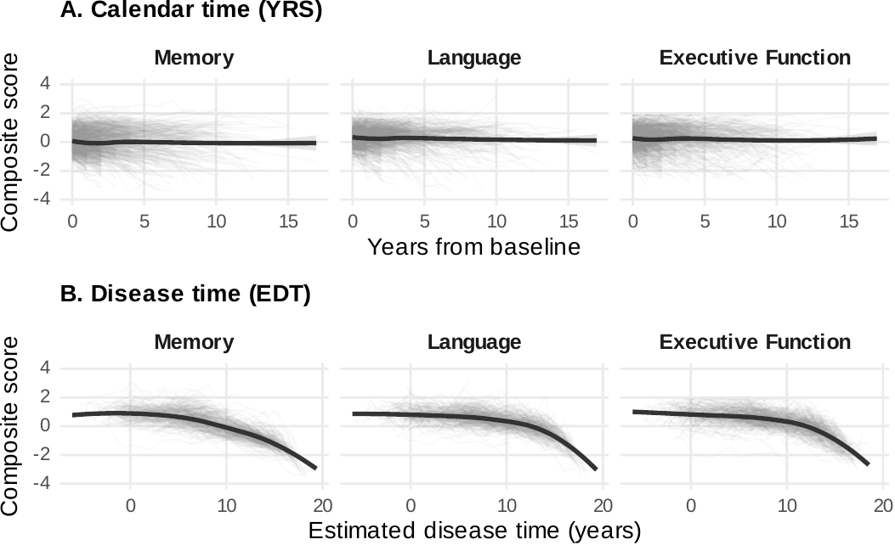
:::

::: {.slide-footer}
Calendar time hides the decline (Panel A) — disease stages pool out the trajectory EDT aligns participants on disease stage and the monotonic decline reappears (Panel B)
:::

::: {.slide-citation}
Raket, 2020 · Künel et al., 2021
:::

::: {.notes}
Estimated Disease Time (EDT) is computed via progmod (Raket 2020) with simultaneous ADAS-13 + MMSE multivariate fit (Künel 2021). EDT is each individual's position on the disease timeline, aligning patients at different calendar-time stages. Under calendar time the population-average cognitive trajectory looks flat (because A+ participants enter at different disease stages and get pooled). Under EDT, disease-stage alignment reveals the expected monotonic decline. EDT is used as the LGCM time metric.
:::

## {.fig-sidebar data-menu-title="Ch6 · EDT circularity"}

::: {.eyebrow}
Chapter 6 · EDT disclosure
:::

::: {.slide-title}
EDT–cognition circularity: an honest disclosure
:::

::: {.slide-body}

::: {.fig-col style="padding-left: 12px"}

[**The concern**]{.subhead}

- ADAS-13 + MMSE feed [**both**]{.accent} EDT and Memory / Language composites
- Could inflate EDT-cognition association artifactually

[**Mitigations**]{.subhead}

- Bifactor CFA dilutes any single item's contribution
- EDT enters as [**time axis only**]{.accent}, not as outcome
- Executive Function has minimal ADAS/MMSE overlap — same pattern emerges

:::

::: {.text-col}

[**Verdict**]{.subhead}

- Disclosed, mitigated
- Pattern holds in EF (least overlap)
- Future work: EDT from independent measures

:::

:::

::: {.slide-citation}
Kang et al., 2023
:::

::: {.notes}
ADAS-13 and MMSE feed both the EDT computation (Raket framework) and the Memory + Language cognitive composites. This is a shared-item circularity concern. Three mitigations: (1) bifactor CFA on the cognitive composites dilutes any single item's contribution to a domain factor; (2) EDT enters the LGCM as the TIME axis only — slope loadings, not outcome scores; (3) Executive Function has minimal ADAS-13/MMSE overlap (TMT-B, Boston Naming, etc.) and shows the same pattern of results, suggesting the result isn't driven by shared items.
:::

## {.fig-sidebar data-menu-title="Ch6 · LME spec"}

::: {.eyebrow}
Chapter 6 · LME specification
:::

::: {.slide-title}
LME 3-way interaction model
:::

::: {.slide-body}

::: {.fig-col style="padding-left: 12px"}

[**The equation**]{.subhead}

[*Cog*~*it*~ = β₀ + *b*₀ᵢ + (β₁ + *b*₁ᵢ) · *YRS*]{.accent} [+ linear (*YRS* × *CVR* × *HVR*) terms]{.accent} [+ quadratic (*YRS*² × …) terms]{.accent} [+ covariates (age, edu, APOE ε4)]{.accent} [+ ε~*it*~]{.accent}

[**Random**]{.subhead}

intercept + slope per participant

:::

::: {.text-col}

[**Stratification**]{.subhead}

- [**By sex**]{.accent} (separate male / female models)
- [**By cognitive domain**]{.accent} (Memory, Language, Executive)
- [**By CVR predictor**]{.accent} (FRS vs CVR_mimic)

Total: 12 LME tests (FRS + CVR_mimic) × 2 sex × 3 domain.

:::

:::

::: {.slide-citation}
Bates et al., 2015 · Clayton et al., 2014
:::

::: {.notes}
The chapter-specific LME 3-way interaction model. Mixed effects with random intercepts and slopes per participant. The model includes the linear YRS × CVR × HVR three-way interaction plus quadratic YRS² × ... terms, with covariates for age, education, and APOE ε4. Sex-stratified (separate models for males and females), repeated for 3 cognitive domains and both CVR predictors (FRS, CVR_mimic) = 12 main analyses.
:::

## {.fig-hero data-menu-title="Ch6 · LME forest"}

::: {.eyebrow}
Chapter 6 · LME headline
:::

::: {.slide-title}
FRS dominates; CVR_mimic mostly null
:::

::: {.slide-body}
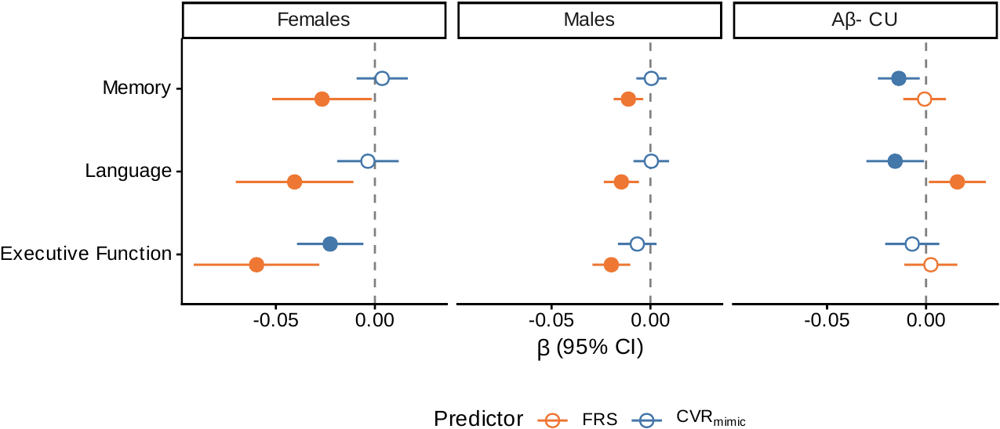
:::

::: {.slide-footer}
FRS 3-way interactions are significant across nearly every sex × domain cell CVR~mimic~ is mostly null; β~FRS~ runs [**2–5× larger**]{.accent} in magnitude
:::

::: {.notes}
The headline LME result. Forest plot of YRS × CVR × HVR three-way interaction coefficients, stratified by sex and cognitive domain, for both FRS and CVR_mimic predictors. Filled = significant, open = n.s. Pattern: FRS interactions are significant across nearly all sex × domain combinations (all surviving FDR within FRS). CVR_mimic interactions are mostly null. The β coefficient is approximately 2-5× larger in magnitude for FRS than CVR_mimic. The A−/CU control panel (Slide on robustness) shows the pattern reverses in cognitively-normal amyloid-negative participants.
:::

## {.fig-sidebar data-menu-title="Ch6 · LME paired Δβ"}

::: {.eyebrow}
Chapter 6 · Formal comparison
:::

::: {.slide-title}
Paired Δβ — FRS > CVR_mimic, formally
:::

::: {.slide-body}

::: {.fig-col style="padding-left: 12px"}

[**Bootstrap setup**]{.subhead}

- Clustered bootstrap on same participants
- Bias-corrected 95% CI on Δβ = β_FRS − β_CVR
- Pairs same individuals across predictors

[**Results**]{.subhead}

- Males: Δβ < 0 across all 3 domains (FRS interaction larger in magnitude)
- Females: Δβ < 0, Memory most pronounced
- All CIs exclude zero

:::

::: {.text-col}

[**Why this slide**]{.subhead}

- Upgrades qualitative "FRS dominates" to formal paired test
- Anticipates "did you actually compare them?"

:::

:::

::: {.slide-citation}
Efron & Tibshirani, 1994
:::

::: {.notes}
Upgrade the qualitative dissociation to a formal paired test. Clustered bootstrap on the same participants gives paired Δβ = β_FRS - β_CVR with bias-corrected 95% CIs. Pairs the same individuals across the two predictors — eliminates between-participant variance and isolates predictor differences. All Δβ point estimates are negative (FRS interactions larger in magnitude than CVR_mimic). All CIs exclude zero — formal evidence of dissociation, not just descriptive.
:::

## {.fig-sidebar data-menu-title="Ch6 · LGCM setup"}

::: {.eyebrow}
Chapter 6 · LGCM specification
:::

::: {.slide-title}
Parallel-process LGCM for HVR + cognition
:::

::: {.slide-body}

::: {.fig-col}
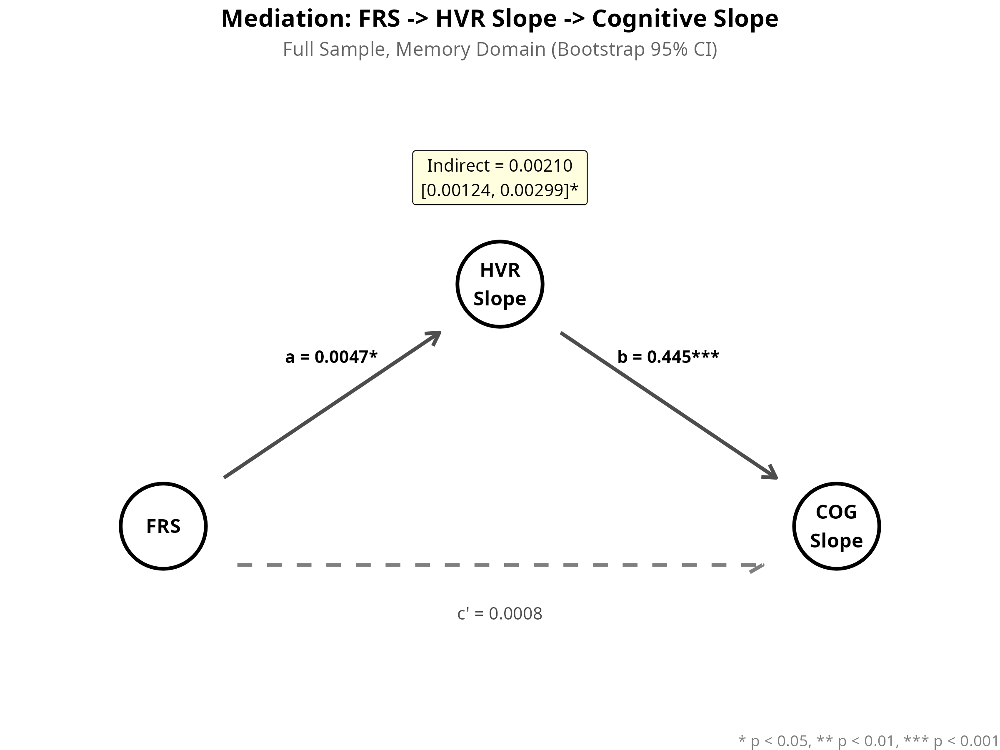
:::

::: {.text-col}

[**Two parallel processes**]{.subhead}

- HVR latent intercept + slope
- Cog latent intercept + slope

[**Time metric**]{.subhead}

- [**Individually-varying EDT**]{.accent}
- Fixed-quadratic phantom factors

[**Estimation**]{.subhead}

- FIML · OpenMx + SLSQP
- Cog residual variance fixed to [**SE²**]{.accent}

:::

:::

::: {.slide-citation}
Bollen & Curran, 2006 · Muñiz-Terrera et al., 2017 · Neale et al., 2016
:::

::: {.notes}
The chapter-specific LGCM specification. Two parallel processes (HVR and cognitive composite), each with latent intercept + linear slope (and a fixed quadratic phantom factor). Time metric is individually-varying EDT (not calendar time — see EDT slide). Cognitive residual variance is fixed to the CFA-derived measurement-error SE² rather than freely estimated — a methodological choice validated via simulation (next slide). Estimation: FIML for missingness handling, OpenMx with SLSQP solver. Fully random quadratic slopes failed to converge — used fixed quadratic with phantom factors instead.
:::

## {.fig-sidebar data-menu-title="Ch6 · SE-constrained sim"}

::: {.eyebrow}
Chapter 6 · Simulation validation
:::

::: {.slide-title}
SE-constrained residuals work
:::

::: {.slide-body}

::: {.fig-col style="padding-left: 12px"}

[**Why constrain residuals to SE²?**]{.subhead}

- ADSP-PHC CFA produces [**observation-specific SEs**]{.accent}
- Freely estimating residuals discards this information
- Constraint leverages known measurement error

[**Simulation setup**]{.subhead}

- 9 conditions × 1,000 reps each
- SE-constrained vs free-residual
- Outcomes: convergence, bias, RMSE, 95% coverage

:::

::: {.text-col}

[**Results (N = 200 example)**]{.subhead}

- Convergence: [**500/1000**]{.accent} reps (both methods)
- RMSE: [**0.006**]{.accent} (both methods)
- 95% CI coverage: 93.8% (SE) vs 93.4% (free)
- Bias near zero in both

[**Verdict**]{.subhead}

Performance is [**equivalent**]{.accent} — the SE&#8209;constraint trades a tiny efficiency gain for the principled use of measurement error.

:::

:::

::: {.slide-citation}
Bollen & Curran, 2006 · Appendix B simulation
:::

::: {.notes}
Why fix cognitive residual variance to SE² instead of freely estimating? ADSP-PHC CFA produces observation-specific standard errors — measurement-error information that's known. Constraining to SE² leverages it; free estimation discards it. Validated via simulation: 9 conditions × 1,000 reps, SE-constrained vs free. Both yield comparable convergence, bias, RMSE, and 95% coverage. SE-constrained is more efficient at modest N. Justifies the choice for the main LGCM analyses.
:::

## {.fig-sidebar data-menu-title="Ch6 · Bootstrap"}

::: {.eyebrow}
Chapter 6 · Inference
:::

::: {.slide-title}
Why bias-corrected bootstrap
:::

::: {.slide-body}

::: {.fig-col style="padding-left: 12px"}

[**The indirect effect (a · b)**]{.subhead}

- Product of two coefficients
- Sampling distribution is [**skewed**]{.accent}
- Sobel test assumes normality — known to be conservative

[**Bias-corrected bootstrap**]{.subhead}

- Adjusts for skewness in the bootstrap distribution
- Standard for mediation since MacKinnon et al.
- N = 1,000 resamples

:::

::: {.text-col}

[**Paired Δ_a bootstrap**]{.subhead}

- Same seed across FRS and CVR_mimic
- Enables formal predictor comparison (Slide 21)

:::

:::

::: {.slide-citation}
Efron & Tibshirani, 1994
:::

::: {.notes}
Why bias-corrected bootstrap rather than Sobel or delta-method? The indirect effect is a product of coefficients (a × b), with a skewed sampling distribution. Sobel assumes normality and is conservative; BC bootstrap is the accepted standard since MacKinnon's mediation work. 1,000 resamples used. The paired Δ_a bootstrap uses the same random seed across FRS and CVR_mimic models, enabling within-participant formal comparison of indirect effects.
:::

## {.fig-hero data-menu-title="Ch6 · HVR-cog coupling"}

::: {.eyebrow}
Chapter 6 · The b-path
:::

::: {.slide-title}
HVR-cognitive coupling is robust to CVR measure
:::

::: {.slide-body}
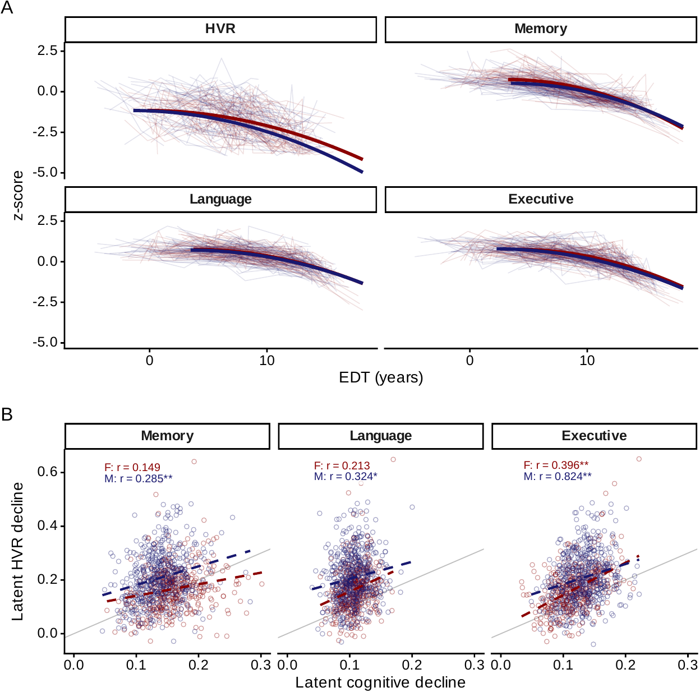
:::

::: {.slide-footer}
HVR-slope × cognitive-slope correlations sig in [**4 of 6**]{.accent} sex × domain cells for both FRS and CVR~mimic~ models. Coupling is the [**predictor-agnostic finding**]{.accent} — a neurodegenerative signal, not driven by age confound.
:::

::: {.slide-citation}
Kramer et al., 2007 · Oschwald et al., 2020 · Anblagan et al., 2018
:::

::: {.notes}
The b-path evidence. Latent HVR-slope × cognitive-slope correlations from the LGCM are significant in 4 of 6 sex × domain combinations for FRS models, and 4 of 6 for CVR_mimic models — males generally show coupling across all 3 cognitive domains; females primarily in Executive Function. Hippocampal-cognitive coupling is the predictor-agnostic finding: it's not driven by age confound; it's a neurodegenerative signal. The scatter plot shows individual-level decline-rate associations; the 1:1 reference line and per-sex fits show consistent negative correlation (faster HVR decline tracks faster cognitive decline).
:::

## {.fig-leftright data-menu-title="Ch6 · Mediation money"}

::: {.slide-body}

::: {.header-col}

::: {.eyebrow}
Chapter 6 · The money slide
:::

::: {.slide-title}
FRS a-paths bold; CVR~mimic~ a-paths faded
:::

::: {.slide-subtitle}
b-paths bold for both predictors
:::

::: {.body-text}
Rows are cognitive domains (Memory, Language, Executive). Columns are FRS vs CVR~mimic~.

Each panel shows male (blue) and female (red) path coefficients.

[**Bold**]{.accent} = bootstrap 95% CI excludes zero.

[**Pattern**]{.subhead}

FRS a-paths bold across the board; CVR~mimic~ a-paths faded (mostly n.s.); b-paths bold in both columns.
:::

:::

::: {.fig-col}
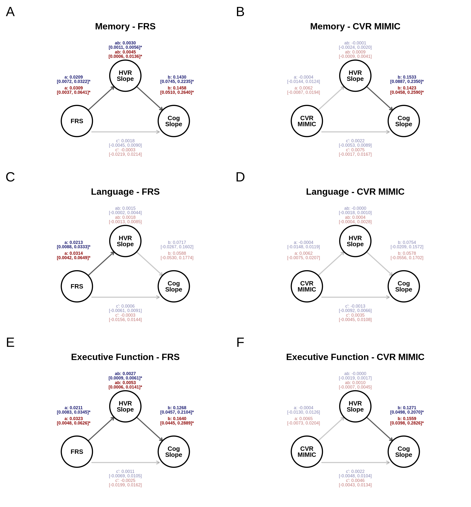
:::

:::

::: {.notes}
The headline mediation result. Grid of path diagrams: rows are MEM/LAN/EXF cognitive domains, columns are FRS vs CVR_mimic predictors, each panel shows male (blue) and female (red) path coefficients. Bold = bootstrap CI excludes zero. Visual pattern: FRS a-paths are bold across the board; CVR_mimic a-paths are faded (mostly n.s.). b-paths are bold in BOTH columns. This is the visual confirmation of the chapter thesis: FRS effects on hippocampal atrophy are largely age-confounded; coupling itself is robust.
:::

## {.fig-sidebar data-menu-title="Ch6 · LGCM paired Δa"}

::: {.eyebrow}
Chapter 6 · Formal a-path comparison
:::

::: {.slide-title}
Paired Δa — FRS > CVR_mimic a-path
:::

::: {.slide-body}

::: {.fig-col style="padding-left: 12px"}

[**Bootstrap setup**]{.subhead}

- Same seed across FRS / CVR_mimic models
- Δa = a_FRS − a_CVR per individual
- Bias-corrected 95% CI

[**Results (sign)**]{.subhead}

- [**Males**]{.accent}: Δa positive across MEM, LAN, EXF
- Females: Δa positive in LAN, narrowly include zero in MEM + EXF

:::

::: {.text-col}

[**Why this slide**]{.subhead}

- Upgrades the "FRS a-paths bold, CVR_mimic faded" pattern to a formal paired test
- Pre-empts "you eye-balled it"

:::

:::

::: {.slide-citation}
Efron & Tibshirani, 1994
:::

::: {.notes}
The LGCM analog of the LME paired Δβ slide. Δa = a_FRS - a_CVR per individual, with shared seed across the FRS and CVR_mimic bootstrap iterations — pairs the same participants across predictors. Males show consistently positive Δa across the three cognitive domains (FRS a-paths larger). Females show clearer dissociation in Language; Memory and Executive Function CIs narrowly include zero. Even with the female partial nulls, the dissociation pattern is formally confirmed via paired test.
:::

## {.fig-sidebar data-menu-title="Ch6 · FDR defense"}

::: {.eyebrow}
Chapter 6 · Multiple testing
:::

::: {.slide-title}
12 LGCM × 12 LME — how to handle?
:::

::: {.slide-body}

::: {.fig-col style="padding-left: 12px"}

[**Two principled positions**]{.subhead}

- [**LME**]{.accent}: FDR within predictor (6 tests = 3 domains × 2 sex); FRS and CVR_mimic corrected separately (distinct hypotheses)
- [**LGCM**]{.accent}: inference rests on the [**pattern of dissociation**]{.accent} across 12 tests, not any single test

[**Sensitivity**]{.subhead}

- All FRS LME interactions survive FDR
- CVR_mimic LME interactions do not survive FDR
- Paired Δβ / Δa confirms predictor difference

:::

::: {.text-col}

[**Pre-empt**]{.subhead}

- Conservative correction would not change conclusions
- Pattern argument is robust to per-test correction

:::

:::

::: {.slide-citation}
Rothman, 1990 · Perneger, 1998
:::

::: {.notes}
Multiple testing defense. Position: FDR is applied to the 6 LME tests within a predictor (3 domains × 2 sex), with FRS and CVR_mimic corrected separately because they address distinct hypotheses (not the same family). For LGCM, the inference is the PATTERN of dissociation across all 12 tests, not whether any single test survives a Bonferroni cutoff (Rothman 1990, Perneger 1998: do not correct against the entire universe of tests when the inference is patterned). All FRS LME effects survived FDR; CVR_mimic effects didn't. Paired Δβ / Δa formal tests confirm the predictor difference.
:::

## {.fig-sidebar data-menu-title="Ch6 · A−/CU reversal"}

::: {.eyebrow}
Chapter 6 · Strongest sensitivity result
:::

::: {.slide-title}
A−/CU control: the pattern reverses
:::

::: {.slide-body}

::: {.fig-col style="padding-left: 12px"}

[**A−/CU sub-sample**]{.subhead}

- Amyloid-negative, cognitively unimpaired participants within UKB age range
- Independent sensitivity sample
- No AD pathology

[**Pattern in A−/CU**]{.subhead}

- [**FRS interactions: n.s. (do not survive FDR)**]{.accent}
- [**CVR_mimic interactions: FDR-significant**]{.accent}
- LGCM in A−/CU: both predictors null on a-paths

:::

::: {.text-col}

[**Interpretation**]{.subhead}

- In A+, FRS effects are carried by age × AD pathology covariation
- In A−/CU, age × pathology link weak → genuine residual CV signal emerges
- Supports a specificity interpretation over cherry-picking

:::

:::

::: {.notes}
The chapter's strongest sensitivity result. In amyloid-negative cognitively-unimpaired participants (no AD pathology, age range matched), the FRS vs CVR_mimic pattern REVERSES: FRS interactions do not survive FDR; CVR_mimic interactions are FDR-significant in some domains. Interpretation: in A+, FRS effects are carried by age covarying with AD pathology progression. In A−/CU, this age × pathology link is weak, and a genuine residual CV signal emerges via CVR_mimic. This reversal is the strongest defense against "you split your sample to find a result" — the dissociation pattern is consistent with the proposed mechanism.
:::

## {.fig-sidebar data-menu-title="Ch6 · HVR vs HC"}

::: {.eyebrow}
Chapter 6 · HVR vs HC sensitivity
:::

::: {.slide-title}
HVR > HC for moderation
:::

::: {.slide-body}

::: {.fig-col style="padding-left: 12px"}

[**3-way interaction count**]{.subhead}

| Brain measure | Significant / 12 |
|---------------|-----------------:|
| **HVR z-score** | ~10–12 |
| **HC z-score** | ~6–8 |
| **Raw HC + TIV** | ≈ 0 (n.s.) |

[**Raw HVR**]{.subhead} (no UKB normalization) shows similar pattern to z-scored HVR — supports specificity.

:::

::: {.text-col}

[**Why HVR wins**]{.subhead}

- Captures HC + LV jointly — ventricular component carries additional moderation signal
- Pre-empts "you cherry-picked HVR"

:::

:::

::: {.slide-citation}
Schoemaker et al., 2019 · Fernandez-Lozano et al., 2025 · Bruno 2016
:::

::: {.notes}
Direct empirical sensitivity: HVR vs HC for the moderation analyses. HVR z-score 3-way interactions are significant in ~10-12 of 12 models; HC z-score in ~6-8 of 12; raw HC + TIV is non-significant overall. Raw HVR (no UKB normalization) shows similar pattern to z-scored HVR — supports that the result is about the ratio measure, not the normative scoring. HVR's ventricular component adds sensitivity to the moderation analyses.
:::

## {.fig-hero data-menu-title="Ch6 · Norm transfer"}

::: {.eyebrow}
Chapter 6 · Normative transfer validation
:::

::: {.slide-title}
UKB → ADNI z-score transfer (with calibration caveat)
:::

::: {.slide-body}
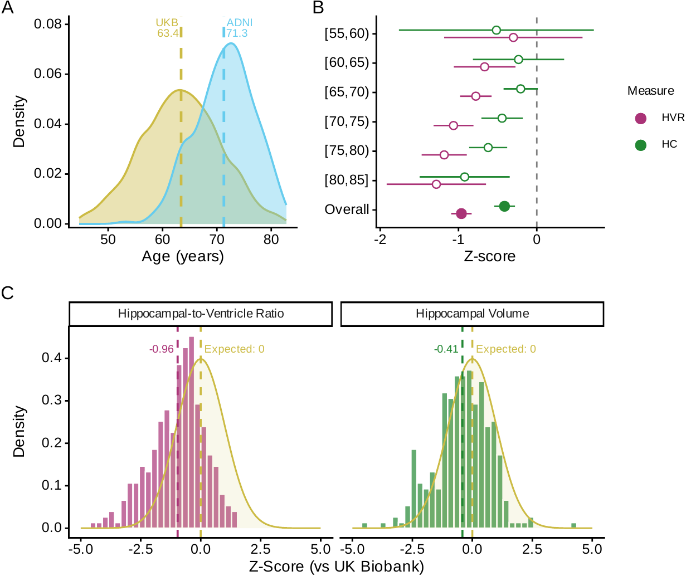
:::

::: {.slide-footer}
ADNI A−/CU shows a systematic negative HVR z-score offset (~5 yrs older than UKB). Within-ADNI relative comparisons remain valid.
:::

::: {.slide-citation}
Sliwinski et al., 2010 · Hoffman & Stawski, 2009
:::

::: {.notes}
Validation of the UKB → ADNI normative transfer. In the A−/CU comparable ADNI subsample (within UKB age range), HVR z-scores show a systematic negative offset (~0.3-0.5 SD mean), driven by the age distribution mismatch — ADNI participants are ~5 years older on average. HC z-scores are closer to expected. Within-ADNI relative comparisons remain valid (the offset is constant); absolute z-scores interpreted with calibration caveat. Future work: re-anchoring centiles with older reference populations.
:::

## {.fig-sidebar data-menu-title="Ch6 · Sex-specific findings"}

::: {.eyebrow}
Chapter 6 · Sex differences
:::

::: {.slide-title}
Sex-specific results and the one CVR~mimic~ positive
:::

::: {.slide-body}

::: {.fig-col style="padding-left: 12px"}

[**FRS sex asymmetry**]{.subhead}

- Female FRS ceiling rates higher (variance compression)
- Male FRS coefficient [**3.06**]{.accent}; female [**2.33**]{.accent} (D'Agostino 2008)

[**The one CVR~mimic~ positive**]{.subhead}

- Female [**Executive Function**]{.accent} survives FDR
- Consistent with Villeneuve 2011 — vascular burden selectively impairs EF in MCI

:::

::: {.text-col}

[**Δa larger in females**]{.subhead}

- Female Δa estimates larger than male across MEM, LAN, EXF
- Dissociation more pronounced in females

:::

:::

::: {.slide-citation}
Ferretti et al., 2018 · Mielke 2022 · Villeneuve et al., 2011
:::

::: {.notes}
Sex-specific patterns. FRS has different coefficients by sex (3.06 men, 2.33 women), compressing female FRS variance more (higher ceiling-effect rates). The only CVR_mimic LME interaction surviving FDR is Female Executive Function — consistent with Villeneuve 2011's finding that vascular burden selectively impairs executive function in MCI. Female Δa estimates are larger than male across all three cognitive domains, suggesting the dissociation is more pronounced in females.
:::

## {.fig-sidebar data-menu-title="Ch6 · Attrition"}

::: {.eyebrow}
Chapter 6 · Attrition
:::

::: {.slide-title}
Selective dropout makes FRS findings conservative
:::

::: {.slide-body}

::: {.fig-col style="padding-left: 12px"}

[**Completers vs dropouts**]{.subhead}

- Dropouts had [**higher baseline FRS**]{.accent}
- Selective loss of higher-CV-risk participants
- Direction of bias: [**attenuates**]{.accent} observed CV effects

[**Implication**]{.subhead}

- FRS LME / LGCM effects are conservative estimates
- True association may be stronger
- CVR_mimic null findings unlikely to be inflated by attrition

:::

::: {.text-col}

[**Mitigations**]{.subhead}

- FIML estimation in LGCM (partial-data participants retained)
- Sensitivity analysis on completers only — similar pattern

:::

:::

::: {.notes}
Selective loss of higher-risk participants would bias toward null in the analyses examining those very risk factors. Dropouts in this ADNI cohort had higher baseline FRS — direction of bias attenuates the observed FRS effects. So the FRS findings are CONSERVATIVE estimates. CVR_mimic null findings are unlikely to be inflated by this bias. FIML retains partial-data participants; sensitivity analysis on completers-only yields similar pattern.
:::

## {.fig-sidebar data-menu-title="Ch6 · Reserve interpretation"}

::: {.eyebrow}
Chapter 6 · Interpretation
:::

::: {.slide-title}
Moderation without mediation — reserve mechanism
:::

::: {.slide-body}

::: {.fig-col style="padding-left: 12px"}

[**The puzzle**]{.subhead}

- CVR~mimic~ a-path (LGCM) = 0 → no acceleration of HVR atrophy
- But LME 3-way interactions emerge in some Female CVR~mimic~ models
- How can it moderate without mediating?

[**Reserve interpretation**]{.subhead}

- Residual CV burden may reduce [**capacity**]{.accent} to maintain cognition at a given structural level
- A reserve-like mechanism distinct from neurodegeneration

:::

::: {.text-col}

[**Supporting evidence**]{.subhead}

- A−/CU reversal (Slide 23) consistent with this
- Significant CVR~mimic~ *c'* direct effects in some female domains
- Frames cognitive reserve as biologically tractable

:::

:::

::: {.slide-citation}
Stern, 2012 · Rabin et al., 2018 · Iadecola, 2020
:::

::: {.notes}
Reconciles the apparent LME × LGCM asymmetry. CVR_mimic doesn't accelerate hippocampal atrophy (a-path null) but does moderate the HVR-cognition relationship (some Female LME interactions). Interpretation: residual CV burden may reduce the brain's CAPACITY to maintain cognition at a given structural level — a reserve-like mechanism, distinct from accelerated atrophy. Supported by the A−/CU reversal (vascular signal surfaces when AD pathology is absent), significant CVR_mimic direct effects (c') in some Female domains, and the cognitive reserve literature (Stern 2012, Rabin 2018).
:::

## {.fig-sidebar data-menu-title="Ch6 · Limitations"}

::: {.eyebrow}
Chapter 6 · Limitations
:::

::: {.slide-title}
What this chapter does not claim
:::

::: {.slide-body}

::: {.fig-col style="padding-left: 12px"}

[**Sample**]{.subhead}

- Single cohort (ADNI)
- UKB → ADNI z-score offset (older population)
- LGCM N ≈ 250–300 per sex — modest for bootstrap

[**Measurement**]{.subhead}

- FRS 30% ceiling compresses variance
- 5-indicator MIMIC may be enriched
- Cross-sectional CVR measurement (single timepoint)

:::

::: {.text-col}

[**Modeling**]{.subhead}

- Fixed-quadratic LGCM constrains individual non-linearity (makes a-path null conservative)
- CFI/TLI/RMSEA not computable with individually-varying time scores

[**Generalizability**]{.subhead}

- WRAP, AIBL replication is future work

:::

:::

::: {.slide-citation}
Grimm & Ram, 2016 · Mehta & West, 2000
:::

::: {.notes}
Honest limitations. Single cohort (ADNI) — replication needed. UKB → ADNI z-score offset (older population) — within-ADNI comparisons are valid but absolute z-scores carry calibration caveat. LGCM N ≈ 250-300 per sex — modest for bootstrap mediation, though within standard recommendations. FRS 30% ceiling compresses variance — could partially explain CVR_mimic null findings. 5-indicator MIMIC may be enriched (theory-driven dropping of BMI/smoking/diabetes/etc.). Cross-sectional CVR measurement — single timepoint, not longitudinal exposure. Fixed-quadratic LGCM constrains individual non-linearity — conservative for a-paths. CFI/TLI/RMSEA not available under individually-varying time scores in OpenMx.
:::

## {.fig-sidebar data-menu-title="Ch6 · Future"}

::: {.eyebrow}
Chapter 6 · Replication + extensions
:::

::: {.slide-title}
What's next
:::

::: {.slide-body}

::: {.fig-col style="padding-left: 12px"}

[**Replication**]{.subhead}

- WRAP, AIBL — longitudinal CV measurement cohorts
- More diverse demographics

[**Framework extensions**]{.subhead}

- MIMIC age-adjustment generalizes to any age-confounded composite (PRS, lifestyle indices)
- Richer indicator panel (amyloid as covariate?)

:::

::: {.text-col}

[**Intervention trials**]{.subhead}

- Test whether CV management preserves HVR-cog coupling
- Use [**age-adjusted CV endpoints**]{.accent}, not raw FRS

:::

:::

::: {.slide-citation}
Livingston et al., 2024
:::

::: {.notes}
Future directions. (1) Replication in WRAP, AIBL — longitudinal CV measurement cohorts. (2) MIMIC framework generalizes — any composite score (e.g., polygenic risk, lifestyle index) where a major component independently predicts the outcome can be MIMIC-adjusted. (3) Intervention trials testing whether CV management preserves HVR-cog coupling should use AGE-ADJUSTED CV endpoints, not raw FRS. (4) Richer MIMIC indicator panel — e.g., adding amyloid as either comparator or additional indicator.
:::

## {.fig-sidebar data-menu-title="Ch6 · Mediation magnitudes"}

::: {.eyebrow}
Chapter 6 · Indirect effect detail
:::

::: {.slide-title}
FRS mediates 4 of 6; CVR~mimic~ mediates none
:::

::: {.slide-body}

::: {.fig-col style="padding-left: 12px"}

[**FRS indirect (a × b)**]{.subhead}

- [**4 of 6**]{.accent} sex × domain models significant
- Males: 2 of 3 (proportion mediated [**62–71%**]{.accent})
- Females: 3 of 3 (MEM, LAN, EXF) — proportion mediated [**100%**]{.accent} (full mediation)

[**CVR~mimic~ indirect**]{.subhead}

- [**0 of 6**]{.accent} models significant
- Confirms a-path null

:::

::: {.text-col}

[**Female a-path β (FRS)**]{.subhead}

- Memory: [**β = −0.027**]{.accent} (*p*~FDR~ = 0.038)
- Language: [**β = −0.040**]{.accent} (*p*~FDR~ = 0.009)
- EXF: [**β = −0.060**]{.accent} (*p*~FDR~ < 0.001)

[**CVR~mimic~ exception**]{.subhead}

- Female EXF: [**β = −0.023**]{.accent} (*p*~FDR~ = 0.051, trending)

:::

:::

::: {.notes}
Concrete mediation magnitudes. FRS indirect effect significant in 4 of 6 sex × domain models. Males: 2 of 3, proportion mediated 62–71%. Females: all 3 with full mediation (100% — the a-path explains the entire FRS → cognition effect). CVR_mimic indirect: zero of six. Female a-path FRS β values: Memory -0.027, Language -0.040, Executive Function -0.060 (all FDR-significant). CVR_mimic comes close only for female EXF (β = -0.023, p_FDR = 0.051, trending). This is the quantitative skeleton behind the "FRS dominates" headline.
:::

## {.fig-sidebar data-menu-title="Ch6 · FRS-age confound"}

::: {.eyebrow}
Chapter 6 · Quantifying the confound
:::

::: {.slide-title}
FRS-age *r* = 0.33 zero-order, 0.36 partial
:::

::: {.slide-body}

::: {.fig-col style="padding-left: 12px"}

[**FRS-age correlation (ADNI)**]{.subhead}

- Zero-order: *r* = [**0.326**]{.accent}
- Partial (other CVRFs controlled): *r* = [**0.358**]{.accent}
- Variance decomposition:
  - Age alone *R*² = [**0.107**]{.accent}
  - CVRFs alone *R*² = [**0.406**]{.accent}
  - Combined *R*² = [**0.482**]{.accent}

:::

::: {.text-col}

[**Ceiling compression**]{.subhead}

- [**28.1%**]{.accent} males at 30% FRS cap
- [**74.9%**]{.accent} females at 30% cap
- 72.2% scored above 20% risk

[**Implication**]{.subhead}

- Age contribution is real but modest in *R*² terms
- Variance-compression is the bigger problem
- MIMIC residualizes [**at the latent level**]{.accent}, not the observed

:::

:::

::: {.notes}
The quantitative case for MIMIC. FRS-age r = 0.326 zero-order, 0.358 partial (controlling for other CVRFs) — substantial but not dominant in R² terms (age alone explains 10.7% of FRS). The bigger problem is variance compression: 28.1% of males and 74.9% of females hit the 30% FRS ceiling, and 72.2% score above 20%. So FRS in elderly cohorts is partly an age proxy AND saturates near the top. MIMIC handles both: age is residualized at the latent level (preserving observed indicators), and the latent CVR is unbounded.
:::

## {.fig-sidebar data-menu-title="Ch6 · MIMIC fit details"}

::: {.eyebrow}
Chapter 6 · MIMIC model statistics
:::

::: {.slide-title}
γ = 0.125 — age explains 1.6% of latent CVR
:::

::: {.slide-body}

::: {.fig-col style="padding-left: 12px"}

[**Fit indices (robust)**]{.subhead}

| Index | Value | Threshold |
|:------|:-----:|:---------:|
| CFI | [**1.000**]{.accent} | ≥ 0.95 |
| TLI | [**1.020**]{.accent} | ≥ 0.95 |
| RMSEA | [**0.000**]{.accent} | ≤ 0.06 |
| SRMR | [**0.009**]{.accent} | ≤ 0.08 |

: {tbl-colwidths="[34,33,33]"}

:::

::: {.text-col}

[**Structural path**]{.subhead}

- Age → latent CVR: γ = [**0.125**]{.accent}
- *R*² = [**0.016**]{.accent}
- → age explains [**1.6%**]{.accent} of latent CVR variance

[**Interpretation**]{.subhead}

CVR~mimic~ is [**largely age-free**]{.accent} at the latent level.

Latent factor captures cardiovascular signal independent of age.

:::

:::

::: {.notes}
The MIMIC model fit is excellent: CFI = 1.000, TLI = 1.020, RMSEA = 0.000, SRMR = 0.009 — all far better than threshold. The structural path γ = 0.125, R² = 0.016 means age explains only 1.6% of the latent CVR variance. So the residualization is doing what we asked: keeping the cardiovascular signal that's independent of age. (Contrast with FRS where age alone explains 10.7% of the score.)
:::

## {.fig-sidebar data-menu-title="Ch6 · B-path coverage"}

::: {.eyebrow}
Chapter 6 · HVR-cognition coupling detail
:::

::: {.slide-title}
B-path: 4 of 6 in the mediation model
:::

::: {.slide-body}

::: {.fig-col style="padding-left: 12px"}

[**Mediation b-path (LGCM)**]{.subhead}

- [**FRS models**]{.accent}: 4 of 6 sex × domain b-paths significant
- [**CVR~mimic~ models**]{.accent}: 4 of 6 significant
- Males: 3 of 3 cognitive domains
- Females: 1 of 3 (Executive Function only)

[**Parallel-process coupling**]{.subhead}

- Reported separately in chapter
- Language parallel-process coupling reached significance in [**males only**]{.accent}

:::

::: {.text-col}

[**Why female b-paths are sparser**]{.subhead}

- Smaller female longitudinal sub-sample → lower power
- Executive Function carries the female signal

[**Why this matters**]{.subhead}

- HVR-cognition coupling is the [**predictor-agnostic finding**]{.accent} — robust to FRS vs CVR~mimic~
- Not 6/6, but pattern direction is consistent across all panels

:::

:::

::: {.notes}
B-path coverage in the LGCM mediation models: 4 of 6 sex × domain combinations significant for FRS, 4 of 6 for CVR_mimic. Within sex: males show significant b-paths in all 3 domains (Memory, Language, EXF); females in 1 of 3 (Executive Function only). The smaller female longitudinal sub-sample limits power. The chapter also reports parallel-process coupling separately — Language parallel-process coupling reached significance in males only. Coupling is the predictor-agnostic finding: pattern direction is consistent across all panels even where significance is not universal.
:::

## {.fig-sidebar data-menu-title="Ch6 · Sex × age covariate"}

::: {.eyebrow}
Chapter 6 · Age covariate asymmetry
:::

::: {.slide-title}
Age → HVR sig in males, n.s. in females
:::

::: {.slide-body}

::: {.fig-col style="padding-left: 12px"}

[**Males**]{.subhead}

- Age → HVR intercept: [**all 6**]{.accent} models significant
- Age → HVR slope: [**all 6**]{.accent} significant
- Age coefficients larger in FRS than CVR~mimic~ models

[**Females**]{.subhead}

- Age → HVR intercept: [**all n.s.**]{.accent}
- Age → HVR slope: all n.s.

:::

::: {.text-col}

[**Possible contributing factors**]{.subhead}

- Smaller female longitudinal sub-sample → lower power
- FRS already absorbs much of the age signal — covariate age competes for residual variance

[**Not claimed**]{.subhead}

- Definitive biological vs power attribution
- Pattern is reported, not formally tested as sex × age

[**Why disclose**]{.subhead} a committee will spot the asymmetry in path tables.

:::

:::

::: {.notes}
A subtle pattern committee may probe. In males, age → HVR intercept and slope are significant in all 6 LGCM models. In females, all are n.s. Two complications: (1) female sample size is smaller, reducing power for the covariate effect; (2) age coefficients are larger in FRS than CVR_mimic models because FRS already absorbs age variance. So the male-female asymmetry is more likely a power artifact than a biology finding — but disclose it before being asked.
:::

## {.fig-sidebar data-menu-title="Ch6 · CVR cross-sec limit"}

::: {.eyebrow}
Chapter 6 · CVR measurement limit
:::

::: {.slide-title}
CVR measured cross-sectionally — single timepoint
:::

::: {.slide-body}

::: {.fig-col style="padding-left: 12px"}

[**The limitation (chapter)**]{.subhead}

> CV risk measured [**cross-sectionally**]{.accent}.

[**What this means**]{.subhead}

- HVR + cognition are longitudinal
- CVR is [**single-timepoint**]{.accent}, baseline only
- Cannot test whether CVR *change* predicts HVR slope

[**Additional caveat**]{.subhead}

- Values [**compressed in upper range**]{.accent} — limited dynamic range

:::

::: {.text-col}

[**Mitigation**]{.subhead}

- Baseline CVR proxies cumulative exposure
- Primary inference is baseline-CVR → HVR trajectory (not Δ-on-Δ)
- Intervention trials would test causality

[**Future work**]{.subhead}

- Longitudinal CV cohorts (WRAP, AIBL)
- Richer MIMIC indicator panel

:::

:::

::: {.notes}
A clean limitation. CVR_mimic is constructed from baseline (single-timepoint) cardiovascular indicators — total cholesterol, HDL, BP, BMI, smoking. HVR and cognition are longitudinal. So we cannot directly test whether CVR CHANGE predicts HVR change — only baseline-CVR-predicts-HVR-trajectory. Mitigations: (1) baseline CVR is a fair proxy for cumulative exposure given the ADNI age range; (2) variance compression in elderly limits the dynamic range we'd see in longitudinal CVR anyway; (3) intervention trials would actively change CVR and test directly. Future cohorts (WRAP, AIBL) have repeated CV indicators.
:::

## {.fig-sidebar data-menu-title="Ch6 · Reserve paths"}

::: {.eyebrow}
Chapter 6 · Reserve mechanism
:::

::: {.slide-title}
Moderation without mediation — the reserve frame
:::

::: {.slide-body}

::: {.fig-col style="padding-left: 12px"}

[**The pattern**]{.subhead}

- CVR~mimic~ a-path: [**null**]{.accent} (no acceleration of HVR atrophy)
- CVR~mimic~ × HVR × time (LME 3-way): [**significant**]{.accent} in some female models
- → CVR~mimic~ moderates without mediating

[**Reserve framing**]{.subhead}

> CV risk reduces [**capacity to maintain**]{.accent} cognition at a given structural level — not by driving atrophy.

:::

::: {.text-col}

[**Supporting evidence**]{.subhead}

- A⁻/CU reversal — CVR~mimic~ sig where FRS isn't
- Female CVR~mimic~ *c'* effects (some domains)
- Frames CVR as a [**reserve-like factor**]{.accent}

[**Distinct from neurodegeneration**]{.subhead}

- Not via atrophy acceleration
- Distinct from amyloid / tau cascade — modifiable

:::

:::

::: {.slide-citation}
Stern, 2012 · Rabin et al., 2018 · Iadecola, 2020
:::

::: {.notes}
The conceptual centerpiece — and the most defensible interpretation of the null a-path / non-null LME-interaction dissociation. CVR_mimic does not accelerate HVR atrophy (a-path null) yet it modifies how HVR relates to cognitive performance over time (3-way LME interaction significant in some female models). This is "moderation without mediation" — and it fits the cognitive reserve framework (Stern 2012; Rabin 2018; Iadecola 2020). Cardiovascular risk reduces the brain's capacity to maintain cognition at a given structural level, without directly accelerating atrophy. Supporting evidence: the A−/CU reversal (CVR_mimic significant where FRS isn't, when AD pathology is absent), and significant CVR_mimic c' direct effects in some female domains. This makes CVR a modifiable reserve-like target, distinct from the neurodegenerative cascade.
:::

## {.fig-sidebar data-menu-title="Ch6 · A−/CU LGCM detail"}

::: {.eyebrow}
Chapter 6 · Mechanistic closure
:::

::: {.slide-title}
A−/CU LGCM — null a-paths, preserved b-paths
:::

::: {.slide-body}

::: {.fig-col style="padding-left: 12px"}

[**a-paths (predictor → HVR slope)**]{.subhead}

| Domain | FRS β · *p* | CVR~mimic~ β · *p* |
|:-------|:---------:|:----------------:|
| Memory | 0.005 · 0.560 | 0.002 · 0.759 |
| Language | 0.005 · 0.546 | 0.002 · 0.792 |
| EXF | 0.005 · 0.582 | 0.002 · 0.804 |

: {tbl-colwidths="[30,35,35]"}

a-path estimates near zero — [**genuinely null**]{.accent}, not power-limited.

:::

::: {.text-col}

[**b-paths (HVR → cognition)**]{.subhead}

- Memory: [**β = 0.356**]{.accent} · *p* = 0.003
- EXF: [**β = 0.283**]{.accent} · *p* = 0.034
- Language: β = 0.307 · *p* = 0.051 (borderline)

[**Indirect (Sobel)**]{.subhead}

- All [***p* > 0.5**]{.accent} — no mediation

[**Closure**]{.subhead} FRS mediates only when age co-varies with [**AD pathology**]{.accent}; coupling persists.

:::

:::

::: {.slide-citation}
Appendix C · A−/CU LGCM table
:::

::: {.notes}
The mechanistic closure of the age-confounding argument. In A−/CU participants (N = 300, analytic N = 260): a-paths range 0.002–0.005 across all 6 sex × domain × predictor combinations — all p > 0.5. The estimates themselves are near zero, so this is a genuinely null effect, not power-limited. Meanwhile, b-paths (HVR → cognition) remain significant for Memory (β ≈ 0.356, p = 0.003) and Executive Function (β ≈ 0.283, p = 0.034) — coupling persists. Indirect effects (Sobel) all p > 0.5 — no mediation. Compare to primary A+ sample where FRS predicted HVR slope in all 6 models. So FRS mediates through HVR only when age co-varies with AD pathology; in cognitively normal aging, the age component of FRS does not predict hippocampal change.
:::

## {.fig-sidebar data-menu-title="Ch6 · Attrition detail"}

::: {.eyebrow}
Chapter 6 · Selective dropout — directional bias
:::

::: {.slide-title}
Dropouts had higher baseline FRS and APOE ε4
:::

::: {.slide-body}

::: {.fig-col style="padding-left: 12px"}

[**Baseline (completers vs dropouts)**]{.subhead}

| | Completers | Dropouts | *p* |
|:--|:--:|:--:|:--:|
| FRS | −0.04 | [**0.22**]{.accent} | < 0.001 |
| APOE ε4 (%) | 58.1 | [**65.5**]{.accent} | 0.038 |
| HVR z | −2.03 | −2.26 | 0.051 |
| Sex (% M) | 56.2 | 54.3 | 0.64 |
| Age | 73.7 | 74.3 | 0.32 |

: {tbl-colwidths="[28,24,24,24]"}

:::

::: {.text-col}

[**Logistic regression (dropout)**]{.subhead}

- FRS: [**OR = 1.52**]{.accent} [1.26, 1.84]
- APOE ε4: [**OR = 1.37**]{.accent} [1.02, 1.86]

[**Direction of bias**]{.subhead}

Dropouts skew toward [**higher CV risk**]{.accent} and more ε4 carriers — characteristics that inflate observed FRS effects.

[**Implication**]{.subhead}

Selective dropout would [**attenuate**]{.accent} the FRS effects we report → [**conservative estimates**]{.accent}.

:::

:::

::: {.slide-citation}
Appendix C · attrition baseline table
:::

::: {.notes}
Selective attrition specifics. Completers (≥4 visits) vs dropouts (<4 visits): FRS differs significantly (completers M=-0.04 vs dropouts M=0.22, p<0.001); APOE ε4 carrier rate differs (58.1% vs 65.5%, p=0.038); HVR z-score shows trend (p=0.051); sex, age, education comparable. Logistic regression: FRS OR=1.52 [1.26, 1.84], APOE ε4 OR=1.37 [1.02, 1.86]. Direction of bias is conservative for FRS effects — higher-risk participants dropping out attenuates observed FRS associations. So if we see FRS effects despite this loss, the population-level effects are likely larger.
:::

## {.fig-sidebar data-menu-title="Ch6 · Raw HVR sensitivity"}

::: {.eyebrow}
Chapter 6 · Robustness to normative z-scoring
:::

::: {.slide-title}
Raw HVR effects survive — z-scoring isn't driving findings
:::

::: {.slide-body}

::: {.fig-col style="padding-left: 12px"}

[**Raw HVR (no UKB z-scoring)**]{.subhead}

| Domain | β | *p* |
|:-------|:-:|:-:|
| Memory | [**−0.0162**]{.accent} | [**0.003**]{.accent} |
| Language | [**−0.0133**]{.accent} | [**0.042**]{.accent} |
| EXF | [**−0.0200**]{.accent} | [**0.005**]{.accent} |

: {tbl-colwidths="[40,30,30]"}

All three [**significant**]{.accent} — same direction as z-scored HVR.

:::

::: {.text-col}

[**Raw HC + TIV covariate**]{.subhead}

- Memory: β = −0.013, *p* = 0.10 (n.s.)
- Language: β = −0.008, *p* = 0.30 (n.s.)
- EXF: [**β = −0.017, *p* = 0.017**]{.accent} (sig)

[**Takeaway**]{.subhead}

- Raw HVR replicates z-scored pattern; HC + TIV weaker
- z-scoring [**enhances sensitivity**]{.accent} but the effect lives in the raw measure

:::

:::

::: {.slide-citation}
Appendix C · raw measure sensitivity
:::

::: {.notes}
Robustness check: do the FRS × HVR × Years effects survive when we drop the UKB normative z-scoring and use raw HVR? Yes. Raw HVR Memory β=-0.0162 (p=0.003); Language -0.0133 (p=0.042); EXF -0.0200 (p=0.005). All three domains significant in the same direction as the z-scored analyses. Raw HC + TIV (instead of HVR) is weaker — only EXF reaches significance (β=-0.0169, p=0.017). So normative z-scoring is a sensitivity enhancement, not the driver of the findings; HVR's structural-vascular composite is what carries the signal.
:::

